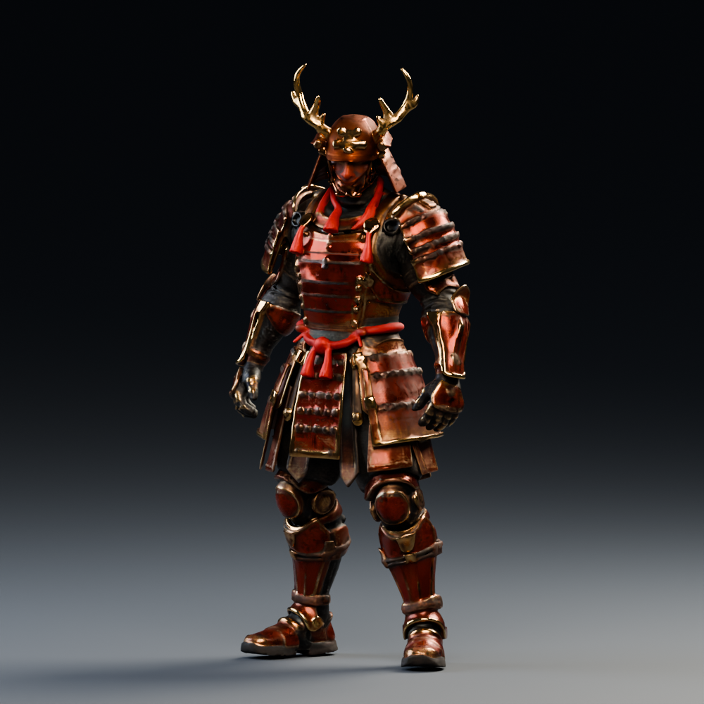
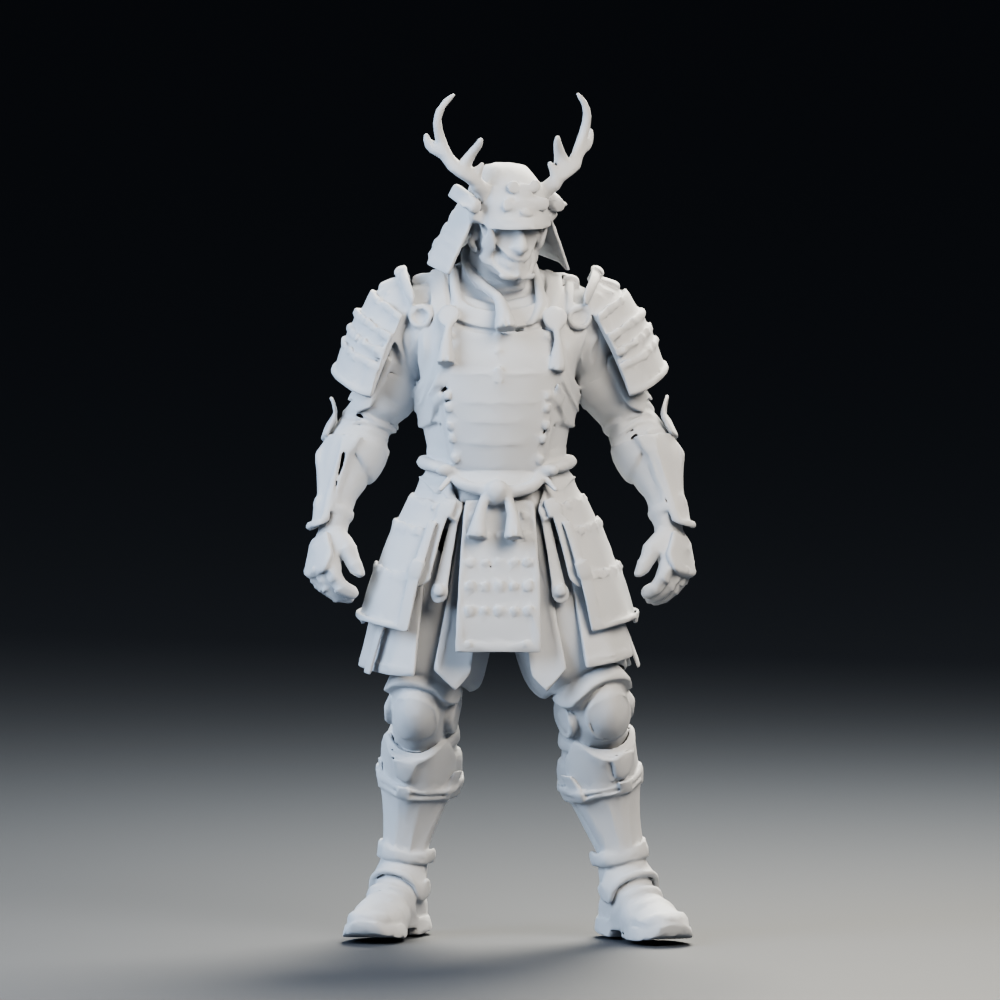
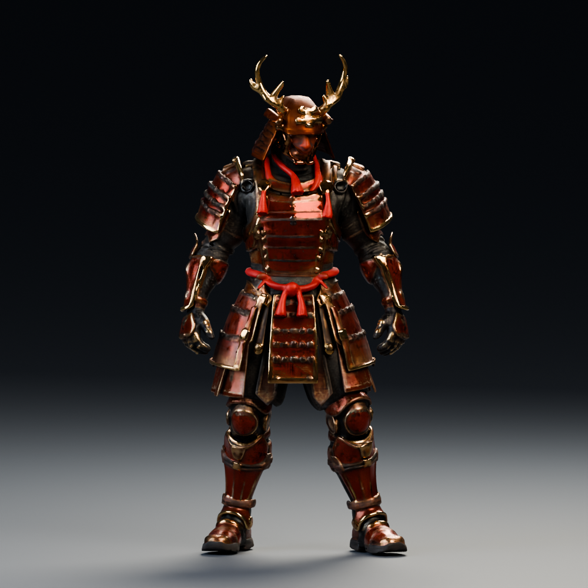
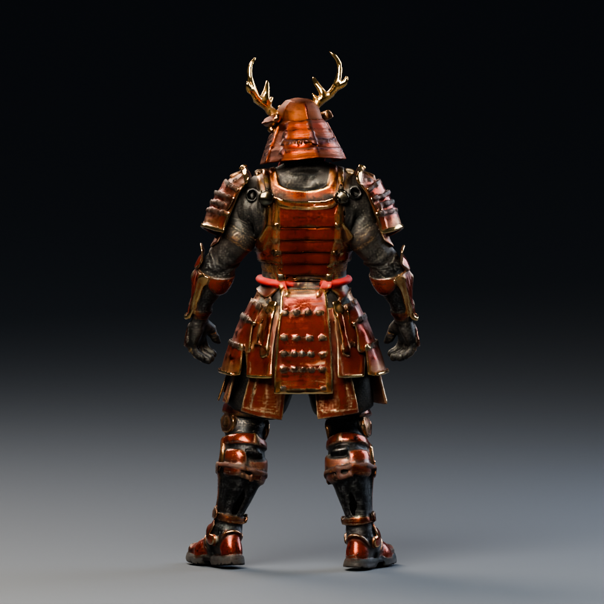
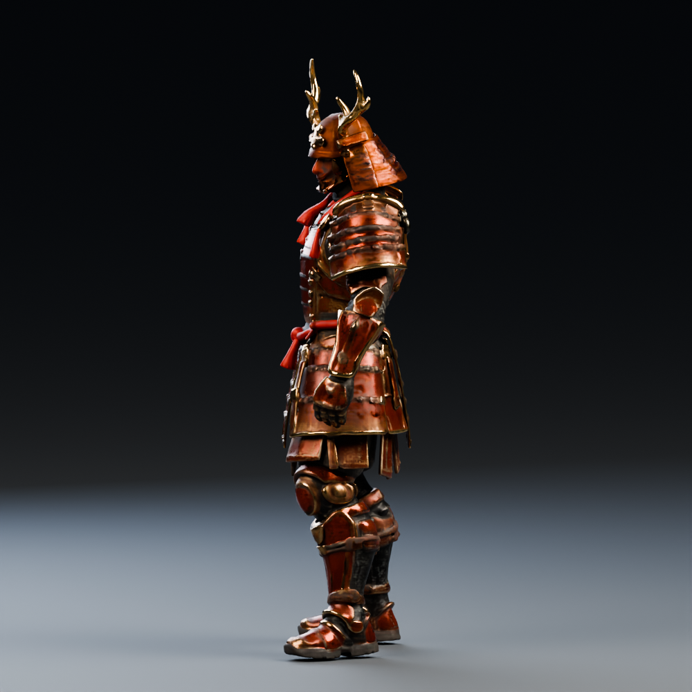
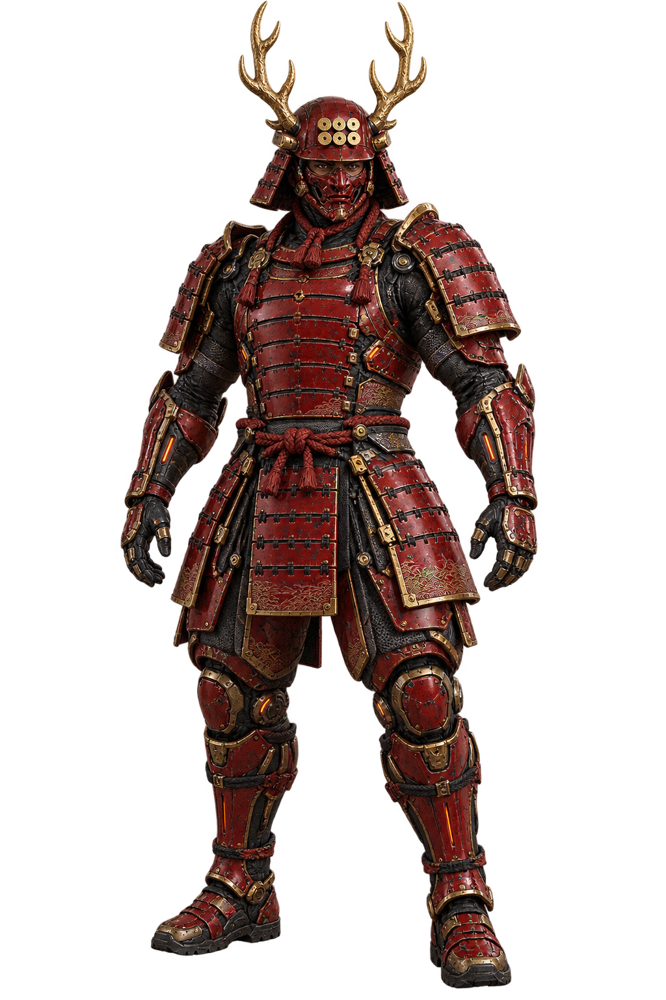

# 未來赤備：真田幸村 × TRELLIS 兩代比較

**2026-10-18：先取回 TRELLIS 第一代＋DINOv2，再完成 TRELLIS.2＋DINOv3 生成；兩版模型均已下載、驗證與渲染。** 使用同一張透明參考圖及 seed 1615。這是獨立角色試作，不替換目前的 Pages 遊戲。

## 直接看成果

新增 **[頭部逐項精修：1536 生成、眼睛／六文錢修整與身體試接](head-study/README.md)**。已確認原網格的四枚錢紋是生成錯誤，使用 Blender 局部重建；最新以 Rocketbox 人臉眼眶取代程序式眼睛，並重做薄浮雕六文錢與頭盔材質接合。提供前後近拍、可編輯原檔及較小的互動檢視版，尚未完成動畫拓樸。

新增 **[1080p／30fps 左右對照影片](comparison/README.md)**：同步 360°、頭盔／胸甲／手部近拍，提供壓縮 MP4 下載。

| TRELLIS 第一代＋DINOv2 | TRELLIS.2＋DINOv3 |
| --- | --- |
|  |  |
| [GLB](trellis1/future-sanada.glb) · [Blender 場景](trellis1/future-sanada-studio.blend) · [互動檢視器 ZIP](trellis1/viewer.zip) | [GLB](future-sanada.glb) · [Blender 場景](future-sanada-studio.blend) · [互動檢視器 ZIP](viewer.zip) |
|  |  |

下載檢視器 ZIP 後解壓縮、開啟 `index.html`，可旋轉、縮放、切換白模與網格。模型及程式內嵌，無外部資源依賴。實測方式為本機 HTTP 載入後切離線；未驗證各瀏覽器的 `file://` 行為。GitHub 的 ZIP／GLB 頁面需按 **Download raw file** 下載。

兩版都用 Blender 4.3.0／Cycles CPU，以相同鏡位與燈光渲染，每張 1000 × 1000、32 samples、降噪。第一代只有烘焙色彩，展示時明確設 `metallic=0`；第二代沿用生成的 PBR 材質。這是兩套完整流程的展示，不是只更換 DINO 編碼器的對照實驗，亦非公平的效能基準。

## 實際改善與限制

第二代的胸甲、肩甲及裙甲起伏更清楚，鹿角分叉與手指形狀也保留更多；金屬邊緣與黑色內襯能呈現不同反光。建議以第二代作為後續精修基底。

仍未達參考插畫精度：甲片邊緣有融化般的凹凸，六文錢和面罩變形，手指仍有黏連，金屬反光偏強，部分未來機械細節遺失。背面是單張圖推測，沒有背面真值。增加面數不會自動修正這些形狀。

| 第二代正面 | 背面 | 側面 |
| --- | --- | --- |
|  |  |  |

| 項目 | 第一代 | 第二代 |
| --- | --- | --- |
| 官方模型 | TRELLIS-image-large | TRELLIS.2-4B |
| 原始三角面 | 294,104 | 5,931,928 |
| 匯出 GLB 三角面 | 149,998 | 148,107 |
| 匯出頂點 | 93,993 | 138,656 |
| 檔案大小（十進位） | 7.82 MB | 19.52 MB |
| 貼圖 | 2048² 色彩 | 2048² 色彩＋金屬度／粗糙度 |
| 骨架／動畫 | 無 | 無 |
| 權重載入 | 53.47 秒 | 91.24 秒 |
| 推論 | 4.54 秒 | 163.53 秒 |
| 網格處理、UV、貼圖匯出 | 42.13 秒 | 21.31 秒 |
| 函式內總時間 | 104.20 秒 | 276.08 秒 |

推論使用 Modal NVIDIA H100 80GB；Blender 預覽使用本機 CPU。以上時間不含環境建置、容器啟動、傳輸或 Blender 渲染。第二代首次執行包含核心暖機並使用低顯存卸載，不可直接與官方暖機後基準比較。生成紀錄的 PyTorch 峰值配置量不涵蓋所有自訂 CUDA 配置，不能拿來推算最低顯存需求。

兩版均通過 SHA-256、有限幾何／UV、內嵌貼圖及實際瀏覽器載入檢查。第二代有法線；第一代未儲存法線，由載入器推導。第二代檢出 **5 個近零面積三角形**（叉積長度 < 1e-12），保留原始輸出供重現；進遊戲前需清理，`validated` 只代表結構檢查通過，不代表動畫拓樸合格。

檢視器已通過 Chromium 1280 × 900、390 × 844 載入、離線切換視角／白模／線框／自轉檢查，沒有頁面錯誤、外部請求或水平溢出。使用軟體 WebGL，未測實體手機效能。尚須網格清理、關節拓樸、骨架／權重、動作與 LOD，才適合加入遊戲。

[第二代生成紀錄](generation.json) · [幾何檢查](mesh-inspection.json) · [渲染紀錄](render-report.json) · [檢視器驗證](viewer-verification.json) · [機器狀態](status.json) · [第一代完整紀錄](trellis1/README.md)

## 輸入設計



image gen 產生的 1024 × 1536 RGBA 透明圖：赤紅漆甲、金色六文錢與鹿角盔、覆面頬、黑色機械內骨架、少量橙色能源接縫。沒有武器、披風或底座，以降低遮擋。

## 重現與取回成果

在 `/workspace/yukimura` 執行。既有成果存於 Modal Volume `yukimura-trellis2-cache`，只取回檔案不需重跑 GPU：

```sh
/workspace/yukimura-tools/bin/python tools/run_trellis1.py --download-only
/workspace/yukimura-tools/bin/python tools/run_trellis.py --download-only
/workspace/yukimura-tools/render-env/bin/python tools/inspect_trellis_glb.py
/workspace/yukimura-tools/render-env/bin/python tools/render_trellis_study.py
node tools/build_trellis_viewer.mjs
```

第一代使用 `results/future-sanada-trellis1/`，第二代使用 `results/future-sanada/`。下載經支援的 Volume API，驗證 GLB 雜湊後才替換目的檔。

需要重新生成第二代時才執行：

```sh
/workspace/yukimura-tools/bin/python -m pip install 'modal[api-proxy-support]==1.6.1' 'truststore==0.10.5'
/workspace/yukimura-tools/bin/python tools/run_trellis.py
```

啟動器使用系統 CA 信任、保留 TLS 與平台 proxy，映射既有 `modal_token_id`／`modal_token_secret`。不要在聊天、程式、前端或 Git 放入金鑰。DINOv3 已以 Modal `main` 的 Secret **`trellis-huggingface`**／鍵 **`HF_TOKEN`** 通過 CPU 權限預檢，再完成 H100 全流程。其他帳號重現時，需先取得 [DINOv3 gated model](https://huggingface.co/facebook/dinov3-vitl16-pretrain-lvd1689m) 的讀取權；`TRELLIS_HF_SECRET` 可指定其他 Secret 名稱。

此輸入已有 alpha，完整載入與生成流程已驗證可跳過未使用的 RMBG-2.0。使用單一 H100、20 分鐘上限、無自動重試、無常駐部署。`--build-only` 僅建置環境。

第二代固定程式提交 `75fbf0183001ed9876c8dbb35de6b68552ee08bd`、PyTorch 2.6.0／CUDA 12.4、xformers 0.0.29.post3；實際使用 `1024_cascade`、seed 1615、150,000 面簡化目標與 2048 貼圖。1024 指空間表示解析度，不是螢幕畫素或面數。

[第二代生成執行](https://modal.com/apps/clarence-chien/main/ap-YwgcT6SN8yjPADqOnS0g8B) 已完成遠端生成和 Volume 儲存，但本機接收摘要時因 `TorchVersion` 型別反序列化失敗；已將回傳值改成字串，並以[下載專用執行](https://modal.com/apps/clarence-chien/main/ap-Kp2aCksY9D70pWrGVwsbSs)成功取回成果，沒有再次推論。新字串回傳路徑已做語法檢查，未為重測摘要另開 GPU。既往 proxy／DINOv3 權限阻擋均已解除。

## 來源與授權

- [Microsoft TRELLIS.2 程式與說明](https://github.com/microsoft/TRELLIS.2)
- [論文](https://arxiv.org/abs/2512.14692) · [專案展示](https://microsoft.github.io/TRELLIS.2)
- [官方模型](https://huggingface.co/microsoft/TRELLIS.2-4B) · [官方操作範例](https://github.com/microsoft/TRELLIS.2/blob/75fbf0183001ed9876c8dbb35de6b68552ee08bd/example.py)
- DINOv3 具有獨立的模型授權與 gated access；請閱讀模型頁條款。TRELLIS.2 的 MIT 授權不代表其全部依賴皆為 MIT。
- TRELLIS.2 模型／程式：[MIT 授權副本](TRELLIS-LICENSE.txt)。nvdiffrast／nvdiffrec 等依賴另有各自授權，見官方 README。
- 角色參考圖：本次依使用者要求由 image gen 產生；六文錢、鹿角盔與真田赤備作為識別元素，未來機甲為架空設計。
