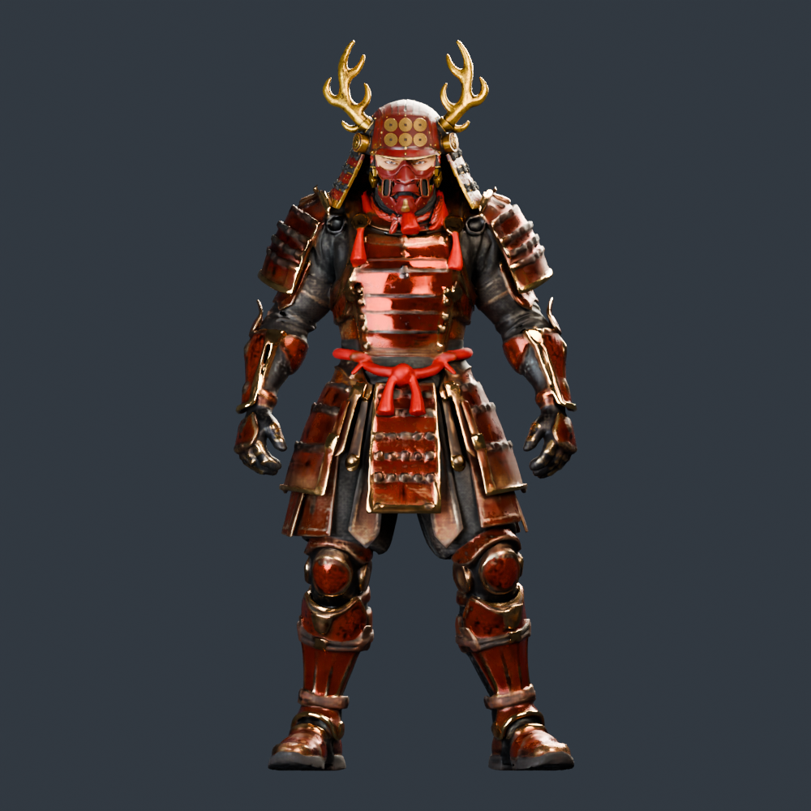
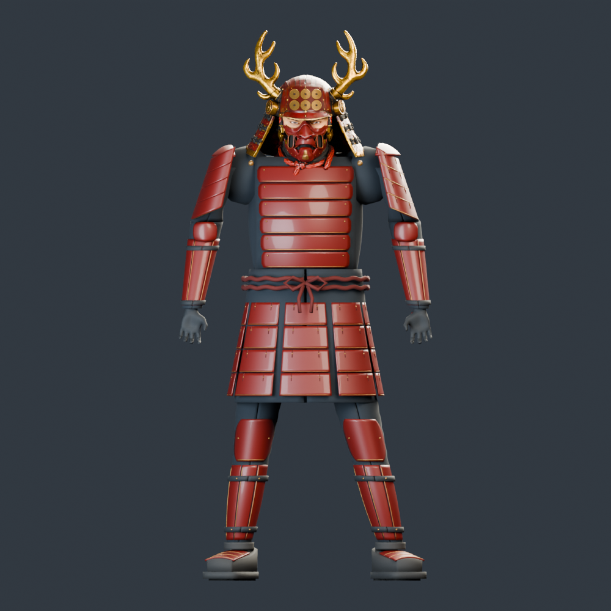
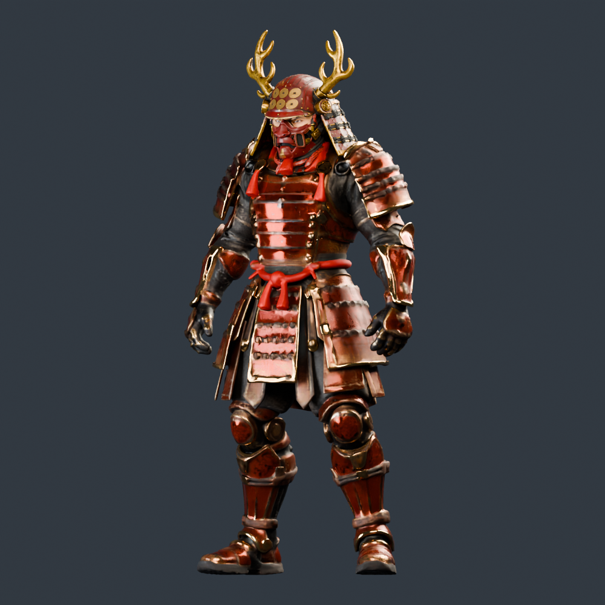
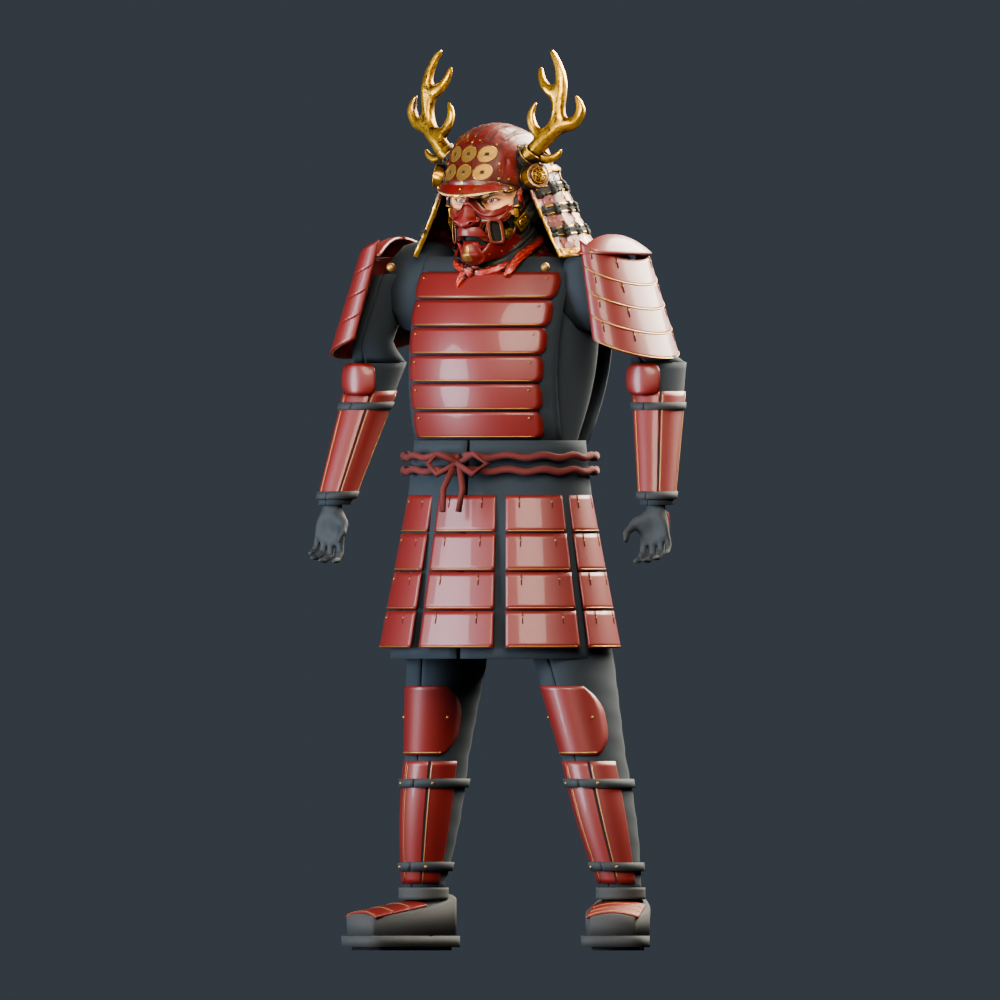
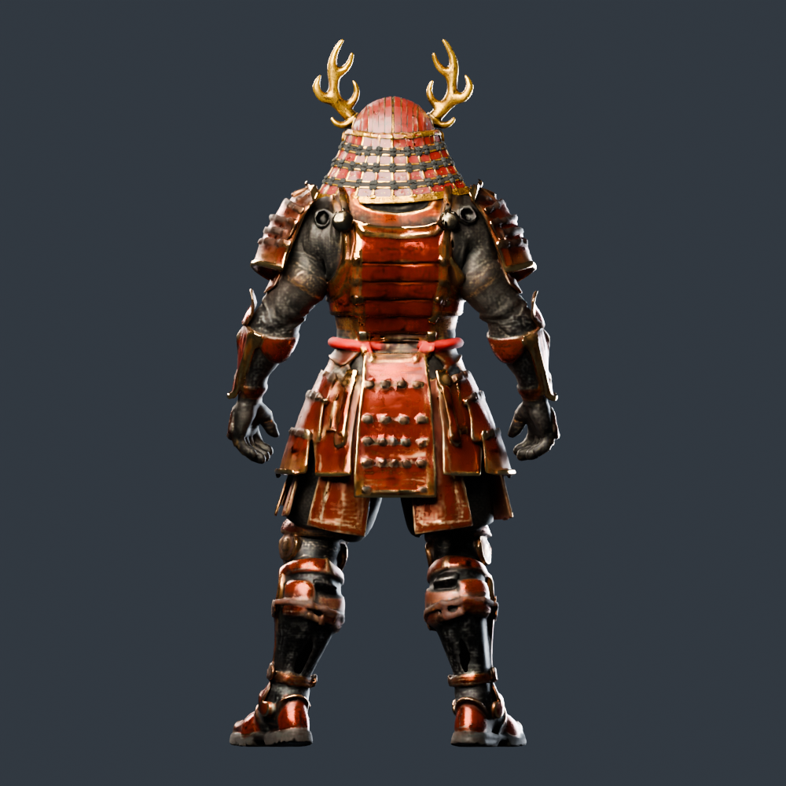
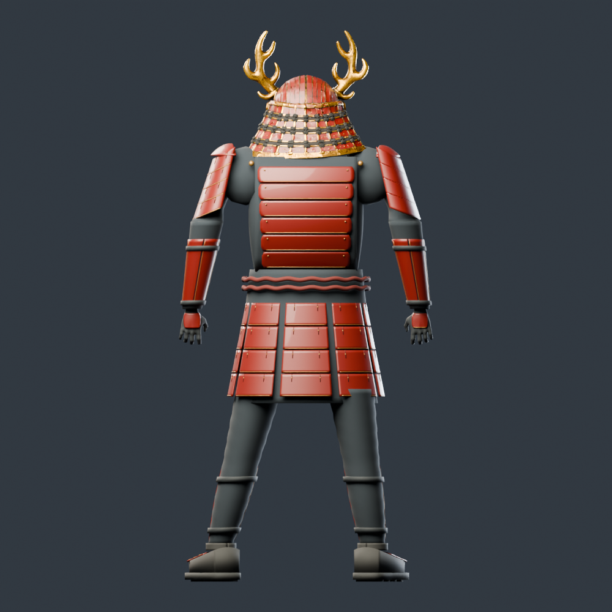
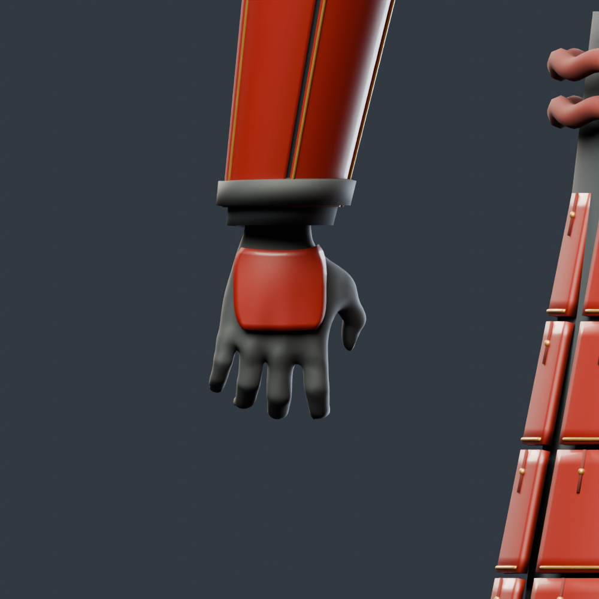

# 未來赤備：全身第一輪修整

這一輪從頭部往下完成肩胸、背甲、手臂、雙手、腰甲、膝脛與靴子的靜態修整。頭部沿用已完成的 pass29，眼神、六文錢與面罩沒有重新生成。**這是全身結構整理版，還不是插畫精細度的完成品，也尚未替換遊戲。**

## 先看全身

| 修整前：既有頭部接原始生成身體 | 本輪：全身重建與配適 |
| --- | --- |
|  |  |
|  |  |
|  |  |

[側面](refined/side.png) · [白模](refined/clay.png) · [原始側面](baseline/side.png) · [原始白模](baseline/clay.png)

保留原生成身體的零碎表面會穿出新甲片，因此最後依原身體的姿態、尺寸與胸背表面取樣，重建甲冑及內層衣料，移除展示版中的舊身體網格。[原始試裝 GLB](../head-study/fitting/static-fit.glb) 完整保留。新甲片較規整，但也簡化了原生成版的高頻起伏和機械紋樣；不能把「更乾淨」當成所有美術細節都更好。

## 各區處理

| 部位 | 本輪處理 | 前後近拍 |
| --- | --- | --- |
| 頭部 | 沿用 pass29 的 37 個網格，驗證位置與三角面數不變 | [既有頭部成果](../head-study/README.md) |
| 胸背 | 前後各六層弧面甲片、收邊、鉚釘、內縮衣料與領口 | [胸前原版](baseline/torso.png)／[本輪](refined/torso.png)；[背甲原版](baseline/rear-armor.png)／[本輪](refined/rear-armor.png) |
| 肩甲 | 每側四層弧面甲、頂蓋、繫帶與固定鉚釘 | [原版](baseline/shoulder.png)／[本輪](refined/shoulder.png) |
| 手臂 | 內袖、肘甲、前臂五條護片、上下束帶；修正肘甲被衣料遮住 | [原版全身](baseline/front.png)／[本輪全身](refined/front.png) |
| 雙手 | CC0 人體五指網格，放鬆半握姿；腕口封閉，手背甲依手型貼合 | [手掌原版](baseline/hands.png)／[本輪](refined/hands.png)；[手背原版](baseline/hand-back.png)／[本輪](refined/hand-back.png) |
| 腰甲 | 八個方向、每片四層，另有內襯、雙腰繩、繩結、繫帶與下緣 | [原版](baseline/waist.png)／[本輪](refined/waist.png) |
| 腿部 | 護膝、左右各三條護脛、兩條束帶、連續褲管，沿用左右不同站姿；護膝改貼合新褲管，消除側面懸空 | [原版](baseline/legs.png)／[本輪](refined/legs.png) |
| 足部 | 靴面、踝口、三層腳背護片、封閉鞋底及底部止滑塊 | [原版](baseline/boots.png)／[本輪](refined/boots.png) |



赤漆、黃銅、皮革各共用一組 512² 色彩、粗糙度與法線貼圖，另有衣料及繫帶材質。貼圖由確定性程序產生，並非新增高模雕刻烘焙，也不是手繪磨損；目前只提供細微表面變化。兩側及不同甲片共用生成方法與材質，後續可用於士兵／其他武將，但本輪沒有批次改動其他角色。

## 下載與互動檢查

- [全身互動檢視器 ZIP](viewer.zip)：解壓後開啟 `index.html`；可旋轉、白模、線框、聚焦肩胸／手部／腿足。
- [可編輯 Blender 原檔](refined/body-refined.blend)：保留獨立甲片與內嵌貼圖。
- [完整零件 GLB](refined/body-refined.glb) · [按部位及材質合併的 GLB](refined/body-preview.glb)。
- [檔案大小與 SHA-256](downloads.json)。GitHub 檔案頁按 **Download raw file** 下載。

檔案約為：編輯版 GLB 35.0 MiB、合併版 GLB 35.7 MiB、Blender 46.1 MiB、檢視器 ZIP 35.6 MiB，均低於 GitHub 單檔 100 MiB 限制。

檢視版不減少幾何面數；它只合併共用材質的零件，降低獨立網格數。因此還不是手機用的低面數遊戲模型。檢視器內嵌模型、貼圖及程式；驗證方式是本機 HTTP 載入後切斷網路操作，未涵蓋所有瀏覽器的 `file://` 行為。

## 驗證範圍

幾何與材質數據見 [完整版本](refined/mesh-inspection.json)、[檢視版本](refined/preview-inspection.json) 和 [專項驗證](refined/verification.json)；另有 [Blender 原檔重開檢查](refined/blend-verification.json)：

- 身體七區共 435 個新增零件，逐件通過位置合併後的封閉邊檢查及近零面積檢查。整個角色共有 **471,378 三角面**，近零面積三角形為零。
- 既有頭部 37 個網格的頂點位置及面數保持不變。編輯版 472 個網格；展示版按部位／材質合併為 **61 個網格**，沒有減面。Babylon.js 按材質 primitive 拆分後為 77 個可繪製網格；61 並非實測 draw call 數。
- 每隻手的五條手指鏈端點距對應網格頂點最多約 1.71 mm；這只確認來源姿態及網格配適，不是握槍接觸或關節活動驗證。
- 護膝頂點至褲管最近頂點最大距離約 11.7 mm，補上側面配適檢查；這不是有號碰撞或綁定驗證。
- 色彩、粗糙度／金屬度與法線貼圖確實內嵌於 GLB。

前後各 13 張圖以 Blender 4.3／Cycles **CPU**、1000 × 1000、20 samples 與降噪輸出；本輪沿用原版的正規化尺寸、鏡位、燈光。見 [原版渲染紀錄](baseline/render-report.json) 與 [本輪渲染紀錄](refined/render-report.json)，以及 [26 張圖的尺寸、鏡位與雜湊驗證](render-verification.json)。這輪沒有啟動 Modal 或新的 GPU 生成工作。

瀏覽器檢查見 [驗證報告](viewer-verification.json)、[桌面畫面](viewer-1280.png)、[手機尺寸畫面](viewer-390.png)。使用 Chromium 軟體 WebGL，驗證載入、控制鈕、離線操作與無橫向溢出；不是實體手機 FPS 測試。

## 仍待完成

衣料皺褶、磨損分布、甲片精雕與未來機械細節仍較簡化；頭身材質密度也不一致。肩甲連接、袖口轉折與鞋面造型也仍偏簡化。頭盔邊緣、頸肩與原有頭部搭接缺陷尚未全部解決。這輪的清理不能宣稱已達參考插畫或寫實人物水準。

零件之間有預期搭接，未焊接成單一人體網格，也沒有做全域自相交證明。尚無全身重拓樸、骨架／權重、武器握持動畫、碰撞與 LOD；靜態手型不能直接當作所有招式的握姿。下一輪應以全身比例和甲片／衣料細節為共同目標，再進行遊戲網格、骨架及動作驗證。

## 來源與重建

手部來自專案既有 [open-hand-study.blend](../../../../assets/cinema/open-hand-study.blend)，取 frame 14、subdivision 1 的網格並封閉腕口，靜態配適左右兩手。原始 MPFB／MakeHuman 資產為 CC0，固定 commit `d0a32e57a7f915cb2f2b95410e2117648c7bbb7e`；[來源及 SHA-256](../../../../assets/vendor/mpfb/provenance.json)、[CC0 授權](MAKEHUMAN-CC0-LICENSE.md)。沒有把 MPFB 外掛程式打包進檢視器。

頭部沿用 [Rocketbox MIT 授權](../head-study/ROCKETBOX-LICENSE.txt) 的眼部來源；生成基底沿用 [TRELLIS 授權](../TRELLIS-LICENSE.txt)。檢視器 ZIP 包含相關授權及 Babylon.js 授權。

在 repo 根目錄，使用含 `bpy==4.3.0` 與 NumPy 的 Python 執行（此環境為 `/workspace/yukimura-tools/render-env/bin/python`）：

```sh
python tools/refine_trellis_body.py
python tools/verify_trellis_body.py --directory docs/experiments/future-sanada/body-study/refined
python tools/inspect_trellis_glb.py --model docs/experiments/future-sanada/body-study/refined/body-refined.glb --report docs/experiments/future-sanada/body-study/refined/mesh-inspection.json
python tools/inspect_trellis_glb.py --model docs/experiments/future-sanada/body-study/refined/body-preview.glb --report docs/experiments/future-sanada/body-study/refined/preview-inspection.json
node tools/build_trellis_viewer.mjs docs/experiments/future-sanada/body-study --body-study
node tools/check_trellis_head_viewer.mjs --body-study
```

渲染使用 `tools/head_study_render.py --fullbody --size 1000 --samples 20`，視角清單為 `front,three-quarter,side,back,clay,torso,shoulder,rear-armor,hands,hand-back,waist,legs,boots`。先渲染原版，再用 `--normalization-report docs/experiments/future-sanada/body-study/baseline/render-report.json` 渲染本輪。生成步驟及來源雜湊記錄於 [refinement-report.json](refined/refinement-report.json)。
