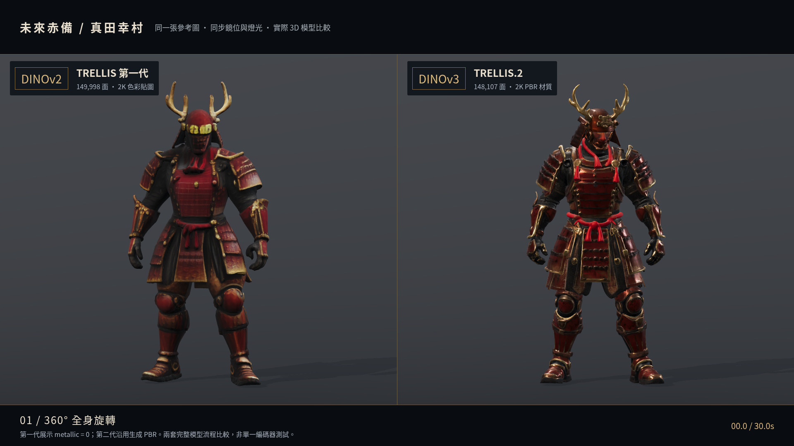
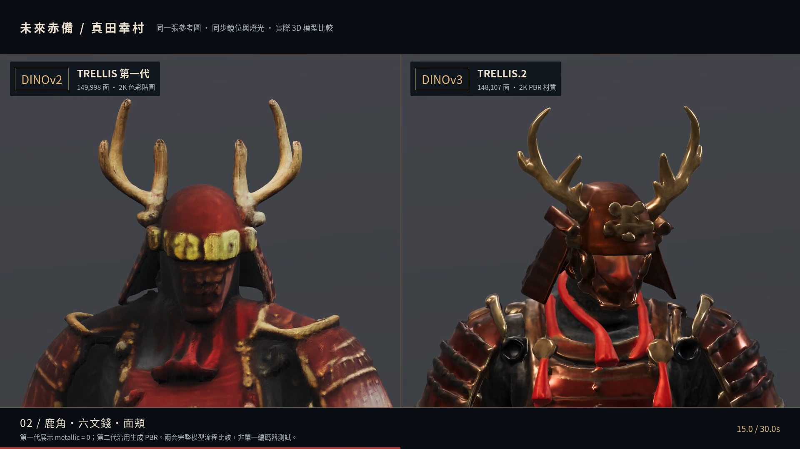

# DINOv2 vs DINOv3：未來赤備 1080p 對照影片

左側為 **TRELLIS 第一代＋DINOv2**，右側為 **TRELLIS.2＋DINOv3**。兩版使用相同輸入圖、正規化身高、鏡位及燈光。比較的是兩套完整生成流程，不能把差異全部歸因於 DINO 編碼器。

[直接下載 MP4](https://raw.githubusercontent.com/clarencechien/yukimura/art/jigoku-prerendered-2d/docs/experiments/future-sanada/comparison/sanada-dinov2-vs-dinov3-1080p.mp4) · [GitHub 檔案頁](sanada-dinov2-vs-dinov3-1080p.mp4) · [模型與 Blender 靜態渲染比較](../README.md)

若瀏覽器直接播放影片，可使用播放器的下載選單，或在連結上選擇「另存連結」。GitHub 檔案頁可按 **Download raw file**。不需下載模型或 ZIP 才能看影片。



## 影片內容

| 時間 | 鏡頭 |
| --- | --- |
| 00–12 秒 | 同步完整 360° 旋轉，包含正／側／背面 |
| 12–17 秒 | 平滑放大頭部，近看鹿角、六文錢及面頬 |
| 17–22 秒 | 胸甲、肩甲及材質的近距離小角度環繞 |
| 22–27 秒 | 護腕、手指與關節近拍 |
| 27–30 秒 | 拉回全身斜側面對照 |

影片為 **1920 × 1080、30fps、30 秒、900 幀、無音軌**。1080p 指整個左右對照畫面；每側模型畫布為 960 × 848，其餘是標題與鏡頭說明。每幀直接渲染原始 GLB，沒有從低幀率影片補幀或把低解析度影片放大。

第一代展示 `metallic=0`，使用原有色彩貼圖；第二代沿用生成的金屬度／粗糙度貼圖。兩個原始模型均未修改。這是相機運動的展示影片，沒有新增角色骨架或肢體動畫。

本片使用 **Babylon.js／Chromium 軟體 WebGL** 在 CPU 逐幀輸出；不是 Blender Cycles 影片，也沒有再呼叫 Modal 推論。既有 Blender 靜態圖仍留在上一層。此離線輸出速度不能當作手機遊戲效能。

## 壓縮與驗證

成品 **10,007,986 bytes（約 10.01 MB／9.54 MiB）**。完整 900 幀解碼通過；Chromium 桌面 1920 × 1080 與手機尺寸 390 × 844 均可播放，並成功跳轉至七個時間點。這是手機尺寸測試，未實測實體 iPhone／Android。

四張壓縮前後抽樣畫面 SSIM 為 **0.9898–0.9965**（不是整支影片的平均分數），已目視檢查壓縮後頭部近拍。影像與文字保持清楚。



使用 H.264／MP4、`yuv420p`、30fps、CRF 21、最高碼率 6Mbps、`faststart`。影片索引在檔案前端，適合開始下載後播放；MP4 本身已壓縮，不另外套 ZIP。

[輸出紀錄](video-report.json) · [解碼與播放驗證](video-verification.json)

## 重現

在 `/workspace/yukimura`，使用既有 npm 依賴、`/usr/bin/chromium`、FFmpeg／ffprobe 與 Noto CJK 字型：

```sh
# 僅確認九個鏡位截圖
node tools/render_trellis_comparison.mjs --preview
# 逐幀輸出及壓縮整支影片
node tools/render_trellis_comparison.mjs
# 檢查完整解碼、1080p/30fps/900 幀、壓縮品質及瀏覽器播放／跳轉
node tools/check_trellis_comparison.mjs
```

原始模型、授權及來源見[上一層](../README.md#來源與授權)。
