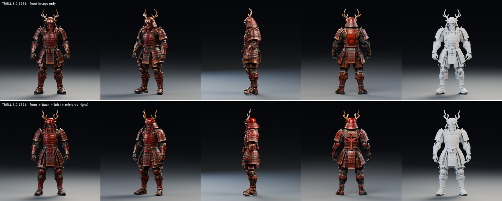
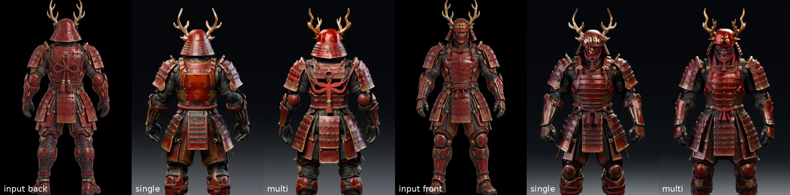

# 未來赤備：TRELLIS.2 三視圖拼接

TRELLIS.2 官方只吃一張圖。這裡試的是社群 ComfyUI 套件 [visualbruno/ComfyUI-Trellis2](https://github.com/visualbruno/ComfyUI-Trellis2)（MIT）的多視角做法：把正面、背面、側面圖各自當條件，按體素位置分區拼接。不裝 ComfyUI，直接移植到我們在 Modal 上跑的 TRELLIS.2 1536 cascade。

## 做法

讀過該套件的原始碼（`trellis2/pipelines/samplers/flow_euler.py` 的 `FlowEulerMultiViewSampler`），它不是真正的多視角重建：

1. 每張圖**各自**算一份 DINOv3 條件；模型從來沒有同時看過多張圖，也沒有相機參數。
2. 取樣的每一步，模型對每個視角各跑一次，各自只看自己那張圖。
3. 依體素位置以 softmax 加權混合各次的預測：體積前半偏聽正面圖，後半偏聽背面圖，兩側偏聽側面圖。
4. 粗結構、形狀、貼圖三個階段都這樣做。

移植版 [tools/multiview/trellis_multiview_modal.py](../../../../tools/multiview/trellis_multiview_modal.py)：

- **包裝流模型**：正向條件時，每個視角各跑一次再加權混合；負向（空白）條件照常跑一次，所以 CFG 不變。官方的 `pipeline.run()` 原封不動。
- **體素軸向是實測得來的**：拿 body v2 的原始體素頂點對齊匯出的 GLB，得到 GLB = 體素的 (x, z, −y)。也就是 z 朝上、正面 = −y、角色左側 = +x。執行時記錄的稀疏結構範圍是 x 15、y 7、z 31，z 最高，與實測一致。
- **混合溫度**：2.0，與套件取樣器的預設相同。
- **右側圖**：用左側圖鏡像（角色左右對稱）。
- **對照組**：「只用正面圖」與「三視圖」用同一個 seed（7），所以起始雜訊完全相同。

## 輸入

第 1 階段的 Nano Banana Pro 三視圖（[part-pipeline](../part-pipeline/README.md)）：[正面](../part-pipeline/images/ab-front-gemini-3-pro-image.png)、[左側](../part-pipeline/images/sheet-side.png)、[背面總角結版](../part-pipeline/images/sheet-back-knotA2.png)。

- **去背**：用 [key_views.py](../../../../tools/multiview/key_views.py)，從邊框灰色往內做連通去背，結果在 [inputs/](inputs/)。
- **比例一致**：三張的人物高度一致（頭頂 11–13 px、腳底 2461–2466 px），經 TRELLIS.2 依外框裁切後比例相同。

## 結果

上排只用正面圖，下排用三視圖；左起：正面、斜側、側面、背面、白模。



背面與正面近看（左起：背面輸入、只用正面、三視圖、正面輸入、只用正面、三視圖）：



| | 只用正面 | 三視圖 |
| --- | ---: | ---: |
| 推論時間（H100） | 158 秒 | 182 秒 |
| 實際解析度 | 1536 | 1536 |

推論時間只多約 15%，因為流模型在整體時間裡佔比不大，大部分時間花在解碼與上採樣。

- **背面**：只用正面時，背甲是一塊憑空猜的平板，沒有甲片和繩結。三視圖版照背面圖長出了總角結、流蘇和一排排背甲，頭盔後方的錣（護頸）也比較像原設計。繩結比設計圖簡化，只剩一個紅色的交叉結。
- **側面**：兩者接近；三視圖版的袖和草摺側面層次較清楚。
- **正面**：兩者都忠於正面圖，細節（前立、面具）略有不同，沒有明顯變差。
- **白模**：形狀整體一致，三視圖版的背部有凹凸，不再是平的。
- **代價與風險**：
  - 三視圖必須同姿勢、同比例。
  - 視角之間不一致的地方會在混合帶互相拉扯；這次沒有看到明顯接縫。

## 360 度轉台影片

[turntable-single-vs-multi-1080p.mp4](turntable-single-vs-multi-1080p.mp4)：左邊只用正面圖，右邊三視圖。前 12 秒全身，後 12 秒上半身近拍，燈光與 [Tripo 比較](../tripo-compare/README.md) 相同。

## 重現

```sh
python tools/multiview/key_views.py
python tools/run_trellis.py --multiview --modes single,multi --seeds 7          # Modal H100，各約 5 分鐘
blender-python tools/render_body_v2.py --model .tmp/multiview/multi-seed-7/body-remesh.glb --output .tmp/multiview/render-multi \
    --size 700 --samples 24 --views front,three-quarter,side,back,clay
python tools/run_trellis.py --turntable --left .tmp/multiview/single-seed-7/body-remesh.glb \
    --right .tmp/multiview/multi-seed-7/body-remesh.glb --output .tmp/mv-turntable
tools/turntable_compose.sh .tmp/mv-turntable docs/experiments/future-sanada/multiview/turntable-single-vs-multi-1080p.mp4 \
    "TRELLIS.2 front only" "TRELLIS.2 front+back+side"
```

生成的 GLB（各約 73 MB）留在 Modal Volume `yukimura-trellis2-cache` 的 `results/future-sanada-multiview/`，沒有放進 Git；生成紀錄在 [generation-single-seed-7.json](generation-single-seed-7.json)、[generation-multi-seed-7.json](generation-multi-seed-7.json)。

## 結論

三視圖拼接是開源路線裡便宜又有效的補強：只多約 15% 的推論時間，就能把原圖看不到的背面從「猜」變成「照圖」。它仍然只是按區域分別引導，不是真正的多視角重建，所以各視角必須一致，而細節（例如繩結）會比設計圖簡化。
