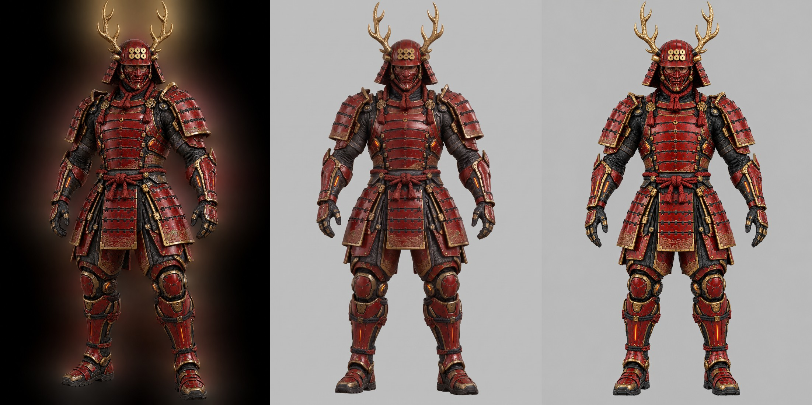
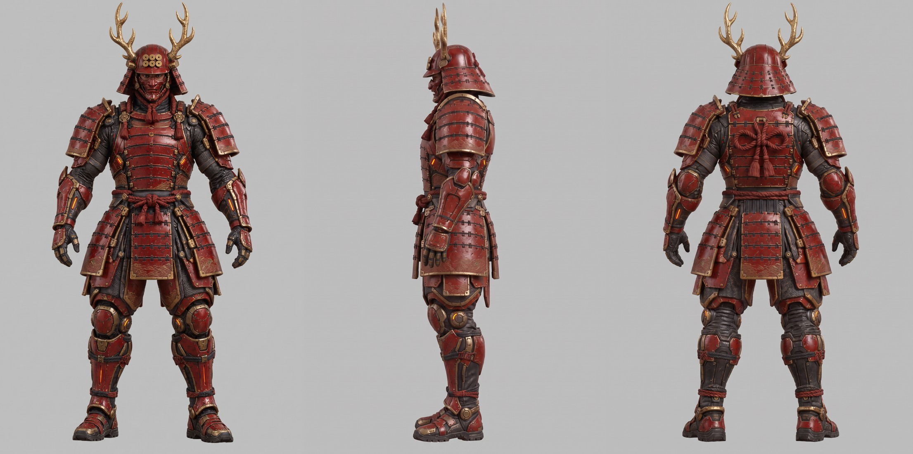
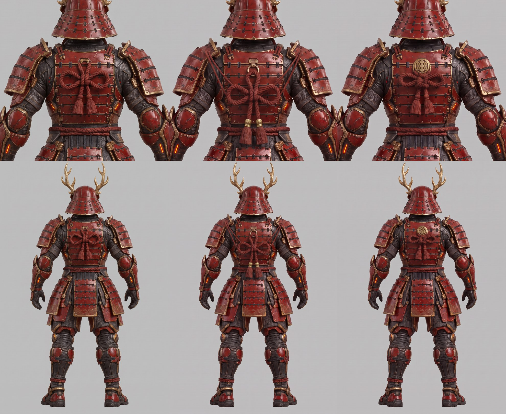
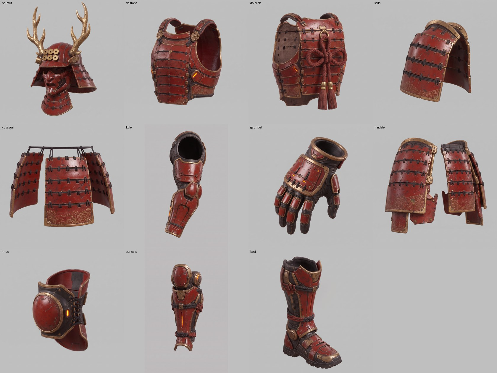
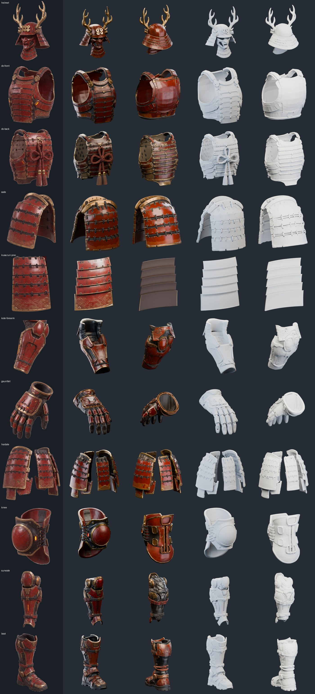
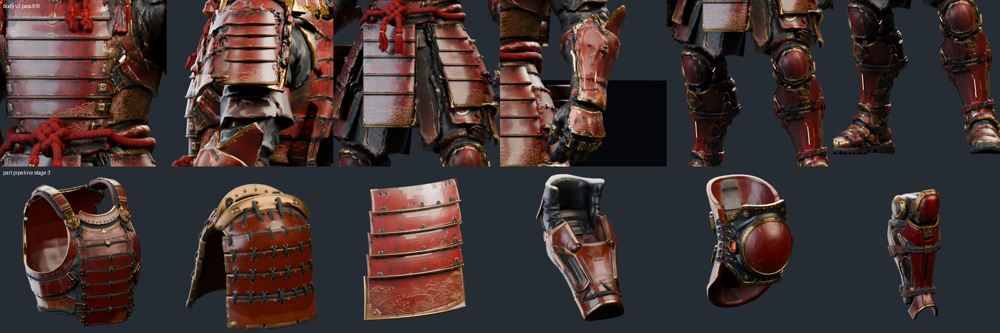
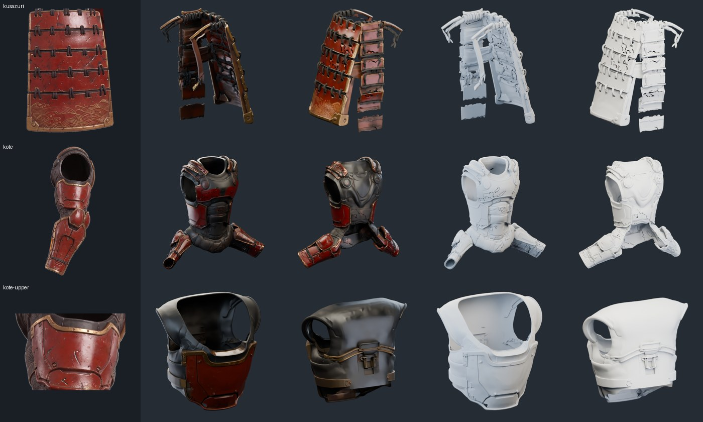

# 未來赤備：拆件生成＋既有骨架組裝

計劃見 [PLAN.md](PLAN.md)。每個階段的對照圖放在這裡，通過後才進下一階段。

## 第 0 階段：圖像模型 A/B

同一張原圖、同一段提示（正面、正交、A 姿勢、灰底、平光，保留全部造型細節，[提示全文](images/prompts.json)），請兩個模型各畫一張。工具：[gen_image.py](../../../../tools/part_pipeline/gen_image.py)。

左：原圖。中：`google/gemini-3-pro-image`（Nano Banana Pro）。右：`openai/gpt-image-2.5-flare`。

| | Nano Banana Pro | GPT Image 2.5 Flare |
| --- | --- | --- |
| 與原圖造型一致 | 較高：體型厚實、袖與膝甲的形狀接近原圖 | 較瘦，部分甲片重新設計（袖變長、膝甲變小） |
| A 姿勢、對稱 | 手臂角度較小（約 25°），對稱良好 | 標準 A 姿勢、最對稱 |
| 解析度 | 1696 × 2528 | 1024 × 1536 |
| 費用 | 0.140 美元 | 0.055 美元 |

兩張都已去掉原圖的光暈與暗背景，水平甲片、六文錢、鹿角、能量槽都保留。

**建議：用 Nano Banana Pro。** 它最忠於原圖，解析度也高，而且據評測多參考圖（之後畫側面、背面、單件都要以正面為參考）較穩。缺點是單價較高：以剩餘約 7.8 美元計，約可畫 55 張，本計劃預估需要 20–25 張。

[原圖檔](images/)：`ab-front-gemini-3-pro-image.png`、`ab-front-gpt-image-2.5-flare.png`。

## 第 1 階段：三視圖

選定 Nano Banana Pro。以第 0 階段的正面圖為主參考、原圖為輔，畫左側與背面（各 0.14 美元，[提示全文](images/prompts.json)）。

[正面](images/ab-front-gemini-3-pro-image.png)、[左側](images/sheet-side.png)、[背面](images/sheet-back.png)，各 1696 × 2528。

- 三張的身高、比例、A 姿勢一致，可以直接當建模的正交參考。
- **背面是新設計的**：原圖沒有背面，這次補上同樣水平排列的背甲、背上的總角結（紅繩蝴蝶結）、後草摺，以及頭盔後方張開的錏（護頸）。
- 側面看得出胴甲包覆身體的弧度、袖的厚度、草摺垂掛的位置，以及膝、脛、靴的側面輪廓。
- 小差異：側面的袖比正面略方，背面的手甲比正面略簡化。單件圖會以正面為準，統一這些細節。

### 背面紅繩結：改設計

依回饋，原本背上的大蝴蝶結像禮物緞帶貼在甲片上。以背面圖為底、只改繩結，畫了三版（各 0.14 美元）：

左：原版。中：**傳統總角結**：背甲上方一個金環，掛一個小總角結，兩條尾繩加流蘇垂到腰繩，另有兩條細繩往上連到兩邊袖的背面。右：**六文錢金具**：背甲中央一枚刻六文錢的圓金具，下面一個緊湊的小結與流蘇，沒有連到袖的繩。

（第一次畫傳統版時繩結過大、繩粗如船纜，已重畫成中間這版：[過大版](images/sheet-back-knotA.png)。）

背面定為 **A：傳統總角結**（[背面正式版](images/sheet-back-knotA2.png)）。

## 第 2 階段：單件圖

每件以三張設定圖（正面、左側、背面總角結版）為參考，單獨畫在灰底上，3/4 視角，沒有身體、內側中空。部件與提示在 [parts.json](../../../../tools/part_pipeline/parts.json)，工具 [gen_parts.py](../../../../tools/part_pipeline/gen_parts.py)。左右對稱的件只畫左邊，3D 時鏡像。

| 部件 | 結果 |
| --- | --- |
| 頭盔 | 鹿角、六文錢、錏、吹返、面具一體；面具內是空的 |
| 胴（前） | 6 段水平甲片、綿嚙（肩帶）、兩側能量槽；不含繩結 |
| 胴（後） | 同樣的水平甲片，金環掛總角結與兩條流蘇 |
| 袖 | 5 段甲片、底段金波紋 |
| 草摺 | 畫成中央一片加左右兩片掛在繩上；建模時只取中央那片 |
| 籠手 | 上臂機械袖、肘甲、前臂甲與能量槽，兩端中空 |
| 手甲 | 黑色機械手套、紅金指甲片、手背板 |
| 佩楯 | 畫成左右兩片大腿甲 |
| 膝甲 | 圓形膝蓋板、黑色關節殼與橘燈 |
| 脛當 | 紅金甲片、垂直能量槽、小腿紅繩 |
| 足甲 | 紅金甲片、黑色機械靴、厚胎紋鞋底 |

第一輪有三件重畫（各 0.14 美元）：袖的下面多畫了一雙靴子；草摺畫成整圈裙；膝甲畫得像頭盔。

## 第 3 階段：逐件 3D

每件單件圖先以色鍵去背（灰底很平，不需要去背網路；[cutout.py](../../../../tools/part_pipeline/cutout.py)），再在 Modal H100 以 TRELLIS.2 1536 cascade 一件一件生成（[trellis_parts_modal.py](../../../../tools/part_pipeline/trellis_parts_modal.py)，`python tools/run_trellis.py --parts-study --names … --seeds 1615`）。每件約 4–9 分鐘，原資料先存進 Modal Volume `yukimura-trellis2-cache/results/future-sanada-parts/`，再匯出兩種：開放曲面（`high`）與重網格封閉版（`closed`），各約 30 萬面、2048 貼圖。

**選用的結果**（左起：輸入、上色 30°、上色 210°、白模 30°、白模 210°；全部用封閉版）：

| 部件 | 結果 |
| --- | --- |
| 頭盔 | 鹿角、六文錢、吹返、面具、錏都成形，背面護頸也合理 |
| 胴（前） | 6 段水平甲片與綴繩是真的幾何；背面是 TRELLIS 推測的平板，組裝時只用前半 |
| 胴（後） | 總角結與流蘇有立體幾何；組裝時只用後半 |
| 袖 | 5 段甲片、綴繩、上緣金具 |
| 草摺 | **改用程式生成**（見下）：5 段水平甲片，貼圖取自單件圖 |
| 籠手 | 只取肘到腕（見下）；肘甲與前臂甲成形 |
| 手甲 | 五指分開、指甲片清楚，可再綁指骨 |
| 佩楯、膝、脛、足 | 皆成形；膝與脛的背面為推測 |

**和 body v2 同部位比較**（上：body v2 pass 8／9，下：本階段單件）：

**失敗與對策**

- **草摺**：正面平視的平板沒有深度線索，TRELLIS 生成碎片。改寫 [kusazuri_panel.py](../../../../tools/part_pipeline/kusazuri_panel.py)：5 段弧形甲片（外傾、上緣塞入上一片、金色捲邊），每個頂點透過圖中面板的梯形取樣單件圖，背面為深色漆。約 1 萬面。
- **整條手臂**：肩口的圓洞被當成脖子，生成出一件有手臂的上衣。改在肘部切開：肘到腕（`kote-forearm`）成功；上臂甲（`kote-upper`）兩個 seed 都變成背心，第 4 階段改用程式生成的弧形甲片。
- **開放曲面的小洞**：開放版在薄甲片上有針孔狀破洞（白模上的黑色裂紋），封閉版沒有，因此全部改用封閉版。

GLB 每件約 20–28 MB，未放入 Git，可由 Modal Volume 重新下載：`python tools/run_trellis.py --parts-study --names helmet,… --seeds 1615 --download-only`。去背後的輸入圖可由 `cutout.py` 重建，也不放入 Git。
