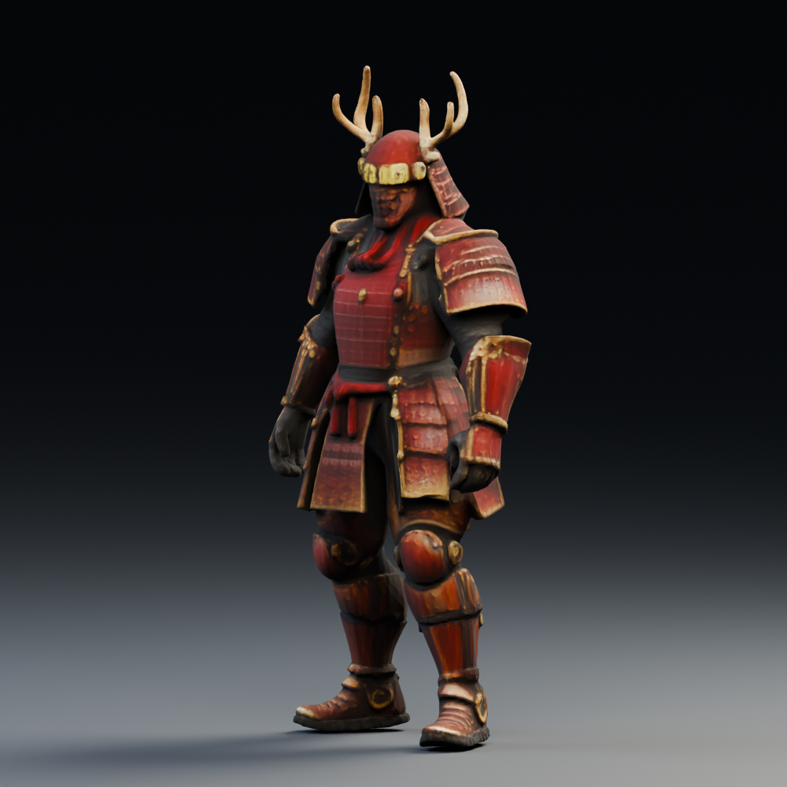
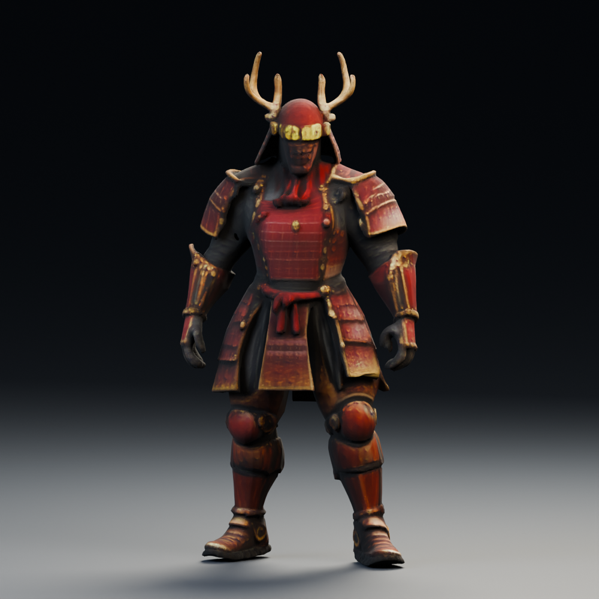
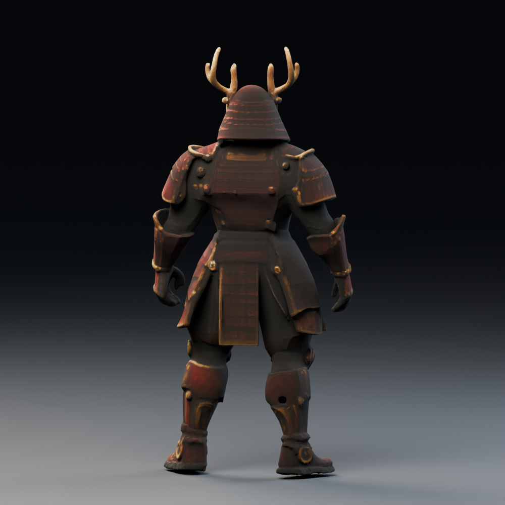
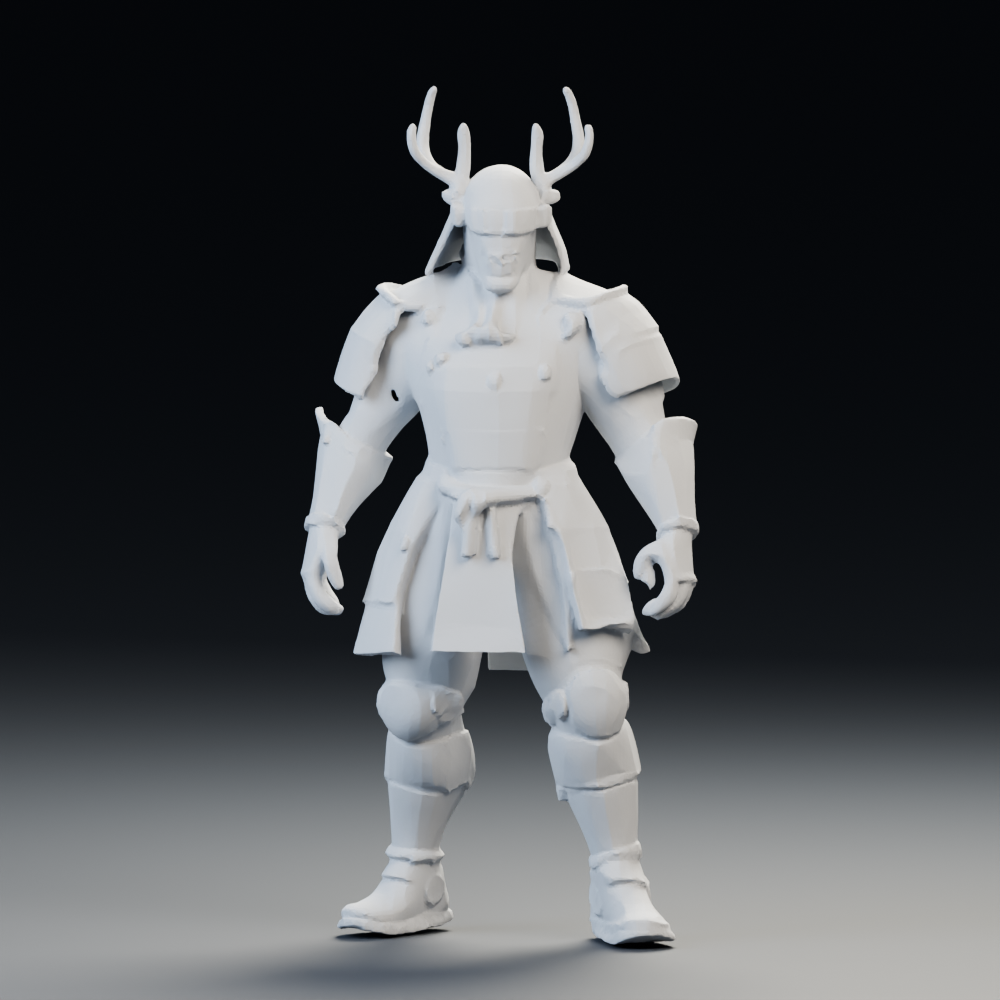

# 未來幸村：TRELLIS 第一代替代試作

此路線使用 Microsoft 官方 `TRELLIS-image-large` 與其原本訓練搭配的 `dinov2_vitl14_reg`，不需要 DINOv3。它與 TRELLIS.2 是兩套不同的模型；沒有把 DINOv2 硬接入第二代權重。

輸入沿用 [同一張透明背景參考圖](../reference.png)。輸出獨立放在本目錄，不替換遊戲角色。

## 實測結果

**第一代已在 NVIDIA H100 80GB 成功生成模型與貼圖**，沒有使用 DINOv3 或 HF token。

| 項目 | 實測 |
| --- | --- |
| 原始網格 | 147,032 頂點／294,104 三角面 |
| GLB | 7,822,076 bytes，已存入 Modal Volume |
| 貼圖 | 2048 × 2048 烘焙色彩 |
| 首次權重載入 | 53.47 秒 |
| 模型推論 | 4.54 秒 |
| 網格處理、UV 與貼圖匯出 | 42.13 秒 |
| 函式內總時間 | 104.20 秒（不含環境建置、容器啟動與傳輸） |
| PyTorch 峰值配置 GPU 記憶體 | 9.85 GiB（非整張 GPU 的總占用） |

[Modal 執行紀錄](https://modal.com/apps/clarence-chien/main/ap-6QJzjDmxPNyuoWuQGe1SD3) · [生成紀錄](generation.json) · [驗證狀態](status.json)

**GLB 已下載並通過 SHA-256、幾何與貼圖檢查。** 簡化後有 93,993 頂點、149,998 三角面，沒有退化三角形；內嵌 2048 色彩貼圖。glTF 沒有儲存法線，載入器會依三角形產生法線。沒有骨架或動畫。

- [原始 GLB](future-sanada.glb) · [可編輯 Blender 場景](future-sanada-studio.blend)
- [互動檢視器 ZIP](viewer.zip)：解壓縮後開啟 `index.html`，可轉向、縮放、看白模與網格。
- [幾何檢查](mesh-inspection.json) · [渲染紀錄](render-report.json) · [檢視器驗證](viewer-verification.json)



| 正面 | 背面 | 白模 |
| --- | --- | --- |
|  |  |  |

這是 Blender 4.3.0／Cycles CPU 的實際幾何渲染，每張 1000 × 1000、32 samples。赤備與鹿角輪廓保留，但甲片層次、六文錢、面罩與手指細節明顯簡化；背面是單圖推測，還不是插畫品質或可直接動畫的遊戲角色。

展示時將第一代材質設為 `metallic=0`，避免未指定金屬度時 glTF 預設值 1 令全身偏黑。這是明確的展示設定，不是預測出的 PBR 材質；原始 GLB 完全保留下載內容與雜湊。

檢視器已測試 1280 × 900 與 390 × 844 的 Chromium，模型載入、正／側／背面、白模、網格、自動旋轉與離線操作通過，無頁面錯誤或外部資源請求。使用本機 HTTP 載入後切離線及軟體 WebGL 測試，未驗證各瀏覽器的 file:// 行為，不能當成實體手機效能證明。

## 重新下載與渲染

成果仍在 Volume `yukimura-trellis2-cache` 的 `results/future-sanada-trellis1/`。以下命令不重新生成：

```sh
/workspace/yukimura-tools/bin/python tools/run_trellis1.py --download-only
/workspace/yukimura-tools/render-env/bin/python tools/inspect_trellis_glb.py --model docs/experiments/future-sanada/trellis1/future-sanada.glb --material-profile basecolor
/workspace/yukimura-tools/render-env/bin/python tools/render_trellis_study.py --model docs/experiments/future-sanada/trellis1/future-sanada.glb --output docs/experiments/future-sanada/trellis1 --basecolor-only
node tools/build_trellis_viewer.mjs docs/experiments/future-sanada/trellis1
```

## 執行

```sh
/workspace/yukimura-tools/bin/python tools/run_trellis1.py
```

重用已驗證的 Modal CUDA 映像 `im-CWPfod9BzDeCjqD07JU8Ui`，原建置定義在 `tools/trellis_modal.py`，可用 `tools/run_trellis.py --build-only` 重建。額外安裝第一代需要的 spconv、Kaolin、Gaussian rasterizer 與 UV／烘焙工具。

先在 CPU 檢查官方 checkpoint、DINOv2 權重的公開存取與套件匯入，通過後才呼叫單一 H100。GPU 函式上限 20 分鐘、無自動重試、沒有常駐部署。網格與 Gaussian 中間成果會先存入 Modal Volume，以免貼圖匯出失敗時重新生成。

這一代匯出的是烘焙色彩貼圖；不能視為 TRELLIS.2 的金屬度／粗糙度材質預測。單圖背面仍是推測，手指、鹿角、甲片需要實際檢查，產出不含骨架與動畫。

## 來源

- [Microsoft TRELLIS](https://github.com/microsoft/TRELLIS/tree/442aa1e1afb9014e80681d3bf604e8d728a86ee7) · [模型與 pipeline 設定](https://huggingface.co/microsoft/TRELLIS-image-large)
- [Meta DINOv2](https://github.com/facebookresearch/dinov2/tree/7764ea0f912e53c92e82eb78a2a1631e92725fc8)
- [TRELLIS MIT 授權](TRELLIS-LICENSE.txt)。FlexiCubes、Kaolin、mip-splatting、nvdiffrast 等依賴具有各自授權，依上游 README／LICENSE；不是整個工具鏈都由 MIT 涵蓋。
