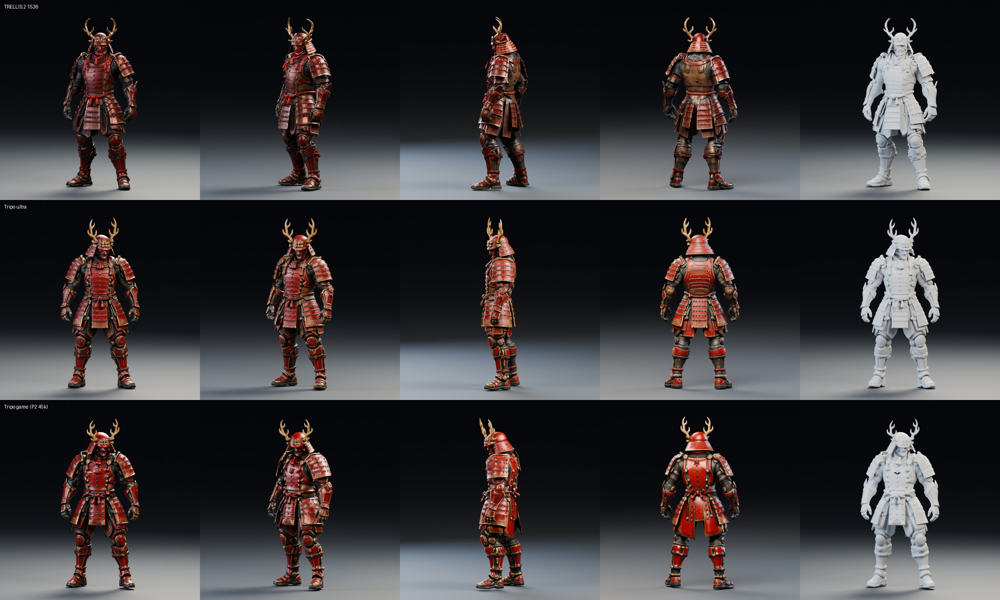
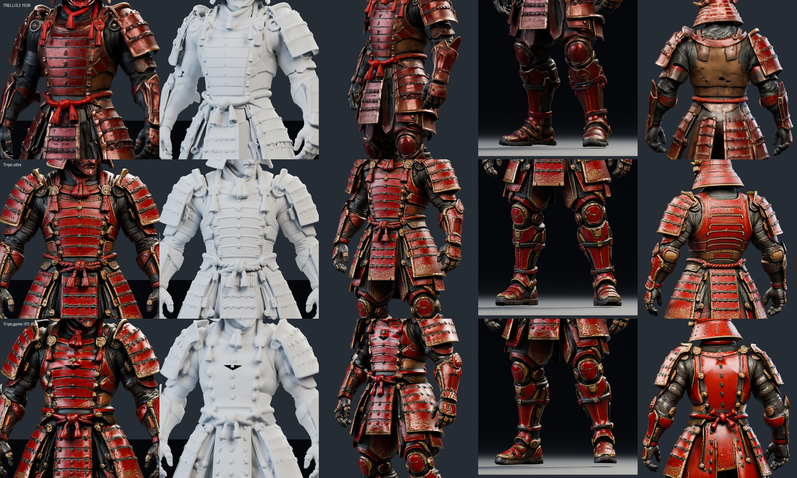
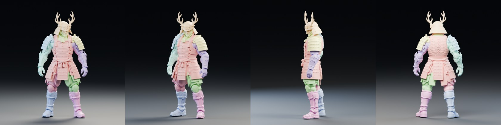
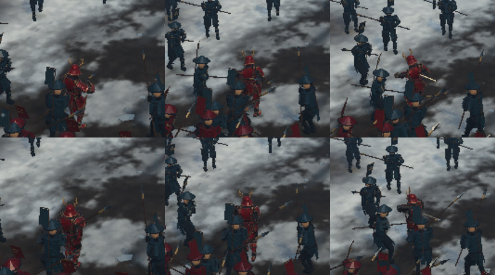
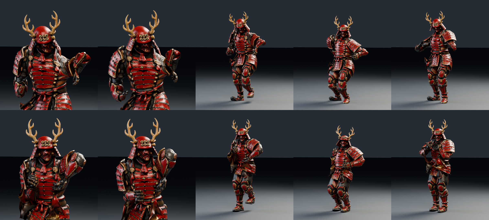
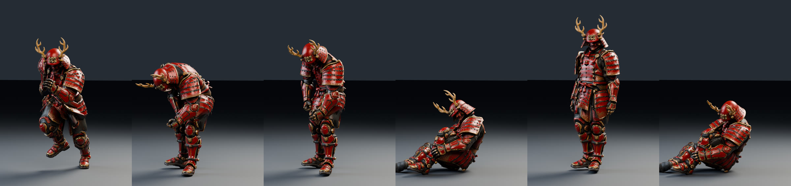

# 未來赤備：Tripo 與 TRELLIS.2 1536 比較

同一張參考圖（[reference.png](../reference.png)，SHA-256 `c84b2864…`，與 body v2 的 TRELLIS.2 輸入完全相同），分別交給 Tripo API 與 TRELLIS.2 1536 cascade，比較未經任何後製的原始輸出。

## 比較方式

| | TRELLIS.2 | Tripo |
| --- | --- | --- |
| 模型 | `microsoft/TRELLIS.2-4B`，1536 cascade，seed 7 | 見下方三種設定 |
| 輸出 | body v2 的原始封閉重網格匯出（`body-remesh.glb`，未經 pass 2–9 精修） | API 回傳的 GLB，未修改 |
| 算圖 | 同一支 [render_body_v2.py](../../../../tools/render_body_v2.py)、同一組攝影機與燈光 | 同左 |

Tripo 的三種設定（[tripo_generate.py](../../../../tools/tripo_generate.py)）：

| 名稱 | 設定 | 用途 |
| --- | --- | --- |
| `ultra` | `v3.1-20260211`、Ultra 幾何（`geometry_quality=detailed`）、PBR、`texture_quality=detailed` | 和 TRELLIS 比最高品質 |
| `parts` | `v3.1-20260211`、`generate_parts=true`（只有幾何，Tripo 不允許與貼圖同開） | 看它能否自動拆件，方便綁骨 |
| `game` | `P2-20260801` 低面數、上限 45,000 面、PBR | 看能否直接符合遊戲武將上限（9 萬面、7 MB） |

## 結果

Tripo 原始輸出在 [tripo/](tripo/)（每種設定一個 GLB、Tripo 的預覽圖與任務紀錄）。Tripo 匯出時正面朝 +X，算圖前轉成和 TRELLIS 相同的 −Y 朝前，其餘未改動。

**全身**（左起：正面、斜側、側面、背面、白模；上：TRELLIS.2 1536，中：Tripo ultra，下：Tripo game）



**近拍**（左起：胸部、胸部白模、手、腿、背）



**Tripo 自動拆件**（`parts`，每個顏色是一件；共 11 件：頭盔、胴＋草摺、左右袖、左右臂、左右大腿、左右小腿與靴等）



| | TRELLIS.2 1536 | Tripo ultra | Tripo game（P2） | Tripo parts |
| --- | ---: | ---: | ---: | ---: |
| 三角面 | 571,463 | 1,884,017 | 46,449 | 1,491,486（11 件） |
| 檔案 | 73.5 MB | 69.6 MB | 15.0 MB | 41.2 MB |
| 貼圖 | 2 張 4096² | 3 張 4096²（PBR） | 3 張 4096²（PBR） | 無 |
| 生成時間 | 約 4 分鐘推論＋1.5 分鐘載入（H100） | 2 分鐘 | 2 分鐘 | 1 分鐘 |
| 費用 | Modal GPU 時間 | 60 點（0.6 美元） | 120 點（1.2 美元） | 40 點（0.4 美元） |

## 360 度轉台影片

[turntable-trellis-vs-tripo-1080p.mp4](turntable-trellis-vs-tripo-1080p.mp4)：1920×1080、30 fps、24 秒。左 TRELLIS.2 1536，右 Tripo v3.1 Ultra；前 12 秒全身轉一圈，後 12 秒上半身近拍轉一圈。兩邊都縮放到 2 m 高、在同一組固定燈光下原地旋轉，所以每個角度的光線完全相同。

在 Modal L4 GPU 上以 Blender 4.3 Cycles 算圖（96 samples、OptiX 降噪，每格約 5 秒，1,440 格分 12 台平行），本機以 ffmpeg 合成。重現：

```sh
python tools/run_trellis.py --turntable --left .tmp/body-v2/seed-7/body-remesh.glb --right .tmp/tripo-ultra-ny.glb --output .tmp/turntable
tools/turntable_compose.sh .tmp/turntable docs/experiments/future-sanada/tripo-compare/turntable-trellis-vs-tripo-1080p.mp4 "TRELLIS.2 1536" "Tripo v3.1 Ultra"
```

（`.tmp/tripo-ultra-ny.glb` 是 Tripo ultra 轉成 −Y 朝前的副本。）

## 差別

- **甲片幾何**：Tripo 的胴、草摺、袖都是水平、等距、邊緣銳利的甲片，綴繩是立體的；TRELLIS 的甲片邊緣軟、有凹凸，白模上可見表面起伏。這正是 body v2 花了 pass 2–9 想修的部分。
- **繩結與流蘇**：Tripo 的頸前繩結、腰繩結、流蘇都是乾淨的立體造型；TRELLIS 的繩子糊在身上。
- **背面**：原圖沒有背面。Tripo 推出一個合理的背甲（水平甲片、綴繩、背後的繩）；TRELLIS 的背面是一塊暗褐色的平板。
- **貼圖**：Tripo 的赤漆與金邊乾淨、接近原圖；TRELLIS 偏暗、偏褐，有雜斑。
- **對稱與比例**：Tripo 左右對稱、站姿端正；TRELLIS 略側轉，承襲原圖的 3/4 視角。
- **遊戲版**：Tripo game 只有 46,449 面，就已低於遊戲武將上限（9 萬面），外觀仍保有大部分細節，背甲則簡化成平滑的紅板。檔案 15 MB 仍超過 7 MB，主要是三張 4K 貼圖；縮成 1–2K 即可達標。
- **拆件**：Tripo 能直接把角色分成頭盔、胴、袖、手臂、腿、靴等 11 件幾何，可以每件綁一根骨頭；但拆件模式不能同時產生貼圖，要另外把 ultra 的貼圖轉印過去。
- **TRELLIS 的優勢**：開源（MIT）、可自架，沒有額度與使用條款限制；Tripo 是付費服務。

**結論**：同一張圖，Tripo ultra 的原始輸出就已經優於 TRELLIS.2 1536 加上 body v2 九輪精修的結果；遊戲版也只需要縮小貼圖。若要繼續做這個角色，建議改走 Tripo：以 ultra 作為影片版，以 game 作為遊戲版，再用 Tripo 的自動綁骨或拆件結果綁到遊戲骨架。

## 綁骨與動作：Tripo 與開源雙線比較

同一個模型（Tripo game，46,449 面）分兩條線做成可動角色，再套同樣的動作比較。

| | Tripo 線 | 開源線 |
| --- | --- | --- |
| 綁骨 | Tripo API `animations/rig`（`v3.0-20260909`、biped、Mixamo 骨名），[tripo_rig.py](../../../../tools/tripo_rig.py) | 只用 Blender，[rig_open.py](../../../../tools/rig_open.py) |
| 骨架 | 65 根（含手指），Mixamo 命名 | 18 根，與遊戲 `yukimura.glb` 的控制骨同名同階層 |
| 關節位置 | Tripo 自動判斷 | 從填滿的正面剪影找胯下、腋下、肩、肘、腕、膝、頸；深度取附近頂點的中間值，左右對稱 |
| 蒙皮 | Tripo 自動 | Blender bone heat。原始網格是很多片開放的殼，直接算時 62,525 個頂點全部失敗；改在 1 cm 體素填實後的封閉代理上算（42,826 頂點，只有 8 個沒解出），再以最近面內插複製回原網格 |
| 動作 | Tripo 預設動作（`preset:idle/run/slash/hurt`）；遊戲的 8 個動作則由 [rig_tripo_gameclips.py](../../../../tools/rig_tripo_gameclips.py) 轉到它的骨架上 | 遊戲的 8 個動作，由 [game_retarget.py](../../../../tools/game_retarget.py) 依骨頭方向轉移 |
| 費用與時間 | rig-check 0＋rig 25＋retarget 40（每個動作 10）＝ 65 點（0.65 美元），約 1 分鐘 | 免費，CPU 約 10 秒 |

兩條線都能帶著遊戲的 8 個動作（`idle run slash reverse thrust spin dash hurt`）直接放進遊戲：遊戲只依動作名稱找片段，不看骨頭名稱。下圖是在實際遊戲裡，以 Playwright 把英雄模型換成這兩個 GLB 的截圖（[capture-rig-ingame.mjs](../../../../tools/capture-rig-ingame.mjs)，repo 裡的模型沒有被替換），上排開源、下排 Tripo；左起待機、奔跑、攻擊。兩者都能載入、沒有錯誤，三個動作都正常播放。



### 動作比較影片

[rig/anim-open-vs-tripo-1080p.mp4](rig/anim-open-vs-tripo-1080p.mp4)：1920×1080、24 fps、47 秒。

- 前段：同一組遊戲動作（idle、run、slash、hurt），左邊開源、右邊 Tripo，先全身、再上半身近拍。
- 後段：Tripo 骨架配上 Tripo 自己的預設動作。

在 Modal L4 上以 Cycles 算圖（64 samples），共 944 格；本機以 ffmpeg 合成。重現：

```sh
blender-python tools/rig_open.py --mesh .tmp/tripo-game-ny.glb --output .tmp/rig-open/rig-open.glb
blender-python tools/rig_tripo_gameclips.py --glb docs/experiments/future-sanada/tripo-compare/rig/tripo/rig-model_url.glb --output .tmp/rig-tripo/tripo-gameclips.glb
python tools/run_trellis.py --anim-compare --open .tmp/rig-open/rig-open.glb --tripo .tmp/rig-tripo/tripo-gameclips.glb \
    --preset docs/experiments/future-sanada/tripo-compare/rig/tripo/retarget-model_url.glb
tools/anim_compare_compose.sh .tmp/animcmp docs/experiments/future-sanada/tripo-compare/rig/anim-open-vs-tripo-1080p.mp4
```

**同一動作、不同蒙皮**（上排開源、下排 Tripo；左起：slash 近拍兩格、run、hurt、idle）



**Tripo 預設動作**（左起：run、slash 兩格、hurt、idle、hurt 倒地）



### 差別

- **甲片變形**：兩邊都會在關節處拉扯甲片，沒有一邊做到「甲片保持剛硬、只有關節彎」。開源線在手臂舉高時肩甲（袖）會跟著上臂彎曲；垂在腰側的手甲會被擠扁。Tripo 線的袖比較像一整塊跟著手臂走，但手肘內側的灰色布料會鼓成一個球。
- **骨架細節**：Tripo 有手指、三節脊椎、頸、鎖骨，做影片或要握武器時比較好用；開源線只有遊戲用的 18 根骨，手是一整塊。
- **動作來源**：Tripo 預設動作是自然的動態捕捉風格，但跟這個遊戲無關，`slash` 比較像彎腰鞠躬，`hurt` 是坐倒在地。而且每段都帶著一個固定的根骨偏移：`animate_in_place` 只去掉位移，沒有歸零。遊戲要用的仍是自己的 8 個動作，兩條線都能用 game_retarget.py 套上。
- **轉移的限制**：game_retarget.py 只複製每根骨頭的方向。原遊戲角色雙手握槍；新模型肩膀較寬、手臂比例不同，雙手就對不上同一把槍。若要雙手握持，需要再加手部 IK 或手動修。這對兩條線都一樣。
- **相容性**：兩者都能直接在遊戲中執行。但兩者都沒有槍：生成的模型本來就沒有，遊戲的 `weapon` 骨在開源線上保留了，Tripo 線沒有。另外檔案都約 16 MB，超過 7 MB 上限，原因同樣是三張 4K 貼圖。
- **可重現性與可控性**：開源線完全在本機、不用額度，關節與權重都看得到也改得了，但關節偵測是針對這種站姿與服裝調的規則，換角色可能要再調。Tripo 線是黑盒，換任何雙足角色都能一鍵完成。

**結論**：要遊戲用，兩條線的品質相近，關節處都需要人工修權重。開源線免費、骨架直接與遊戲相同，比較划算。要影片用或要手指，Tripo 的 65 根骨與自然的預設動作較好，0.65 美元也很便宜。比較實際的做法是混合：用 Tripo 綁骨取得手指與權重，再用 game_retarget.py 套遊戲自己的動作（即本文的 `tripo-gameclips.glb`）。
