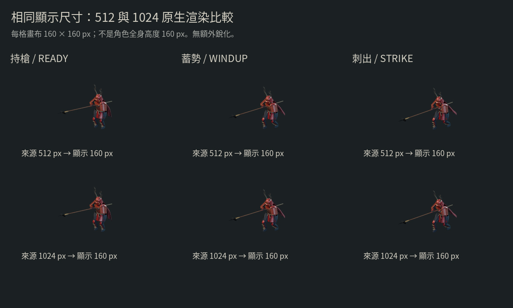

# Blender 三幀試渲：第一個製作驗證

> 2026-10-15 路線修正：使用者要求以插畫為實際素材，做分層／淺浮雕與重打光。新的優先方案見 [插畫 2.5D 重打光](ILLUSTRATION_RELIGHT.md)；下列完整 3D／舊模型試渲流程保留作研究比較，不是目前的造型製作方向。

2026-10-15（Asia/Taipei），分支 `art/jigoku-prerendered-2d`。這一輪已實際執行 Blender，產出九張 PNG 與可編輯場景；不是把 image gen 圖裁切成 sprite。

[互動比較頁](review.html) · [三幀原圖與檢查資料](renders/render-report.json) · [上一輪概念圖](README.md)


## 本輪完成

- 重用 `yukimura-grip-study.blend`：87,087 三角形、92 根骨架，保留原有手部接觸與動畫。
- 對赤漆區域增加選擇性的 clearcoat、微細表面法線，調整籠手與布料材質；原高模烘焙法線和 UV 保留。
- 建立 4×4 m 石坪、落燼／碎石、焦木關門、曲面瓦與六文錢旗布。這是小型光影測試場景，尚未達到概念圖的廢墟複雜度。
- 固定 35.264° 正交俯角；三個角色幀共用相機與腳底原點。以三姿勢聯集決定畫布，避免槍尖或鹿角被裁掉。
- 分別原生渲染 1024²／512² 透明角色圖，另有三張 1024² 場景圖。512 圖不是由 1024 圖縮小冒充原生渲染。
- 互動比較頁可選姿勢內容、來源解析度、160／256 px 或原始像素顯示；場景只渲染 1024，切換時會鎖定該解析度。

| 圖名 | 既有 action | 取樣 frame | 說明 |
| --- | --- | ---: | --- |
| ready | idle | 0 | 持槍 |
| windup | thrust | 20 / 90 | 蓄勢 |
| strike | thrust | 40 / 90 | 刺出 |

這是三個 key pose 的比較，不是新完成的連續動作。三幀姿勢差距仍偏小，源動作的刺擊幅度、肩胯帶動與重心值得再設計；沒有為了畫面好看而扭開已校準的手腕。

## 縮到實際尺寸



兩列都顯示在 160×160 px 畫布，人物本身更小；使用 Pillow 的 Lanczos 縮放和排版，未加入銳化、生成式修補或濾鏡。此縮圖只用於檢視，不是覆寫原始 PNG。

本輪目視結論：512 原生圖在這個顯示大小已保留主要剪影，1024 增加了近看餘裕，不能補出來源模型沒有的甲片、布褶或解剖形體。遊戲品質的下一個瓶頸是模型與動作設計，並非先把所有動畫升到 4K。

## 與插畫的差距

- 肩甲、面頬和足部仍有程序模型的簡化輪廓，布料缺乏真實張力與厚薄變化。
- 赤漆／金屬／布的材質有分層，但磨損與織紋仍偏程序化，不能等同參考圖的設計密度。
- 關門與地面仍過於整齊，只有基本灰燼／碎石，未完成受火、泥水痕與不規則破損的敘事細節。
- 本次沒有新增高模雕刻、重拓樸、鬼火特效、亡軍、8 方向動畫或 Phaser 遊戲。

因此這一輪證明的是 **Blender → 一致透明角色幀的流程可用**，美術品質尚未通過插畫目標。下一步應先精修一個模型的胸肩甲、面頬、袴與足部，再在同一鏡頭比較；暫不把現有品質量產成大量方向與動畫。

## 渲染與檢查證據

Blender 4.3.2／Cycles CPU、4 執行緒、最多 128 samples、自適應取樣。系統 Blender 沒有 OpenImageDenoise 支援，首次試用降噪失敗後改為關閉降噪，正式九張均成功輸出。沒有啟用 Modal 或 GPU 離線渲染。

九張影像的渲染及寫檔合計 **112.47 秒**，不含場景建立、試錯與檢查時間。每張耗時、相機、姿態、原檔雜湊見 [render-report.json](renders/render-report.json)。

[validation.json](renders/validation.json) 核對九張圖的 SHA-256、尺寸、RGBA／透明範圍、角色邊界留白、共用相機、姿態影像不同，以及原始 v22 場景未變。這些不是完整人體／衣甲碰撞或手機效能認證。透明角色不包含獨立地面投影層，腳底影需要後續另外輸出。

靜態比較頁已用 Chromium 驗證 1440×1000 桌面及 390×844 手機尺寸，涵蓋圖片載入、解析度切換、場景解析度鎖定、原始像素捲動及無水平頁面溢出；沒有 JS 例外或失敗的 HTTP 回應。記錄見 [browser-check.json](renders/browser-check.json)。這不是遊戲或真機效能測試。

角色圖與場景圖使用不同構圖倍率（角色約 3.480、場景 6.8），但相同鏡頭方向／燈光；每一類內的三幀倍率一致。腳底基準以角色圖的 `pivot_normalized_top_left` 記錄，不能直接拿場景圖的畫素位置當角色 pivot。

## 重建與編輯

```sh
blender --background --threads 4 --python-exit-code 1 \
  --python tools/render_jigoku_study.py
python3 tools/review_jigoku_study.py
```

先 `-- --draft --poses ready` 可做低成本 512 px 場景預覽，產物在 `.tmp/jigoku-2d/draft`。完整命令會產生三個姿勢九張原圖；審查腳本要求完整九張，避免局部渲染冒充完整報告。

Pillow 與 Noto Sans CJK 字型僅用於檢查／比較圖排版。前端遊戲不依賴它們。輸出檔案如下：

- [可編輯 Blender 場景](../../../assets/optimized/jigoku-2d/yukimura-sprite-study.blend)：完整材質、鏡頭、燈光、骨架與關門地坪，貼圖仍封裝於檔內。
- [渲染腳本](../../../tools/render_jigoku_study.py)：從原始 v22 源檔重建，不累加修改。
- [檢查及比較頁腳本](../../../tools/review_jigoku_study.py)：圖像完整性、縮圖與靜態頁面。

素材仍沿用 MPFB／MakeHuman CC0 與 Rocketbox MIT 的既有來源，授權說明見 [模型 NOTICE](../../../public/models/NOTICE.md)；新增程序場景與渲染腳本由本專案製作。

本次沒有變動 `src/`、`public/`、套件依賴或 Pages 部署。既有遊戲與本次離線驗證分開保存。
