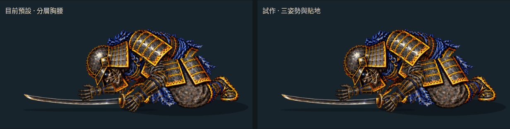
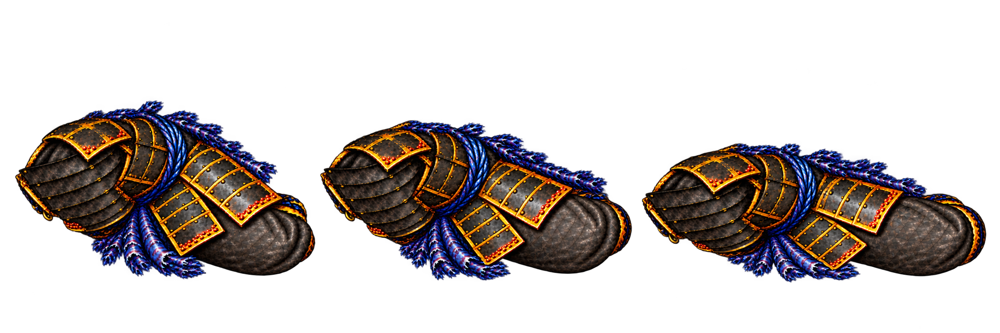
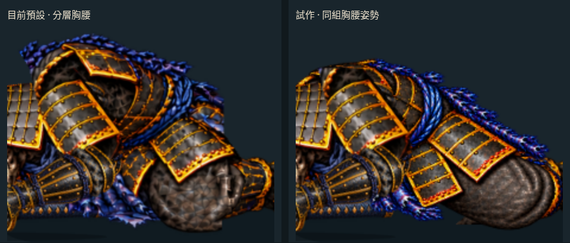

# 胸腰三姿勢與貼地接續

2026-10-17（台北時間）。分支 `art/jigoku-prerendered-2d`。**可播放候選；未替換預設或正式遊戲。**

[原速 30 fps 影片](free-arm-settle/sequence-normal-30fps.mp4) · [¼ 倍速 30 fps 影片](free-arm-settle/sequence-30fps.mp4) · [比較頁原始檔](free-arm-settle/sequence-review.html) · [手機畫面](free-arm-settle/sequence-mobile.jpg)



這次一起製作低伏、開始側翻、繼續側倒三張胸腰原畫，讓胸甲、兩片裙甲、藍繩與膝部在同組畫面中保持對應，再接回共用頭盔、雙臂、肩甲、護脛及刀。新增剛性貼地約束，改善整塊身體只跟隨肩點平移時下緣浮起的問題。**原畫切換仍能看出形狀跳動，四個主要交接的全彩差異尚未優於預設，因此未升為預設。**

## 同組原畫與實際裝配



本輪一次 image gen，以前輪 `body-transition-folded.png` 的胸腰造型及原 `side-fall-breakdowns.png` 的側倒方向為參考。要求同一鏡頭、體格、兩片裙甲及膝部造型，三格都只畫胸甲—骨盆—大腿—膝部，不畫頭、手、肩甲、小腿或武器。原始輸出為 **2172×724 RGBA**，生成檔 `exec-443e12af-0e96-4fe3-a9fb-c729b95a17d4.png`；不是每格 2172 px，也不是三張獨立生成。



[1220 ms 比較](free-arm-settle/sequence-comparison-1220.png) · [1260 ms 比較](free-arm-settle/sequence-comparison-1260.png) · [1380 ms 比較](free-arm-settle/sequence-comparison-1380.png)。這些畫面由實際 Canvas 擷取；互動頁可原速／¼ 倍速播放、暫停、倒帶，以及逐點比較四個換圖邊界。

- `?body=sequence` 在 **1200 < 時間 ≤ 1440 ms** 取代 bridge、roll、side 的胸部與下身；1440 ms 後接回原 rest。其餘時間與預設逐像素相同。前輪單張候選仍可用 `?body=paint` 查看。
- 三格採同一縮放 **0.46**、同一預旋轉 **10°**，各自人工標定肩點。實際透明間隙用於裁分三格，檢查邊界沒有切到人物，也沒有鄰格殘留。
- 三張執行貼圖共約 **0.624 MiB RGBA8**，僅候選模式載入。數值是貼圖理論解碼量，不是手機實測顯存；比較頁的雙場景與畫布另有開銷。
- 其餘頭盔、近遠側手臂、肩甲、護脛、刀與原骨架路徑共用。胸腰在護脛前方、頭盔及近側手臂後方，不重疊繪製舊胸腰。

## 肩點連續、身體下緣貼地

原先整張胸腰跟隨肩點平移，肩點升降也會把膝部及布料一起抬離地面。現在把三張裁片都當作固定形狀的平面部件：

1. 由實際 alpha > 0 的像素格四角建立凸包；不是使用大矩形外框猜接觸點。
2. 身體肩點維持既有連續路徑，求一個小角度，讓旋轉後凸包最下緣保持在 `y=687`，場景地面為 `y=690`。
3. 只旋轉和平移，不縮放、拉伸、網格變形、影像溶接或 AI 補幀。求解範圍 ±12°，實際動作檢查皆不足 5°；無法接地時會報錯，不以裁掉下緣掩蓋。

此約束讓部件下緣保持同一高度，但接觸點可能是布料而非膝蓋，**不是膝關節、重心或受力模擬**。人工肩點也只是二維裝配座標，不能據此宣稱人體解剖正確。

## 整段交接結果

在每個邊界前後 ±0.001 ms 擷取實際畫布；RGB 平均絕對差為 0–255，輪廓差為身體 alpha > 16 的 XOR 像素數。兩者都不是美術品質分數。

| 交接 | 預設 RGB 差 | 候選 RGB 差 | 預設輪廓差 | 候選輪廓差 |
| --- | ---: | ---: | ---: | ---: |
| 1200 ms：舊圖進第一格 | 4.4055 | 4.9286 | 7607 | 8700 |
| 1240 ms：第一格進第二格 | 2.2896 | 2.7292 | 1899 | 4142 |
| 1320 ms：第二格進第三格 | 2.5910 | 2.6116 | 3310 | 3174 |
| 1440 ms：第三格接舊 rest | 1.9962 | 2.4470 | 1263 | 3394 |

[量測、來源及裁片檢查](free-arm-settle/sequence-art-check.json) · [候選交接截圖](free-arm-settle/handoffs/sequence/) · [同次預設截圖](free-arm-settle/handoffs/sequence-baseline/)

1320 ms 的輪廓變化像素略少，但交集／聯集比例仍較低；其餘主要邊界的變化更大，不能用單一數字判定成功。和前輪「只換一張」候選相比，1240 ms 色差由 3.0875 降至 2.7292，仍高於預設的 2.2896。1220 ms 既有肩甲分層的小差異也下降，但不是本輪主要瓶頸。

同組生成讓甲片更容易對應，仍沒有保證每格胸腰尺寸及投影完全相同；目前尤其第一、第二格的胸部高度與裙甲位置會跳。下一步應先對這組圖做胸甲、裙甲、髖、膝的分件與對應檢查，決定哪些形狀能直接共用，再修接入與落定兩端；繼續獨立重生成整張人物不能替代這一步。

## 重建與驗證

[來源、參考 SHA256、裁分、肩點、矩陣與凸包](free-arm-settle/body-sequence.json)。原始生成圖及既有素材均未覆寫，沒有新增 Blender／Modal 工作或第三方下載。

```sh
python tools/prepare_body_sequence.py
node --test tools/check_body_sequence.mjs
node tools/capture_fall_handoffs.mjs docs/routes/jigoku-2d/free-arm-settle/handoffs/sequence-baseline sequence previous
node tools/capture_fall_handoffs.mjs docs/routes/jigoku-2d/free-arm-settle/handoffs/sequence sequence
python tools/check_body_sequence_art.py
node tools/check_sequence_review_browser.mjs
python tools/package_sequence_review.py
```

**49 項測試通過**：46 項既有動作測試，加上 3 項剛性接地測試。新增測試涵蓋 2,400 個實際動作時間點、肩點一致、凸包下緣貼地、距離保持、允許角度內接觸高度的單調性、倒帶確定性及不可達輸入。素材檢查重建三張可見 RGBA、透明邊界、單一比例矩陣與凸包。

[瀏覽器檢查](free-arm-settle/sequence-browser-check.json) 驗證實際繪圖矩陣、共用四肢與武器、遮擋順序、區間外畫面相同、速度切換、播放／暫停／重播、390 px 排版，以及第三張貼圖延遲載入時的縮放。前輪 `?body=paint` 的 16 張交接 PNG 另確認逐像素不變。

[影片檢查](free-arm-settle/sequence-video-check.json)：¼ 倍速 90 張／3 秒，原速 30 張／1 秒，皆為實際瀏覽器 **30 fps** 捕捉並含末端停留；兩種速度均捕捉到三張新原畫。MP4 不縮放，僅需要時補偶數邊界；GIF 共用色盤並逐取樣核對。30 fps 是播放頻率，並非每秒 30 張新原畫，亦非手機效能量測。

此分支未部署 Pages；GitHub HTML 連結顯示原始碼，可直接查看本頁動圖、PNG 及 MP4。[前輪完整胸腰單張試作](BODY_TRANSITION.md) · [目前預設動作](FREE_ARM_SETTLE.md)。
