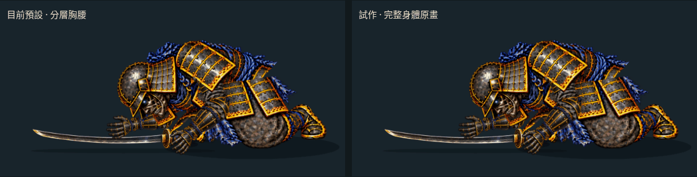
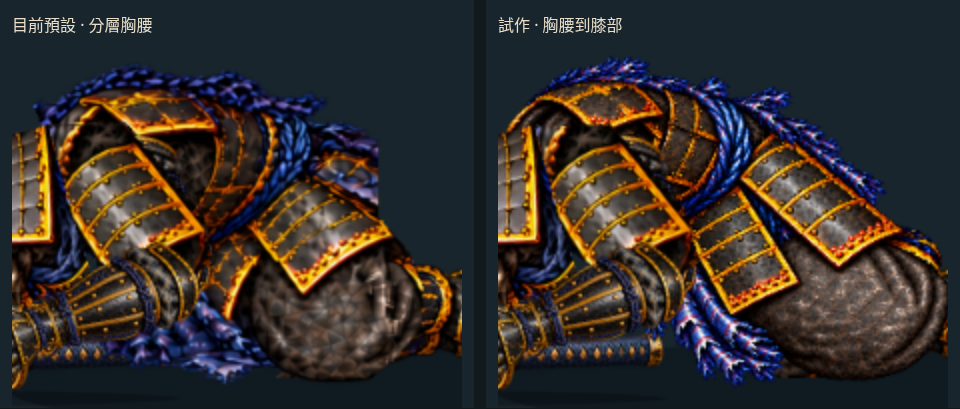

# 胸腰到膝部：完整過渡原畫試作

2026-10-17（台北時間）。分支 `art/jigoku-prerendered-2d`。**候選稿已能播放，但未採用為預設。**

[原速 30 fps 影片](free-arm-settle/body-normal-30fps.mp4) · [¼ 倍速 30 fps 影片](free-arm-settle/body-30fps.mp4) · [同步比較頁原始檔](free-arm-settle/body-review.html) · [手機畫面](free-arm-settle/body-mobile.jpg)



這輪將胸甲、骨盆、大腿與膝部畫成一張完整部件，再裝回既有頭盔、雙臂、肩甲、護脛及武器。新稿保留黑金甲、藍繩與兩片長裙甲，也處理第一稿浮在頭盔上方的空心領口。**單張形體較完整，接入動畫後兩端的換圖跳動仍增加。** 預設維持護脛提前放低版本；正式遊戲未替換。

## 實際裝配



放大圖來自同時刻的實際 Canvas；不是另畫的宣傳圖。[完整人物比較](free-arm-settle/body-comparison.png)。比較頁提供原速／¼ 倍速、播放、暫停、重播、拖曳及換格前後逐點查看。

- `?body=paint` 僅在 **1200 < 時間 ≤ 1240 ms** 取代 bridge 的胸部與下身，改畫一張完整部件；前後姿勢沿用預設。未帶參數或 `?body=original` 完全沿用原版。若同時指定 `hip=paint`，優先使用完整身體稿。
- 頭盔、近遠側手臂、肩甲、護脛及刀的貼圖、路徑與關節保持共用。新身體在護脛前方、頭盔及近側手臂後方；不疊回舊胸腰甲片。
- 原稿 **1536×1024**；以單一比例 **0.26**、旋轉 **−3°**，將來源人工肩點 `[520,390]` 對齊原 bridge 肩點 `[494,541]`。沒有拉伸、變形網格、溶接或 AI 補幀。
- 註冊後裁片 **291×207**，box `[419,480,710,687]`，新增約 **0.230 MiB RGBA8**，只在候選模式載入。這是貼圖理論解碼量，不含畫布或雙場景比較開銷，也不是手機顯存實測。
- 來源及輸出 alpha ≤ 16 的微弱邊緣清除；其餘顏色及透明度保留。身體跟隨現有肩點的小幅平移，瀏覽器檢查實際下緣未越過地面 `y=690`。這只驗證投影邊界，不代表接地受力已正確。

## 兩端換格結果

同一時間前後 ±0.001 ms 的實際右側畫布；全彩差值為 RGB 絕對差平均，尺度 0–255。輪廓變化為身體圖層 alpha > 16 遮罩的 XOR 像素數，越小表示此邊界改變的覆蓋區域越少。

| 交接 | 預設 RGB 差 | 候選 RGB 差 | 預設輪廓變化 | 候選輪廓變化 |
| --- | ---: | ---: | ---: | ---: |
| 1200 ms：進入新稿 | 4.4055 | 4.9964 | 7607 | 7647 |
| 1220 ms：既有肩甲分層 | 0.00959 | 0.000097 | 0 | 0 |
| 1240 ms：離開新稿 | 2.2896 | 3.0875 | 1899 | 3679 |
| 1320 ms：下一個身體換格 | 2.5910 | 2.5910 | 3310 | 3310 |

[完整量測](free-arm-settle/body-transition-check.json) · [候選實際截圖](free-arm-settle/handoffs/body/) · [同次預設截圖](free-arm-settle/handoffs/body-baseline/)

1220 ms 移除胸部裁片切換的小差異，但無法抵消 1200／1240 ms 的退步。新稿的胸部寬度、裙甲排列、膝部形狀和下一張 roll 原畫不同；尤其離開新稿時，膝部又突然縮小。色差及輪廓量測不是美術品質評分，這次視覺檢查也能看到不連續，因此沒有換成預設。

這輪驗證了「局部腰甲補繪」以外的完整身體替換流程，同時證明只單獨重畫中間一張仍不夠。下一步應先固定同一套胸甲、兩片裙甲、髖部與膝部的形狀，製作**前姿—中間姿—後姿整組**，對照肩、髖、膝及地面接點，再整組接入；不能繼續用彼此造型不同的單張生成圖堆幀。

## 來源、生成及重建

兩次 image gen，原始輸出均保留，沒有新增 Blender／Modal 工作或第三方下載：

1. [完整身體第一稿](../../../assets/source/jigoku-2d/ghost-rig/body-transition-study.png)，`exec-3ba8f6fe-2092-4a3a-bc29-bbb85bbab158.png`。參考實際 1199.999／1240.001 ms 胸腰圖層裁切，要求完整胸甲到膝部、雙片裙甲與相同黑金藍繩風格。第一稿上方空心領口裝配後明顯浮起，因此不用於執行。
2. [低伏胸部修稿](../../../assets/source/jigoku-2d/ghost-rig/body-transition-folded.png)，`exec-89c595a1-b373-4f06-bad0-93b8a21a1051.png`。參考第一稿與實際組裝人物，要求移除抬起的領口、頸部藏到左下頭盔後方、保留裙甲及大腿位置，不畫頭、手、護脛、刀。這張接入候選。

[完整註冊、生成檔名、來源與參考 SHA256](free-arm-settle/body-transition.json)。第一次參考圖保留在來源目錄，包含當時 torso/lower/waist/restore 圖層，未包含共用頭盔、肩甲、雙臂及獨立護脛。從 Canvas `[850,350,300,200]` 放大到 600×400 作參考，屬既有畫面的擷取，不是生成或重畫。

```sh
# 重新取得參考僅輸出至 .tmp，原始來源不覆寫
node tools/capture_body_transition_references.mjs
node tools/capture_fall_handoffs.mjs docs/routes/jigoku-2d/free-arm-settle/handoffs/body-baseline body previous
python tools/prepare_body_transition.py
node tools/capture_fall_handoffs.mjs docs/routes/jigoku-2d/free-arm-settle/handoffs/body body
python tools/check_body_transition_art.py
node tools/check_body_review_browser.mjs
python tools/package_body_review.py
```

46 項既有動作測試通過。素材檢查驗證來源雜湊、單一比例矩陣、肩點、可見像素、alpha、裁切及兩端量測。[瀏覽器檢查](free-arm-settle/body-browser-check.json) 驗證共用部件、實際繪圖矩陣、遮擋順序、地面邊界、區間外畫面完全一致、逐點控制、速度切換、暫停重播、390 px 排版及貼圖尚未載入時的縮放。

[影片檢查](free-arm-settle/body-video-check.json)：¼ 倍速 90 張實際瀏覽器畫面／3 秒，原速 30 張／1 秒，皆為 30 fps，末端含停留。MP4 只補偶數邊界，不縮放；GIF 共用色盤，逐取樣核對。30 fps 是播放頻率，不代表每秒 30 張新原畫，也不是生成影片或手機效能量測。

此分支尚未部署 Pages；GitHub 的 HTML 連結顯示原始碼，可直接看本頁動圖、PNG 及 MP4。前輪局部補繪見 [WAIST_TRANSITION.md](WAIST_TRANSITION.md)，目前預設見 [FREE_ARM_SETTLE.md](FREE_ARM_SETTLE.md)。
