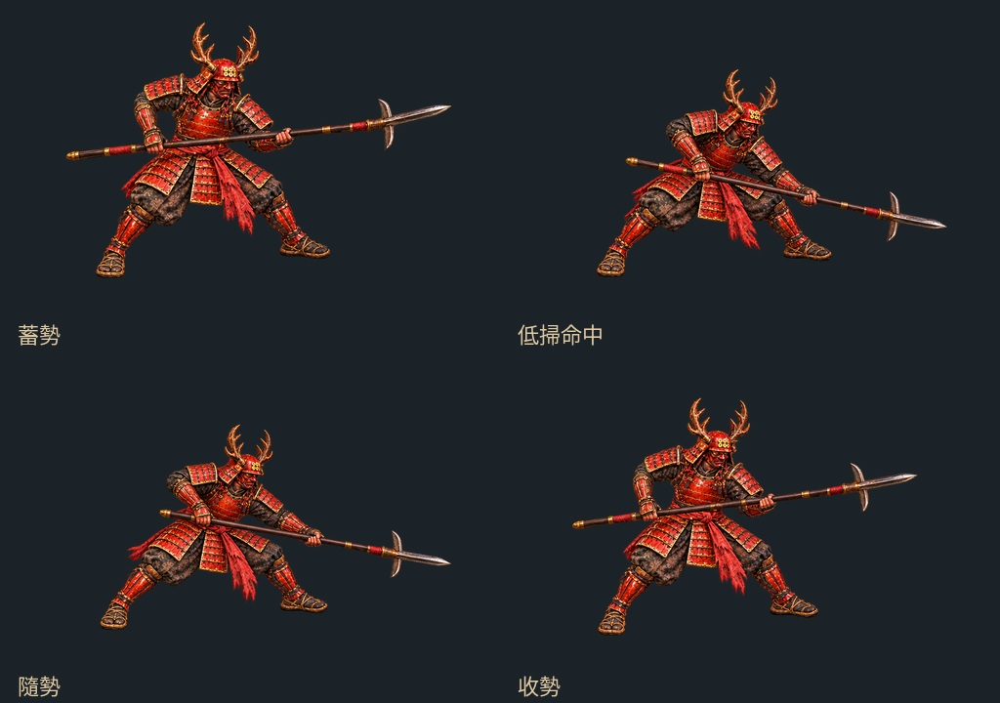
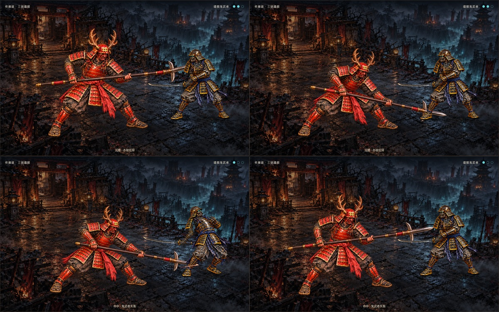
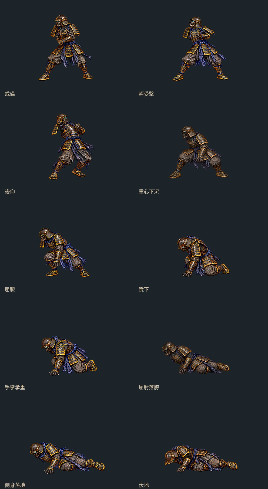
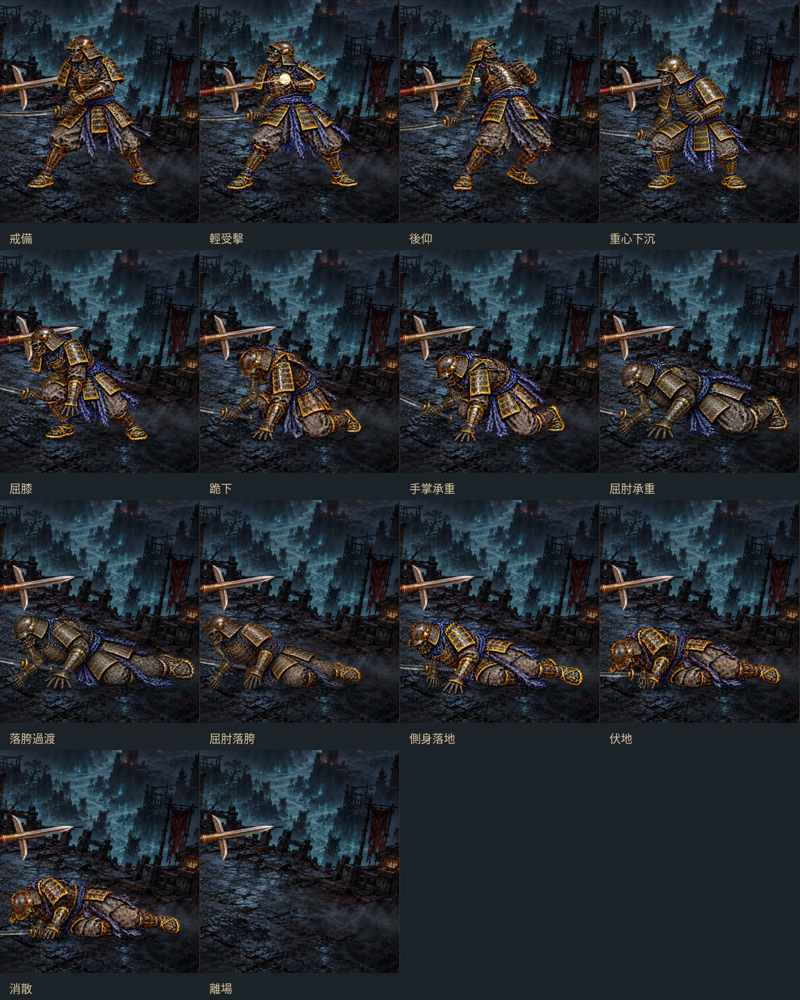
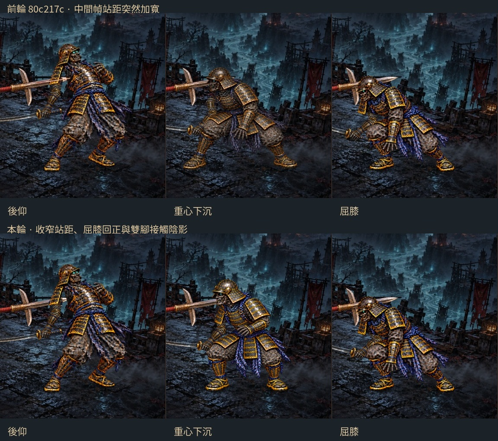
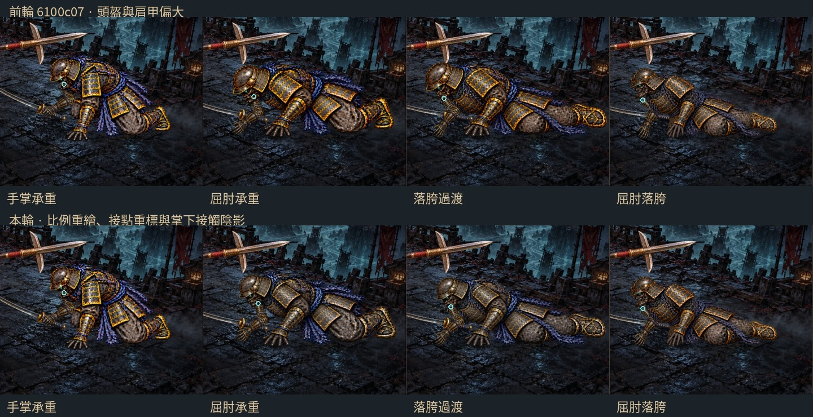
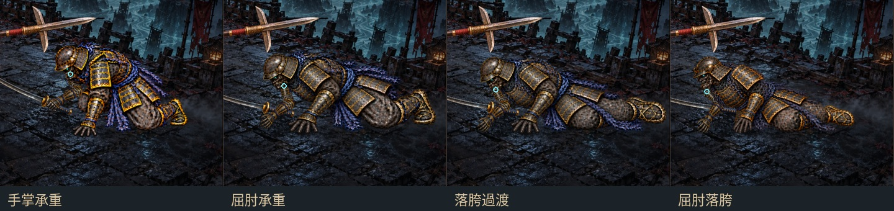
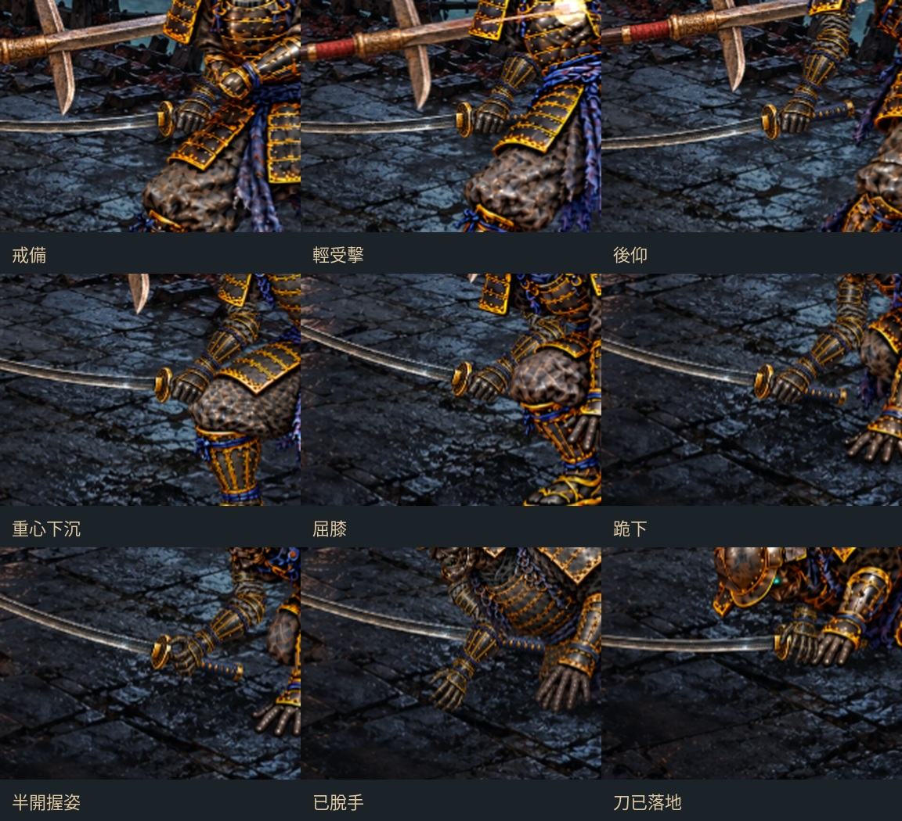
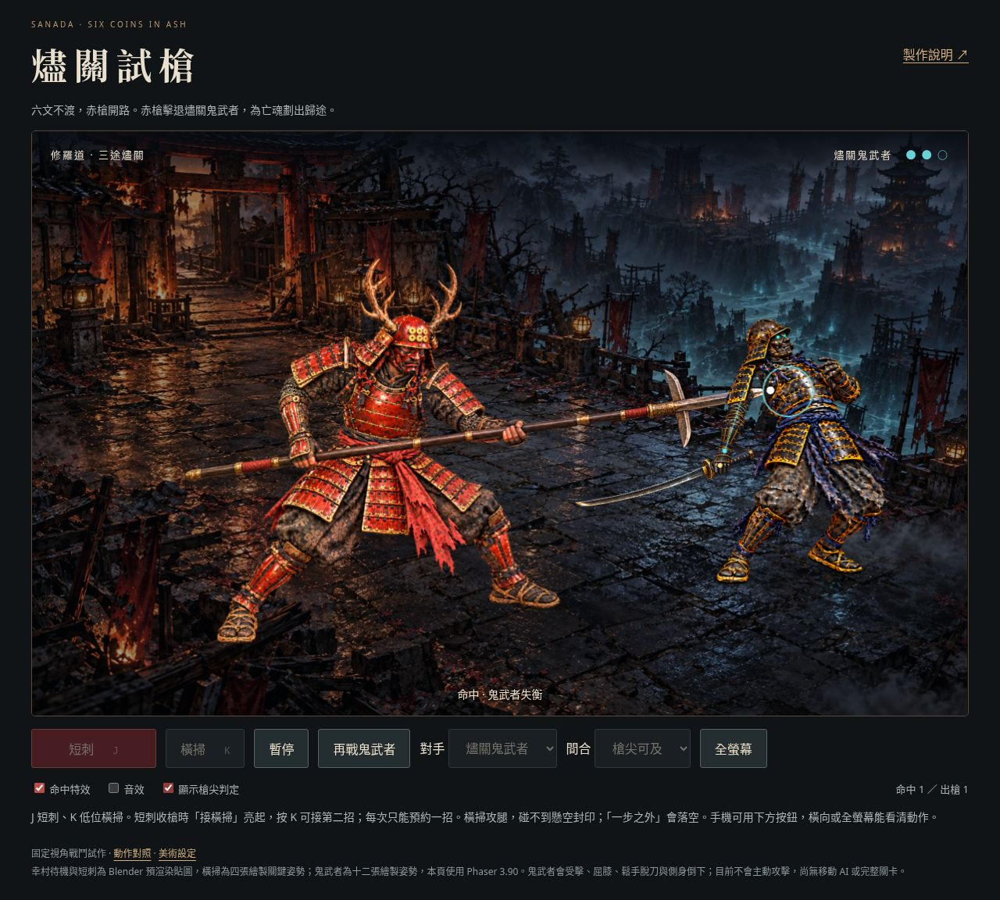
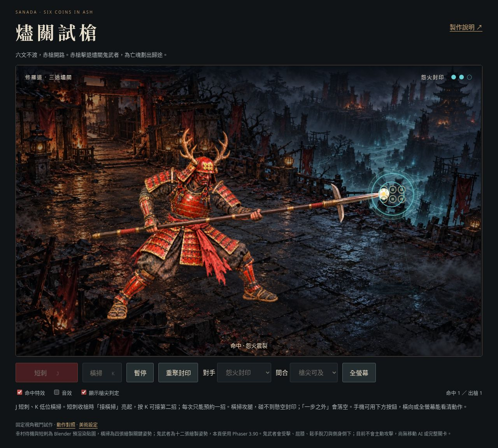

# 燼關試槍：短刺接低位橫掃

2026-10-15（Asia/Taipei）。分支 `art/jigoku-prerendered-2d`。


[連招 30 fps 影片](combat/combo-30fps.mp4) · [倒地 30 fps 影片](combat/combat-30fps.mp4) · [桌機截圖](combat/desktop.jpg) · [手機截圖](combat/mobile.jpg) · [試玩頁原始檔](combat/index.html)

上方為 **實際 Phaser 場景錄製**，不是新生成的動作影片。GitHub 可看 GIF 與截圖；HTML 要透過 HTTP 靜態伺服器開啟，目前此分支尚未部署到 GitHub Pages。線上 v22 遊戲沒有替換。

## 這輪能玩什麼

**六文不渡，赤槍開路。**

燼關前，守關的鬼武者仍握著生前的刀。他已忘記效忠誰，卻沒有忘記攔住每一個離去的人。幸村壓低身勢，收槍，踏穩——赤槍落處，讓這場戰爭先放過一個亡魂。

- 按 **J／空白鍵**，或手機的 **短刺** 按鈕：蓄勢、短刺、收槍。短刺不能重複出手，沒有按住連發。
- 按 **K／橫掃**：低位攻腿；短刺收槍時按鈕亮起為「接橫掃」，此時按 K 可預約一招，收槍完成後自動接續。重複按不增加攻擊次數。
- **對手**：預設燼關鬼武者；亦可切回上一輪怨火封印，短刺可命中封印，低掃碰不到懸空封印。
- **槍尖可及**：短刺槍尖進入上身、低掃槍尖進入近側腿部碰撞圓才扣血；三次命中擊倒鬼武者／破封。
- **一步之外**：目標位於射程外，出槍會刺空。改變間合會重置目標；攻擊途中不能切換。
- **再戰鬼武者／重聚封印**：重置血量、命中次數與攻擊動作；暫停、逐次試槍。
- **命中特效**：切換火星、短槍光軌、封印震動與小幅鏡頭震動；開關不改變傷害規則。70 ms 命中停頓屬於動作時序，保留。
- **音效**預設關閉，可自行開啟；為 Web Audio 合成的簡短出槍／命中聲，不是專業錄製的兵器音效。
- **顯示槍尖判定**：青圈是目標碰撞範圍，白點為槍尖，金點表示有效攻擊幀。此項用於動作檢查。

手機支援觸控；全螢幕依瀏覽器支援，亦可轉橫向。切到背景分頁會暫停，回來後手動繼續。偏好減少動態時，不啟用漂浮落燼與鏡頭震動。

## 本輪：第二招與接招時機



以原短刺的第一幀為 image gen 參考，補繪四張完整身體與槍的姿勢，等比例縮放、對齊兩腳後，直接作為 Phaser 貼圖。沒有放大短刺變形幅度，也沒有新增 Blender 渲染。這是低位斜掃的初版，轉腰幅度與槍身投影仍需再修。

- 32 個模擬幀以 30 Hz 更新，依序持有四張姿勢 **8／6／8／10 幀**，總長約 1.067 秒；命中另停頓 70 ms。**不是每秒 30 張新繪姿勢**。
- 短刺的零起算第 22–30 幀可預約一次橫掃；完成原短刺第 36 幀後接招。過早、過晚、暫停或已擊倒敵人時不接受預約；重置清除預約。
- 橫掃有效幀為零起算 9–16；先進入低姿態才開啟判定，避免蓄勢到低掃的大幅換圖路徑錯打懸空封印。近側腿圓心為目標根位置左側 55 px、場景 y=535，半徑 42 px。槍尖為人工標記，仍用線段對圓判定，每招最多扣血一次。
- 後腳標記對齊既有接地點；前腳標記與既有接地點差距小於 12 px。這是人工投影對齊，沒有跨姿勢骨架或解剖驗證。新舊角色的甲片、身高、握姿與槍長投影仍有差異，轉接仍會跳格。
- 低掃沿用敵人現有受擊與倒地圖，**尚未製作專用的腿部受擊／絆倒反應**。



[母圖](../../../assets/source/jigoku-2d/yari-sweep-poses.png) · [裁切與對齊紀錄](combat/sweep-art.json) · [槍尖與時序](combat/sweep-track.json) · [手機橫掃截圖](combat/mobile-sweep.jpg)

## 鬼武者的反應



敵人採黑漆甲、藍黑繫繩、鐵面頬與冷色眼神，與幸村赤甲區分。沿用十二張姿勢，前輪只重繪「重心下沉」一幀，讓站距與軀幹角度介於後仰、屈膝之間。持刀側手臂沿用獨立上臂、前臂與手，在 Phaser 中組合；另一隻支撐手臂畫在身體圖內。A、B 母圖為 1536×1024，C 為 2172×724；屈肘落胯沿用 C 的右半，以 2/3 等比例縮小。新的重心下沉母圖為 1536×1024，以 0.67 等比例縮小。兩張過渡姿勢改用同一張 2172×724 精修母圖，分別等比例縮小至 0.87／0.84，依支撐指尖及後腳跨度重新對齊。上圖只顯示身體分層，缺少的手臂會由遊戲中的共用部件補回。

- 非致命命中：輕受擊並與主角共同停頓 70 ms；停頓後輕受擊至 90 ms → 後仰至 220 ms → 輕受擊回正至 360 ms → 戒備。
- 最後一擊：停頓後，輕受擊至 90 ms → 後仰至 180 ms → 重心下沉至 250 ms → 屈膝至 330 ms → 跪下至 420 ms → 手掌承重至 500 ms → 屈肘承重至 540 ms → 落胯過渡至 580 ms → 屈肘落胯至 640 ms → 側身落地至 720 ms → 伏地至 1000 ms → 700 ms 漸淡，最後離場。以上為停頓結束後累計時間。
- 暫停也凍結敵人的反應時間；重置會立即恢復戒備與三點生命，沒有殘留的死亡回呼。
- 倒地圖已畫出膝彎、手臂承重與軀幹屈曲，程式不把站姿旋轉成橫躺木偶，也不做非等比壓縮。

**這是十二張關鍵姿勢切換，不是完整骨架動畫或 30 張不同敵人動作／秒。** 各圖的甲片與身體投影仍有生成差異，腳掌也尚未使用跨姿勢的 IK 約束。倒地總長仍為 1000 ms，再漸淡 700 ms。沿用前輪固定刀長、握刀手與上臂／前臂長度；身體本身仍是十二張姿勢切換，肩膀位置會隨姿勢跳變，尚非完整連續骨架動畫。屈肘與手掌承重仍不完整，分層清理也可能改變局部甲片與輪廓。



[實際受擊畫面](combat/enemy-hit.jpg) · [敵人原圖](../../../assets/source/jigoku-2d/ghost-warrior-poses.png) · [新增過渡原圖](../../../assets/source/jigoku-2d/ghost-warrior-inbetweens.png) · [重心過渡原圖](../../../assets/source/jigoku-2d/ghost-warrior-weight-shift.png) · [裁切、接地與來源紀錄](combat/enemy-art.json)

## 前輪：修正後仰至屈膝的站距



前輪的「重心下沉」雙腳突然站得比前後兩幀更開，隨後又收回，形成明顯的橫向滑步。本輪重繪這一張中間姿勢：收窄站距、屈膝下沉、上身由後仰回正，近側手先回到腹前，再接下一幀的低姿態。

- 沿用原本 180–250 ms 的下沉階段，沒有增加姿勢數、圖集大小或延長倒地時間。
- 新圖重新標記肩腕接點，沿用固定 65／75 px 手臂；後仰、下沉、屈膝三幀各自補上雙腳接觸陰影。
- 以人工標記的鞋底中心作對照，前後兩次切換的最大腳位移由約 **66.87 降至 30.35 px**（1200×750 場景座標）。[量測紀錄](combat/recoil-check.json) 保留前輪標記與本輪資料。這是人工投影點比較，**不是自動像素追蹤、腳底鎖定或物理承重驗證**。
- 新圖與前後幀的甲片、布料及頭部角度仍不完全一致；只是減少中間幀突然跨開雙腿的問題，還不能視為連續骨架動畫。

[新下沉姿勢母圖](../../../assets/source/jigoku-2d/ghost-rig/recoil-buckle.png) · [前輪三姿勢擷取](combat/recoil-before.jpg) · [本輪三姿勢擷取](combat/recoil-after.jpg)

## 前輪：比例與材質精修



較早版本的兩張過渡圖頭盔、肩甲偏大，金邊也比相鄰姿勢更亮，切換時像突然換了體格。前輪以相鄰的撐地／落胯姿勢作比例參考，透過一次 image gen 編修，縮小頭盔與面頬、收合肩甲，調整手部輪廓，將金邊改成較收斂的舊黃銅亮度。

生成結果仍會改變構圖，因此重新等比例對齊兩姿勢，並重標肩、腕接點。四個承重姿勢增加掌下接觸陰影，依各姿勢人工標記的支撐指尖位置繪製；沒有增加紋理、即時光照或物理模擬。上圖前輪來自 `6100c07` 的實際瀏覽器擷取，本輪來自重新錄製的 Phaser 畫面。

只替換兩個既有圖集格子，沒有增加角色姿勢數或圖集顯示記憶體。其餘十張身體圖的可見像素與 alpha 保持原樣。**甲片排列、膝部與接地輪廓仍有生成差異**；這是局部造型精修，不能視為已完成角色一致性或真實承重模擬。

[本輪精修母圖](../../../assets/source/jigoku-2d/ghost-rig/shoulder-refined.png) · [前輪畫面](combat/proportion-before.jpg) · [圖集來源與比例](combat/enemy-art.json)

## 肩部與軀幹過渡



原本「手掌承重 → 屈肘落胯」的肩接點一次跳 **81.48 px**（1200×750 場景座標）。前輪補繪後最大單次位移為 42.06 px；本輪重繪並重標接點後，三次位移為 **32.40、26.87、27.06 px**。最大單次位移較前輪再減少約 **23%**，較最初直接切換減少約 **60%**。數值來自實際瀏覽器中的上臂圖層位置，詳見 [量測紀錄](combat/shoulder-check.json)，不是整個動作品質的評分。

- 新姿勢各停留 40 ms，確保 30 fps 取樣時能顯示；原有脫刀時間 500 ms、著地 780 ms、開始消散 1000 ms 不變。
- 身體圖層位置、尺寸與旋轉保持固定；過渡靠新畫出的軀幹／屈肘輪廓。沒有為追趕肩點而平移整個角色、拉長手臂或交叉淡化兩個人體。
- 新圖以支撐手掌落點作人工對齊參考，**不代表腳掌或膝蓋已被 IK 鎖住**。頭盔大小、甲片與腿部投影仍有生成差異；肩接點也仍是離散切換。此輪只改善上述承重段，其他段落還有跳動。
- 目前兩姿勢共同使用 [精修母圖](../../../assets/source/jigoku-2d/ghost-rig/shoulder-refined.png) 的左右兩半。[前輪屈肘母圖](../../../assets/source/jigoku-2d/ghost-rig/shoulder-yield.png) 與 [前輪落胯母圖](../../../assets/source/jigoku-2d/ghost-rig/shoulder-sink.png) 保留供比較。

## 固定臂長與鬆手



持刀側由共用的上臂、前臂與手組合，不再依賴十二張身體圖各自畫出不同長度的手臂。原有刀與握緊手繼續使用，沿用半開、張開兩張手部姿勢。

- 上臂與前臂的關節距離固定 **65／75 px**（場景比例 0.6，為 39／45 px）。手臂採加厚布料與籠手的重繪圖，等比例對齊相同關節長度，沒有沿橫向拉扯貼圖。兩段 IK 根據肩膀與目標腕點計算肘部；超出範圍時限制伸手距離，不拉長貼圖，彎肘方向固定，避免翻肘。
- 目標腕點在肩膀的局部座標中平滑變化，手掌長軸跟隨前臂方向。肩膀接點仍隨身體圖切換，**世界座標中的手臂仍可能跳動**，不是全身連續骨架動畫。固定長度與局部連續已驗證；身體接縫與肩甲遮擋仍需視覺精修。
- 致命受擊停頓結束後 **430 ms 半開握姿、500 ms 張開並脫刀**。刀從最後的 IK 握點出發，沿 280 ms 固定拋物線落地，780 ms 著地。手指目前只有三張狀態圖，未做逐根手指骨架。
- 刀保持同一張 410×51 圖，場景圖寬固定 246 px；鬆手後右手臂仍顯示。刀、手臂與身體一起消散，暫停和重置共同生效。落刀尚無物理引擎碰撞或刀刃反彈。
- 繪製順序為刀、遠側上臂／前臂、身體、手，讓肩甲遮住肩部接點。另一隻手臂仍畫在身體圖內。



開啟「顯示槍尖判定」可看青色肩—肘—腕連線與金色握點。上述近照與骨架圖都取自實際 Phaser 畫面，沒有另畫示意人物。

[接點與來源紀錄](combat/enemy-rig.json) · [半開與張開手母圖](../../../assets/source/jigoku-2d/ghost-rig/arm-parts.png) · [加厚上臂／前臂母圖](../../../assets/source/jigoku-2d/ghost-rig/arm-parts-stocky.png) · [共用刀與握緊手](../../../assets/source/jigoku-2d/ghost-rig/katana-hand.png) · [身體分層 A](../../../assets/source/jigoku-2d/ghost-rig/arm-bodies-a.png) · [B](../../../assets/source/jigoku-2d/ghost-rig/arm-bodies-b.png) · [C](../../../assets/source/jigoku-2d/ghost-rig/arm-bodies-c.png)

## 從動作到命中

沿用上一輪的 **15 個固定肢段與骨盆／雙膝連動**。待機與短刺沿用原有 Blender 動作；橫掃另用上述四張新姿勢，敵人沿用十二個姿勢。

1. 待機／短刺仍為 30 fps 貼圖；Phaser 負責場景、貼圖渲染、輸入、粒子與 tween。
2. 在原插畫手動標記槍尖 `(1520, 350)`，套用與 Blender 動畫相同的槍位移，再換算為場景座標。碰撞資料來自 [spear-track.json](combat/spear-track.json)。
3. 僅在第 **15–16 幀**有效（零起算 14–15）。使用前後槍尖位置的線段對圓判定，避免低更新頻率越過碰撞位置。每次攻擊最多傷害一次。
4. 命中時角色動畫停頓 70 ms，同時觸發火星與封印震動；收槍完成才開始下一招；短刺收勢期間可預約一次橫掃。
5. 前腳與後腳腳尖沿用固定接觸點，在對應位置加接地陰影；背景是新生成的一張空場景畫，沒有預先畫死的人物。



這是固定站位、單目標的戰鬥回饋試作。鬼武者會受擊與倒下，目前不主動攻擊；封印仍可選作測試目標。**沒有敵人 AI、移動尋路、方向切換或完整關卡；目前只有短刺接低掃這一組連招**。背景石台不是可碰撞地形；陰影、人物高光與材質不是即時 3D 光照。圖層膝踝接縫與肩胯轉動仍有改善空間。

## 引擎與成本

使用 **Phaser 3.90.0／MIT**，從 npm 官方套件取得，將固定版本與授權一併放在 [vendor](combat/vendor/)。已核對 npm 套件 SHA512，並保存 [來源與檔案 SHA256](combat/vendor/PROVENANCE.json)。執行時不依賴外部 CDN，不修改主遊戲的 Babylon.js 或根目錄依賴。

| 載入方式 | 角色每幀 | 角色圖集 RGBA8 記憶體 |
| --- | --- | --- |
| 小於 900 px 的視窗 | 512×320 | 待機＋短刺，共約 45 MiB |
| 桌機視窗 ≥ 900 px | 1024×640，兩頁／動作 | 待機＋短刺，共約 180 MiB |

敵人另加一張十二姿勢圖集，改排為 3 欄 × 4 列，兩邊尺寸均小於 4096：手機 2304×2048，約 **18 MiB**；桌機 3456×3072，約 **40.5 MiB**。共用刀、兩段手臂與三張手圖另加 180,396 bytes（約 0.172 MiB），橫掃另加手機 2.5／桌機 10 MiB，合計角色貼圖約 65.67／230.67 MiB，尚不含背景、渲染緩衝與可能的 mipmap。此頁只載入暖火光一種角色補光。壓縮檔案大小不等於顯示記憶體；正式手機遊戲還需要 KTX2／更小圖集、按需換動作，以及實機效能量測。圖集規格在進入頁面時選擇，旋轉或調整視窗不會中途重新載入另一套。

新背景母圖為 1536×1024，參考既有地獄概念圖，以 image gen 生成一次無人物石台，再輸出 WebP。來源見 [原圖](../../../assets/source/jigoku-2d/combat-arena.png) 與 [素材紀錄](combat/art-provenance.json)。幸村待機／短刺重用既有 Blender CPU 輸出；本輪橫掃為一次 image gen 的四張姿勢。鬼武者沿用前輪圖集與手臂部件，沒有重新建模或打光。沒有使用 Modal／GPU 建模。

## 驗證與重建

- [連招影片檢查](combat/combo-video-check.json)：90 張實際瀏覽器截圖、固定 30 fps、3 秒；確認兩招兩次傷害、四張橫掃姿勢確實顯示、K 接招與手機觸控。GIF 另逐幀解碼核對，非實機效能量測。

比對 `80c217c` 的十一張未修改姿勢：桌機與手機版的可見像素、alpha 均未改變；WebP 完全透明區域的 RGB 可能因壓縮而不同。「重心下沉」以外的十一張造型沿用前輪，圖集大小與姿勢數也相同。

- [兩套圖集邊界檢查](combat/art-check.json)：桌機／手機各十二個身體輪廓，確認近距站位下不被 1200×750 畫面裁切，兩張圖集均在 4096 尺寸內。曾發現落胯過渡的後腳超出右緣，已調整等比例縮放並加入此回歸檢查；不包含獨立手臂／武器，也不驗證人體解剖。另外檢查後仰、下沉與屈膝的人工鞋底中心標記，避免重新出現大於 35 px 的相鄰位移。
- 共 **21 項**規則檢查（另新增 [5 項低掃與接招檢查](../../../tools/check_jigoku_sweep.mjs)，涵蓋命中／落空、單次接招、暫停與重置、不同更新步長、命中停頓與擊倒後輸入）：[10 項戰鬥規則檢查](../../../tools/check_jigoku_combat_state.mjs)：三擊破封、防重複傷害、有效幀與停頓、遠距離刺空、不同更新間隔、暫停與重置、線段碰撞邊界、敵人反應順序、反應暫停與重置、目標切換、非致命受擊回正且不進入倒地姿勢；另有 [6 項手臂與共用武器檢查](../../../tools/check_jigoku_enemy_weapon.mjs)，驗證握點距離、脫手瞬間連續、落地高度、暫停與重置、各姿勢固定臂長、不可達目標、局部曲線連續、鬆手時序、承重段最大肩位移下降，以及不同 30 Hz 取樣起點都會顯示兩張新姿勢。
- [瀏覽器檢查結果](combat/browser-check.json)：實際 Phaser 載入、桌機 HD 與手機圖集、鍵盤／觸控、命中／刺空／破封、暫停、特效關閉、鬼武者受擊姿勢、錄影逐幀核對實際圖集索引、身體位置／尺寸固定與零旋轉、實際上臂／前臂圖層接點跟隨骨架、固定刀圖尺寸、握緊／半開／張開貼圖確實切換、逐幀臂長與武器透明度、完整死亡順序、閃光到期清除與錯誤請求檢查。
- [影片檢查](combat/video-check.json)：78 張實際瀏覽器畫面、固定 30 fps、2.6 秒；影片從敵人剩一點生命開始，呈現最後一擊與倒地。錄影在 Phaser 啟動前安裝可控時鐘，再取樣畫面，避免更換時鐘打亂 TweenManager 的時間基準；不代表實體手機可以穩定 30／60 fps。GIF 以 30／30／40 ms 近似，均勻幀間隔請看 MP4。

從 repo 根目錄啟動 Python 靜態伺服器後，開啟 `/docs/routes/jigoku-2d/combat/` 路徑。此頁不用額外安裝 npm 依賴；檢查腳本沿用 repo 的 Playwright／Chromium。

```sh
python3 -m http.server 8080
# 另開終端執行檢查與重建：
python3 tools/prepare_jigoku_combat.py
python3 tools/prepare_ghost_warrior.py
python3 tools/check_jigoku_enemy_art.py
python3 tools/prepare_yari_sweep.py
node --test tools/check_jigoku_combat_state.mjs tools/check_jigoku_enemy_weapon.mjs tools/check_jigoku_sweep.mjs
node tools/check_jigoku_combat.mjs
python3 tools/package_jigoku_combat_preview.py
python3 tools/package_jigoku_combo_preview.py
```

圖像重新打包需 Pillow／NumPy；瀏覽器錄影打包需 FFmpeg。瀏覽器檢查會自行啟動並關閉臨時 HTTP 伺服器。

下一步先修正短刺與橫掃交接的身形、槍長投影與手位，再補轉腰中間姿勢及低掃專用受擊圖；目前不宜把四張姿勢的跳格當作完整連續動畫。
