# 燼關試槍：共用頭盔與連續轉頭

2026-10-16（台北時間）。分支 `art/jigoku-prerendered-2d`。

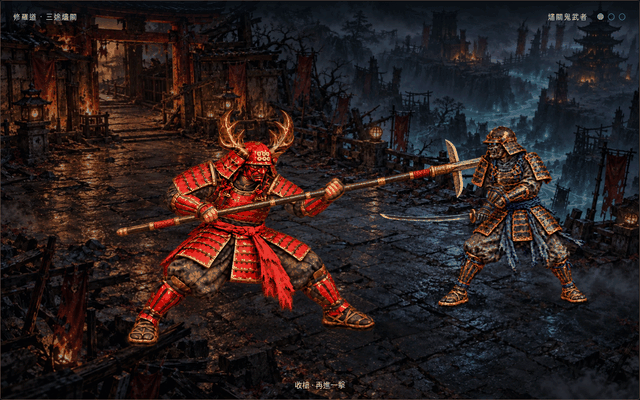

[本輪連招 30 fps 影片](combat/combo-30fps.mp4) · [打斷蓄刀 30 fps 影片](combat/enemy-recoil-30fps.mp4) · [交鋒 30 fps 影片](combat/duel-30fps.mp4) · [交鋒桌機](combat/duel-desktop.jpg) · [交鋒手機](combat/duel-mobile.jpg) · [手機承力格擋](combat/duel-mobile-guard.jpg) · [低掃擊倒 30 fps 影片](combat/low-hit-30fps.mp4) · [倒地 30 fps 影片](combat/combat-30fps.mp4) · [桌機截圖](combat/desktop.jpg) · [手機截圖](combat/mobile.jpg) · [試玩頁原始檔](combat/index.html)

上方為 **實際 Phaser 場景錄製**，不是新生成的動作影片。GitHub 可看 GIF 與截圖；HTML 要透過 HTTP 靜態伺服器開啟，目前此分支尚未部署到 GitHub Pages。線上 v22 遊戲沒有替換。

## 最新：共用頭盔與連續轉頭

[側倒動圖、30 fps 影片及驗證](FREE_ARM_SETTLE.md) · [檢視頁原始檔](free-arm-settle/index.html)


把既有頭盔與面部拆成同一張共用部件，保持大小與紋理一致，側倒時連續平移、旋轉。四次換格的輪廓重疊及全彩差異均改善，新增前輪／共用頭盔同步比較。36 項動作測試、1601 個頭部取樣與桌機／手機檢查通過，更新 30 fps 影片；肩甲遮擋及頸部接縫仍待精修，未替換正式遊戲。

## 前輪：五姿勢蹲跪接續

[動圖、30 fps 比較與驗證](FREE_ARM_TRANSITION.md) · [檢視頁原始檔](free-arm-transition/index.html)

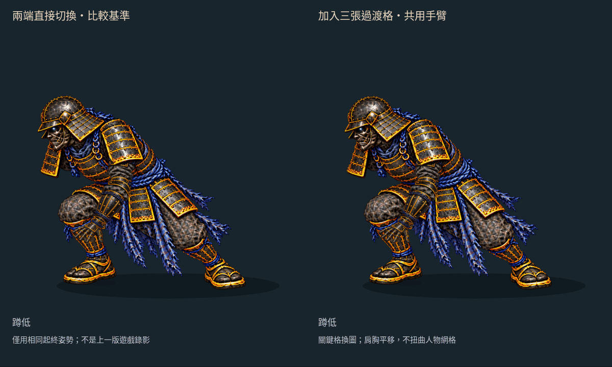

新增重心前移、後膝降低、近地三張插畫，接到既有蹲姿與跪姿；共用手臂跟隨連續肩點，420 ms 後沿用掌根固定與屈肘下沉。13 項相關測試、素材與桌機／手機檢查通過。這是五張關鍵原畫的獨立試作，30 fps 是播放頻率；末段收腳與衣甲輪廓仍待精修，尚未替換正式戰鬥。左側是本輪建立的兩端切換比較，不是歷史遊戲錄影。

## 前輪：跪地撐掌與屈肘下沉

[接地試作、30 fps 影片與驗證](FREE_ARM_SUPPORT.md) · [檢視頁原始檔](free-arm-support/index.html)

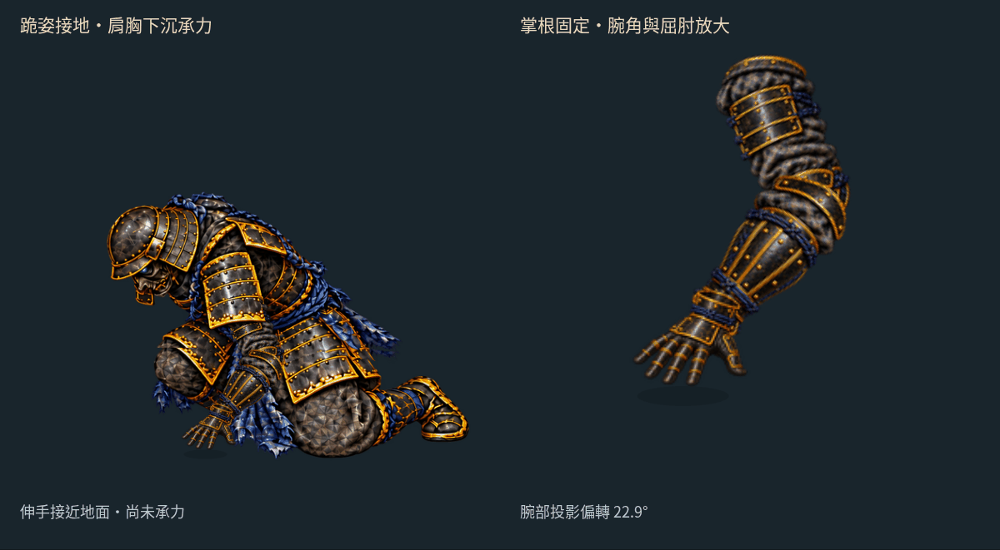

沿用 85／90 px 上臂與前臂，新增跪姿遮擋底圖和專用撐掌。掌根接地後固定，肩胸再下降 8 px，肘部彎曲承接位移，膝腳保持原位。8 項相關測試與桌機／手機實際繪圖矩陣檢查通過。這是獨立跪姿段，**蹲跪全身過渡尚未完成，也未替換戰鬥動作**。

## 前輪：共用空手部件已能實際轉動

[可動試裝、接縫放大與驗證](FREE_ARM_PARTS.md) · [試裝頁原始檔](free-arm-parts/index.html)


本輪沿用既有上臂、前臂與兩張手形，接到固定 85／90 px 骨架；另以一次 image gen 補出移除空手後的胸甲與腰帶底圖，加入肩甲遮擋片。這是固定蹲姿的伸手預備，**手尚未接地，也未替換戰鬥動作**。肘部護甲重疊與手形換圖仍需精修，完整限制見試裝紀錄。

5 項骨架／部件測試、素材來源與桌機／手機實際繪圖矩陣檢查通過。以下遊戲錄影仍為 `494bdc1` 的正式圖集版本。

## 前輪：先檢查空手臂能否自然接地

[骨架試算與未採用修稿](FREE_ARM_STUDY.md) · [互動檢視頁原始檔](free-arm/index.html)

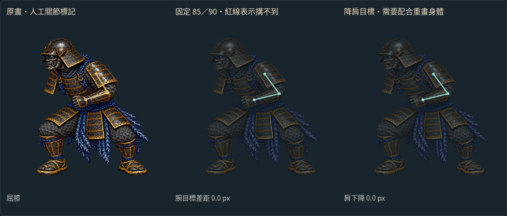

這輪新增固定長度空手臂的可達性檢查與可播放檢視頁。以候選 85／90 px 臂長計算，現行跪地圖的肩腕距離超出約 33 px；一次 image gen 試修減到約 10 px，但仍不足以確認可直接共用骨架。原畫關節是人工估計，試修稿保留作比較，**尚未替換遊戲或原圖集**。綠色骨架顯示需重畫的肩部位置，不是完成的全身動畫。

已完成 3 項新骨架測試、桌機／手機檢視與素材隔離檢查；完整數值、限制與下一步見上方紀錄。以下遊戲畫面維持 `494bdc1` 的蹲低修稿版本。

## 這輪能玩什麼

**六文不渡，赤槍開路。**

燼關前，守關的鬼武者仍握著生前的刀。他已忘記效忠誰，卻沒有忘記攔住每一個離去的人。幸村壓低身勢，收槍，踏穩——赤槍落處，讓這場戰爭先放過一個亡魂。

- 按 **開始交鋒**：鬼武者開始主動出刀，雙方各三格血；初始仍為姿勢練習，載入畫面時不會被偷襲。結束交鋒會回到練習並重置。
- 按 **L／格擋**：短暫防禦 580 ms，從按下起 1100 ms 後可再用。格擋中不能出槍，出槍中不能格擋；太早按會在刀到前失效。手機有獨立按鈕。
- 按 **J／空白鍵**，或手機的 **短刺** 按鈕：蓄勢、短刺、收槍。短刺不能重複出手，沒有按住連發。
- 按 **K／橫掃**：低位攻腿；短刺收槍時按鈕亮起為「接橫掃」，此時按 K 可預約一招，收槍完成後自動接續。重複按不增加攻擊次數。
- **對手**：預設燼關鬼武者；亦可切回上一輪怨火封印，短刺可命中封印，低掃碰不到懸空封印。
- **槍尖可及**：短刺槍尖進入上身、低掃槍尖進入近側腿部碰撞圓才扣血；三次命中擊倒鬼武者／破封。
- **一步之外**：目標位於射程外，出槍會刺空。改變間合會重置目標；攻擊途中不能切換。
- **再戰鬼武者／重聚封印**：重置血量、命中次數與攻擊動作；暫停、逐次試槍。
- **命中特效**：切換火星、短槍光軌、封印震動與小幅鏡頭震動；開關不改變傷害規則。70 ms 命中停頓屬於動作時序，保留。
- **音效**預設關閉，可自行開啟；為 Web Audio 合成的簡短出槍／命中聲，不是專業錄製的兵器音效。
- **顯示槍尖判定**：青圈是目標碰撞範圍，白點為槍尖，金點表示有效攻擊幀。此項用於動作檢查。

手機支援觸控；全螢幕依瀏覽器支援，亦可轉橫向。切到背景分頁會暫停，回來後手動繼續。偏好減少動態時，不啟用漂浮落燼與鏡頭震動。

## 前輪：蹲低時保留同一套鎧甲，收攏伸出的手指

[短刺擊倒 30 fps MP4](combat/combat-30fps.mp4) · [低掃擊倒 30 fps MP4](combat/low-hit-30fps.mp4) · [手機蹲低・短刺](combat/crouch-consistency-thrust-mobile.jpg) · [手機蹲低・低掃](combat/crouch-consistency-sweep-mobile.jpg)

前輪修了屈膝圖，下一張蹲低仍換成不同的膝部衣料、腰甲和張開手掌。本輪用 **一次 image gen 修稿**，以目前的屈膝、蹲低及接續跪地三格為參考，只替換桌機／手機圖集的 **第 4 格（零起算）**。

- 膝部改為更接近屈膝圖的菱格衣料，整理頭盔、面罩、腰甲與藍色衣帶；空手側向前膝伸下，手指比原稿收攏。**手掌仍偏張開，尚未完成由握拳逐漸鬆開的連續動作。**
- 原圖 1536×1024，使用 **0.49 倍等比例縮放與平移 `[138,234]`**，沒有非等比拉伸。手工重標持刀側肩點及鞋底；持刀臂仍接既有 65／75 px 部件，局部腕目標 `[-65,121]` 保留。
- 相對 `f97f3a1`，肩點移動 **10.595 px**，兩個鞋底中心移動 **4.661／3.700 px**（原畫座標；遊戲中乘 0.6）。這些是人工接點註冊差異，並非自動追蹤或解剖正確性的證明。
- 其餘 **11 格 × 兩種解析度，共 22 格**的可見 RGB 與 alpha 保留，包括前輪屈膝修稿。沒有增加動畫格或貼圖尺寸，角色 RGBA8 估算維持 **桌機 57.599 MiB／手機 25.245 MiB**；沒有實體手機 FPS 測量。
- 命中、收步、250–330 ms 蹲低、鬆手及落刀時序保留。**後續跪地原畫尚未重畫，手臂移動、肩位與衣帶輪廓仍會切換**；本輪是插畫一致性修稿，沒有完成連續全身倒地動畫。

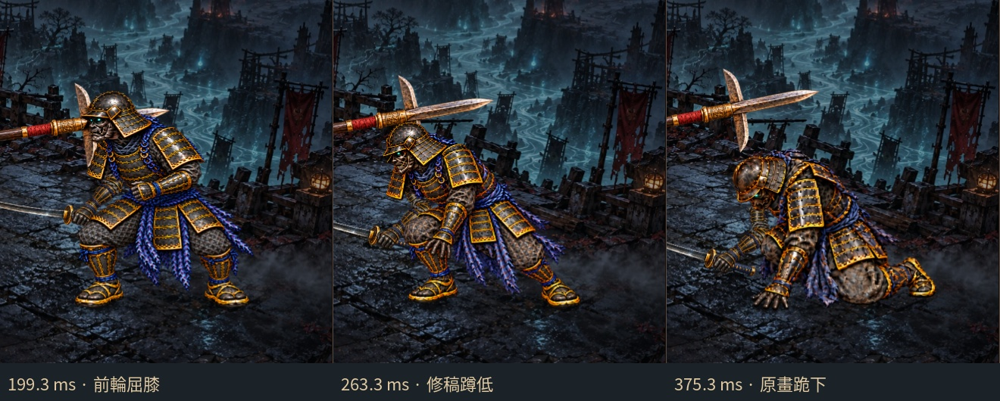

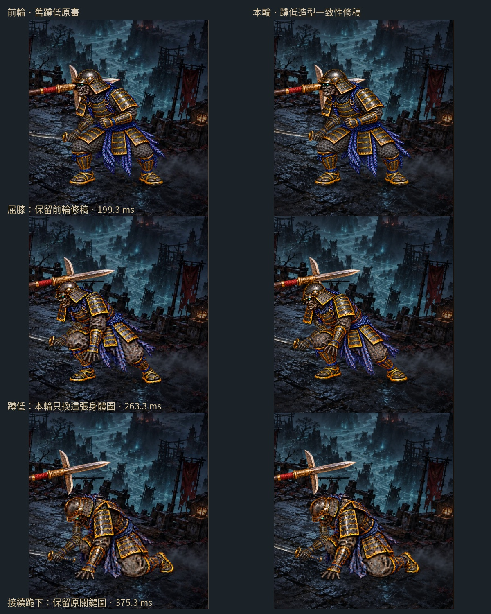

[低掃前後對照](combat/crouch-consistency-sweep-comparison.jpg) · [低掃三姿勢](combat/crouch-consistency-sweep-sequence.jpg) · [素材與接點檢查](combat/crouch-consistency-art-check.json) · [錄影配對紀錄](combat/crouch-consistency-check.json) · [新原畫](../../../assets/source/jigoku-2d/ghost-rig/crouch-consistent.png)。左側取 `f97f3a1` 已提交的影片，右側為本輪實際 Phaser 截圖；依反應階段與最近時間配對，差異記錄於 JSON。兩段擊倒影片各 78 幀、30 fps／2.6 秒；image gen 只修角色原畫，沒有生成遊戲錄影。

## 前輪：讓屈膝時的頭盔與空手側更接近前姿勢

[短刺擊倒 30 fps MP4](combat/combat-30fps.mp4) · [低掃擊倒 30 fps MP4](combat/low-hit-30fps.mp4) · [手機屈膝・短刺](combat/buckle-consistency-thrust-mobile.jpg) · [手機屈膝・低掃](combat/buckle-consistency-sweep-mobile.jpg)

前輪已對齊肩臂並加入交替收步，但切到屈膝原畫時，頭盔、面罩、空手側及膝部造型仍像換了一套。這輪用 **一次 image gen 修稿**，參考遊戲目前的胸甲部件與真實交接畫面，重畫屈膝身體圖；已替換桌機與手機圖集中的 **第 3 格（零起算）**。

- 頭盔及面罩改為較接近共用胸甲的造型與朝向；空手側由張開的手掌改為橫在腹前的握拳，膝部衣料也收斂。這是插畫修稿，沒有新增 3D 模型。
- 生成圖的整體尺寸變大，因此依原鞋底間距做 **0.5025 倍等比例縮放與平移**，沒有非等比拉伸或整身扭曲。肩點重新手工標記，持刀側仍接原本的獨立手臂與刀。
- 肩點相對前版變動約 **0.143 px**，左右鞋底標記分別約 **0.782／0.687 px**（原畫座標）；原握刀局部距離、收步、180 ms 交接、後續鬆手與脫刀時序保留。這些數值只驗證接點註冊，不代表解剖或輪廓完全一致。
- 其餘 **11 格 × 桌機／手機共 22 格**的可見 RGB 與 alpha 未變，共用胸甲、雙腿、手臂及武器貼圖也未換。現有圖集尺寸不變，角色 RGBA8 估算維持 **桌機 57.599 MiB／手機 25.245 MiB**；圖集下載檔案大小略增。
- **仍是單格修整，尚非連續全身動畫。** 頭部位置、空手臂角度、膝甲和衣帶輪廓仍有差異，接續蹲低與跪地圖也未重畫。下方保留三姿勢對照，沒有只展示修過的單張圖。

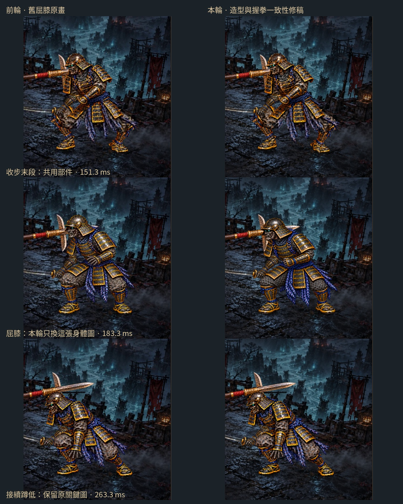

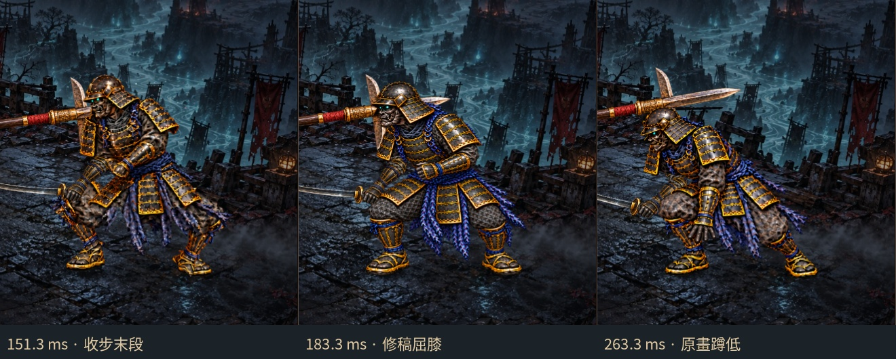

[低掃前後對照](combat/buckle-consistency-sweep-comparison.jpg) · [低掃三姿勢](combat/buckle-consistency-sweep-sequence.jpg) · [素材及接點檢查](combat/buckle-consistency-art-check.json) · [錄影取樣紀錄](combat/buckle-consistency-check.json) · [新修稿原圖](../../../assets/source/jigoku-2d/ghost-rig/buckle-consistent.png)。對照左側取 `893bb9d` 已提交影片，右側為本輪實際 Phaser 截圖；兩段新擊倒影片各 78 幀、30 fps／2.6 秒。image gen 只產生身體原畫，沒有生成遊戲錄影。

## 前輪：下沉時交替收步，減少腳位突然切換

[短刺擊倒 30 fps MP4](combat/combat-30fps.mp4) · [低掃擊倒 30 fps MP4](combat/low-hit-30fps.mp4) · [手機短刺收步](combat/enemy-footwork-thrust-mobile.jpg) · [手機低掃收步](combat/enemy-footwork-sweep-mobile.jpg)

前輪已讓致命命中的肩臂與握刀接續，但下沉時雙腳固定，180 ms 切到屈膝原畫後卻突然收窄。現在用**先右腳、再左腳的短促失衡收步**，把腳位變化放進實際動作；另一腳留在地面，腿部仍保持固定長度。

- 右腳於受擊後 **10–75 ms** 收進，接著 **10 ms 雙腳支撐**；左腳於 **85–175 ms** 收進。兩腳各有小幅抬離地面的弧線，不同時騰空，命中停頓與暫停會凍結整副姿勢。
- 到 175 ms，兩個人工標記的鞋底中心對齊既有屈膝圖；180 ms 的原畫交接時間不變。仍保留原肩臂、刀與後續跪下、鬆手、落刀時序。
- **接觸陰影跟著腳下位置移動**，抬腳時變淡、略放寬，落地後恢復。待機、非致命受擊及出刀也改由同一鞋底標記定位陰影，不再只用粗略固定偏移。
- 這是固定視角的平面動作與人工接點，**不是真正受力、步態或三維腳掌模擬**。鞋型、膝甲與大腿輪廓仍來自不同原畫，頭盔與空手側的跳動也尚未修完；對齊鞋底中心不等於輪廓完全一致。
- 沒有新增角色貼圖、生成圖、Blender、Modal 或第三方素材。角色 RGBA8 估算維持 **桌機 57.599 MiB／手機 25.245 MiB**，未量測實體手機 FPS。

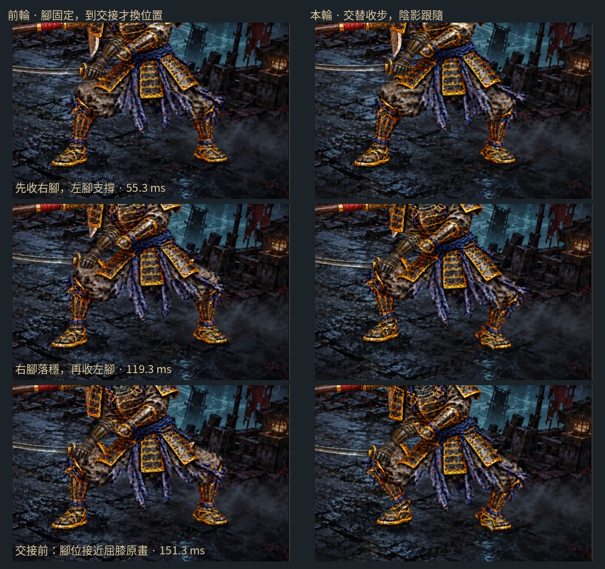

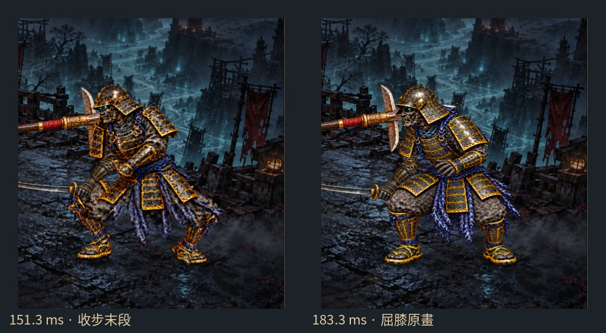

[低掃收步對照](combat/enemy-footwork-sweep-comparison.jpg) · [低掃交接相鄰畫面](combat/enemy-footwork-sweep-handoff.jpg) · [人工鞋底標記、實際圖層與陰影紀錄](combat/enemy-footwork-check.json)。前後對照取 `78d090c` 已提交影片與本輪實際 Phaser 截圖，配對反應進度，時間差另列於紀錄；這不是自動像素追蹤或生成動畫。兩段新擊倒影片各 78 幀、30 fps／2.6 秒。

本次 30 Hz 錄影在交接前的最後取樣，左鞋底標記距屈膝目標由約 **43.20 px** 降至短刺 **9.88 px**／低掃 **5.75 px**，右側由約 **30.24 px** 降至接近 0。最後取樣分別在 151.33／158 ms，早於 175 ms 落穩，所以不能把錄影中的剩餘距離當成落地端點誤差；這些也只是人工標記距離，不代表鞋子輪廓已相同。

## 前輪：致命命中先保留姿勢，再接屈膝

[短刺擊倒 30 fps MP4](combat/combat-30fps.mp4) · [低掃擊倒 30 fps MP4](combat/low-hit-30fps.mp4) · [手機短刺](combat/enemy-fatal-thrust-mobile.jpg) · [手機低掃](combat/enemy-fatal-sweep-mobile.jpg)

前輪第三次命中會立刻改成整身受擊圖，胸甲、肩臂及刀跟著跳位。現在短刺與低掃的致命一擊也保存當下姿勢，**70 ms 命中停頓期間維持同一副身體**，接著用原本八個身體部件下沉。

- 前 **180 ms** 以腰胯帶動胸甲與固定長度雙腿，雙腳留在原位；持刀臂保留 65／75 px 臂長。命中當下可接待機、蓄刀、出刀或收招，不先跳回戒備。
- 到 180 ms 對齊原 `buckle` 屈膝圖的肩點，握刀手也接到原持刀曲線。低掃增加 180–250 ms 的這張屈膝圖；250 ms 後的跪下、承手、430 ms 鬆手、500 ms 脫刀與消散時序不變。
- **只改善命中瞬間、下沉與肩臂握刀銜接，還沒有完成連續倒地。** 180 ms 換回整身原畫時，頭盔、空手側手臂、腰甲與腿形仍有差別，腳位也會改變；後續跪地依然切換原圖。下方相鄰畫面直接展示這個限制。
- 共用既有貼圖，不新增 image gen、Blender、Modal 或第三方素材。角色 RGBA8 估算仍為 **桌機 57.599 MiB／手機 25.245 MiB**；這不是實體手機效能量測。

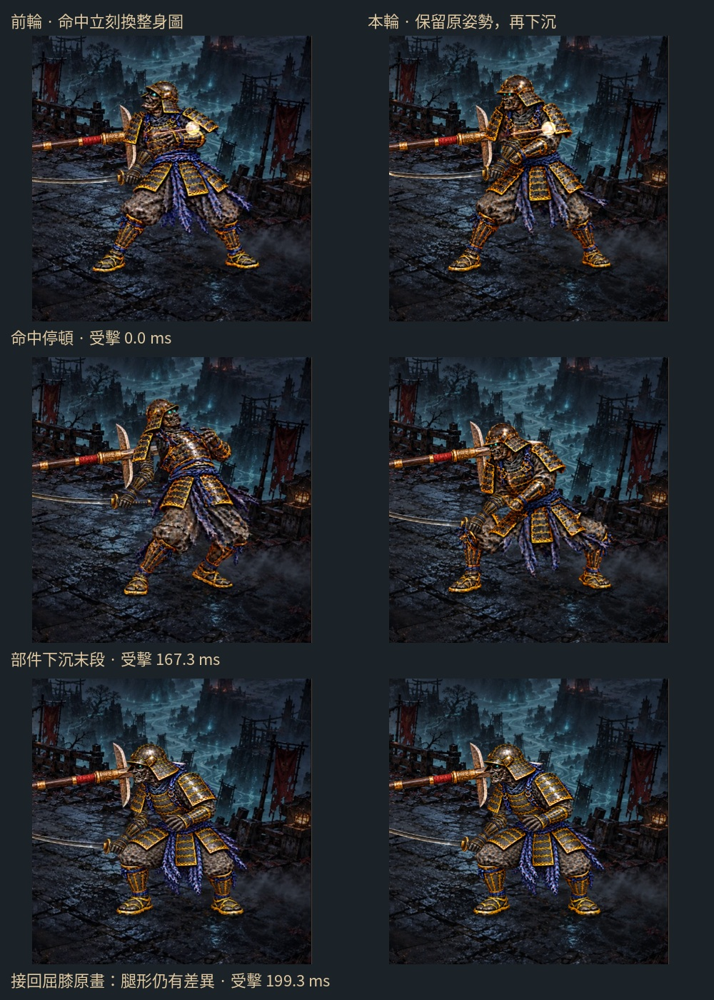

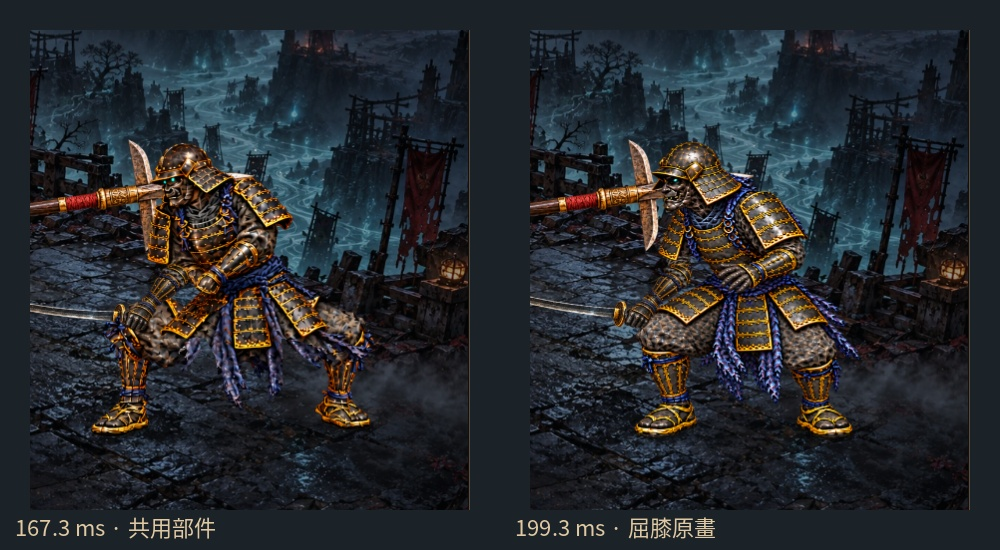

[低掃前後對照](combat/enemy-fatal-sweep-comparison.jpg) · [低掃交接相鄰畫面](combat/enemy-fatal-sweep-handoff.jpg) · [配對時刻與命中位移紀錄](combat/enemy-fatal-bridge-check.json)。對照來源是 `5d33b8c` 已提交 MP4 與本輪實際 Phaser 截圖；兩段新影片各 78 幀、30 fps／2.6 秒，沒有生成或補間影片畫面。交鋒影片保留前輪紀錄；非致命連招也已重錄，確認原本的回防仍正常。

## 前輪：低掃後落胯屈膝，原腳位上回防

[實際連招 30 fps MP4](combat/combo-30fps.mp4) · [前後對照](combat/enemy-low-rig-comparison.jpg) · [腿部近照](combat/enemy-low-rig-detail.jpg) · [手機承重](combat/mobile-sweep.jpg)

前輪非致命低掃仍切換四張整身圖，腿形、腳位與回穩姿態會跟著改變。現在 **鬼武者的腰甲、左右大腿、脛甲與足部都由同一張待機插畫拆出**，加上既有軀幹共八個身體部件；持刀手臂、手掌與刀繼續共用原部件。

- 命中時保存當下胸甲與持刀姿態，保留 **70 ms 命中停頓**；之後前 **140 ms** 腰胯向受擊側移 5 px、下沉 18 px（原畫座標，在遊戲中為 3／10.8 px），胸甲前傾，兩膝一起承接。
- 大腿、脛骨長度依手工標記固定，兩腳鎖在原位。每條腿保持同一彎曲方向，不拉長肢段追腳點；踝部與足部共用接點，腰甲移動帶動髖部及胸甲。
- 到原有 **420 ms** 低掃反應結束點回到同一站姿；攻擊判定、傷害、接招與敵方反擊時機不變。待機、出刀、短刺受擊也沿用八個身體部件，避免只在低掃時換體格。
- **本輪只替換非致命低掃反應。** 致命低掃與倒地仍使用原關鍵圖；還沒有跨步、抬腳、轉身、關節體積補繪或真正受力模擬。原畫遮擋區有限，膝甲與腰甲接縫仍可精修。
- 只有原畫遮罩、裁切與手機縮圖，沒有新增 image gen、Blender、Modal 或第三方素材。可見身體圖層從兩層增為八層；角色 RGBA8 估算變為 **桌機 57.599 MiB／手機 25.245 MiB**，分別增加約 0.132／0.059 MiB，未宣稱實體手機幀率提升。

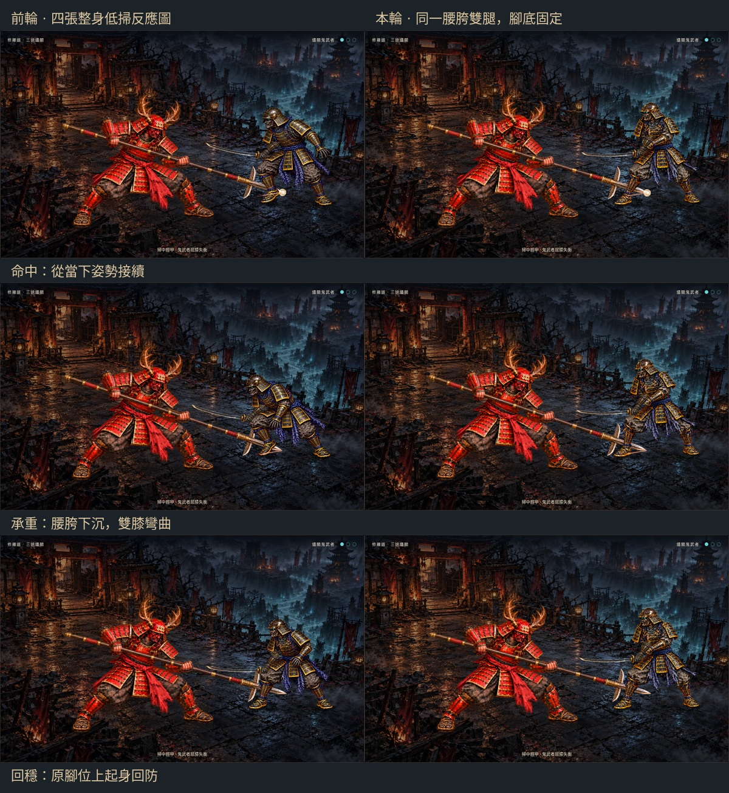

對照取前輪實際 MP4 與本輪 Phaser 截圖，配對相同攻擊幀、招式與血量，取樣時間差另記錄。[關節、腳位與取樣紀錄](combat/enemy-low-rig-comparison.json) · [裁切來源檢查](combat/enemy-body-art-check.json) · [瀏覽器檢查](combat/browser-check.json)。上方 GIF 是 90 張實際瀏覽器畫面的短刺接低掃連招，30 fps／3 秒，不是生成動畫或實體手機效能測試。

## 前輪：命中後沿用當下姿勢，再承力回防

[實際打斷蓄刀影片](combat/enemy-recoil-30fps.mp4) · [前後對照](combat/enemy-recoil-comparison.jpg) · [手機受擊](combat/enemy-recoil-mobile.jpg)

前輪的出刀已連續，但被短刺打中後仍會跳到另一張整身受擊圖。現在 **非致命短刺命中時，先保存當下蓄刀／斬下／收勢的時序姿態**，由同一副胸甲、同一組肩臂與同一把刀接續反應；待機練習也沿用這條路徑。

- 命中瞬間保持原本胸甲角度、肩肘腕與握刀位置，原有 **70 ms 命中停頓** 凍結整個姿勢。停頓結束後，前 **95 ms** 後仰承力、收回持刀手；到原有 **360 ms** 反應結束點回正，沒有延長反擊空隙或改變傷害時機。
- 保持固定 **65／75 px** 臂長、同一握點與刀身尺寸，下半身仍固定站位。受擊期間保留同一圖層順序，不切成另一個體格或以透明疊化掩蓋交接。
- 上方新增影片為 **關閉命中特效的實際 Phaser 錄影**：幸村短刺打斷蓄刀，鬼武者停頓、受力、回防。共 60 張畫面，30 fps／2 秒；不是新生成的影片，也不是實體手機效能測試。
- **這輪只替換非致命上身短刺反應。** 低掃、致命一擊及倒地仍保留原關鍵圖；空手側仍畫在軀幹上，敵方腿部也尚未加入承重或退步。這是平面部件動作，不是人體力學模擬。
- 沒有新增貼圖、image gen、Blender、Modal 或第三方來源。所有使用中的角色貼圖與 `a0ddb54` 位元組相同，角色 RGBA8 估算維持 **桌機 57.467 MiB／手機 25.186 MiB**。

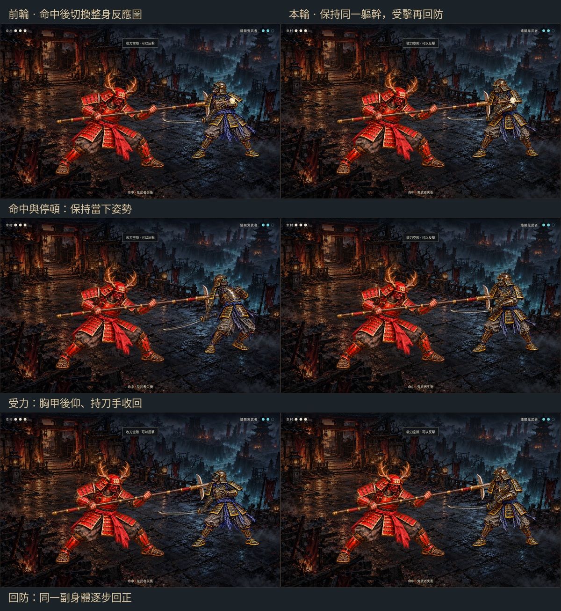

對照使用前輪與本輪的「格擋後反擊」實際畫面，配對相同幸村攻擊幀、血量與受擊回復階段；這與上方新錄的「蓄刀被打斷」片段是兩個情境。各組取樣時間差與影片驗證見 [錄影及對照紀錄](combat/enemy-recoil-video-check.json)。

## 前輪：讓肩膀跟著同一副胸甲出刀

[實際交鋒 30 fps MP4](combat/duel-30fps.mp4) · [前後對照大圖](combat/enemy-body-comparison.jpg) · [手機格擋](combat/duel-mobile-guard.jpg)

前輪已對齊刀槍，但敵人從蓄刀切到斬下時，整個身體會換圖，肩點在一格內大幅跳動。現在 **待機、蓄刀、斬下、收刀共用同一張原畫裁出的軀幹與下半身**；胸甲以腰帶為支點連續轉動，肩點使用完全相同的變換，再求解持刀手臂。

- 蓄刀逐步收身 **4°**，斬下轉至前傾 **10°**，收勢前 **520 ms** 回正。這是視覺曲線；原有蓄刀 850 ms、斬擊 180 ms、收招 1400 ms 與傷害時刻保留。
- 下半身保持同一站姿與腳位；軀幹只做剛性旋轉，沒有整身拉伸或透明疊化。上臂藏在肩甲下，前臂位於胸甲前，整段出刀不再切換遮擋順序。
- 手、刀仍共用握點，保持 **65／75 px** 臂長及刀身尺寸；早晚格擋仍能對齊實際刀刃與槍身，火星出現在接觸位置。
- 此次 30 Hz 錄影的相鄰肩點最大位移，由 **63.19 px 降至 6.65 px**（1200×750 場景座標，限定未受擊的出刀段）。這是取樣位移，不是整體動作品質或人體力學評分。
- 兩個部件只對既有插畫做遮罩、裁切與手機尺寸縮圖；沒有新增 image gen、Blender、Modal 或第三方素材。停止載入三格整身出刀圖集，角色 RGBA8 估算降為 **桌機 57.467 MiB／手機 25.186 MiB**；增加一個可見身體圖層，未宣稱實體手機 FPS 提升。

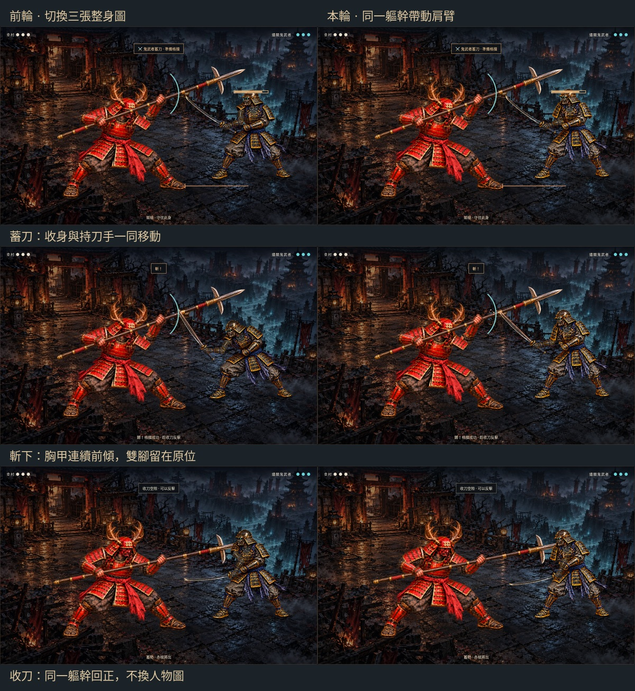

對照來自前輪實際 MP4 與本輪瀏覽器截圖，配對相同階段、血量與格擋次數；三組階段取樣時間差分別為 −10／6／6 ms，完整座標見 [對照紀錄](combat/enemy-body-comparison.json)。[原畫裁切檢查](combat/enemy-body-art-check.json) 核對可見色彩、遮罩、手機縮圖與待機輪廓；[瀏覽器檢查](combat/duel-browser-check.json) 從實際胸甲圖層反算肩點，確認雙臂確實接在畫面上的身體。

仍有範圍限制：空手側手臂畫在軀幹上，尚未獨立活動；雙腿未加入敵方跨步或承重。受擊、回穩及倒地仍採既有關鍵圖，從出刀被打斷時仍可見姿勢切換。下一步先銜接受擊反應與回防，再擴充步法。

## 前輪：讓敵刀真正到達畫面上的槍身

[交鋒 30 fps MP4](combat/duel-30fps.mp4) · [刀槍接觸近照](combat/blade-contact-detail.jpg) · [手機格擋](combat/duel-mobile-guard.jpg)

前輪火星放在槍上的標記，但敵刀仍沿原本的砍擊路徑移動，兩件武器沒有交會。本輪把 **刀刃上的鋼面標記與槍身接觸點納入同一組求解**，保持刀長、握點與兩段手臂長度。敵刀接近槍身、承力後退開；火星改從當次刀刃的實際接觸座標發出。

- 敵人蓄刀最後 **240 ms** 逐步接近；若玩家更晚按格擋，從按下當刻的手臂姿勢開始銜接，不在輸入當幀直接跳姿。極晚格擋仍保留原規則，接近時間會相應縮短。
- 格擋成立時刀刃標記與槍身標記重合，最多保持 **65 ms**，再逐步退刀，**300 ms** 內接回原本收刀路徑。若防禦先結束，提早開始鬆開接觸。玩家已開始反擊時，不會把敵刀重新吸到新的攻擊槍路上。
- 接觸可以沿刀刃滑動：在現有 410×51 刀圖的鋼面內選點，調整固定長度雙臂。**不拉長手臂、不縮放刀身、不把刀從手中移開**。刀光也改沿實際刀刃繪製，移除原本指向預設位置的假斬線。
- 防禦 580 ms、回氣 1100 ms、傷害時刻、早擋失效與遠距落空都保留。**規則先判定格擋，再將平面動畫幾何對齊**；這不是通用刀槍碰撞或剛體受力系統。敵人軀幹仍會切換關鍵圖，肩位交接尚可精修。
- 沒有新增貼圖、image gen、Blender、Modal 或第三方素材。使用中的角色貼圖與 `8a6cfb0` 完全相同，角色 RGBA8 估算維持 **桌機 66.606 MiB／手機 29.248 MiB**；新增的是 CPU 平面求解，尚未量測實體手機 FPS。

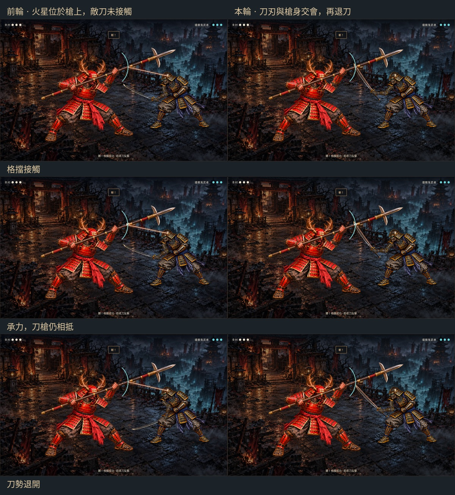

前後採相同防禦剩餘時間、規則階段與血量；本次格擋事件後的取樣時刻相差 6 ms，詳見 [接觸座標與對照時間](combat/blade-contact-comparison.json) · [刀圖鋼面標記檢查](combat/blade-contact-art-check.json) · [瀏覽器逐幀檢查](combat/duel-browser-check.json)

以下段落保留各輪製作紀錄；歷史數字以各輪為準，共用錄影片段會更新至目前版本。

## 前輪：格擋也沿用同一人物，連續抬槍與收槍

[交鋒 30 fps MP4](combat/duel-30fps.mp4) · [桌機架槍](combat/duel-desktop.jpg) · [手機承力格擋](combat/duel-mobile-guard.jpg)

原本按格擋會切到四張不同的全身圖，肩甲、體格與手臂姿勢會跳變。現在 **待機、短刺、低掃、格擋全部共用十四個人物部件與同一把槍**。不是把原本不可達的握點硬塞進骨架，而是重新安排胸前斜擋的槍路，讓固定長度雙臂自然接住。

- 前 **140 ms** 從待機連續抬槍，接著架穩；最後 **100 ms** 收回同一待機姿勢。保持原有 **580 ms 防禦／1100 ms 回氣**，防禦仍從按下起生效，沒有新增只能在架穩後格擋的規則。
- 擋中時承力曲線從零開始，**55 ms** 到達最大退讓、**160 ms** 內回穩；若已進入收槍段，承力也隨之淡出，不會跨過防禦結束又彈回去。腰胯最多再退 1 px、下沉 2 px，槍後手最多再退 2 px、下降 3 px。
- 肩膀沿用原胸甲關節，雙臂跟隨握點；兩段腿部保持長度，雙腳鎖定地面。早擋、晚擋和完整過渡都檢查可達性與 **小於 35° 的平面腕角**；這不是三維人體解剖或力學模擬。
- 格擋火星改用當下槍身的接觸標記。**敵方傷害仍依時間與間合判定**，刀刃與槍身尚未完成實體接觸對齊；這輪改善人物交接，未宣稱完成兵器碰撞。
- 沒有新增角色圖、image gen、Blender 或 Modal 工作。全部使用中的貼圖與 `cd2ae36` 位元組相同；停止載入四格格擋身體圖與手指圖集，角色 RGBA8 估算減少 **桌機 10.125 MiB／手機 2.531 MiB**。

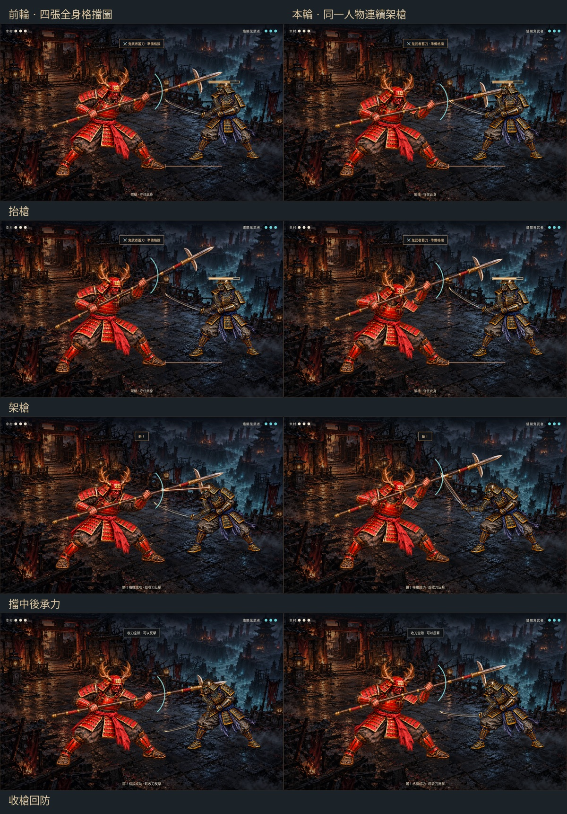

[對照時刻與關節資料](combat/shared-guard-comparison.json) · [瀏覽器逐幀檢查](combat/duel-browser-check.json) · [貼圖與成本檢查](combat/shared-hero-art-check.json)

## 前輪：腰胯與雙膝一起承接槍勢

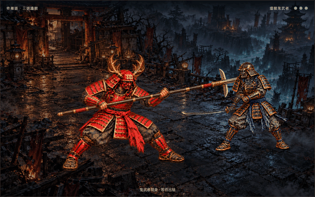

[低掃 30 fps MP4](combat/shared-sweep-30fps.mp4) · [短刺 30 fps MP4](combat/shared-hero-30fps.mp4) · [手機畫面](combat/shared-sweep-mobile.jpg)

上一輪下半身是一張固定圖片，只有上身轉動。這輪把同一原畫拆為 **腰甲、左右大腿、脛甲與足部**，加上既有胸甲、雙臂與雙手，共十四個可重用部件。待機、短刺、低掃沿用相同造型；沒有新生成角色圖，也沒有全身拉伸。

- 低掃先向後落胯，再下沉至 **8 px**，隨勢向前 **5 px**。短刺同步加入小幅蓄力與前送。數值是 1200×750 遊戲畫布的距離，不是人體實際單位。
- 兩段腿部 IK 固定大腿與小腿長度，保留膝蓋原本彎曲方向；腳踝與足部鎖定原位，膝蓋隨骨盆移動。腰甲遮住髖部切口，膝甲與腳踝保留原畫重疊，避免拆圖露洞。
- 腰部移動後，肩膀位置會一起更新，再求解雙臂。兩手仍貼著同一把槍；短刺／低掃整段的平面腕角均小於 **35°**。這是平面投影約束，不是人體解剖或受力驗證。
- **槍尖軌跡、攻擊時間、命中窗口與傷害規則未變**。瀏覽器逐幀由實際圖層重算髖、膝、踝、肩、肘、腕和槍尖，確認關節連接、雙腳不滑動、暫停與命中停頓不漂移。
- 此輪用現有畫作裁切及 CPU 動作計算，沒有新增 image gen、Blender 或 Modal 工作。桌機／手機角色貼圖 RGBA8 估算約 **76.731／31.779 MiB**，多六個圖層但裁切更緊，未增加貼圖記憶體估算。

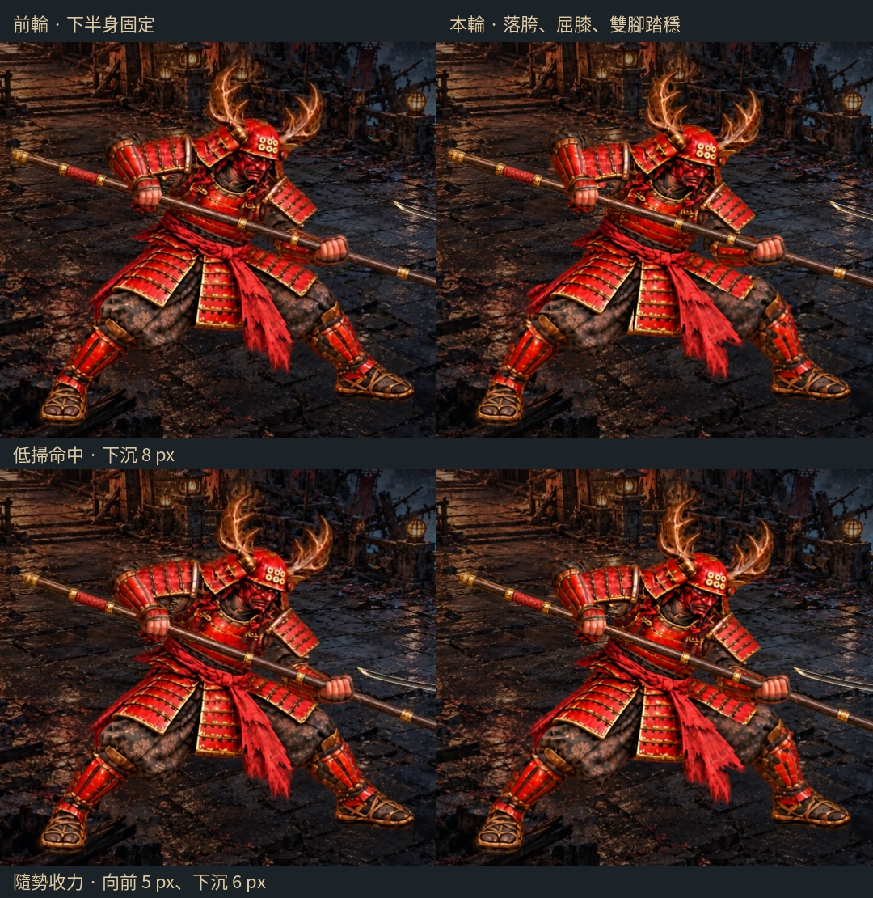

[對照取樣與關節資料](combat/leg-loading-comparison.json) · [素材保留與成本檢查](combat/shared-hero-art-check.json)

目前只有小幅平面承重動作，尚無跨步、抬跟、轉身換面或真正質量／受力模擬。格擋仍為四張關鍵圖：已試算把架槍握點套進現有肩位與臂長，架槍姿勢有不可達目標，不能直接沿用；下一步須先調整肩帶與架槍路徑。肩腰接縫仍可精修。

## 前輪：橫掃也沿用同一身體與槍


[低掃 30 fps MP4](combat/shared-sweep-30fps.mp4) · [低掃命中畫面](combat/shared-sweep-contact.jpg) · [手機畫面](combat/shared-sweep-mobile.jpg) · [短刺接低掃 30 fps](combat/combo-30fps.mp4)

前輪短刺已經使用赤甲共用部件，但橫掃會切換到另一批全身圖，身材、甲片與槍會跟著改變。這輪讓 **待機、短刺、低掃共用完全相同的八個插畫部件**；格擋仍使用四張姿勢圖，但所有動作都握同一把 **760 px 槍，前後握點相距 237 px**。進入低掃與收槍回待機的部件變換相同，不再切換舊造型。

- 低掃維持 **32 個 30 Hz 動作幀（約 1.067 秒）、第 9–16 有效幀（零起算）、70 ms 命中停頓**。短刺收槍接低掃、單次命中、遠距落空、低掃碰不到懸空封印、非致命回穩與致命倒地都沿用原有規則。
- 動作由「蓄勢 → 下槍 → 接觸 → 隨勢 → 提槍 → 回防」六個時段構成。這些是同一組部件運動的時間標記，**不是六張不同人物圖**。腰身最多前傾 16°，槍軸向下轉到 20°；手臂以固定長度 IK 跟隨雙手握點。
- 在整段連續曲線取樣下，後手／前手的平面腕角最大約 **21.70°／30.64°**。不拉長手臂、不縮放槍身，也不讓手離開握點；數字是人工關節標記的平面檢查，不能當成三維人體解剖認證。
- **低掃槍尖判定現在同樣由實際共用槍端點計算**，使用 [shared-sweep-track.json](combat/shared-sweep-track.json)。瀏覽器從 sprite 原點、尺寸與角度重算槍尖，核對遊戲正在使用的碰撞座標；不只比較動畫模組自己回傳的數字。
- 本輪 **沒有新增 image gen、Blender 或 Modal 工作**。所有仍在使用的角色貼圖逐一與 `d44c03f` 比對，檔案完全相同。停止載入舊橫掃與兩張交接圖集，角色貼圖估算再節省手機 **3.75 MiB**／桌機 **15 MiB**。
- 目前是固定鏡頭平面內的低位掃擊，還不是帶轉身、換面與步法的完整三維橫掃。雙腳保持原圖，尚未加入膝胯承重；肩甲與腰甲接縫、格擋四張圖的交接仍可精修。

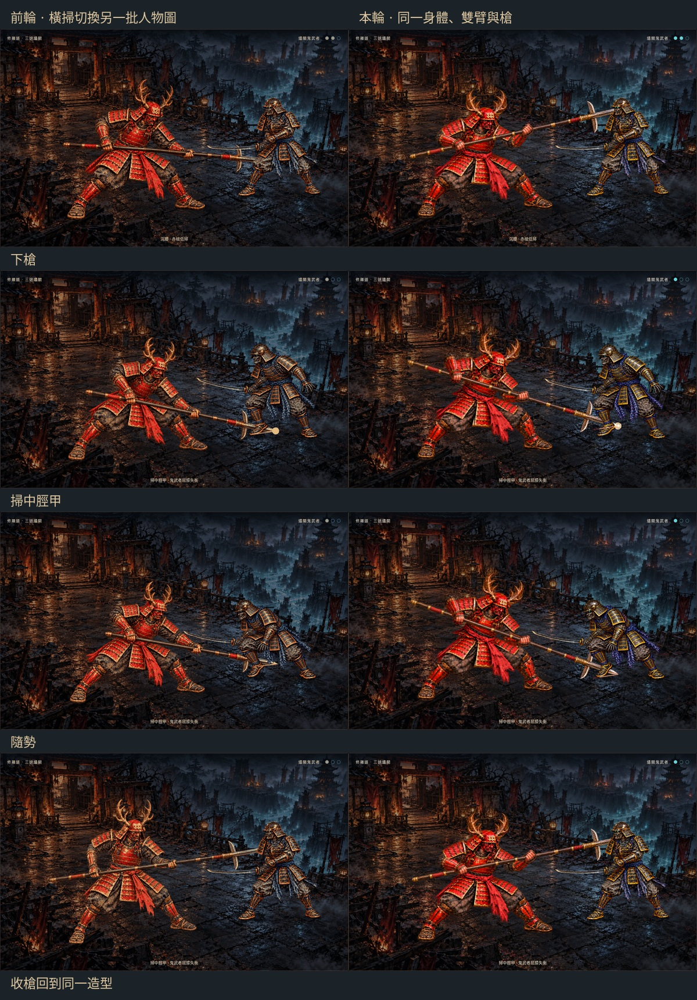


[同一攻擊幀與血量的對照資料](combat/shared-sweep-comparison.json) · [逐幀實際擷取](combat/shared-sweep-capture.json) · [桌機／手機檢查](combat/shared-sweep-browser-check.json) · [貼圖重用與記憶體核對](combat/shared-hero-art-check.json)

## 前輪：待機、短刺與格擋接上同一把槍

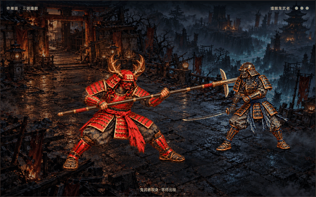

[短刺 30 fps MP4](combat/shared-hero-30fps.mp4) · [待機畫面](combat/shared-hero-idle.jpg) · [命中畫面](combat/shared-hero-contact.jpg) · [手機畫面](combat/shared-hero-mobile.jpg)

前輪格擋換成赤甲新造型，但待機與短刺仍使用舊 Blender 圖集，換動作時人物比例、甲片與槍都會跳變。這輪以格擋的「放槍」圖為基準：**保留原有下身、雙臂與雙手，僅補一張移除雙臂的胸甲底圖**，拆成八個可重用部件。待機、短刺和四個格擋姿勢使用同一把 **760 px 槍、237 px 握點間距**。

- 短刺使用平面兩段手臂 IK：上臂與前臂長度固定，手掌與槍一起轉動，禁止把手臂拉長以追上握點。腰身最多前傾 10°；**雙腳與下身保留同一張圖、相同位置及尺寸**。後手沿收槍／送槍曲線移動，前手維持固定握距。
- 保留 **36 個 30 Hz 動作幀、1.2 秒短刺、14／15 有效幀、70 ms 命中停頓與原有接招時間**。部件在各幀改變位置及角度；沒有逐幀生成新人物，也沒有把整張人物拉伸。待機保持穩定戒備，尚未新增呼吸、步法或下身承重動畫。
- **槍尖判定由畫面上同一把槍的端點計算**，替換舊造型的短刺座標。瀏覽器另從實際 sprite 尺寸、原點與旋轉重算槍尖，核對判定資料；近距一擊、遠距落空與原有連招維持通過。這仍是槍尖線段／目標圓判定，敵人出刀仍非真正刀身碰撞。
- 平面投影下，手背方向與前臂方向的最大夾角：後手約 **28.54°**、前手約 **18.36°**。這是人工關節標記的平面檢查，**不是完整人體手腕角度或三維解剖驗證**。肩甲與腰甲接縫仍需進一步修飾。
- 這輪共三次 image gen：兩版全身動作候選圖因握距、身高與站距不一致而捨棄；第三次只製作清理後胸甲。沒有新增 Blender 或 Modal 渲染。原下身的可見像素與 alpha 已核對相同。
- **當時橫掃仍使用舊六姿勢與烘焙武器**，本輪已由上述共用部件替換。四張格擋圖仍為關鍵姿勢切換，尚未改成這套連續雙臂控制。

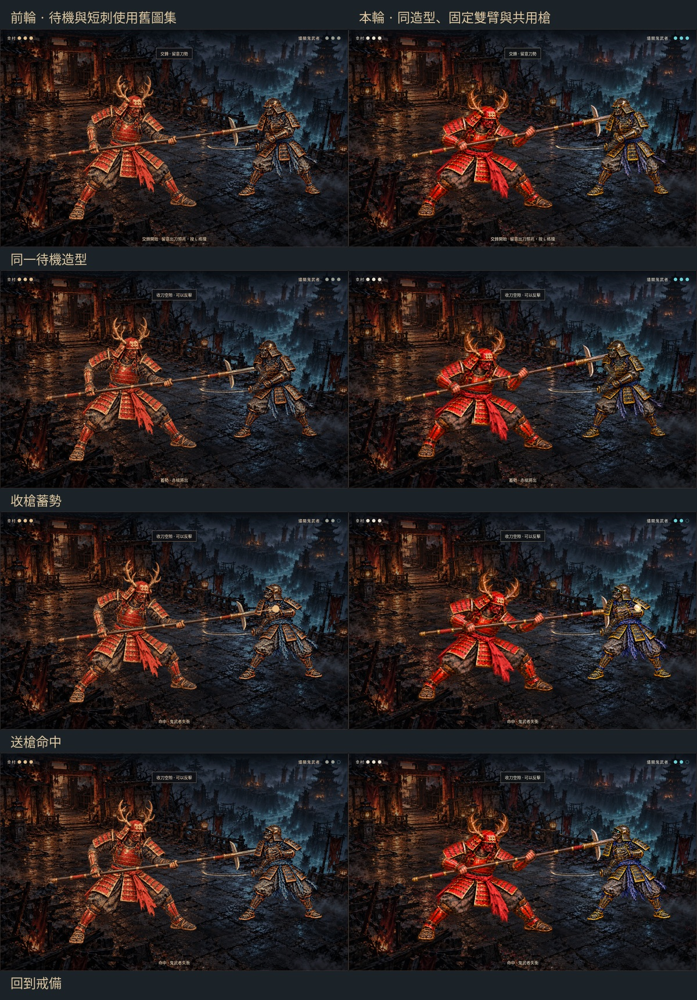

[相同遊戲時刻對照](combat/duel-motion-check.json) · [部件、關節與來源](combat/thrust-rig.json) · [實際短刺擷取](combat/shared-hero-capture.json) · [瀏覽器檢查](combat/shared-hero-browser-check.json) · [素材與記憶體核對](combat/shared-hero-art-check.json)

## 前輪：固定槍長，補抬槍與放槍

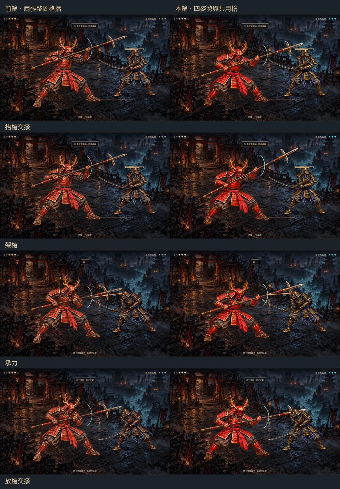

前輪的槍直接畫在兩張格擋圖中，架槍換到承力時，槍長和手距也會改變。本輪把它拆成 **四張不含槍的身體圖、同一把槍、八個前景手指／袖口圖層**，接成「抬槍 → 架槍 → 承力 → 放槍」。手指疊在槍身上方，讓握槍的遮擋關係可見。

- 四個格擋姿勢都使用 **760 px 槍長、237 px 前後握點間距**（1200×750 場景座標），只做平移與旋轉，不依手距縮放槍身。雙手中心定義同一槍軸，前手標記與固定握點最大差 **2.56 px**；標記為人工量測，不能當成解剖學精度。
- 前輪兩張圖人工估計的手距約 **238／143 px**，本輪四張身體圖標記約 **237.19–239.56 px**。固定前握點落在手掌範圍內；差異與標記見 [共用槍資料](combat/guard-rig.json)。這不是從畫面自動追蹤出的結果。
- 前 80 ms 抬槍，之後架槍；成功格擋時切承力，最後 100 ms 放槍。仍沿用 **580 ms 防禦、1100 ms 回氣**，沒有靠延長無敵時間補動作。暫停凍結所有圖層，重置／出槍時會隱藏共用槍與手指層。
- 身體圖以固定腳距等比例對齊，人工腳位距既有標記小於 8 px。格擋火星與弧線現在跟隨槍上的接觸標記；敵方傷害仍按間合與時刻判定，刀身尚未真正撞上槍身。
- 本輪用了三次 image gen：乾淨槍身、四姿勢草稿、前手抬高修正。第一版前手太低，保留為來源研究，遊戲只載入修正版。沒有重新跑 Blender 或 Modal。
- **當時只有四個格擋姿勢共用這把槍。** 待機、短刺、低掃仍使用原有烘焙武器；交接到那些動作時，槍刃畫法、人物體格與肩甲輪廓仍有差異。身體仍是關鍵圖切換，尚非連續骨架動作。

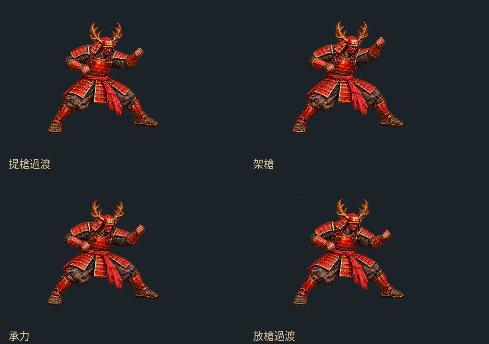

[共用槍與握點](combat/guard-rig.json) · [前輪格擋對照擷取資料](combat/guard-motion-check.json) · [修正版母圖](../../../assets/source/jigoku-2d/guard-rig/bodies.png) · [乾淨槍身](../../../assets/source/jigoku-2d/guard-rig/yari.png)

## 前輪：身體一起出刀與架槍

前輪以兩次 image gen 參考編輯，新增 **鬼武者三張身體層：蓄刀收身、前傾斬下、收刀回正**，以及 **幸村兩張全身圖：架槍、承力收勢**（本輪已由上述四姿勢取代）。沿用赤甲／黑金甲、火光與布甲細節；沒有對整個人旋轉或非等比拉伸。

- 鬼武者仍共用原本上臂 65 px／前臂 75 px、握刀手與同一把刀。三張新身體層標記肩接點，手臂跟隨接點；出刀圖層改讓上臂覆蓋肩部開口，避免肩甲遮掉整段上臂。身體根位置、尺寸及零旋轉保持固定。
- 蓄刀開始 160 ms 後切到收身圖；180 ms 出刀段使用斬下圖；收刀前 160 ms 延續斬下，160–360 ms 使用回正圖，之後回原戒備。**被玩家打斷時直接走原有受擊恢復，不會插入出刀／收刀圖。** 傷害、預兆與格擋時間未延長。
- 幸村按 L 時切到架槍圖，格擋成功後立即換承力圖；沒接到刀時，在防禦最後 100 ms 收勢，結束後回原待機。兩張圖按後腳與前腳間距等比例對齊，映射後前腳離原標記小於 4 px；這是人工腳位對齊，不是腳底物理約束。
- 當時幸村的槍與手仍畫在整張姿勢圖中，**不是共用剛體武器**；兩張圖的槍投影長度、手距和甲片仍有差異。鬼武者手臂長度與刀具可由程式固定，但不能據此宣稱整個人物已通過人體物理驗證。
- 這是五張關鍵圖接上 30 fps 時序，**不是每秒三十張不同的手繪姿勢，也不是完整連續骨架動畫**。肩點／頭部輪廓切換仍可見，幸村受傷也尚無專用姿勢。本輪未使用 Blender 或 Modal 重新渲染。

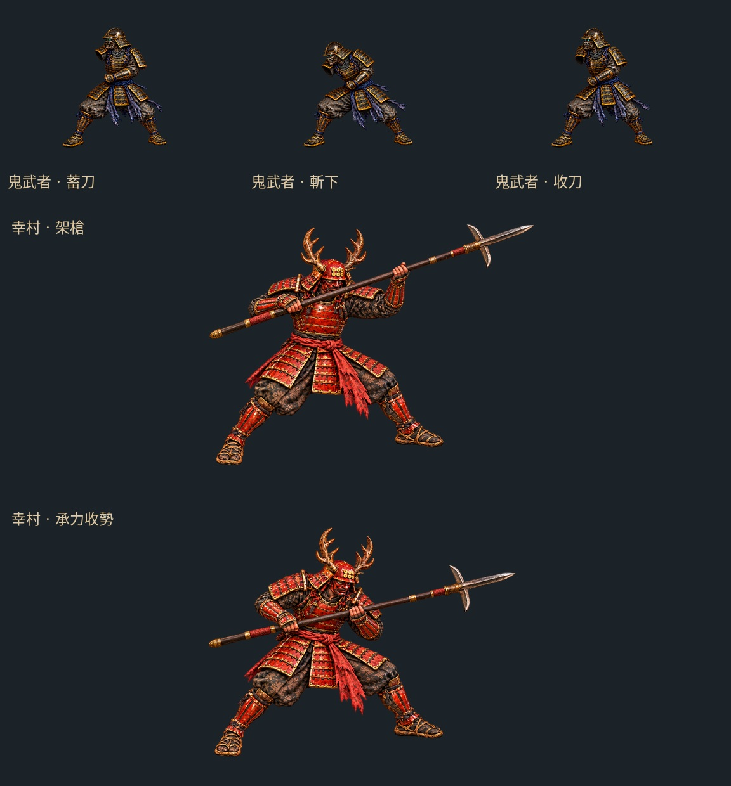

[來源、等比例對齊與十項邊界檢查](combat/duel-art.json) · [鬼武者母圖](../../../assets/source/jigoku-2d/ghost-rig/duel-bodies.png) · [幸村母圖](../../../assets/source/jigoku-2d/yari-guard-poses.png)

## 攻守規則：可應對的出刀與反擊空隙

鬼武者在交鋒開始後等待 1200 ms，**蓄刀 850 ms → 出刀 180 ms → 收刀 1400 ms**，之後再次蓄刀。預兆包含文字、頭頂進度條與地面間合線；不依賴顏色或鏡頭震動。玩家在出刀起點仍處於格擋期間就能擋下，格擋結束後可趁收刀短刺反擊。近距出刀只扣一格血；「一步之外」會揮空。短刺或低掃命中也會打斷蓄刀，重啟收刀空隙。

- 沿用前輪玩家血量、格擋回氣、勝負與再戰；暫停／背景分頁停止攻守計時，命中停頓也凍結敵方與格擋計時。交鋒規則使用 1 ms 固定步長，畫面仍由 Phaser 更新，不會每毫秒繪圖。
- 切換對手、間合與再戰會重置試戰；封印不會出刀。這仍是可重置的固定站位試驗，不是有進度的關卡。敵人節奏固定、命中可持續壓制，目前尚未調整進攻與格擋的難度平衡。

- **敵方傷害按間合與出刀時刻判定，並非刀刃逐像素碰撞**；玩家短刺／低掃仍用既有槍尖碰撞。兩者目前刻意保留不同判定方式，以先驗證攻守節奏。
- 戰場、待機／短刺／低掃、受擊／倒地與鬼武者武器部件仍共用原資產；本輪替換幸村格擋圖層；鬼武者三張出刀姿勢沿用。

[交鋒瀏覽器檢查](combat/duel-browser-check.json) · [逐幀攻守狀態](combat/duel-capture.json) · [影片核對](combat/duel-video-check.json)

## 前輪：回穩不再重播受擊圖

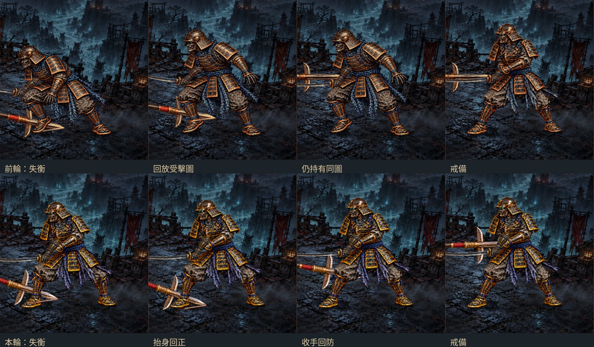

前輪低身失衡後，會回放原本的腿部受擊圖，再突然切回站姿。本輪補上「抬身回正」與「收手回防」兩張完整身體圖，讓空手從腿旁回到腹前，雙膝逐步伸展。持刀側繼續使用原本兩段手臂、握刀手與同一把刀；肩腕接點重新標記，手臂局部目標曲線也跟著新姿勢調整。

- 受擊時序仍為：停頓 70 ms → 腿部受擊至 110 ms → 低身失衡至 260 ms → **抬身回正至 340 ms → 收手回防至 420 ms** → 戒備。兩張新圖各持有 80 ms，沒有延長整段回穩時間；致命低掃保持原流程，不會抬身站回來。
- 人工標記比較「失衡至戒備」這一段：最大相鄰肩點位移約 **55.92 → 45.75 px**；最大鞋底中心位移約 **41.12 → 25.70 px**。使用 1200×750 場景座標，戒備鞋底為人工估計；**不是自動像素追蹤、腳底鎖定或人體解剖驗證**。
- 前兩張低掃受擊圖在桌機／手機圖集中的可見像素與 alpha 保持一致，原本十四個接點及共用武器部件也保持一致。新增圖分別等比例縮放至 0.82／0.88，再對齊腳位，沒有對身體做非等比拉伸或交叉淡化。
- 本輪仍是兩張關鍵姿勢。頭部大小、肩甲輪廓、腳底承重與各圖的身形仍有差異，距離完整連續動畫還有落差。

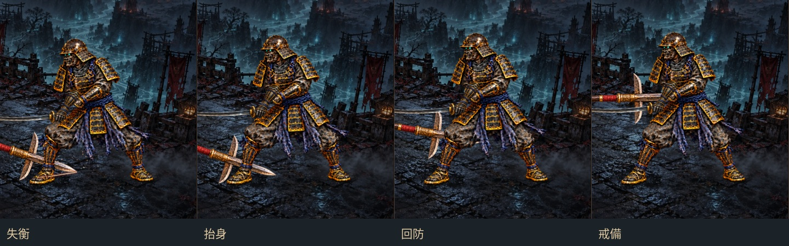

[新回穩母圖](../../../assets/source/jigoku-2d/ghost-rig/low-recovery.png) · [接點與像素檢查](combat/recovery-art-check.json) · [實際前後擷取來源](combat/recovery-preview-check.json)

## 低掃受擊與致命分支

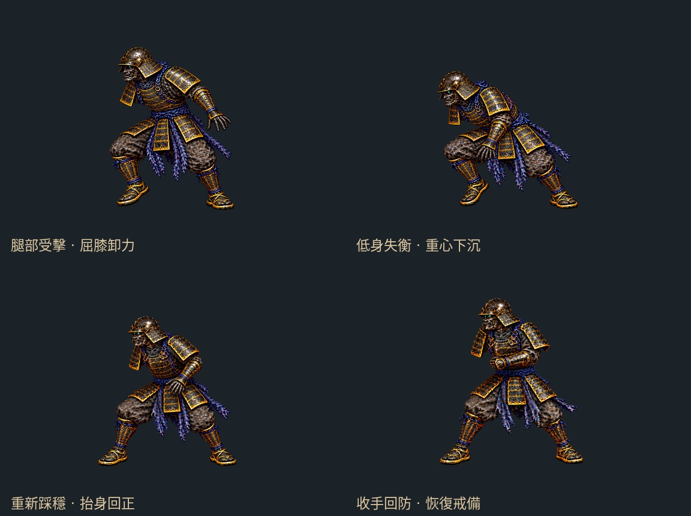

原本短刺與低掃都播放上身後仰。前輪補繪「腿部受擊」與「低身失衡」兩張圖：前腿屈膝、腳跟提起，身勢降低，空手張開維持平衡。原本的持刀側手臂、三種握姿與刀繼續共用，兩個新肩腕接點也套用固定 65／75 px 的兩段手臂。兩張新圖的比例、盔甲與腳部投影仍有生成差異，不是物理模擬或完整骨架動畫。

- **未致命低掃**：命中停頓 70 ms，之後腿部受擊至 110 ms → 低身失衡至 260 ms → 抬身回正至 340 ms → 收手回防至 420 ms → 戒備。
- **致命低掃**：停頓後腿部受擊至 110 ms → 低身失衡至 250 ms → 共用屈膝至 330 ms，再接既有跪倒、手掌承重、脫刀及側身落地。430 ms 開始鬆手、500 ms 脫刀、780 ms 刀落地，1000 ms 開始消散，1700 ms 離場。
- **短刺**保留原本的上身受擊路徑。反應類型由實際命中的招式記錄，預約下一招不會提前改變敵人反應；暫停和命中停頓也會凍結低掃反應。
- 低掃的手臂局部目標另設過渡曲線；致命路徑在 250 ms 接回既有目標，後續脫刀沿用同一把刀與相同的釋放位置。肩接點仍隨身體姿勢切換，不能視為無接縫的連續動畫。
- 身體維持固定根位置與等比例尺寸，前兩張受擊圖以同一個 0.78 比例縮放、對齊後腳；新增回穩圖使用上方的等比例對齊，另標前腳接觸陰影。沒有把整個站姿旋轉成倒地；腳底承重與滑步仍需繼續修正。

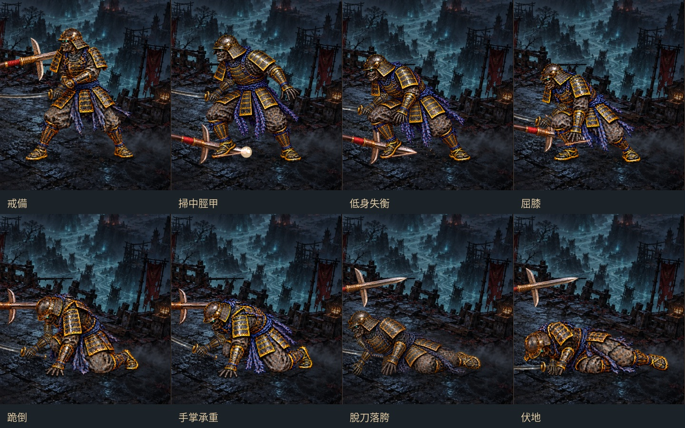

[新姿勢母圖](../../../assets/source/jigoku-2d/ghost-rig/low-hit.png) · [裁切、接點與八項畫面邊界檢查](combat/enemy-low-art.json) · [實際錄影逐幀資料](combat/low-capture.json)

## 前輪：共用交接姿勢，補沉腰與回正

> 以下保留舊六姿勢製作紀錄；這套人物圖已由本輪共用骨架取代，不再載入。


前輪的四張低掃姿勢與原短刺出自不同繪圖，接招時人物身形、手位、槍尖位置會突然換掉。本輪將低掃的第一張直接換成既有短刺最後一幀，最後一張換成既有待機第一幀；中間保留低掃、隨勢兩張，再以 image gen 補繪「沉腰下槍」與「提槍回正」。兩張新圖參考原短刺與既有低掃圖，等比例對齊腳位，沒有把身體拉伸變形，也沒有新增 Blender 渲染。

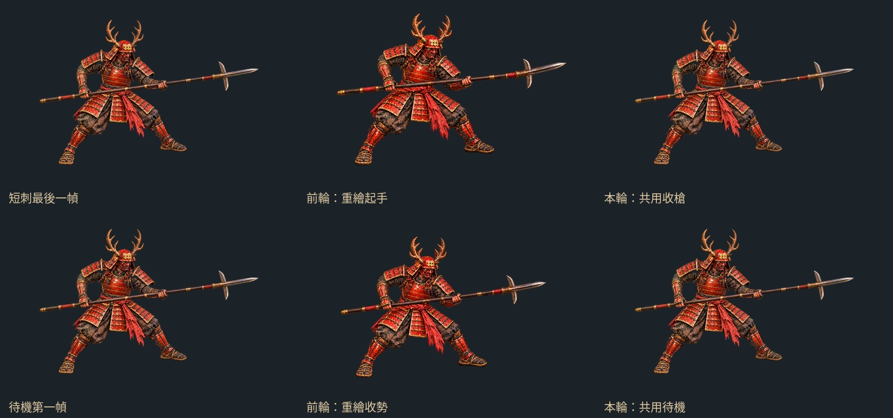

- **桌機與手機各兩個交接點，合計四項圖集引用／像素檢查完全一致。** 兩端直接引用已載入的原動畫圖集，不另存相同貼圖；桌機錄影另外逐幀檢查實際綁定的圖集與索引。 手、甲片與槍也隨共用畫面一致；僅限交接點，招式中段仍是分開繪製的姿勢。
- 橫掃仍為 32 個模擬幀、30 Hz、約 1.067 秒；六張姿勢分別持有 **4／4／6／5／5／8 幀**，命中停頓另計 70 ms。**不是每秒 30 張不同動作，也沒有用交叉淡化製造雙手／雙槍殘影。**
- 人工標記的相鄰槍尖最大投影位移由 **246.92 降至 137.57 px**，約減少 **44%**。量測包含兩端交接，使用 1200×750 場景座標。這表示補圖減少了槍尖跳距，**不代表固定物理槍長、正確人體解剖或全身連續動畫**。[檢查紀錄](combat/sweep-continuity-check.json) 保存基準版本、逐步距離與限制。
- 四張獨立繪圖的後腳標記對齊既有接地點，前腳標記距既有接地點小於 12 px；這是人工投影對齊，沒有完整腳底 IK。中段身高、肩甲、握距與槍長投影仍有差異。
- 短刺零起算第 22–30 幀可預約一次橫掃；低掃有效幀仍為 9–16，近側腿判定圓仍為目標根位置左側 55 px、y=535、半徑 42 px。每招最多傷害一次，過早／過晚輸入、暫停、重置、遠距落空與懸空封印規則沿用。
- 幸村六姿勢與命中時序沿用前輪；敵人低掃反應已改為上方的新分支。

[新過渡母圖](../../../assets/source/jigoku-2d/yari-sweep-transitions.png) · [前輪母圖](../../../assets/source/jigoku-2d/yari-sweep-poses.png) · [來源與對齊紀錄](combat/sweep-art.json) · [槍尖與時序](combat/sweep-track.json) · [手機橫掃截圖](combat/mobile-sweep.jpg)

## 共用身體圖與短刺反應


敵人採黑漆甲、藍黑繫繩、鐵面頬與冷色眼神，與幸村赤甲區分。沿用十二張姿勢，前輪只重繪「重心下沉」一幀，讓站距與軀幹角度介於後仰、屈膝之間。持刀側手臂沿用獨立上臂、前臂與手，在 Phaser 中組合；另一隻支撐手臂畫在身體圖內。A、B 母圖為 1536×1024，C 為 2172×724；屈肘落胯沿用 C 的右半，以 2/3 等比例縮小。新的重心下沉母圖為 1536×1024，以 0.67 等比例縮小。兩張過渡姿勢改用同一張 2172×724 精修母圖，分別等比例縮小至 0.87／0.84，依支撐指尖及後腳跨度重新對齊。上圖只顯示身體分層，缺少的手臂會由遊戲中的共用部件補回。

- 非致命短刺：輕受擊並與主角共同停頓 70 ms；停頓後輕受擊至 90 ms → 後仰至 220 ms → 輕受擊回正至 360 ms → 戒備。
- 致命短刺：停頓後，輕受擊至 90 ms → 後仰至 180 ms → 重心下沉至 250 ms → 屈膝至 330 ms → 跪下至 420 ms → 手掌承重至 500 ms → 屈肘承重至 540 ms → 落胯過渡至 580 ms → 屈肘落胯至 640 ms → 側身落地至 720 ms → 伏地至 1000 ms → 700 ms 漸淡，最後離場。以上為停頓結束後累計時間。
- 暫停也凍結敵人的反應時間；重置會立即恢復戒備與三點生命，沒有殘留的死亡回呼。
- 倒地圖已畫出膝彎、手臂承重與軀幹屈曲，程式不把站姿旋轉成橫躺木偶，也不做非等比壓縮。

**共用部分為十二張關鍵姿勢，加上四張低掃受擊／回穩圖；不是完整骨架動畫或每秒 30 張不同敵人動作。** 各圖的甲片與身體投影仍有生成差異，腳掌也尚未使用跨姿勢的 IK 約束。倒地總長仍為 1000 ms，再漸淡 700 ms。沿用前輪固定刀長、握刀手與上臂／前臂長度；身體本身仍是十二張姿勢切換，肩膀位置會隨姿勢跳變，尚非完整連續骨架動畫。屈肘與手掌承重仍不完整，分層清理也可能改變局部甲片與輪廓。


[實際受擊畫面](combat/enemy-hit.jpg) · [敵人原圖](../../../assets/source/jigoku-2d/ghost-warrior-poses.png) · [新增過渡原圖](../../../assets/source/jigoku-2d/ghost-warrior-inbetweens.png) · [重心過渡原圖](../../../assets/source/jigoku-2d/ghost-warrior-weight-shift.png) · [裁切、接地與來源紀錄](combat/enemy-art.json)

## 前輪：修正後仰至屈膝的站距


前輪的「重心下沉」雙腳突然站得比前後兩幀更開，隨後又收回，形成明顯的橫向滑步。本輪重繪這一張中間姿勢：收窄站距、屈膝下沉、上身由後仰回正，近側手先回到腹前，再接下一幀的低姿態。

- 沿用原本 180–250 ms 的下沉階段，沒有增加姿勢數、圖集大小或延長倒地時間。
- 新圖重新標記肩腕接點，沿用固定 65／75 px 手臂；後仰、下沉、屈膝三幀各自補上雙腳接觸陰影。
- 以人工標記的鞋底中心作對照，前後兩次切換的最大腳位移由約 **66.87 降至 30.35 px**（1200×750 場景座標）。[量測紀錄](combat/recoil-check.json) 保留前輪標記與本輪資料。這是人工投影點比較，**不是自動像素追蹤、腳底鎖定或物理承重驗證**。
- 新圖與前後幀的甲片、布料及頭部角度仍不完全一致；只是減少中間幀突然跨開雙腿的問題，還不能視為連續骨架動畫。

[新下沉姿勢母圖](../../../assets/source/jigoku-2d/ghost-rig/recoil-buckle.png) · [前輪三姿勢擷取](combat/recoil-before.jpg) · [本輪三姿勢擷取](combat/recoil-after.jpg)

## 前輪：比例與材質精修


較早版本的兩張過渡圖頭盔、肩甲偏大，金邊也比相鄰姿勢更亮，切換時像突然換了體格。前輪以相鄰的撐地／落胯姿勢作比例參考，透過一次 image gen 編修，縮小頭盔與面頬、收合肩甲，調整手部輪廓，將金邊改成較收斂的舊黃銅亮度。

生成結果仍會改變構圖，因此重新等比例對齊兩姿勢，並重標肩、腕接點。四個承重姿勢增加掌下接觸陰影，依各姿勢人工標記的支撐指尖位置繪製；沒有增加紋理、即時光照或物理模擬。上圖前輪來自 `6100c07` 的實際瀏覽器擷取，本輪來自重新錄製的 Phaser 畫面。

只替換兩個既有圖集格子，沒有增加角色姿勢數或圖集顯示記憶體。其餘十張身體圖的可見像素與 alpha 保持原樣。**甲片排列、膝部與接地輪廓仍有生成差異**；這是局部造型精修，不能視為已完成角色一致性或真實承重模擬。

[本輪精修母圖](../../../assets/source/jigoku-2d/ghost-rig/shoulder-refined.png) · [前輪畫面](combat/proportion-before.jpg) · [圖集來源與比例](combat/enemy-art.json)

## 肩部與軀幹過渡


原本「手掌承重 → 屈肘落胯」的肩接點一次跳 **81.48 px**（1200×750 場景座標）。前輪補繪後最大單次位移為 42.06 px；本輪重繪並重標接點後，三次位移為 **32.40、26.87、27.06 px**。最大單次位移較前輪再減少約 **23%**，較最初直接切換減少約 **60%**。數值來自實際瀏覽器中的上臂圖層位置，詳見 [量測紀錄](combat/shoulder-check.json)，不是整個動作品質的評分。

- 新姿勢各停留 40 ms，確保 30 fps 取樣時能顯示；原有脫刀時間 500 ms、著地 780 ms、開始消散 1000 ms 不變。
- 身體圖層位置、尺寸與旋轉保持固定；過渡靠新畫出的軀幹／屈肘輪廓。沒有為追趕肩點而平移整個角色、拉長手臂或交叉淡化兩個人體。
- 新圖以支撐手掌落點作人工對齊參考，**不代表腳掌或膝蓋已被 IK 鎖住**。頭盔大小、甲片與腿部投影仍有生成差異；肩接點也仍是離散切換。此輪只改善上述承重段，其他段落還有跳動。
- 目前兩姿勢共同使用 [精修母圖](../../../assets/source/jigoku-2d/ghost-rig/shoulder-refined.png) 的左右兩半。[前輪屈肘母圖](../../../assets/source/jigoku-2d/ghost-rig/shoulder-yield.png) 與 [前輪落胯母圖](../../../assets/source/jigoku-2d/ghost-rig/shoulder-sink.png) 保留供比較。

## 固定臂長與鬆手


持刀側由共用的上臂、前臂與手組合，不再依賴十二張身體圖各自畫出不同長度的手臂。原有刀與握緊手繼續使用，沿用半開、張開兩張手部姿勢。

- 上臂與前臂的關節距離固定 **65／75 px**（場景比例 0.6，為 39／45 px）。手臂採加厚布料與籠手的重繪圖，等比例對齊相同關節長度，沒有沿橫向拉扯貼圖。兩段 IK 根據肩膀與目標腕點計算肘部；超出範圍時限制伸手距離，不拉長貼圖，彎肘方向固定，避免翻肘。
- 目標腕點在肩膀的局部座標中平滑變化，手掌長軸跟隨前臂方向。肩膀接點仍隨身體圖切換，**世界座標中的手臂仍可能跳動**，不是全身連續骨架動畫。固定長度與局部連續已驗證；身體接縫與肩甲遮擋仍需視覺精修。
- 致命受擊停頓結束後 **430 ms 半開握姿、500 ms 張開並脫刀**。刀從最後的 IK 握點出發，沿 280 ms 固定拋物線落地，780 ms 著地。手指目前只有三張狀態圖，未做逐根手指骨架。
- 刀保持同一張 410×51 圖，場景圖寬固定 246 px；鬆手後右手臂仍顯示。刀、手臂與身體一起消散，暫停和重置共同生效。落刀尚無物理引擎碰撞或刀刃反彈。
- 繪製順序為刀、遠側上臂／前臂、身體、手，讓肩甲遮住肩部接點。另一隻手臂仍畫在身體圖內。


開啟「顯示槍尖判定」可看青色肩—肘—腕連線與金色握點。上述近照與骨架圖都取自實際 Phaser 畫面，沒有另畫示意人物。

[接點與來源紀錄](combat/enemy-rig.json) · [半開與張開手母圖](../../../assets/source/jigoku-2d/ghost-rig/arm-parts.png) · [加厚上臂／前臂母圖](../../../assets/source/jigoku-2d/ghost-rig/arm-parts-stocky.png) · [共用刀與握緊手](../../../assets/source/jigoku-2d/ghost-rig/katana-hand.png) · [身體分層 A](../../../assets/source/jigoku-2d/ghost-rig/arm-bodies-a.png) · [B](../../../assets/source/jigoku-2d/ghost-rig/arm-bodies-b.png) · [C](../../../assets/source/jigoku-2d/ghost-rig/arm-bodies-c.png)

## 從動作到命中

待機、短刺、低掃與格擋使用十四個插畫部件，取代舊 Blender 圖集與六張橫掃姿勢；敵人使用十二個共用姿勢、四個低掃受擊／回穩姿勢與三個出刀姿勢。

1. 短刺與低掃以 30 Hz 更新固定長度四肢及腰胯變換；Phaser 負責即時合成圖層、場景、輸入、粒子與 tween。
2. 使用共用槍的實際軸線端點，套用與畫面相同的位移及角度；短刺碰撞資料為 [shared-spear-track.json](combat/shared-spear-track.json)，低掃為 [shared-sweep-track.json](combat/shared-sweep-track.json)。舊 `spear-track.json` 只保留作歷史造型與橫掃交接素材來源。
3. 僅在第 **15–16 幀**有效（零起算 14–15）。使用前後槍尖位置的線段對圓判定，避免低更新頻率越過碰撞位置。每次攻擊最多傷害一次。
4. 命中時角色動畫停頓 70 ms，同時觸發火星與封印震動；收槍完成才開始下一招；短刺收勢期間可預約一次橫掃。
5. 前腳與後腳腳尖沿用固定接觸點，在對應位置加接地陰影；背景是新生成的一張空場景畫，沒有預先畫死的人物。


這是固定站位、單目標的戰鬥回饋試作。鬼武者會受擊與倒下，交鋒模式會依固定時序蓄刀攻擊；封印仍可選作測試目標。**沒有移動尋路、方向切換或完整關卡；目前只有短刺接低掃這一組連招**。背景石台不是可碰撞地形；陰影、人物高光與材質不是即時 3D 光照。圖層膝踝接縫與肩胯轉動仍有改善空間。

## 引擎與成本

使用 **Phaser 3.90.0／MIT**，從 npm 官方套件取得，將固定版本與授權一併放在 [vendor](combat/vendor/)。已核對 npm 套件 SHA512，並保存 [來源與檔案 SHA256](combat/vendor/PROVENANCE.json)。執行時不依賴外部 CDN，不修改主遊戲的 Babylon.js 或根目錄依賴。

| 載入方式 | 前輪角色貼圖 RGBA8 估算 | 本輪角色貼圖 RGBA8 估算 |
| --- | ---: | ---: |
| 手機視窗 < 900 px | 25.186 MiB | **25.245 MiB** |
| 桌機視窗 ≥ 900 px | 57.467 MiB | **57.599 MiB** |

本輪保留原軀幹，將整張下半身裁成腰甲、雙側大腿、脛甲與足部，共八個身體部件。角色貼圖增加桌機 0.132 MiB／手機 0.059 MiB，可見身體圖層增加六層；其餘貼圖保持不變。舊低掃圖集仍供致命反應使用，未移除；尚未量測實體手機效能。

逐張載入貼圖的尺寸與估算見 [素材檢查](combat/shared-hero-art-check.json)。這只計算角色貼圖的 RGBA8，尚不含背景、渲染緩衝、驅動程式額外配置與可能的 mipmap；壓縮下載大小也不等於顯示記憶體。尚未量測實體手機 FPS。圖集規格在進入頁面時選擇，旋轉或調整視窗不會中途重新載入另一套。


新背景母圖為 1536×1024，參考既有地獄概念圖，以 image gen 生成一次無人物石台，再輸出 WebP。來源見 [原圖](../../../assets/source/jigoku-2d/combat-arena.png) 與 [素材紀錄](combat/art-provenance.json)。幸村待機／短刺目前使用上方共用插畫部件；舊 Blender CPU 圖集與六張舊橫掃姿勢僅保留為歷史素材，目前皆不再載入。前輪以一次 image gen 新增鬼武者兩張回穩圖，保留原低掃反應，沿用前輪手臂與武器部件，沒有重新建模或打光。沒有使用 Modal／GPU 建模。

## 遊戲基線的驗證與重建

以下保留前輪遊戲基線的驗證紀錄；本輪部件試裝的 5 項測試與檢視頁重建見 [FREE_ARM_PARTS](FREE_ARM_PARTS.md)，未重跑未變動的戰鬥測試。

- 本輪 **77 項規則與動作測試通過**。新增 [蹲低素材檢查](../../../tools/check_crouch_consistency_art.py)：核對修稿來源、等比例註冊、手機縮圖、其餘 22 格（含已修屈膝）的像素保留、肩與鞋底位移，以及原持刀臂偏移。既有屈膝來源檢查仍保留；兩個檢查各自使用其修稿前的提交作為基線。
- [桌機與觸控檢查](combat/browser-check.json) 重錄短刺／低掃／連招；對僅持續 40 ms 的短暫倒地姿勢，另以每次不超過 10 ms 的觀察驗證姿勢及實際圖集格，避免 30 Hz 截圖漏拍造成誤判。影片仍按 33／33／34 ms 擷取，不補畫中間幀。
- [手機檢查](combat/enemy-fatal-mobile-check.json) 另外停在實際屈膝第 3 格與蹲低第 4 格檢查顯示與武器，並保存手機截圖。圖集邊界、共用部件來源與角色貼圖記憶體檢查通過。

以下保留前輪收步驗證：

- 本輪新增 [3 項收步測試](../../../tools/check_enemy_footwork.mjs)，連同既有測試共 **77 項通過**：交替抬腳與雙腳支撐、腳位落在屈膝原畫標記、固定腿長與膝向、步伐起訖連續、支撐腳不漂移，非致命／出刀保持原腳位。
- 桌機與 390 px 手機檢查以實際腳部 sprite 的原點、尺寸與旋轉重算鞋底位置，核對真正送入 Phaser 的陰影繪製位置與透明度，並檢查暫停／重置與後續落刀。[桌機與觸控檢查](combat/browser-check.json) · [手機致命收步檢查](combat/enemy-fatal-mobile-check.json)。
- 本輪角色貼圖與 `78d090c` 相同；新比較圖僅裁切、排版真實錄影畫面。

以下為前輪致命命中銜接的驗證：

- 本輪新增 [4 項致命銜接測試](../../../tools/check_enemy_fatal_bridge.mjs)，連同既有規則共 **74 項通過**：跨敵方階段的命中姿勢、固定肢段與腳位、180 ms 肩肘腕及刀的邊界連續性、命中停頓／暫停／重置、脫刀落地與消散。
- 桌機重新錄製致命短刺、致命低掃及非致命連招；[瀏覽器檢查](combat/browser-check.json) 從實際 Phaser 圖層核對關節與武器。另以 [390 px 手機觸控檢查](combat/enemy-fatal-mobile-check.json) 驗證兩種致命命中、下沉暫停、交接、落刀及重置。
- 原畫裁切與手機縮圖檢查通過。本輪沒有改角色貼圖；新增的圖片都是遊戲截圖或其比較排版。

以下保留各前輪檢查範圍與當時的測試數量：

- 本輪新增 [4 項低掃承重測試](../../../tools/check_enemy_low_rig.mjs)：完整反應的固定腿長與腳位、膝向不翻轉、跨出刀階段的命中連續性、420 ms 回防邊界、命中停頓／暫停／重置，以及致命低掃分支。連同既有測試共 **70 項通過**。
- 瀏覽器由實際八個圖層的原點、位置、尺寸、角度重算髖／膝／踝，確認髖部跟隨腰胯、兩段腿相接、踝部接在固定足部；同時核對肩臂、握點與刀槍接觸。桌機連招錄影保留 90 張畫面，手機觸控另檢查下沉、暫停及正常回防。
- [原畫檢查](combat/enemy-body-art-check.json) 核對八層的可見原色、宣告遮罩、手機縮圖與待機輪廓不遺失不透明像素；動態接縫另以實際畫面檢視。記憶體估算以 `0891c0d` 為前輪基準。

- 本輪新增 [4 項受擊連續性測試](../../../tools/check_enemy_recoil.mjs)：四種敵方階段及待機的命中瞬間銜接、逐毫秒肩肘腕／臂長／握點、360 ms 回防邊界、命中停頓與暫停、重置及目標切換、低掃與致命分支。連同既有規則，共 **66 項通過**。
- 瀏覽器新增 60 張無特效的蓄刀打斷畫面，從實際胸甲圖層反算肩點，檢查固定臂長、命中停頓、正常回防及無玩家傷害；390 px 手機觸控另檢查受擊與暫停。
- 本輪也重跑原本格擋／反擊，以及練習／連招／低掃／倒地的桌機與手機檢查。

- 本輪新增 [3 項敵方軀幹測試](../../../tools/check_enemy_body.mjs)：逐毫秒跨階段肩腕連續、胸甲剛性半徑、受擊不錯播、暫停與重置；連同既有規則及接觸測試，共 **62 項通過**。
- 桌機及 390 px 手機由實際胸甲 sprite 的原點、尺寸、角度反算肩位，核對腳位、圖層順序、固定臂長與刀槍接觸；確認不再請求整身出刀圖集。交鋒錄影為 105 張實際畫面、30 fps／3.5 秒。
- [敵方裁切檢查](combat/enemy-body-art-check.json) 核對來源 SHA256、可見色彩、alpha 遮罩、手機縮圖與待機輪廓；移動接縫另以瀏覽器畫面人工檢視。

以下保留各輪驗證項目；歷史數字及獨立對照圖依各輪為準，最新總數與成本以上方為準。

- 本輪新增 [6 項刀槍接觸測試](../../../tools/check_duel_contact.mjs)：七種早晚格擋時刻的逐毫秒固定臂長／握點／刀刃座標，輸入幀不跳姿，格擋事件當下重合，承力後退刀，遠距及過早格擋不誤吸附，以及暫停／停頓／重置／打斷。連同原有測試共 **59 項**。
- 瀏覽器直接用 **實際 Phaser 刀圖與槍圖的尺寸、原點、位置和角度** 重算接觸點，不只相信動畫模組回傳的 gap；桌機及 390 px 手機觸控皆驗證刀槍相抵，關閉特效後仍能看到接觸，暫停會凍結雙方武器。另核對格擋事件的火星起點與刀槍座標相同。
- [刀圖標記檢查](combat/blade-contact-art-check.json) 對接觸折線取 303 個像素樣本，確認標記位於不透明鋼面內；這是人工選點與 alpha 驗證，不是材質辨識或三維碰撞表面。

- 本輪新增 3 項共用格擋測試：逐毫秒檢查早晚格擋的可達性／臂腿長／足部／腕角，進出格擋與擋中瞬間不跳姿，承力時鐘隨暫停及命中停頓凍結並於重置清除。共用人物測試現為 **11 項**，連同既有規則共 **53 項**。
- [交鋒瀏覽器檢查](combat/duel-browser-check.json) 在 105 張實際畫面中，從真實圖層原點、角度和尺寸重建肩肘腕、髖膝踝、握點與槍尖；確認同一人物架槍、擋中、收槍反擊，手機觸控成功且未載入舊格擋圖集。[影片檢查](combat/duel-video-check.json) 核對 30 fps、3.5 秒及 GIF 解碼。

- 本輪擴充連續動作的腿長／膝向／足部鎖定檢查，並新增落胯帶動膝蓋的案例，共 [8 項共用人物檢查](../../../tools/check_shared_hero.mjs)：整段可達性、固定臂長與腕角、32 幀槍尖一致、關鍵時點連續、相同起收勢、命中停頓／暫停／重置。
- [低掃瀏覽器檢查](combat/shared-sweep-browser-check.json)：60 張桌機實際畫面與 390 px 手機觸控，核對實際圖層肩肘腕／握點／碰撞槍尖、同一腳位、關閉特效仍可命中，以及沒有舊橫掃素材請求。[低掃影片檢查](combat/shared-sweep-video-check.json) 確認 60 幀、30 fps、2 秒與 GIF 解碼一致。

- 前輪加入的 [4 項共用人物規則檢查](../../../tools/check_shared_hero.mjs)：固定臂長／可達範圍、平面腕角、完整 36 幀槍尖判定一致、起收勢與格擋交接、停頓／暫停／重置。
- [共用人物瀏覽器檢查](combat/shared-hero-browser-check.json)：60 張桌機實際畫面，逐幀核對真實 sprite 的肩、肘、腕、握點與槍尖；390 px 手機觸控亦核對同樣的變換，關閉特效仍能命中，沒有溢出或舊圖集請求。
- [素材檢查](combat/shared-hero-art-check.json)：七個下身部件保留原畫色彩與宣告遮罩、待機沒有遺失不透明下身輪廓、保留的角色圖與基準相同，兩張新敵方裁切另驗證、歷史交接圖像素不變、實際載入貼圖尺寸與 RGBA8 估算；[短刺影片檢查](combat/shared-hero-video-check.json) 確認 60 幀、30 fps、2 秒，GIF 依時間逐段核對解碼像素。

- [回穩美術檢查](combat/recovery-art-check.json)：四項舊圖像素保留、舊接點／共用部件未變、人工肩點與鞋底步距比較。新增規則檢查涵蓋不同 30 Hz 取樣起點下兩姿勢皆可顯示、420 ms 恢復戒備、暫停／重置與手臂局部曲線連續。瀏覽器逐幀確認回穩圖集索引、固定臂長、持刀與身體根位置。

- [低掃影片檢查](combat/low-video-check.json)：78 張實際瀏覽器畫面、30 fps、2.6 秒。連招錄影另檢查未致命的屈膝／失衡／回穩；致命錄影逐幀檢查新圖集、固定臂長、握姿與脫刀。手機觸控確認會載入並顯示低掃反應。

- [交接像素與槍尖步距檢查](combat/sweep-continuity-check.json)：四項共用畫面來源引用與可見像素／alpha 完全相同、六姿勢時序、原有效幀保留、腳位標記與圖集尺寸；基準為 `a6bf7a6`，沒有以縮短攻擊時間來掩蓋跳格。

- [連招影片檢查](combat/combo-video-check.json)：90 張實際瀏覽器截圖、固定 30 fps、3 秒；確認兩招兩次傷害、六個低掃時段均沿用同一身體與武器、K 接招與手機觸控。GIF 另逐幀解碼核對，非實機效能量測。

比對 `80c217c` 的十一張未修改姿勢：桌機與手機版的可見像素、alpha 均未改變；WebP 完全透明區域的 RGB 可能因壓縮而不同。「重心下沉」以外的十一張造型沿用前輪，圖集大小與姿勢數也相同。

- [兩套圖集邊界檢查](combat/art-check.json)：桌機／手機各十二個身體輪廓，確認近距站位下不被 1200×750 畫面裁切，兩張圖集均在 4096 尺寸內。曾發現落胯過渡的後腳超出右緣，已調整等比例縮放並加入此回歸檢查；不包含獨立手臂／武器，也不驗證人體解剖。另外檢查後仰、下沉與屈膝的人工鞋底中心標記，避免重新出現大於 35 px 的相鄰位移。
- 本輪另有 [3 項共用槍檢查](../../../tools/check_guard_rig.mjs)，驗證槍長、握點、四姿勢、放槍與回氣時間；瀏覽器另以實際 sprite 的尺寸、原點與角度重算兩端與握點，確認手指圖層順序。
- 沿用 [12 項交鋒規則檢查](../../../tools/check_jigoku_duel.mjs)：預兆先於傷害、格擋／回氣、早擋失效、打斷、暫停／停頓、不同更新步長、遠距落空、勝敗與共用握點。另涵蓋新姿勢選擇、打斷後不錯播、架槍／承力切換與新肩接點的固定臂長；連同以下原有規則、11 項共用人物及 6 項接觸檢查，共 **59 項**。
- 原有 **27 項**規則檢查（[9 項低掃與接招檢查](../../../tools/check_jigoku_sweep.mjs)，涵蓋命中／落空、單次接招、暫停與重置、不同更新步長、命中停頓與擊倒後輸入）：[10 項戰鬥規則檢查](../../../tools/check_jigoku_combat_state.mjs)：三擊破封、防重複傷害、有效幀與停頓、遠距離刺空、不同更新間隔、暫停與重置、線段碰撞邊界、敵人反應順序、反應暫停與重置、目標切換、非致命受擊回正且不進入倒地姿勢；另有 [8 項手臂與共用武器檢查](../../../tools/check_jigoku_enemy_weapon.mjs)，驗證握點距離、脫手瞬間連續、落地高度、暫停與重置、各姿勢固定臂長、不可達目標、局部曲線連續、鬆手時序、承重段最大肩位移下降，以及不同 30 Hz 取樣起點都會顯示兩張新姿勢。
- [瀏覽器檢查結果](combat/browser-check.json)：實際 Phaser 載入、桌機 HD 與手機圖集、鍵盤／觸控、命中／刺空／破封、暫停、特效關閉、鬼武者受擊姿勢、錄影逐幀核對實際圖集索引、身體位置／尺寸固定與零旋轉、實際上臂／前臂圖層接點跟隨骨架、固定刀圖尺寸、握緊／半開／張開貼圖確實切換、逐幀臂長與武器透明度、完整死亡順序、閃光到期清除與錯誤請求檢查。
- [影片檢查](combat/video-check.json)：78 張實際瀏覽器畫面、固定 30 fps、2.6 秒；影片從敵人剩一點生命開始，呈現最後一擊與倒地。錄影在 Phaser 啟動前安裝可控時鐘，再取樣畫面，避免更換時鐘打亂 TweenManager 的時間基準；不代表實體手機可以穩定 30／60 fps。GIF 以 30／30／40 ms 近似，均勻幀間隔請看 MP4。

從 repo 根目錄啟動 Python 靜態伺服器後，開啟 `/docs/routes/jigoku-2d/combat/` 路徑。此頁不用額外安裝 npm 依賴；檢查腳本沿用 repo 的 Playwright／Chromium。

本輪可單獨重建，不需重新呼叫 image gen：

```sh
python3 tools/prepare_buckle_consistency.py
python3 tools/prepare_crouch_consistency.py
python3 tools/check_buckle_consistency_art.py
python3 tools/check_crouch_consistency_art.py
python3 tools/check_enemy_body_art.py
python3 tools/check_jigoku_enemy_art.py
python3 tools/check_shared_hero_art.py
node tools/check_jigoku_combat.mjs
node tools/check_enemy_fatal_browser.mjs
python3 tools/package_jigoku_combat_preview.py --video-only
python3 tools/package_jigoku_low_preview.py
python3 tools/package_crouch_consistency.py
```

以下完整管線包含歷史比較產物；`prepare_ghost_warrior.py` 已接續本輪修稿步驟，重新製作基礎圖集時依序套用屈膝與蹲低修稿。前輪比較圖片保留當時畫面，不必重新生成。

```sh
python3 -m http.server 8080
# 另開終端執行檢查與重建：
python3 tools/prepare_jigoku_combat.py
python3 tools/prepare_ghost_warrior.py
python3 tools/prepare_jigoku_duel_art.py  # 保留上一輪出刀與兩張舊格擋圖的重建
python3 tools/prepare_guard_rig.py  # 四姿勢／共用槍／手指圖層
python3 tools/prepare_shared_thrust.py  # 胸甲 + 原畫腰甲／雙腿／雙臂；保留歷史交接格
node tools/prepare_shared_spear_track.mjs
python3 tools/prepare_enemy_body.py
python3 tools/check_enemy_body_art.py
python3 tools/check_shared_hero_art.py
python3 tools/check_blade_contact_art.py
python3 tools/prepare_enemy_low_hit.py  # 在共用圖集後執行，追加四個接點；可重複執行
python3 tools/check_jigoku_enemy_art.py
python3 tools/check_jigoku_recovery_art.py
python3 tools/prepare_yari_sweep.py
python3 tools/check_jigoku_sweep_art.py
node --test tools/check_jigoku_combat_state.mjs tools/check_jigoku_enemy_weapon.mjs tools/check_jigoku_sweep.mjs tools/check_jigoku_duel.mjs tools/check_guard_rig.mjs tools/check_shared_hero.mjs tools/check_duel_contact.mjs tools/check_enemy_body.mjs tools/check_enemy_recoil.mjs tools/check_enemy_low_rig.mjs tools/check_enemy_fatal_bridge.mjs tools/check_enemy_footwork.mjs
node tools/check_shared_sweep_browser.mjs
python3 tools/package_shared_sweep_preview.py
python3 tools/package_leg_loading_comparison.py
node tools/check_shared_hero_browser.mjs
python3 tools/package_shared_hero_preview.py
node tools/check_jigoku_duel_browser.mjs
python3 tools/package_jigoku_duel_preview.py
python3 tools/package_enemy_recoil_preview.py
python3 tools/package_enemy_body_comparison.py
python3 tools/package_shared_guard_comparison.py
python3 tools/package_blade_contact_comparison.py
python3 tools/package_jigoku_duel_comparison.py
node tools/check_jigoku_combat.mjs
python3 tools/package_jigoku_combat_preview.py --video-only
node tools/check_enemy_fatal_browser.mjs
python3 tools/package_jigoku_combo_preview.py
python3 tools/package_enemy_low_rig.py
python3 tools/package_shared_sweep_comparison.py
python3 tools/package_jigoku_low_preview.py
python3 tools/package_enemy_fatal_bridge.py
python3 tools/package_enemy_footwork.py
python3 tools/package_jigoku_recovery_preview.py
```

圖像重新打包需 Pillow／NumPy；瀏覽器錄影打包需 FFmpeg。瀏覽器檢查會自行啟動並關閉臨時 HTTP 伺服器。

下一步處理蹲低到跪地的空手臂路徑與承重接點，優先試算共用固定長度手臂是否可達，再決定補圖；本輪只替換蹲低原畫，尚未做到連續手指與全身動畫。
