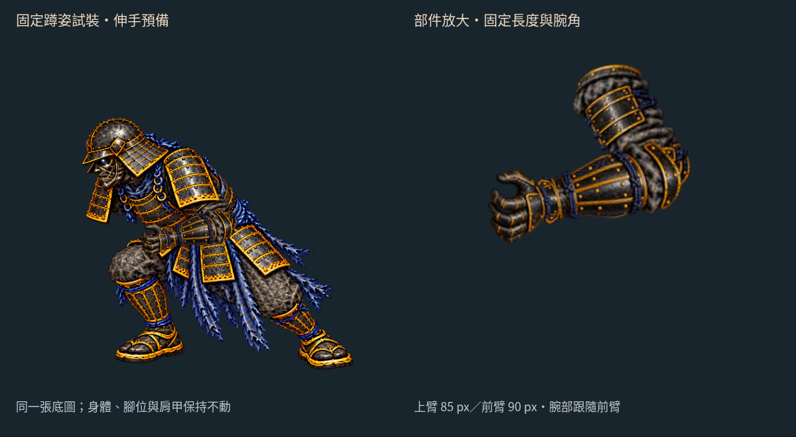
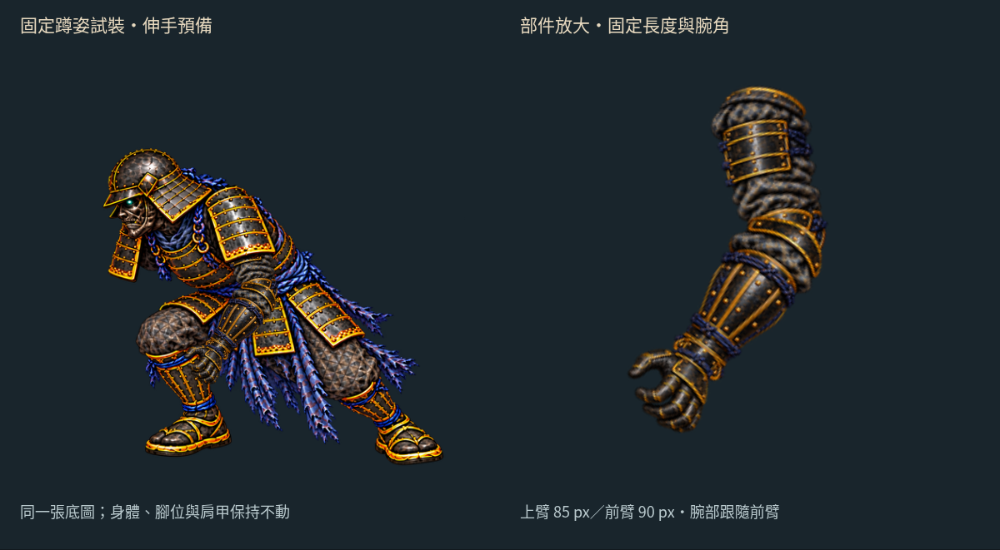
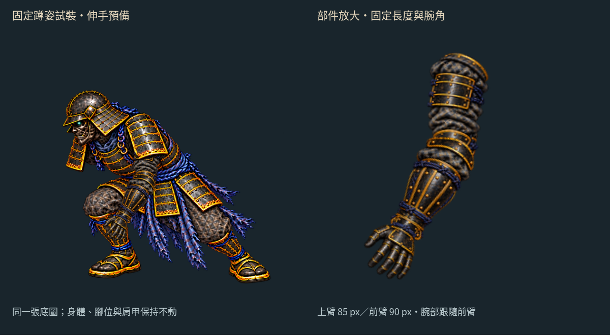

# 空手部件：固定骨架上的可動試裝

2026-10-16（台北時間）。分支 `art/jigoku-prerendered-2d`。

[試裝檢視頁原始檔](free-arm-parts/index.html) · [30 fps MP4](free-arm-parts/parts-30fps.mp4) · [手機](free-arm-parts/mobile.jpg) · [上一輪可達性試算](FREE_ARM_STUDY.md)

這輪把上一輪的線段骨架換成 **真正分開繪製的上臂、前臂與手掌貼圖**。同一組部件會伸手、轉動，肩甲覆蓋上臂根部；移除原空手後的胸甲、腰帶與膝部也已補出一張試裝底圖。



這是 **固定蹲姿的伸手預備，尚未接地或替換戰鬥動作**。左側身體、腳與肩甲不動；右側放大同一組部件。時間沿用前輪曲線的相對肩腕偏移，並以四分之一速度展示，不代表全身正在下沉。GIF 合併相同停留畫面，MP4 為均勻 30 fps。

## 共用哪些東西

- 上臂、前臂、半握手與張掌，全部裁自既有 `arm-parts-stocky.png`，沒有另外生成手臂。以等比例縮放註冊到 **85／90 px** 固定骨架，兩張手形共用腕接點。
- 手掌方向跟隨前臂，平面腕部偏轉為 0；沒有用手腕反折去追目標。**半握與張掌仍是兩張圖切換**，還沒有連續手指動畫，也沒有三維前臂旋轉。
- 一次 image gen 移除蹲低原畫的近側空手，補回遮住的胸甲、藍色腰帶與膝部。生成結果的構圖與細節有改變，因此採 **0.42 倍等比例縮放、平移 `[201,285]`** 重新註冊；沒有當作原圖完全不變的修補。
- 肩甲覆蓋片直接從新底圖裁切，以記錄在 JSON 的多邊形限制 alpha，保留可見 RGB；繪製順序是底圖 → 上臂 → 肩甲覆蓋片 → 前臂 → 手掌。可在檢視頁關閉肩甲或整隻手臂，檢查遮擋。





[顯示骨架接點](free-arm-parts/joints.png) · [移除空手後的底圖](free-arm-parts/clean-body.png) · [部件、來源 SHA、註冊與遮擋資料](free-arm-parts/parts.json)

## 已確認與仍需處理的地方

上臂末端始終接到前臂起點，前臂末端接到同一個腕點，切換手形不改骨架。瀏覽器檢查讀取 **實際 `drawImage` 前的 Canvas 變換矩陣**，另算兩段貼圖接點，沒有只檢查規劃數值；Canvas 的浮點誤差以 0.001 畫布像素容差驗證。

從實際畫面仍能看見肘部雙層護甲／布料重疊、肩甲邊緣與底圖造型差異；手形切換也仍有跳變。這個試裝只證明同一組貼圖可以隨固定骨架活動，**不代表全身跪地、撐掌受力或自然人體動作已完成**。肩部目前固定在新底圖的人工標記 `[516,394.2]`，手停在膝前，不能把它解讀為已撐到地面。

本輪新增的六張檢視貼圖（四部件、底圖、肩甲）RGBA8 合計約 **3.511 MiB**；這是檢視頁素材估算，不是實機顯存量測。正式遊戲沒有載入它們，`combat/`、`src/`、`public/` 維持 `5105604` 基線。

## 檢查與重建

```sh
python3 tools/prepare_free_arm_parts.py
node --test tools/check_free_arm_parts.mjs tools/check_free_arm_reach.mjs
python3 tools/check_free_arm_parts_art.py
node tools/check_free_arm_parts_browser.mjs
python3 tools/package_free_arm_parts.py
```

- **5 項測試通過**：新增 2 項部件端點／手形共用檢查，加上前輪 3 項可達性與固定臂長測試。
- [素材檢查](free-arm-parts/art-check.json)：既有四部件來源像素、底圖等比例註冊、肩甲遮擋片、正式遊戲隔離。
- [桌機與手機檢查](free-arm-parts/browser-check.json)：實際矩陣接點、播放／暫停／拖曳、手形切換、肩甲／手臂開關與 390 px 直向排版；無載入錯誤。
- [影片檢查](free-arm-parts/video-check.json)：30 張實際畫布截圖，30 fps／1 秒，GIF 逐取樣像素核對，MP4 必要時只補偶數尺寸邊緣、不裁切或縮放人物。

HTTP 靜態服務路徑為 `/docs/routes/jigoku-2d/free-arm-parts/`；GitHub 的 HTML 檔案頁只顯示原始碼，可先看上方 GIF。沒有新增 Blender／Modal 渲染或第三方素材。

下一步讓胸甲與肩帶隨降肩曲線下沉，接上跪地底圖，並處理肩甲遮擋與掌根接觸位置；本輪部件可沿用，無須再生成整隻手臂。

後續已完成 [獨立跪姿的掌根固定與屈肘下沉試作](FREE_ARM_SUPPORT.md)，直接沿用本頁的上臂與前臂；蹲跪全身接續仍待處理。
