# 側倒：腰甲過渡原畫試作與比較

2026-10-17（台北時間）。分支 `art/jigoku-prerendered-2d`。

本輪完成兩張 image gen 腰甲稿，將直立雙片裙甲接成可播放候選版本，並檢查前後兩次交接。**局部造型改變，但交接色差基本持平、略增，因此未採用為預設。** 完整過程與 30 fps 比較見 [腰甲過渡試作](WAIST_TRANSITION.md)。

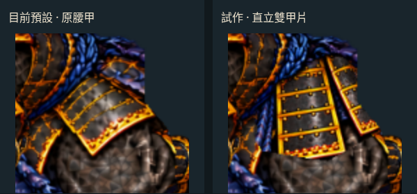

[腰甲同步比較頁原始檔](free-arm-settle/hip-review.html) · [候選版 30 fps 影片](free-arm-settle/hip-30fps.mp4) · [素材與量測](free-arm-settle/waist-transition-check.json)

以下動圖與影片繼續顯示目前預設的護脛放低版本，並非本輪候選腰甲。

[互動檢視頁原始檔](free-arm-settle/index.html) · [30 fps MP4](free-arm-settle/settle-30fps.mp4) · [手機畫面](free-arm-settle/mobile.jpg) · [前輪五姿勢](FREE_ARM_TRANSITION.md)

目前預設沿用前輪修正的**首次側倒時靴尖突然往下跳**：1000–1200 ms 離掌後，讓原護脛與靴子以固定大小逐漸放低，再接上一輪的共用側倒部件。沒有新增生成圖片、Blender 或 Modal 工作；仍是獨立 Canvas 試作，未替換正式遊戲。


右側保留先前收腳、落刀及 860→1180 ms 卸力；1200–1240 ms 使用低頭過渡格，之後接回原側倒圖，1500 ms 到達側躺末姿，停留至 1800 ms。共用手臂的肩／肘／腕位置連續，**身體輪廓仍是原畫換格，不是連續全身動畫**。仍是獨立 Canvas 試作，未替換 Phaser 戰鬥或線上 v22；左側維持五姿勢基線作比較。

本頁 `pose-*.png` 與動圖反映目前預設的護脛提前放低版本；護脛交接截圖在 `handoffs/calf/`；本輪腰甲候選在 `handoffs/hip/`，前輪共用護脛在 `handoffs/leg/`，胸肩接續在 `handoffs/entry/`。前輪共用肩甲截圖在 `handoffs/shoulder/`、共用頭盔在 `handoffs/helmet/`、四格烘焙頭部在 `handoffs/bridge/`；各輪都有保留的比較頁。

## 前輪：原護脛先放低，減輕第一次靴尖跳位

[首次護脛接續比較頁原始檔](free-arm-settle/calf-review.html) · [手機比較](free-arm-settle/calf-mobile.jpg) · [裁切與路徑](free-arm-settle/leg-entry.json) · [素材與交接量測](free-arm-settle/leg-entry-check.json)

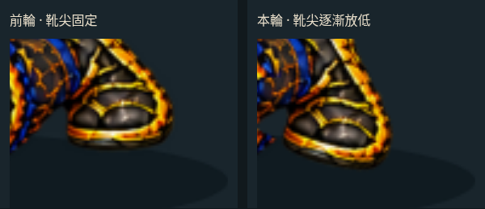

[同時刻完整人物比較](free-arm-settle/calf-comparison.png)；放大圖直接裁自實際 Canvas，沒有另生成動作。

- **拆出原護脛與靴，保留原尺寸**：從既有 `lower.webp` 裁出 `entry-calf.webp`，膝邊向內留 12 px 遮擋重疊；`leg-entry-lower.webp` 只移除原小腿範圍，其餘可見 RGBA 逐像素保留。裁切時明確排除原 `waist.webp` 的 alpha > 16 範圍，腰甲圖層直接沿用原檔，避免把裙甲邊角帶進移動裁片。沒有補畫材質、拉伸或影像淡化。
- **離掌後準備接地**：1000→1200 ms 的旋轉從 0° 到 15°，平移與旋轉採同一平滑進度。這是原護脛與靴整組轉動，不是踝部單獨彎折。末端最低可見像素格為 Y=681，設定投影地面為 Y=690；1001 個姿勢以實際像素格角點驗證未越界，不等於三維碰撞或人體受力正確。
- **原路徑可以比較**：`?calf=fixed` 保留前輪共用護脛；預設及 `?calf=lower` 提前放低。1000 ms 前畫面相同；1200 ms 身體換圖之後，兩版的完整畫布相同。原共用護脛比較頁與捕捉模式已固定舊路徑，保留歷史比較。
- **新增約 0.337 MiB RGBA8**：一張裁切底圖、一張護脛部件；不包含既有資源、畫布或同步比較的兩個繪圖來源，也不是實機顯存量測。

| 1200 ms 交接量測 | 前輪 | 本輪 | 變化 |
| --- | ---: | ---: | --- |
| 完整右側畫布平均 RGB 差 | 4.505 | 4.406 | 降低約 2.2% |
| 靴子區域平均 RGB 差 | 26.646 | 22.580 | 降低約 15% |

局部區域在 600×550 捕捉畫布的 `[500,415,590,485]`，完整前後 PNG、SHA256 與矩陣已保存。啟用拆分的 1000 ms，與相同時間前版相比平均 RGB 差約 0.0024／255，29 個像素最大通道差超過 8，仍有裁邊與重疊取樣差異。**兩組小腿仍在 1200 ms 換片，腰甲、大腿與膝部輪廓也仍會換圖**；本輪只減輕局部跳位，沒有消除首次身體交接。

曾試兩片腰甲一起轉斜，再試分別轉動；前者會外翹，後者整體差異只改善約 1%，且露出不自然的布料補底，因此未採用。最終腰甲保留原畫。下一步需要針對腰甲、大腿與膝部投影補出一致的過渡造型，不能只靠平移／旋轉宣稱全身連續。

## 前輪：共用護脛與靴，藏在大腿後方滑出

[同步比較頁原始檔](free-arm-settle/leg-review.html) · [手機比較](free-arm-settle/leg-mobile.jpg) · [分層與路徑](free-arm-settle/shared-rear-leg.json) · [素材與交接量測](free-arm-settle/shared-rear-leg-check.json)

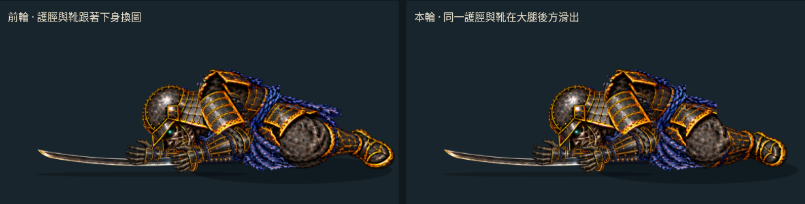

- **既有原畫直接共用**：從 `fall-rest-lower.webp` 裁出一組護脛與靴子，保留原尺寸和可見 RGBA；四張 `legless-*.webp` 僅移除原小腿區域，腰甲與大腿留下。末張接縫向內保留 12 px 重疊，腿部置於大腿圖層後方。低透明度邊緣（alpha ≤ 16）只在共用部件清除，原檔不變。
- **採固定尺寸平移**：1200→1500 ms 水平位移從 −37 px 收至 0；試作旋轉會使靴尖翹起，因此本輪角度保持 0°。可見像素格角點最低為 Y=681，位於原投影地面 Y=690 之上；這是依原畫設定的投影高度，並非真實膝關節、摩擦或接地受力。
- **可以直接對比**：預設及 `?leg=shared` 啟用，`?leg=baked` 保留前輪胸肩接續。兩個實際 Canvas 同時播放，骨架、頭盔、肩甲、雙臂與刀保持相同；1200 ms 以前畫面相同。既有胸肩比較頁已固定 `leg=baked`，歷史比較不隨新預設改變。
- **新增約 0.874 MiB RGBA8**：四張下身變體與一張共用護脛，沒有新增第三方素材。這是貼圖解碼大小估算，不含畫布、原資源與比較頁的兩個繪圖來源，亦非手機顯存實測。

| 身體交接 | 前輪全彩平均差 | 本輪全彩平均差（0–255） | 變化 |
| --- | ---: | ---: | --- |
| 1200 ms | 4.448 | 4.505 | 增加約 1.3% |
| 1240 ms | 3.028 | 2.290 | 降低約 24% |
| 1320 ms | 3.535 | 2.591 | 降低約 27% |
| 1440 ms | 2.869 | 1.996 | 降低約 30% |

量測使用同一時間前後 ±0.001 ms 的實際右側畫布，完整 PNG 與 SHA256 已保存。後三個交接的下身局部平均色差另降低約 47–63%，但**第一個交接略退步，腰甲、大腿與膝部輪廓仍會換圖**；不能把色差改善當成解剖或插畫品質已達標。

下一步應處理 1200 ms 首次進入側倒的下身造型接續，以及大腿／膝部的投影形狀。繼續保持手臂與落地刀的既有路徑，確認輪廓後才接回戰鬥。

## 前輪：離掌後先轉落肩甲，再接第一格側倒

[胸肩接續同步比較頁原始檔](free-arm-settle/entry-review.html) · [手機比較](free-arm-settle/entry-mobile.jpg) · [來源與動作設定](free-arm-settle/shoulder-entry.json) · [素材與交接量測](free-arm-settle/shoulder-entry-check.json)

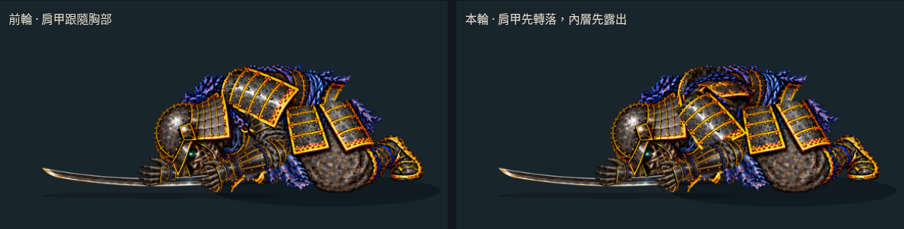

- **提前移動原甲片**：1000 ms 離掌後，原 `cap.webp` 不再完全跟著胸部；沿人工投影路徑轉落，在 1200 ms 前靠近側倒肩甲的位置。起點與原胸甲矩陣一致，整段只平移、旋轉，大小不變。1200 ms 之後仍切換到側倒原片，不是同一肩甲貫穿所有姿勢。
- **重用頸肩內層**：把既有 `shoulderless-bridge.webp` 的頸肩結構，用固定角度對齊到原胸甲座標，只寫入原肩甲 alpha ≥ 250 的遮擋範圍；不足處沿用既有暗色襯布。兩張衍生底圖保留原 alpha，範圍外可見 RGB 不變；包含頭部／去頭兩版供 1180 ms 頭部分層接續。沒有新畫一整個人物，也沒有把胸甲拉長。
- **不以對齊數值代替外觀檢查**：先試輪廓對齊，甲片仍太直；改參考金色甲緣，再以實際畫布確認角度。`tools/fit_shoulder_entry.py` 可重跑這個唯讀對齊試算；它只提供位置種子，不判定解剖正確。最初僅用重複襯布會露出一大片布紋，因此最終加入既有頸肩內層。
- **原動作保持可比**：`?entry=fixed` 保留前輪共用肩甲，預設與 `?entry=drape` 使用提前轉落。同步比較兩邊的時間、身體與頭盔姿勢一致；1000 ms 前及 1200 ms 換圖後畫面相同。既有肩甲比較頁已固定使用 `entry=fixed`。
- **新增約 0.837 MiB RGBA8**：兩張底圖，原甲片直接重用；不含先前素材、畫布和比較頁的額外開銷，不是手機顯存量測。

| 接續點 | 前輪全彩平均差 | 本輪全彩平均差（0–255） | 說明 |
| --- | ---: | ---: | --- |
| 1000 ms | 0.205 | 0.215 | 原本已有離掌換手形，本輪另啟用遮擋底圖 |
| 1180 ms | 0.0027 | 0.0017 | 保留共用頭盔拆分 |
| 1200 ms | 5.068 | 4.448 | 第一個胸肩／身體換圖，平均差降低約 12% |
| 1220 ms | 0.0096 | 0.0096 | 與前輪相同 |
| 1240 ms | 3.028 | 3.028 | 與前輪相同 |

第一個換圖的身體圖層重疊率仍約 **85.86%**，幾乎沒有改善輪廓；改善集中在甲片提前轉落與內層圖案的接續，不能稱為全身已連續。1000 ms 啟用底圖時，相同時間的新舊版本平均 RGB 差約 0.0098／255，76 個像素最大色差超過 8，仍有邊緣取樣差異。1001 個實際甲片姿勢取樣最低點約 Y=635.53，未越過投影地面 Y=690；這不等於真實重力或肩帶受力模擬。

下一步應處理腰甲、骨盆與膝部轉側的造型交接；目前四張身體原畫仍會換格，不能只靠部件矩陣消除所有輪廓跳動。

## 前輪：同一肩甲接續後半段，襯布維持遮擋

[肩甲同步比較頁原始檔](free-arm-settle/shoulder-review.html) · [手機比較](free-arm-settle/shoulder-mobile.jpg) · [來源與動作設定](free-arm-settle/shared-shoulder.json) · [素材與換格量測](free-arm-settle/shared-shoulder-check.json)

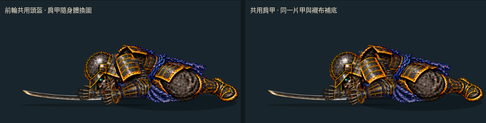

- **沿用低頭過渡格肩甲**：直接讀取 `fall-bridge-cap.webp`，不另製肩甲圖片。1220 ms 接入時使用同一肩點與原位置，之後維持原尺寸，角度漸進至 14°。肩甲的領口固定點相對肩部沿人工曲線調整，避免把整片甲當成上臂一起轉；沒有改動手臂骨架。
- **保留內襯，不挖空胸部**：從既有 `headless-bridge.webp` 的暗色菱格襯布取 20×14 px 區域，以原尺寸重複鋪在舊肩甲範圍內。四張胸部衍生貼圖保留原 alpha，範圍外可見 RGB 逐像素不變；遮擋層移開時仍有襯布，不露背景。這是共用小材質的 2D 裝配，近看仍可能看出重複紋理。
- **保留可比較的前版**：`?shoulder=baked` 是前輪共用頭盔，`?helmet=baked` 是更早的四格版。新同步比較以相同時間讀取兩個實際 Canvas；兩邊身體、頭盔及雙臂姿勢相同。先前頭盔比較頁已鎖定舊肩甲模式，不會隨預設版更新而改變比較內容。
- **額外約 0.753 MiB RGBA8**：只有四張襯布胸部變體，肩甲直接重用既有載入資源。此估算不含原貼圖、畫布及雙場景檢視開銷，不是手機效能實測。

| 身體換格 | 前輪／本輪身體圖層重疊率 | 前輪／本輪全彩平均差（0–255） |
| --- | ---: | ---: |
| 1200 ms | 85.86%／85.86% | 5.068／5.068 |
| 1240 ms | 91.14%／91.18% | 3.625／3.028 |
| 1320 ms | 84.94%／85.40% | 4.289／3.535 |
| 1440 ms | 90.55%／91.35% | 3.760／2.869 |

後三次換格的全彩平均差降低約 **16–24%**，身體圖層重疊率小幅改善；這不是整體美術品質分數。1200 ms 的第一個交接維持原樣，胸甲、腰甲與頸部其他邊線仍會換圖。1220 ms 啟用共用肩甲時，因一個像素的襯布遮罩擴張與取樣，平均 RGB 差約 0.0096／255，127 個像素最大色差超過 8；不能稱為逐像素無縫。

曾試用前段直立肩甲一路接續，實際側倒時位置太高、頸肩露底，因此未採用。現在以姿勢已吻合的過渡肩甲接續後半段，未靠拉伸或淡化掩蓋差異。下一步仍需處理第一個胸肩交接、頸部邊線與腰甲跨格造型。

## 前輪：共用頭盔，不再每格重畫頭部

[頭盔同步比較頁原始檔](free-arm-settle/head-review.html) · [手機比較](free-arm-settle/head-mobile.jpg) · [素材與換格檢查](free-arm-settle/shared-head-check.json)

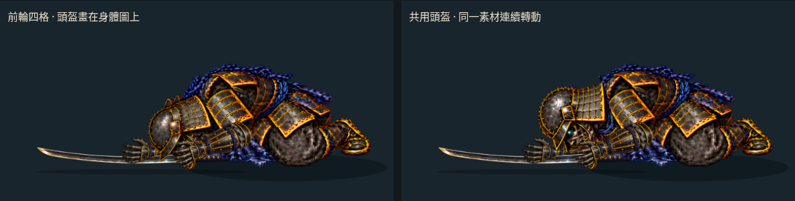

- **沿用原素材**：頭盔、面部、下顎與部分頸甲裁自既有 `torso.webp`。另製作卸力及四張側倒姿勢的去頭胸甲，原素材不覆寫；來源 SHA256、裁切多邊形與頭部軸點見 [shared-head.json](free-arm-settle/shared-head.json)。裁片保留來源可見 RGB，只改 alpha 分層。排除原先跟著頭部懸空的藍繩，頸部切口保留兩個來源像素重疊。
- **同一頭部連續轉動**：起點使用原卸力胸甲的完整剛性轉換，之後沿人工頸部位置插值，保持頭部大小與紋理相同；只平移、旋轉，沒有拉長、壓扁或交叉淡化。近側肩甲仍繪在頭部前方，因此肩甲換圖仍可能改變頭部遮擋。
- **身體與雙臂不變**：同步比較以相同時間讀取兩個實際 Canvas 場景；兩邊的身體／雙臂姿勢資料完全一致，差別是頭部素材與分層。完整檢視頁預設為共用頭盔，`?helmet=baked` 保留前輪四格，`?motion=baseline` 保留原三格。
- **新增資源約 1.268 MiB RGBA8**：一張頭部及五張去頭胸甲，不含原本仍載入的貼圖、畫布和雙場景比較頁開銷；不是手機實測顯存。正式遊戲資源未變。

| 身體換格 | 前輪輪廓重疊率 | 共用頭盔 | 前輪／本輪全彩平均差（0–255） |
| --- | ---: | ---: | ---: |
| 1200 ms | 79.57% | 85.86% | 6.728／5.068 |
| 1240 ms | 81.74% | 91.14% | 4.882／3.625 |
| 1320 ms | 82.24% | 84.94% | 5.205／4.289 |
| 1440 ms | 87.50% | 90.55% | 4.705／3.760 |

四次換格的身體圖層輪廓與全彩差異均改善。**頭部圖層保持連續，但衣甲、肩甲遮擋和頸部造型仍未連續。** 頭部是平面剛性部件，不是立體轉頭、頸椎變形或承重模擬。

1601 個實際頭部轉換取樣中，可見像素格角點最低為 Y≈677.08，未超過設定地面 Y=690；這只驗證投影範圍。1180 ms 拆分啟用時，全畫面平均 RGB 差約 0.0027／255，53 個像素的最大色差大於 8，屬切口與濾波差異，不能稱為逐像素無縫。四個換格的頭部矩陣連續；獨立頭部圖層最多只有兩個像素的預乘色差大於 3，最大 alpha／預乘色差為 8，沒有整張頭圖切換。

## 前輪：低頭稿作過渡，不取代原側倒格

[同步比較頁原始檔](free-arm-settle/bridge-review.html) · [1220 ms 過渡姿勢](free-arm-settle/pose-1220.png) · [手機同步比較](free-arm-settle/bridge-mobile.jpg) · [換格量測](free-arm-settle/bridge-handoff-check.json)

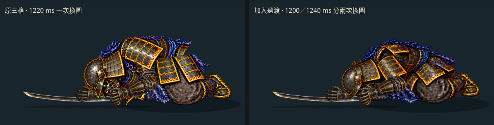

- 來源仍為 `side-fall-bowed-head.png`，只用第一格。前輪判定它不適合替換原 `roll` 圖；這次保留 `roll`，將低頭圖插在其前，關鍵時間為 1220 ms。實際選格為 **1200 ms 之後至 1240 ms**；原 `roll`／`side`／`rest` 的關鍵時間仍為 1260／1380／1500 ms。
- 三張新增裁片沿用前輪記錄的 0.70 倍縮放、肩點及遮擋範圍，約 **0.469 MiB RGBA8**。連同原九張側倒裁片約 1.723 MiB，不含共用手臂、刀或畫布。來源、SHA256 與參數見 [bridge.json](free-arm-settle/bridge.json)。
- 近／遠臂仍固定 85／90 和 65／75 px，刀的位置不變。測試逐樣比對：1180 ms 前與 1260 ms 後的骨架及刀姿和原版一致（排除新增格造成的索引偏移）；1320／1440 ms 的換格截圖也逐像素相同。
- 完整檢視頁預設使用過渡版，可切回 `?motion=baseline` 原三格。同步比較頁用兩個實際 Canvas 場景讀取同一時間，再裁出角色區域；不是新生成的影片或影像變形。兩個來源頁增加記憶體開銷，只供檢視，不是遊戲效能方案。

| 交接 | 身體圖層輪廓重疊率 | 輪廓異動像素 | 全彩平均差（0–255） |
| --- | ---: | ---: | ---: |
| 原本 1220 ms 一次換圖 | 77.86% | 9644 | 6.678 |
| 本輪 1200 ms 進入過渡 | 79.57% | 9069 | 6.728 |
| 本輪 1240 ms 接回原畫 | 81.74% | 7180 | 4.882 |

**原本一次換圖變成兩次較小的輪廓變化，改善幅度有限。** 全彩差異峰值略增；較高重疊率不能證明頭頸已自然連續，也不代表總視覺變化量減少。近側肩甲形狀與頭盔仍有跳位，尚未接回正式戰鬥。

## 前輪：統一比例，量測換格

[逐格比較頁原始檔](free-arm-settle/handoff-review.html) · [像素與輪廓量測](free-arm-settle/handoff-check.json)

三張側倒原畫現在都以 **0.70 倍**註冊，後兩格不再縮為 0.64 倍。調整平移以保留地面高度，肩點沿用來源圖中的原標記；兩側手臂重新跟隨同一肩點曲線。第二格貼地衣料的遮擋界線同步調整，九張裁片約 **1.254 MiB RGBA8**；1401 個取樣的可見身體最低點為 Y=689，最大胸部補償平移從 19.796 降至 15.660 px。

對照 `800ab1f`，擷取每次換格前後相差 **0.002 ms** 的實際畫布，另以相同繪圖矩陣隔離身體圖層 alpha。重疊率為 alpha > 16 的交集／聯集，排除獨立雙臂、刀與原護脛圖層；不是人體驗證。

| 換格 | 舊版身體輪廓重疊率 | 本輪 | 舊版／本輪全彩平均差（0–255） |
| --- | ---: | ---: | ---: |
| 1220 ms | 77.86% | 77.86% | 6.678／6.678 |
| 1320 ms | 77.38% | 82.24% | 4.873／5.205 |
| 1440 ms | 87.28% | 87.50% | 3.837／4.705 |

**改善的是側倒中途突然縮小的比例與第二次換格的輪廓重疊。** 第一個交接完全未變；後段全彩差異增加，最後一次換格的輪廓異動像素也從 3995 增至 4682（放大後面積增加）。不能把重疊率提高解讀成所有接縫都改善。頭盔、甲片、膝部的原畫差異仍可見。

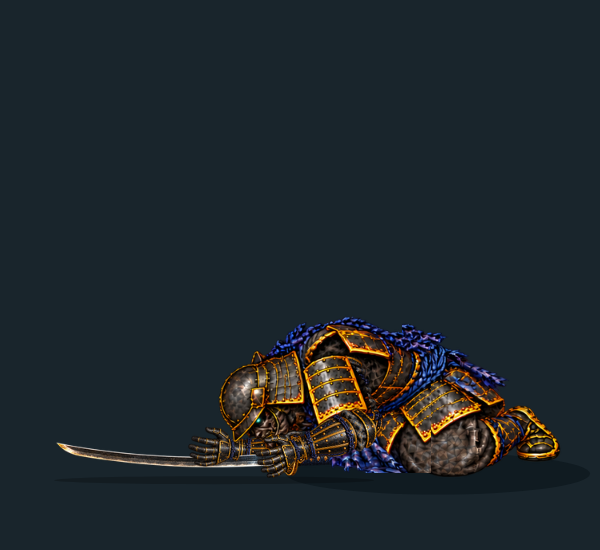
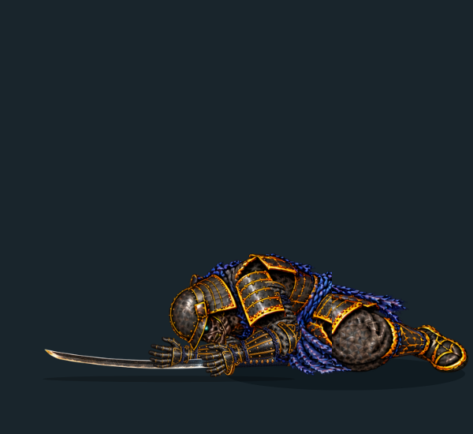

前輪另用一次 image gen 試修低頭姿勢，來源保留於 [side-fall-bowed-head.png](../../../assets/source/jigoku-2d/ghost-rig/side-fall-bowed-head.png)。第一個交接重疊率升至 79.57%，但第二個降為 69.24%，所以**未採用**。對照頁可切至未採用版本；其註冊參數與實際截圖保留於 `handoffs/rejected/`。這個整段替換方案仍未採用；本輪只取其中第一格作額外過渡，沒有沿用它取代後段的方案。

## 前輪側倒原畫與裝配

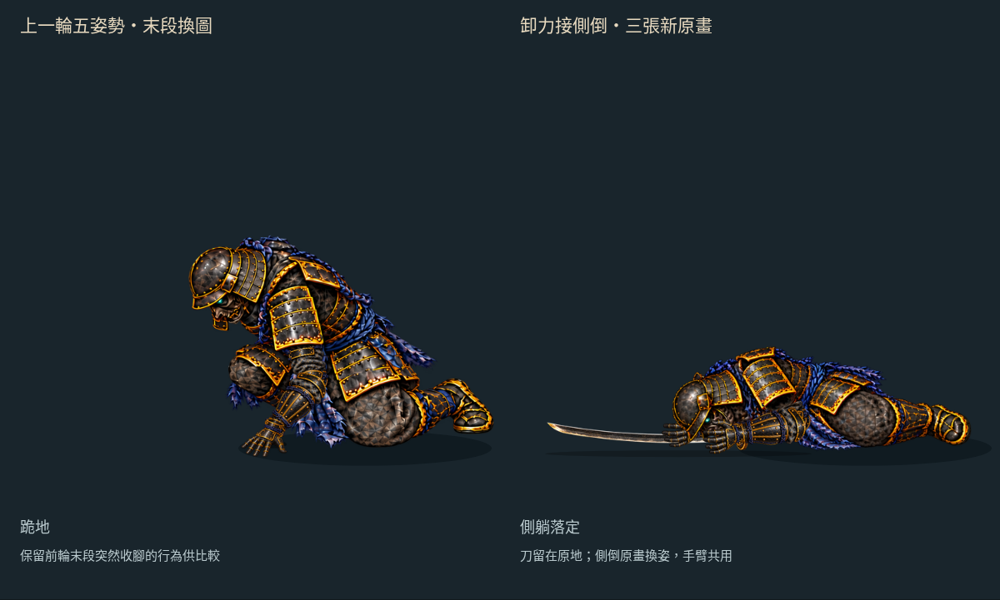

[1260 ms 骨盆側移](free-arm-settle/pose-1260.png) · [1380 ms 膝部翻落](free-arm-settle/pose-1380.png) · [前段低伏末姿](free-arm-settle/pose-1180.png) · [三張來源圖](../../../assets/source/jigoku-2d/ghost-rig/side-fall-breakdowns.png)

- **一次 image gen**：以本頁上一輪右側低伏末姿及 `crouch-arm-clean.png` 為參考，新增 `side-fall-breakdowns.png`，2172×724 RGBA。保留黑金甲、藍繩與左向鏡頭；要求不畫雙臂及武器，供既有部件裝配。生成結果仍有甲片形狀、頭盔尺寸及姿勢差異，不能視為精確拓撲一致的模型。
- **等比例註冊**：三格分別以 0.70／0.64／0.64 縮放及人工肩點對齊，沒有非等比形變。原檔保留；裁片前只將 alpha ≤ 16 的低透明雜點清零。來源雜湊、縮放、偏移、肩點及遮擋多邊形記錄於 [fall.json](free-arm-settle/fall.json)。
- **下身與胸肩分層**：每格拆為下身、胸甲、肩甲三片，胸甲與肩甲用同一平移追隨連續肩點。貼地衣料留在下身層，避免跟著胸甲下沉。初次檢查最低點約 Y=704.32；調整遮擋分層後，1401 個取樣的可見身體像素最低點約 Y=689.32，沒有超過設定地面 Y=690。
- **雙臂續用**：近側仍為 85／90 px、遠側仍為 65／75 px，腕點平順移至各自落定位置。手掌使用既有張掌圖，來源未改；刀持續使用原落刀位置，身體換圖不重新計算放刀起點。
- **原畫時序**：1260／1380／1500 ms 是三張關鍵格；以最近時間選格，切換點在 1220、1320、1440 ms 之後。沒有交叉淡化或影像變形。肩腕連續不代表頭盔與腰甲輪廓也連續，腰部分層仍有接縫。

前輪九張裁片 RGBA8 合計約 **1.133 MiB**（本輪統一比例後為 1.254 MiB），不含既有圖集與畫布；不是實機顯存測量。「查看被遮腳部」與「修補範圍」只適用前段原收腳部件，新側倒腿部已畫在原畫中，不再使用原護脛／鞋的轉動。

## 沿用的卸力段

- **共用胸甲與肩甲**：在既有腰軸上額外前傾 18°，輔以向左 16 px、向下 3 px 的平滑位移。兩片採相同剛性轉換，肩點從同一轉換求得；下身、膝甲、護脛和鞋留在既有收腳末姿，不把整個人物當卡片旋轉。
- **先屈肘，再離掌**：860→1000 ms 掌根保持 `[470,668]`，掌圖繞掌根轉 10°，85／90 px 手臂重新求解，肩胸逐漸降低。支撐期間的投影腕軸偏差仍在 25° 內。
- **收回空手**：1000 ms 改用 `free-arm-parts/open.webp`，以同一腕點接續；到 1180 ms 腕點移至 `[445,650]`。手腕位置連續，手形和手背角度仍是直接換圖，尚非連續翻掌或逐指動畫。
- **落刀與手臂分離**：落刀計算繼續使用原收腳末姿，不把卸力後的肩位重新當成放刀起點。遠側手臂另外跟隨胸甲、縮短向下伸手的目標；65／75 px 臂長維持固定。刀在 860 ms 後的實際繪圖矩陣完全不變。
- **沒有新增貼圖**：張掌圖直接讀取前輪空手套件，不另存副本。本次取樣檢查發現衣甲最低點原本到 Y≈694.07，調整下降幅度後降為 Y≈689.07，保持在設定地面 Y=690 上方。

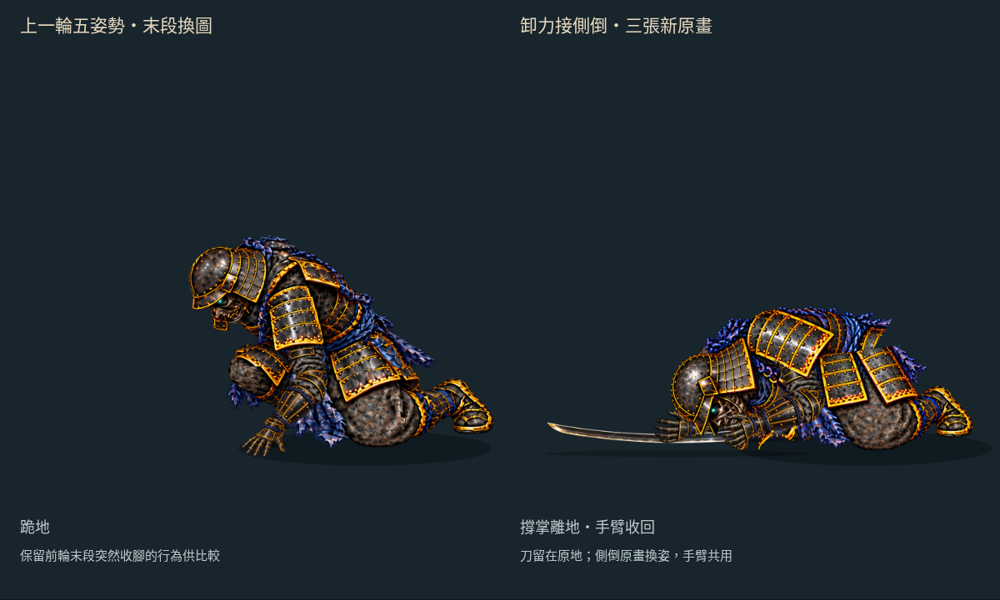

[930 ms 屈肘](free-arm-settle/pose-930.png) · [1000 ms 離掌](free-arm-settle/pose-1000.png) · [1090 ms 收臂](free-arm-settle/pose-1090.png) · [手機畫面](free-arm-settle/mobile.jpg)

參數與來源雜湊見 [yield.json](free-arm-settle/yield.json)；[像素檢查](free-arm-settle/yield-art-check.json)檢查 1001 個實際胸甲／肩甲轉換，alpha > 16 的像素未穿過投影地面或檢視區邊界。這不代表全身碰撞、承重或人體解剖已驗證。腰部仍有裁片重疊，膝髖尚未連動；這一段本身是低伏卸力；其後雖已接側倒原畫，仍不能稱為完整自然側倒動畫。

## 沿用的鬆手與落刀

- **沿用真實繪圖握點**：放手位置與角度取自這段收腳動作的 540 ms 持刀轉換，不套用舊戰鬥倒地的放刀座標。瀏覽器比較 539.999／540.001 ms 實際刀矩陣，確認沒有跳位。
- **手與刀分開**：540 ms 換既有半開手，600 ms 換張掌，兩者皆以腕點註冊、沿前臂軸轉動。手腕在 220 ms 內向身體方向移 12 px、下移 16 px，上臂／前臂仍固定長度。三種手形直接換圖，尚非逐指動畫。
- **落刀曲線**：由靜止開始的二次下降與平滑轉角，搭配總計 140 px 的水平位移，最後刀面轉平。刀的位置不再跟隨手腕；這是人工編排的平面動作，不是重力、慣量與摩擦求解。
- **接地輪廓**：從既有刀貼圖所有 alpha > 0 像素格的四角建立凸包。每次旋轉計算最低點，將刀限制在投影地面 Y=690 上方；碰地後繼續轉平，860 ms 後完全停住。陰影跟隨刀的水平範圍，沒有新增刀或地面貼圖。
- **放刀起點固定**：落刀計算取原收腳末姿；倒帶、任意跳時、重播都重新計算同一放刀起點，不依賴曾經播放到放手那一幀。


[540 ms 鬆手](free-arm-settle/pose-540.png) · [600 ms 張掌](free-arm-settle/pose-600.png) · [860 ms 落定](free-arm-settle/pose-860.png)

只多讀取 `enemy-relax.webp`、`enemy-open.webp` 兩張既有貼圖，RGBA8 約 **0.0324 MiB**。來源雜湊、刀接地凸包與時序參數見 [release.json](free-arm-settle/release.json)。輪廓只處理畫面上的垂直地面限制，沒有角色碰撞、刀鋒厚度或真實接觸力；刀轉平與水平滑移仍需美術調整。

## 持刀側與武器共用

- 直接載入 `combat/enemy-upper.webp`、`enemy-fore.webp`、`enemy-grip.webp`、`enemy-katana.webp` 和既有 `enemy-rig.json`，沒有複製或修改這些素材。重用 `solveArm` 與 `closedGrip`，新增的只是本段動作的肩點及伸手目標。
- 持刀側固定 65／75 px 投影臂長，空手側仍為 85／90 px。兩側數字是不同視角貼圖的平面接點距離，不是人體尺寸。
- 人工標定的遠側肩點位於近側肩點 `[-95,-28]`；近地後用胸甲完全相同的腰軸轉換。手腕目標平順下移，沒有超出固定臂長可達範圍，也不靠求解器截短目標。
- 握刀時，握拳方向沿前臂軸，刀的握點直接取握拳圖中的標記。刀與手共用旋轉，避免刀柄在手中漂移；這是平面接合檢查，不能證明實際手指抓握或三維腕姿正確。
- 繪圖順序：持刀上臂／前臂 → 刀 → 握拳 → 身體／衣甲 → 近側空手。遠側肩臂被胸甲遮住，握拳覆蓋刀柄；不改透明度來藏接縫。
- 「持刀側與武器」開關可獨立開關整組，原本的手臂、肩甲、腳部遮擋檢查仍保留。取景改為 0.8 倍；桌機與手機驗證都檢查完整武器貼圖矩形沒有超出畫面裁切區。

新增讀取的四張既有貼圖 RGBA8 約 **0.140 MiB**；這不是全頁顯存量測。來源雜湊、貼圖尺寸、取景與適用範圍見 [sword-kit.json](free-arm-settle/sword-kit.json)。


## 沿用的收腳與原畫修正

- **保留原膝甲與腰甲**：下身及腰甲覆蓋片重新裁自原近地圖。修補區限定在護脛／鞋原先佔據的多邊形，扣除保留的膝甲區；不再使用整張生成下身。
- **取消 400 ms 換圖**：近地開始即載入同一組下身、腿與腰甲；平移轉為腰軸旋轉時，肩點與轉換連續。前段仍保留原有關鍵格切換。
- **護脛與鞋**裁自前輪近地原畫，保留可見像素。膝點固定；護脛繞膝轉動、鞋跟隨踝點，兩段不拉長也不縮短。投影長度約 73.236／77.713 px，分別是膝到踝、踝到人工鞋尖標記，不能視為人體比例量測。
- **先撐掌、後收腳**：420 ms 前腳部保持原位。護脛逐漸轉 −45°，鞋延後跟上、最後轉 −70°；相對踝角全段小於 30°。延後鞋的轉動可避免中途腳尖往地面下方掃過。
- **胸甲繞腰前傾**：沿用原肩腕軌跡，胸甲與肩甲用同一個剛性轉換對齊肩點。400→540 ms 的腰部補償平移小於 4 px，實測最大約 3.085 px；以腰部轉動承接肩部下降。
- **遮擋分層**：小範圍修補 → 腿部 → 原下身與膝甲 → 胸甲 → 原腰甲覆蓋片 → 空手部件。膝甲遮住護脛根部，腰甲覆蓋轉腰接縫；頭部畫在膝甲前方。收進去的鞋由下身 alpha 真正遮住，始終以 alpha=1 繪製。
- **既有空手完全重用**：85／90 px 上臂和前臂、撐掌貼圖、肩肘腕及掌根曲線都沿用前輪。掌根在 420→1000 ms 固定於 `[470,668]`，之後交接本輪離掌動作。


[400 ms：收腳前](free-arm-settle/pose-400.png) · [接地](free-arm-settle/pose-420.png) · [開始收腳](free-arm-settle/pose-440.png) · [接近末姿](free-arm-settle/pose-480.png) · [末姿](free-arm-settle/pose-500.png) · [關節標記](free-arm-settle/joints.png)


檢視頁的「查看被遮腳部」只改繪圖順序，不改腿部矩陣、不縮放、不淡出。上圖另外關閉手臂，方便看見藏在衣甲後的鞋。

## 修補範圍與像素檢查


「修補範圍」開關標示來源區域。生成像素僅存在於橘框內、青框外；裁片中 alpha > 16 的修補像素為 **291 個**。膝甲和腰帶直接保留原近地圖，並以素材檢查逐像素核對。

瀏覽器在 **399.999／400.001 ms** 擷取右側實際畫布，確認貼圖 URL 沒有切換。本輪包含持刀側且調整取景後，兩張圖僅 304 個像素有差異，各色頻最多差 1／255，屬連續動作的 Canvas 取樣差異；檢查會拒絕較大的色差或大面積變化。這只針對原本的 400 ms 交接，不能證明前段換姿也已平滑。

[399 ms](free-arm-settle/pose-399.png) · [400 ms](free-arm-settle/pose-400.png) · [401 ms](free-arm-settle/pose-401.png) · [剛進入近地部件](free-arm-settle/pose-389.png)

## 素材與限制

先前新增一次 image gen 側倒原畫，另一次低頭修稿未作整段替換；本輪重用低頭稿第一格作過渡，沒有新增生成工作。沒有新增 Blender／Modal 工作或第三方素材。以下原收腳裁片來源維持不變。沿用上一輪的 `touch-shin-clean.png` 補圖，但只擷取挪開腿部後會露出的區域；頭盔、胸甲、肩甲、下身、腰甲、護脛和鞋均使用原近地圖。原收腳裁片只作已記錄的等比例註冊與 alpha 裁切，沒有非等比變形；後續四張胸部變體重用襯布，本輪兩張進入側倒前的底圖再重用頸肩結構，見上方來源與範圍。來源 SHA、膝甲保留區與修補區多邊形見 [settle.json](free-arm-settle/settle.json)。

原收腳七張專用裁片 RGBA8 合計約 **0.964 MiB**，不含其他重用貼圖與畫布緩衝；這是素材估算，不是實機顯存量測。

**本輪末姿比前輪更前傾，並不是原跪姿的完全相同輪廓。** 固定膝點的平面收腳只是一種可重用的動作試作，尚未處理立體腿部旋轉、膝髖連動或碰撞受力。400 ms 的整張下身切換已移除；腰甲拼接、護脛裁邊與前段三次原畫切換仍需精修。持刀側已裝配，但遠側肩點與肘部遮擋仍是人工平面配置；未作三維穿插或受力驗證。

下一步精修腰甲、骨盆與膝部轉側的造型交接；本輪減輕首次側倒的靴尖跳位，但腰甲與大腿交接尚未改善，身體原畫仍會切換，尚不接回戰鬥。沒有直接套用接點不一致的舊側倒原畫，前段原畫切換與離掌手形仍有精修空間。

## 檢查與重建

```sh
python3 tools/prepare_free_arm_settle.py
python3 tools/prepare_sword_release.py
python3 tools/prepare_side_fall.py
python3 tools/prepare_fall_bridge.py
python3 tools/prepare_shared_head.py
python3 tools/prepare_shared_shoulder.py
python3 tools/prepare_shoulder_entry.py
python3 tools/prepare_shared_rear_leg.py
python3 tools/prepare_leg_entry.py
node --test tools/check_leg_entry.mjs tools/check_shared_rear_leg.mjs tools/check_shoulder_entry.mjs tools/check_shared_shoulder.mjs tools/check_shared_head.mjs tools/check_fall_bridge.mjs tools/check_side_fall.mjs tools/check_settle_yield.mjs tools/check_sword_release.mjs tools/check_settling_sword.mjs tools/check_free_arm_settle.mjs tools/check_free_arm_transition.mjs tools/check_free_arm_support.mjs tools/check_free_arm_parts.mjs tools/check_free_arm_reach.mjs
python3 tools/check_free_arm_settle_art.py
python3 tools/check_settle_yield_art.py
python3 tools/check_side_fall_art.py
python3 tools/check_side_fall_art.py bridge.json
node tools/check_free_arm_settle_browser.mjs
node tools/capture_fall_handoffs.mjs docs/routes/jigoku-2d/free-arm-settle/handoffs/current baseline
node tools/capture_fall_handoffs.mjs docs/routes/jigoku-2d/free-arm-settle/handoffs/bridge
python3 tools/check_fall_handoffs.py
python3 tools/check_bridge_handoffs.py
node tools/check_bridge_review_browser.mjs
node tools/capture_fall_handoffs.mjs docs/routes/jigoku-2d/free-arm-settle/handoffs/helmet helmet
python3 tools/check_shared_head_art.py
node tools/check_head_review_browser.mjs
node tools/capture_fall_handoffs.mjs docs/routes/jigoku-2d/free-arm-settle/handoffs/shoulder shoulder
python3 tools/check_shared_shoulder_art.py
node tools/check_shoulder_review_browser.mjs
node tools/capture_fall_handoffs.mjs .tmp/shoulder-entry-baseline entry previous
node tools/capture_fall_handoffs.mjs docs/routes/jigoku-2d/free-arm-settle/handoffs/entry entry
python3 tools/check_shoulder_entry_art.py
node tools/check_entry_review_browser.mjs
node tools/capture_fall_handoffs.mjs .tmp/rear-leg-baseline leg previous
node tools/capture_fall_handoffs.mjs docs/routes/jigoku-2d/free-arm-settle/handoffs/leg leg
python3 tools/check_shared_rear_leg_art.py
node tools/check_leg_review_browser.mjs
node tools/capture_fall_handoffs.mjs .tmp/calf-entry-baseline calf previous
node tools/capture_fall_handoffs.mjs docs/routes/jigoku-2d/free-arm-settle/handoffs/calf calf
python3 tools/check_leg_entry_art.py
node tools/check_calf_review_browser.mjs
python3 tools/package_free_arm_settle.py
```

- **46 項相關測試通過**：新增 2 項護脛提前放低測試，檢查起點重組、投影地面、角度單調、首尾平滑及倒帶；另有 2 項共用護脛測試，檢查單調平移、可見像素格的投影高度、換格時的部件連續與倒帶；另有 3 項肩甲提前轉落測試，驗證離掌起點重組、原骨架不變、位置角度連續、目標對齊與倒帶；另有 3 項共用肩甲測試，驗證接入時的原片位置、領口固定點與角度連續、原骨架不變、停留及任意跳時；另有 3 項共用頭部測試，驗證拆分起點、頭部剛性與轉換連續、關鍵姿勢、落定與倒帶；另有 3 項過渡格測試，驗證前後段保持原動作、新時序、雙臂可達性與連續接點、落刀固定及倒帶；另沿用 3 項側倒測試，涵蓋前段不變、三格選取、肩腕連續、固定雙臂及可達性、末姿停留、刀保持原位和任意跳時；另有既有 27 項卸力、落刀及收腳測試。
- [素材與鞋底檢查](free-arm-settle/art-check.json)：逐裁片核對可見像素，生成像素不得侵入膝甲保留區；1001 個實際 JS 骨架取樣中，鞋上 alpha > 16 的像素未超過起始鞋底 Y=684。另對 1001 個落刀取樣檢查全部可見刀像素格角點，沒有超過 Y=690，接觸時最低點吻合地面。這只驗證螢幕投影高度，不代表三維地面碰撞正確。
- [側倒素材檢查](free-arm-settle/fall-art-check.json)：裁片逐像素對照註冊後來源；1401 個實際轉換取樣確認可見像素位於檢視區及投影地面上方，來源與正式遊戲維持隔離。這不驗證人體受力或全身輪廓連續。
- [瀏覽器檢查](free-arm-settle/browser-check.json)：實際 Canvas 雙側肩／肘／腕、刀柄與握拳、膝／踝接點、支撐期間固定掌根與下身、400 ms 前後實際畫布像素、持刀側繪圖順序／獨立開關／完整貼圖裁切範圍、三種手形與落刀階段、放手矩陣連續、落定後刀固定、胸肩卸力、四張側倒格、共用雙臂接合及前段腿部 alpha=1；原速／慢速、逐姿勢、重播與 390 px 手機觸控均通過，無載入錯誤。
- [換格量測](free-arm-settle/handoff-check.json)：保存三次換格的舊版、新版與未採用修稿截圖及 SHA256；檢查新版註冊參數與捕捉資料一致、第一個交接未變、後兩個交接的正規化輪廓重疊率沒有退步。全彩差異另外如實記錄，不當作全部改善。
- [過渡素材](free-arm-settle/bridge-art-check.json)：1501 個實際動作取樣與四格裁片像素核對，最低點 Y=689，未越過設定地面 Y=690。
- [同步比較檢查](free-arm-settle/bridge-browser-check.json)：兩個來源時間同步、過渡前及 1260 ms 後畫布像素相同、過渡期間不同；播放、暫停、重播、末端停止、390 px 排版均通過。
- [共用頭盔檢查](free-arm-settle/shared-head-check.json)：逐裁片核對來源、1601 個頭部姿勢取樣、四次換格的實際頭部矩陣和圖層像素、啟用時的重組差異；全彩與輪廓比較均對照前輪四格，原遊戲及原始身體素材未變。
- [頭盔同步比較](free-arm-settle/head-browser-check.json)：兩邊時間及身體姿勢相同、1180 ms 前像素相同、其後僅右側使用共用頭部；播放、暫停、重播與手機排版通過。
- [肩甲素材檢查](free-arm-settle/shared-shoulder-check.json)：四張衍生胸部保留原 alpha；舊甲片範圍外 RGB 不變，範圍內沿用已記錄的襯布材質。後三次交接實際甲片矩陣與圖層連續，第一個交接截圖保持原樣。
- [肩甲同步比較](free-arm-settle/shoulder-browser-check.json)：兩邊時間、身體與頭部姿勢相同；1220 ms 前畫面一致，之後僅右側共用肩甲。播放、重播、手機排版、肩甲開關及貼圖載入期間縮放視窗均通過。
- [提前轉落素材與交接](free-arm-settle/shoulder-entry-check.json)：兩張底圖保留原透明度與遮擋區外 RGB，來源雜湊可核對。1001 個實際甲片姿勢未越過投影地面；啟用、頭部分層及第一個換圖均與前輪實際畫布比較，後段像素保持原樣。
- [胸肩同步比較](free-arm-settle/entry-browser-check.json)：相同骨架與頭盔，指定區間以外畫面相同；播放、重播、倒帶、手機排版、肩甲開關及延遲載入時縮放視窗通過。
- [共用護脛檢查](free-arm-settle/shared-rear-leg-check.json)：原畫雜湊、保留像素與裁切 alpha 核對，四次實際換圖差異如實記錄；[同步比較](free-arm-settle/leg-browser-check.json) 檢查時間一致、骨架與刀不變、播放／暫停／手機排版與延遲載入。主瀏覽器檢查另核對實際腿部矩陣、固定比例與大腿後方繪圖順序。
- [首次護脛接續](free-arm-settle/leg-entry-check.json)：逐像素驗證原素材、裁切範圍與原圖雜湊，1001 個實際姿勢檢查全部可見像素格，首次接續及啟用差異如實記錄，後段完整畫布與前輪相同；[同步比較](free-arm-settle/calf-browser-check.json) 驗證時間、骨架、頭盔與刀一致，播放／暫停／倒帶、390 px 排版及延遲貼圖載入均通過。
- [影片檢查](free-arm-settle/video-check.json)：180 張實際瀏覽器畫布，含落刀、卸力、側倒與末姿停留的四分之一速度，均勻 30 fps／6 秒 MP4；GIF 使用共用 256 色色盤與變動區域壓縮，逐取樣核對解碼像素；完整色彩保留在 MP4 與 PNG。30 fps 是播放頻率，不是每秒三十張新原畫。

五姿勢檢視頁、原手臂／撐掌部件與正式遊戲維持原基線；另對側倒段起點 `a49fc49` 確認來源和遊戲檔案未變。HTTP 靜態服務路徑 `/docs/routes/jigoku-2d/free-arm-settle/`；此分支尚未部署到 Pages，GitHub HTML 頁只顯示原始碼，可先看動圖和影片。
