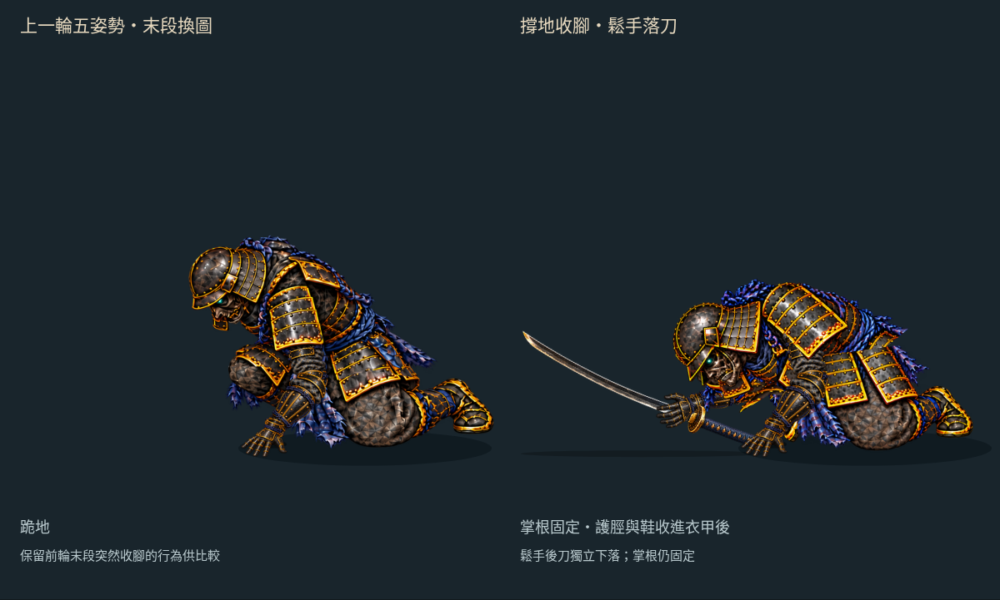
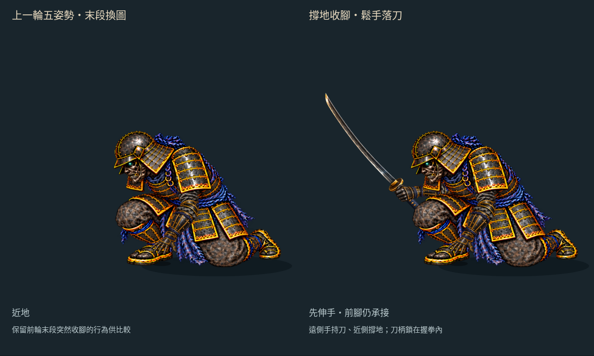

# 撐地收腳：鬆手與落刀接續

2026-10-16。分支 `art/jigoku-prerendered-2d`。

[互動檢視頁原始檔](free-arm-settle/index.html) · [30 fps MP4](free-arm-settle/settle-30fps.mp4) · [手機畫面](free-arm-settle/mobile.jpg) · [前輪五姿勢](FREE_ARM_TRANSITION.md)

本輪從既有持刀收腳末姿接上 **鬆手、落刀、刀碰地轉平**。重用半開手與張掌兩張既有素材；刀從原本拳內的握點離手，手臂再獨立放鬆。身體仍保持原膝甲、腰帶與撐地收腳，不新增生成圖片。


右側 420 ms 近側掌根接地後收腳，540 ms 開始鬆手，600 ms 換張掌，860 ms 刀轉平落定；時間軸延長至 1000 ms，保留落定停留。身體停在收腳末姿，**後續側倒尚未接上**。這仍是獨立 Canvas 試作，未替換 Phaser 戰鬥或線上 v22。左側保留前輪五姿勢基線，末段停留作比較。

## 本輪鬆手與落刀

- **沿用真實繪圖握點**：放手位置與角度取自這段收腳動作的 540 ms 持刀轉換，不套用舊戰鬥倒地的放刀座標。瀏覽器比較 539.999／540.001 ms 實際刀矩陣，確認沒有跳位。
- **手與刀分開**：540 ms 換既有半開手，600 ms 換張掌，兩者皆以腕點註冊、沿前臂軸轉動。手腕在 220 ms 內向身體方向移 12 px、下移 16 px，上臂／前臂仍固定長度。三種手形直接換圖，尚非逐指動畫。
- **落刀曲線**：由靜止開始的二次下降與平滑轉角，搭配總計 140 px 的水平位移，最後刀面轉平。刀的位置不再跟隨手腕；這是人工編排的平面動作，不是重力、慣量與摩擦求解。
- **接地輪廓**：從既有刀貼圖所有 alpha > 0 像素格的四角建立凸包。每次旋轉計算最低點，將刀限制在投影地面 Y=690 上方；碰地後繼續轉平，860 ms 後完全停住。陰影跟隨刀的水平範圍，沒有新增刀或地面貼圖。
- **保留身體動作**：近側掌根與收腳末姿固定；倒帶、任意跳時、重播都重新計算同一放刀起點，不依賴曾經播放到放手那一幀。



[540 ms 鬆手](free-arm-settle/pose-540.png) · [600 ms 張掌](free-arm-settle/pose-600.png) · [860 ms 落定](free-arm-settle/pose-860.png)

只多讀取 `enemy-relax.webp`、`enemy-open.webp` 兩張既有貼圖，RGBA8 約 **0.0324 MiB**。來源雜湊、刀接地凸包與時序參數見 [release.json](free-arm-settle/release.json)。輪廓只處理畫面上的垂直地面限制，沒有角色碰撞、刀鋒厚度或真實接觸力；刀轉平與水平滑移仍需美術調整。

## 持刀側與武器共用

- 直接載入 `combat/enemy-upper.webp`、`enemy-fore.webp`、`enemy-grip.webp`、`enemy-katana.webp` 和既有 `enemy-rig.json`，沒有複製或修改這些素材。重用 `solveArm` 與 `closedGrip`，新增的只是本段動作的肩點及伸手目標。
- 持刀側固定 65／75 px 投影臂長，空手側仍為 85／90 px。兩側數字是不同視角貼圖的平面接點距離，不是人體尺寸。
- 人工標定的遠側肩點位於近側肩點 `[-95,-28]`；近地後用胸甲完全相同的腰軸轉換。手腕目標平順下移，沒有超出固定臂長可達範圍，也不靠求解器截短目標。
- 握刀時，握拳方向沿前臂軸，刀的握點直接取握拳圖中的標記。刀與手共用旋轉，避免刀柄在手中漂移；這是平面接合檢查，不能證明實際手指抓握或三維腕姿正確。
- 繪圖順序：持刀上臂／前臂 → 刀 → 握拳 → 身體／衣甲 → 近側空手。遠側肩臂被胸甲遮住，握拳覆蓋刀柄；不改透明度來藏接縫。
- 「持刀側與武器」開關可獨立開關整組，原本的手臂、肩甲、腳部遮擋檢查仍保留。取景改為 0.8 倍；桌機與手機驗證都檢查完整武器貼圖矩形沒有超出畫面裁切區。

新增讀取的四張既有貼圖 RGBA8 約 **0.140 MiB**；這不是全頁顯存量測。來源雜湊、貼圖尺寸、取景與適用範圍見 [sword-kit.json](free-arm-settle/sword-kit.json)。



## 沿用的收腳與原畫修正

- **保留原膝甲與腰甲**：下身及腰甲覆蓋片重新裁自原近地圖。修補區限定在護脛／鞋原先佔據的多邊形，扣除保留的膝甲區；不再使用整張生成下身。
- **取消 400 ms 換圖**：近地開始即載入同一組下身、腿與腰甲；平移轉為腰軸旋轉時，肩點與轉換連續。前段仍保留原有關鍵格切換。
- **護脛與鞋**裁自前輪近地原畫，保留可見像素。膝點固定；護脛繞膝轉動、鞋跟隨踝點，兩段不拉長也不縮短。投影長度約 73.236／77.713 px，分別是膝到踝、踝到人工鞋尖標記，不能視為人體比例量測。
- **先撐掌、後收腳**：420 ms 前腳部保持原位。護脛逐漸轉 −45°，鞋延後跟上、最後轉 −70°；相對踝角全段小於 30°。延後鞋的轉動可避免中途腳尖往地面下方掃過。
- **胸甲繞腰前傾**：沿用原肩腕軌跡，胸甲與肩甲用同一個剛性轉換對齊肩點。400→540 ms 的腰部補償平移小於 4 px，實測最大約 3.085 px；以腰部轉動承接肩部下降。
- **遮擋分層**：小範圍修補 → 腿部 → 原下身與膝甲 → 胸甲 → 原腰甲覆蓋片 → 空手部件。膝甲遮住護脛根部，腰甲覆蓋轉腰接縫；頭部畫在膝甲前方。收進去的鞋由下身 alpha 真正遮住，始終以 alpha=1 繪製。
- **既有空手完全重用**：85／90 px 上臂和前臂、撐掌貼圖、肩肘腕及掌根曲線都沿用前輪。掌根在 420 ms 後仍固定於 `[470,668]`。


[400 ms：收腳前](free-arm-settle/pose-400.png) · [接地](free-arm-settle/pose-420.png) · [開始收腳](free-arm-settle/pose-440.png) · [接近末姿](free-arm-settle/pose-480.png) · [末姿](free-arm-settle/pose-500.png) · [關節標記](free-arm-settle/joints.png)


檢視頁的「查看被遮腳部」只改繪圖順序，不改腿部矩陣、不縮放、不淡出。上圖另外關閉手臂，方便看見藏在衣甲後的鞋。

## 修補範圍與像素檢查


「修補範圍」開關標示來源區域。生成像素僅存在於橘框內、青框外；裁片中 alpha > 16 的修補像素為 **291 個**。膝甲和腰帶直接保留原近地圖，並以素材檢查逐像素核對。

瀏覽器在 **399.999／400.001 ms** 擷取右側實際畫布，確認貼圖 URL 沒有切換。本輪包含持刀側且調整取景後，兩張圖僅 304 個像素有差異，各色頻最多差 1／255，屬連續動作的 Canvas 取樣差異；檢查會拒絕較大的色差或大面積變化。這只針對原本的 400 ms 交接，不能證明前段換姿也已平滑。

[399 ms](free-arm-settle/pose-399.png) · [400 ms](free-arm-settle/pose-400.png) · [401 ms](free-arm-settle/pose-401.png) · [剛進入近地部件](free-arm-settle/pose-389.png)

## 素材與限制

本次沒有新增 image gen、Blender／Modal 工作或第三方素材。沿用上一輪的 `touch-shin-clean.png` 補圖，但只擷取挪開腿部後會露出的區域；頭盔、胸甲、肩甲、下身、腰甲、護脛和鞋均使用原近地圖。所有裁片只作已記錄的等比例註冊與 alpha 裁切，沒有非等比變形。來源 SHA、膝甲保留區與修補區多邊形見 [settle.json](free-arm-settle/settle.json)。

本頁七張專用裁片 RGBA8 合計約 **0.964 MiB**，不含其他重用貼圖與畫布緩衝；這是素材估算，不是實機顯存量測。

**本輪末姿比前輪更前傾，並不是原跪姿的完全相同輪廓。** 固定膝點的平面收腳只是一種可重用的動作試作，尚未處理立體腿部旋轉、膝髖連動或碰撞受力。400 ms 的整張下身切換已移除；腰甲拼接、護脛裁邊與前段三次原畫切換仍需精修。持刀側已裝配，但遠側肩點與肘部遮擋仍是人工平面配置；未作三維穿插或受力驗證。

下一步由本段收腳、張掌末姿接向側面倒地，讓胸肩、腰膝和支撐手有連續的卸力過程；地上的刀保留獨立狀態。前段原畫切換與手形換圖也仍需精修。

## 檢查與重建

```sh
python3 tools/prepare_free_arm_settle.py
python3 tools/prepare_sword_release.py
node --test tools/check_sword_release.mjs tools/check_settling_sword.mjs tools/check_free_arm_settle.mjs tools/check_free_arm_transition.mjs tools/check_free_arm_support.mjs tools/check_free_arm_parts.mjs tools/check_free_arm_reach.mjs
python3 tools/check_free_arm_settle_art.py
node tools/check_free_arm_settle_browser.mjs
python3 tools/package_free_arm_settle.py
```

- **24 項相關測試通過**：新增 3 項落刀測試，涵蓋持刀段不變、放手連續、手臂可達、掌根固定、刀與手分離、接地及任意跳時；另有既有 21 項持刀、收腳及空手測試。
- [素材與鞋底檢查](free-arm-settle/art-check.json)：逐裁片核對可見像素，生成像素不得侵入膝甲保留區；1001 個實際 JS 骨架取樣中，鞋上 alpha > 16 的像素未超過起始鞋底 Y=684。另對 1001 個落刀取樣檢查全部可見刀像素格角點，沒有超過 Y=690，接觸時最低點吻合地面。這只驗證螢幕投影高度，不代表三維地面碰撞正確。
- [瀏覽器檢查](free-arm-settle/browser-check.json)：實際 Canvas 雙側肩／肘／腕、刀柄與握拳、膝／踝接點、固定掌根與下身、400 ms 前後實際畫布像素、持刀側繪圖順序／獨立開關／完整貼圖裁切範圍、三種手形與落刀階段、放手矩陣連續、落定後固定及腿部 alpha=1；原速／慢速、逐姿勢、重播與 390 px 手機觸控均通過，無載入錯誤。
- [影片檢查](free-arm-settle/video-check.json)：90 張實際瀏覽器畫布，含落刀與落定停留的四分之一速度，均勻 30 fps／3 秒 MP4；GIF 逐取樣像素核對。30 fps 是播放頻率，不是每秒三十張新原畫。

五姿勢檢視頁、原手臂／撐掌部件與正式遊戲維持原基線；另對本輪起點 `d8e21e8` 確認來源和遊戲檔案未變。HTTP 靜態服務路徑 `/docs/routes/jigoku-2d/free-arm-settle/`；此分支尚未部署到 Pages，GitHub HTML 頁只顯示原始碼，可先看動圖和影片。
