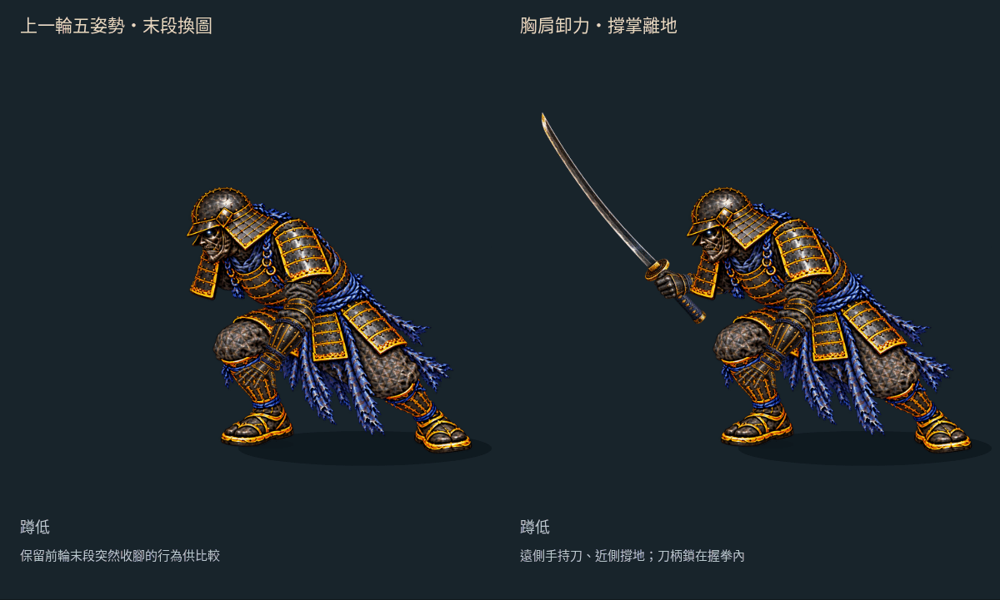
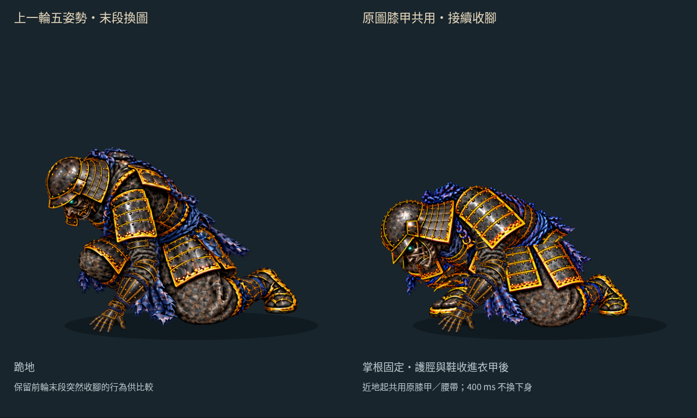
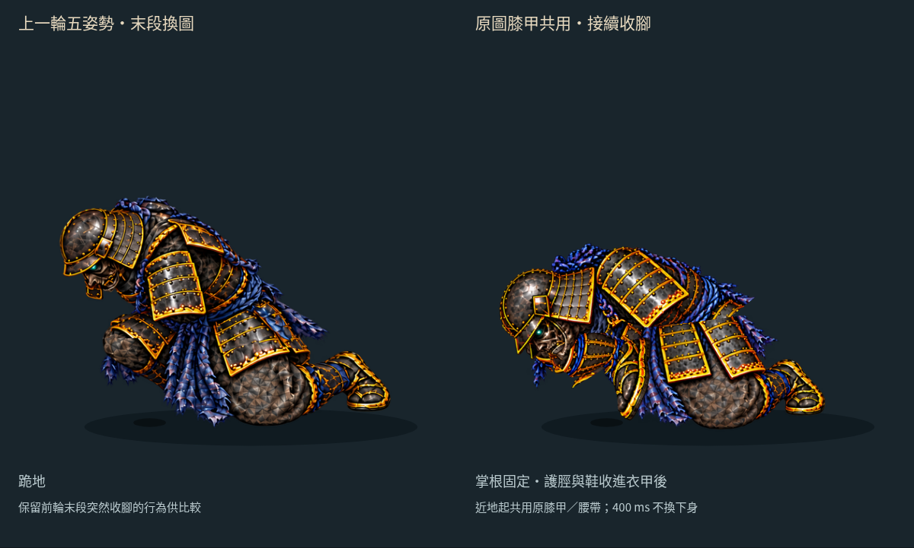
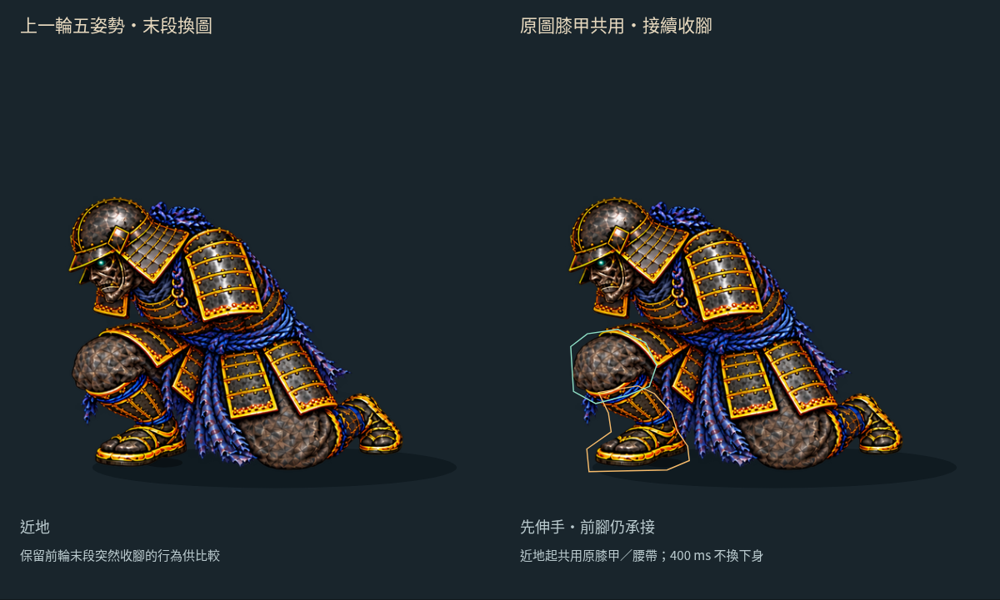

# 收腳接續：保留原膝甲與腰帶

2026-10-16。分支 `art/jigoku-prerendered-2d`。

[互動檢視頁原始檔](free-arm-settle/index.html) · [30 fps MP4](free-arm-settle/settle-30fps.mp4) · [手機畫面](free-arm-settle/mobile.jpg) · [前輪五姿勢](FREE_ARM_TRANSITION.md)

前輪已把護脛與鞋拆成固定部件，但 400 ms 切入整張修補下身時，膝甲與腰帶仍會改樣。這次保留近地原畫的 **下身、膝甲與腰甲像素**，既有修補素材只補護脛、鞋移開後的狹小區域；從近地姿勢開始就用同一套部件，不在 400 ms 再換下身。



左側重播五姿勢版本，右側是修整後的收腳試作。切入近地格後（388 ms 之後）就使用共用部件；400 ms 前胸甲沿原肩點平移，400 ms 起接到繞腰轉動。420 ms 手掌接地後才收腳，500 ms 完成。這仍是獨立 Canvas 試作，未替換 Phaser 倒地或線上 v22。

## 接續修正與共用方式

- **保留原膝甲與腰甲**：下身及腰甲覆蓋片重新裁自原近地圖。修補區限定在護脛／鞋原先佔據的多邊形，扣除保留的膝甲區；不再使用整張生成下身。
- **取消 400 ms 換圖**：近地開始即載入同一組下身、腿與腰甲；平移轉為腰軸旋轉時，肩點與轉換連續。前段仍保留原有關鍵格切換。
- **護脛與鞋**裁自前輪近地原畫，保留可見像素。膝點固定；護脛繞膝轉動、鞋跟隨踝點，兩段不拉長也不縮短。投影長度約 73.236／77.713 px，分別是膝到踝、踝到人工鞋尖標記，不能視為人體比例量測。
- **先撐掌、後收腳**：420 ms 前腳部保持原位。護脛逐漸轉 −45°，鞋延後跟上、最後轉 −70°；相對踝角全段小於 30°。延後鞋的轉動可避免中途腳尖往地面下方掃過。
- **胸甲繞腰前傾**：沿用原肩腕軌跡，胸甲與肩甲用同一個剛性轉換對齊肩點。400→540 ms 的腰部補償平移小於 4 px，實測最大約 3.085 px；以腰部轉動承接肩部下降。
- **遮擋分層**：小範圍修補 → 腿部 → 原下身與膝甲 → 胸甲 → 原腰甲覆蓋片 → 空手部件。膝甲遮住護脛根部，腰甲覆蓋轉腰接縫；頭部畫在膝甲前方。收進去的鞋由下身 alpha 真正遮住，始終以 alpha=1 繪製。
- **既有空手完全重用**：85／90 px 上臂和前臂、撐掌貼圖、肩肘腕及掌根曲線都沿用前輪。掌根在 420 ms 後仍固定於 `[470,668]`。



[400 ms：收腳前](free-arm-settle/pose-400.png) · [接地](free-arm-settle/pose-420.png) · [開始收腳](free-arm-settle/pose-440.png) · [接近末姿](free-arm-settle/pose-480.png) · [末姿](free-arm-settle/pose-500.png) · [關節標記](free-arm-settle/joints.png)



檢視頁的「查看被遮腳部」只改繪圖順序，不改腿部矩陣、不縮放、不淡出。上圖另外關閉手臂，方便看見藏在衣甲後的鞋。

## 修補範圍與像素檢查



「修補範圍」開關標示來源區域。生成像素僅存在於橘框內、青框外；裁片中 alpha > 16 的修補像素為 **291 個**。膝甲和腰帶直接保留原近地圖，並以素材檢查逐像素核對。

瀏覽器在 **399.999／400.001 ms** 擷取右側實際畫布，確認貼圖 URL 沒有切換。兩張圖僅 213 個像素有差異，各色頻最多差 1／255，屬連續動作的 Canvas 取樣差異；檢查會拒絕較大的色差或大面積變化。這只針對原本的 400 ms 交接，不能證明前段換姿也已平滑。

[399 ms](free-arm-settle/pose-399.png) · [400 ms](free-arm-settle/pose-400.png) · [401 ms](free-arm-settle/pose-401.png) · [剛進入近地部件](free-arm-settle/pose-389.png)

## 素材與限制

本次沒有新增 image gen、Blender／Modal 工作或第三方素材。沿用上一輪的 `touch-shin-clean.png` 補圖，但只擷取挪開腿部後會露出的區域；頭盔、胸甲、肩甲、下身、腰甲、護脛和鞋均使用原近地圖。所有裁片只作已記錄的等比例註冊與 alpha 裁切，沒有非等比變形。來源 SHA、膝甲保留區與修補區多邊形見 [settle.json](free-arm-settle/settle.json)。

本頁七張專用裁片 RGBA8 合計約 **0.964 MiB**，不含其他重用貼圖與畫布緩衝；這是素材估算，不是實機顯存量測。

**本輪末姿比前輪更前傾，並不是原跪姿的完全相同輪廓。** 固定膝點的平面收腳只是一種可重用的動作試作，尚未處理立體腿部旋轉、膝髖連動或碰撞受力。400 ms 的整張下身切換已移除；腰甲拼接、護脛裁邊與前段三次原畫切換仍需精修。持刀側與武器未在本頁裝配。

下一步加入持刀側及武器，檢查兩側手臂、衣甲遮擋與後續倒地的接續；前段屈膝仍需要獨立的姿勢與接點調整。

## 檢查與重建

```sh
python3 tools/prepare_free_arm_settle.py
node --test tools/check_free_arm_settle.mjs tools/check_free_arm_transition.mjs tools/check_free_arm_support.mjs tools/check_free_arm_parts.mjs tools/check_free_arm_reach.mjs
python3 tools/check_free_arm_settle_art.py
node tools/check_free_arm_settle_browser.mjs
python3 tools/package_free_arm_settle.py
```

- **18 項相關測試通過**：5 項收腳／交接測試，加上既有 13 項；本次新增近地啟用與 400 ms 轉換連續性回歸檢查。
- [素材與鞋底檢查](free-arm-settle/art-check.json)：逐裁片核對可見像素，生成像素不得侵入膝甲保留區；1001 個實際 JS 骨架取樣中，鞋上 alpha > 16 的像素未超過起始鞋底 Y=684。這只驗證螢幕投影高度，不代表三維地面碰撞正確。
- [瀏覽器檢查](free-arm-settle/browser-check.json)：實際 Canvas 肩／肘／腕／膝／踝接點、固定掌根與下身、400 ms 前後實際畫布像素、遮擋開關及腿部 alpha=1；原速／慢速、逐姿勢、重播與 390 px 手機觸控均通過，無載入錯誤。
- [影片檢查](free-arm-settle/video-check.json)：30 張實際瀏覽器畫布，四分之一速度，均勻 30 fps／1 秒 MP4；GIF 逐取樣像素核對。30 fps 是播放頻率，不是每秒三十張新原畫。

五姿勢檢視頁、原手臂／撐掌部件與正式遊戲維持 `7b2848b` 基線。HTTP 靜態服務路徑 `/docs/routes/jigoku-2d/free-arm-settle/`；此分支尚未部署到 Pages，GitHub HTML 頁只顯示原始碼，可先看動圖和影片。
