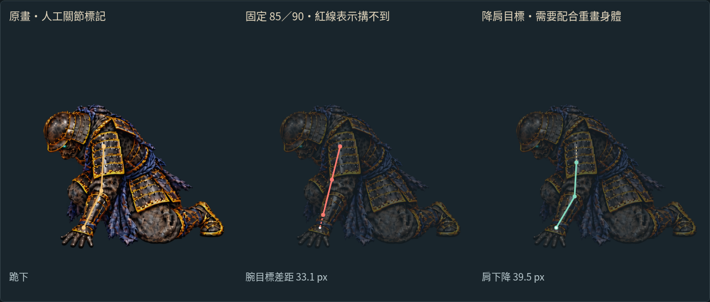
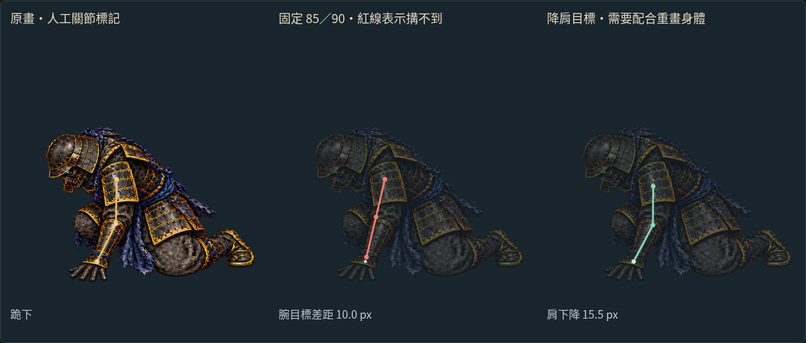

# 空手承重：先確認固定臂長能否接到地面

2026-10-16（UTC）。分支 `art/jigoku-prerendered-2d`，遊戲基線 `494bdc1`。

[互動檢視頁原始檔](free-arm/index.html) · [檢視頁桌機](free-arm/desktop.jpg) · [手機](free-arm/mobile.jpg) · [均勻 30 fps MP4](free-arm/reach-30fps.mp4) · [完整數值](free-arm/reach-report.json) · [目前遊戲錄影](COMBAT_STUDY.md)

本輪完成 **空手側固定骨架的可達性試算**，並試修一張跪地原畫。結果顯示，現有原畫的手臂比例並不一致；試修雖減少差距，仍未符合本次候選骨架。**這是製作檢視，沒有替換遊戲人物或動作。**


上方是檢視頁的實際 Canvas 錄影，30 fps，播放速度為反應時鐘的四分之一；不是遊戲影片、生成動畫或完成的全身動畫。GIF 合併相同的停留畫面，保留總時長；均勻幀距請看 MP4。三欄依序為原畫人工關節、固定臂長試算、需要配合重畫的降肩目標。身體仍切換三張原圖，綠線沒有驅動淡色人物。

## 為什麼不能直接套同一隻手臂

空手側目前畫在整身原圖內，與持刀側共用部件是兩回事。按肩、肘、腕的人工估計，屈膝原畫的兩段長度約 77／80 px、蹲低約 86／75 px，跪地卻約 110／102 px。直接沿用這些圖，不會因為加上 IK 就自動變成同一副身體。

本次使用 **85／90 px** 作為候選空手臂長，稍留鎧甲接縫的空間；這不是人體標準，也不是已完成的製作骨架。持刀側既有 65／75 px 骨架不變。

| 人工標記的姿勢 | 肩到腕距離 | 超出候選總長 175 px | 保留 5 px 彎肘餘量時需降肩 |
| --- | ---: | ---: | ---: |
| 屈膝 | 96.4 px | 0 | 0 |
| 蹲低 | 156.1 px | 0 | 0 |
| 現行跪地 | 208.1 px | 33.1 px | 39.5 px |
| 本輪試修跪地 | 185.0 px | 10.0 px | 15.5 px |

數值為 1152×768 原畫座標，遊戲顯示時乘 0.6。肩關節藏在鎧甲內，標記是估計，**每個端點約有 ±8 px 不確定性**；尤其試修稿的 10 px 差距不足以當成精確解剖判定。這個檢查用來拒絕明顯拉長、安排補圖，不是動作捕捉或三維人體驗證。



## 試修了什麼，為何暫不套入

用一次 image gen，以現行跪地與蹲低圖作參考，要求降低肩胸、縮短近側手臂、保留手掌與膝腳接地位置。原始輸出保存於 [kneel-reach-candidate.png](../../../assets/source/jigoku-2d/ghost-rig/kneel-reach-candidate.png)。檢視素材僅作 0.75 倍等比例縮放及水平位移 −12 px，沒有扭曲身體。



按目前人工標記，試修稿的肩腕距離縮短約 23 px，但手臂輪廓仍偏長，固定骨架的肘位也不會自然落在畫出的肘部。**通過「肩腕可達」只是必要條件，還要對齊肩甲、肘部、腕角、手掌接地與下一張承重圖。** 所以保留這張試修稿供比較，沒有把它混入正式戰鬥圖集。

綠色規劃線只做一件事：保持腕目標與肩部水平位置，降低肩點，讓總伸展不超過 170 px。屈膝、蹲低、跪地之間以平滑曲線過渡；上臂與前臂長度固定，不翻肘、不以伸長手臂掩蓋不可達目標。這條曲線仍需要相應的胸甲／肩帶與空手部件，現在沒有把全身原畫跟著拉動。

## 如何操作與重建

透過 repo 的 HTTP 靜態服務開啟 `/docs/routes/jigoku-2d/free-arm/`。GitHub 的 HTML 檔案頁只顯示原始碼；上方 GIF 與圖片可直接在 GitHub 看。滑桿控制 180–420 ms，可播放／暫停，並切換現行跪地或未採用試修稿。手機可使用同一組控制項。

```sh
python3 tools/prepare_free_arm_study.py
node --test tools/check_free_arm_reach.mjs
python3 tools/check_free_arm_art.py
node tools/check_free_arm_browser.mjs
python3 tools/package_free_arm_study.py
```

- 新增 **3 項骨架檢查**：不可達目標不當作成功、降肩規劃保持腕點／原始標記、完整曲線保持 85／90 px 臂長與固定彎肘側，接點曲線連續。
- [瀏覽器檢查](free-arm/browser-check.json)：實際滑桿、來源切換、播放／暫停、30 張 Canvas 截圖、390 px 手機顯示，無錯誤載入。
- [素材檢查](free-arm/art-check.json)：原始生成檔 SHA、候選 WebP 等比例註冊、候選接點換算；`combat/`、`src/`、`public/` 與 `494bdc1` 相同。
- [來源紀錄](free-arm/provenance.json) 明確標記候選稿未採用。沒有新增 Blender／Modal 工作或遊戲貼圖記憶體負擔。本輪不重錄未變動的遊戲影片，也不把前輪 77 項測試說成本輪重新執行。

下一步依這條降肩與腕目標曲線製作可共用的空手上臂、前臂、手掌，以及移除原空手後的身體遮擋底圖。先在檢視頁對齊肩甲和下一張承重姿勢，確認外觀與可達性一起成立，再接入戰鬥。
