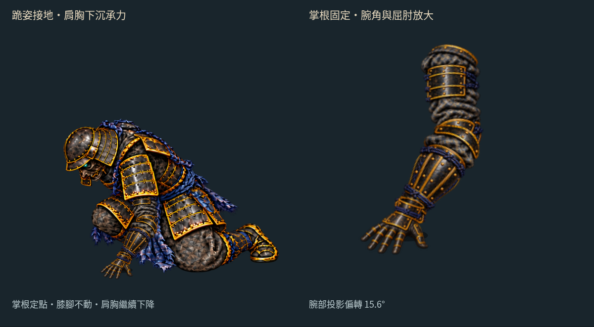
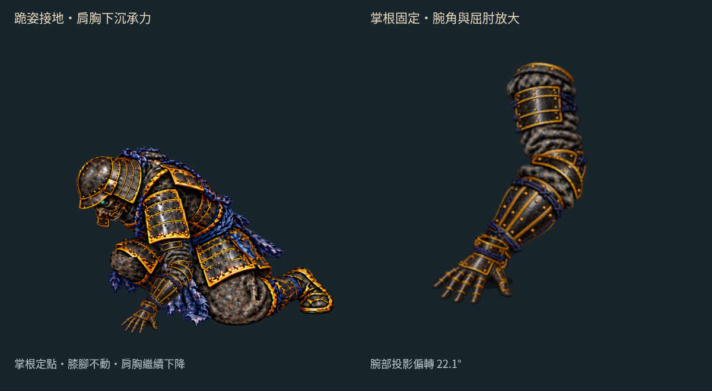

# 跪地撐掌：接地後固定掌根，肩胸繼續下沉

2026-10-16（台北時間）。分支 `art/jigoku-prerendered-2d`。

[互動檢視頁原始檔](free-arm-support/index.html) · [30 fps MP4](free-arm-support/support-30fps.mp4) · [手機畫面](free-arm-support/mobile.jpg) · [前輪部件試裝](FREE_ARM_PARTS.md)

這輪讓既有 **85／90 px 上臂與前臂貼圖**接到跪姿底圖。手掌靠近地面後固定掌根，肩胸再下降，肘部彎曲承接位移，膝與腳保持原位。新增專用撐掌圖，避免直接用垂下的張掌冒充承重姿勢。


這是 **獨立跪姿接地段**，尚未完成蹲姿跨到跪姿的全身過渡，也未替換 Phaser 戰鬥或線上 v22。影片以四分之一速度展示，30 張實際瀏覽器截圖編成 30 fps／1 秒；GIF 合併相同停留畫面。

## 動作與素材

- 330→420 ms：肩胸從基準上方 10 px 逐漸落回基準，手掌接近地面。
- 420→500 ms：畫在手掌上的掌根標記固定於 `[470,668]`；肩胸再下降 8 px，由固定長度骨架調整肘部角度。500→540 ms 保持末姿。
- 上臂與前臂直接載入前輪部件，不另複製或重畫。臂長不伸縮，平面腕部偏轉保持在 25° 內；這是二維投影量測，不是人體關節或受力模擬。
- 一次 image gen 移除跪姿近側手臂並補回遮擋衣甲，另一次產生撐掌素材。跪姿底圖等比例縮至 0.64、平移 `[43,65]`；新手掌等比例縮至 0.06。沒有拉長手臂或扭曲整張人物圖。
- 胸甲與下身分開裁切，腰部保留 24 px 重疊；下身不動，上身只平移。肩甲覆蓋片跟隨肩胸移動，遮住上臂根部。接地陰影隨手掌靠近逐漸變深。





[接地前](free-arm-support/support-330.png) · [骨架與接點](free-arm-support/joints.png) · [關閉手臂的底圖](free-arm-support/clean-body.png) · [來源、裁切與接點資料](free-arm-support/support.json)

## 檢查與限制

實際 Canvas 繪圖矩陣確認上臂末端接前臂、前臂接手掌，容差為 0.001 畫布像素。接地後兩個檢視面板的手掌矩陣保持一致，下身矩陣也不變；胸甲、肩甲與肩點一起移動。桌機與 390 px 手機版播放、拖曳、暫停和顯示開關均已檢查，無載入錯誤。

肩點 `[510.2,497]` 與掌根是人工指定的貼圖接點。這輪驗證的是平面接合與不滑手，尚未確認手指接地面、手腕立體轉動、衣甲碰撞或重量分配。肘部護甲仍有重疊，腰部分層接縫與生成圖細節也需繼續精修；不能把這段當成已完成的自然倒地動畫。持刀側與武器未在這個空手檢視頁裝配。

新增實際載入的胸甲、下身、肩甲與手掌，RGBA8 約 **0.924 MiB**，不含重用的手臂及畫布緩衝；完整 `body.webp` 僅供檢查，頁面不載入。裁切保留所有 alpha > 1 的來源像素，排除框外 18 個 alpha=1 的雜點，詳細數值在素材檢查中。沒有新增 Blender／Modal 工作或第三方素材。

```sh
python3 tools/prepare_free_arm_support.py
node --test tools/check_free_arm_support.mjs tools/check_free_arm_parts.mjs tools/check_free_arm_reach.mjs
python3 tools/check_free_arm_support_art.py
node tools/check_free_arm_support_browser.mjs
python3 tools/package_free_arm_support.py
```

- **8 項測試通過**：固定臂長、可達性、手形共用、掌根固定、腕角與時間邊界連續性。
- [素材檢查](free-arm-support/art-check.json)：來源 SHA、等比例註冊、遮擋裁切及共用部件／正式遊戲維持 `75a55de` 基線。
- [瀏覽器檢查](free-arm-support/browser-check.json)：實際繪圖矩陣、掌根與陰影、固定下身及桌機／手機操作。
- [影片檢查](free-arm-support/video-check.json)：30 張真實畫布截圖，GIF 逐取樣像素核對，MP4 為均勻 30 fps；必要時只補偶數尺寸邊緣，不裁切或縮放。

HTTP 靜態服務路徑為 `/docs/routes/jigoku-2d/free-arm-support/`。此分支尚未部署到 Pages，GitHub HTML 頁只會顯示原始碼；可先看本頁 GIF 與 MP4。

下一步處理蹲姿到跪姿之間的全身接續與腰甲遮擋，再將空手臂加入正式倒地動作。

後續已製作 [五姿勢蹲跪接續](FREE_ARM_TRANSITION.md)，在接地前加入三張過渡原畫，接地後直接重用本輪曲線；末段收腳與遊戲整合仍待處理。
