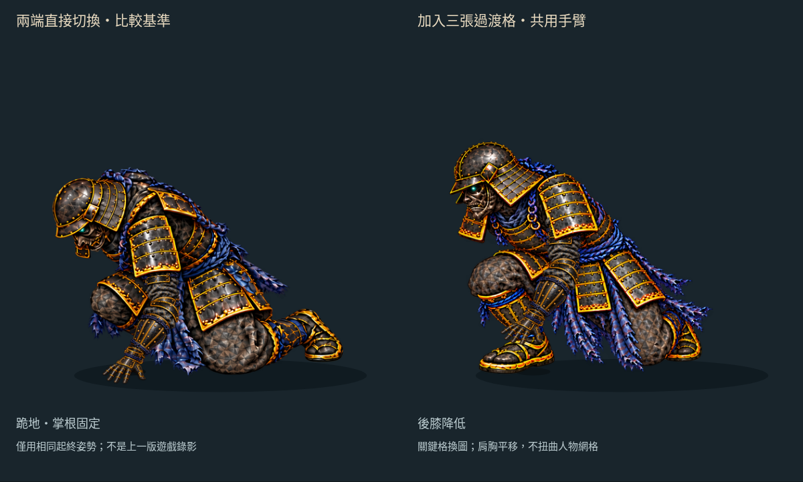

# 蹲跪接續：五個姿勢連到掌根固定

2026-10-16。分支 `art/jigoku-prerendered-2d`。

[互動檢視頁原始檔](free-arm-transition/index.html) · [30 fps MP4](free-arm-transition/transition-30fps.mp4) · [手機畫面](free-arm-transition/mobile.jpg) · [前輪撐掌試作](FREE_ARM_SUPPORT.md)

這輪補出 **重心前移、後膝降低、接近跪地**三張插畫，接在既有蹲姿與跪姿之間。同一組上臂、前臂和撐掌會隨肩胸移動，420 ms 後接回前輪的掌根固定、屈肘下沉。


左側是以相同起終姿勢製作的「直接切換」比較基準，**不是上一版遊戲錄影**；右側是本輪五姿勢試作。這是獨立 Canvas 檢視頁，尚未替換 Phaser 倒地或線上 v22。

## 動作與共用方式

| 時間標記 | 原畫姿勢 | 動作處理 |
| --- | --- | --- |
| 330 ms | 既有蹲低 | 保留前輪起始肩、肘、腕接點；改用同一張撐掌貫穿全段 |
| 352 ms | 重心前移 | 前腳維持註冊位置，後腳抬跟、屈膝 |
| 376 ms | 後膝降低 | 肩胸下降，前腳繼續支撐 |
| 400 ms | 近地 | 後膝靠近地面，手掌下降 |
| 420→540 ms | 既有跪姿 | 掌根固定在 `[470,668]`，肩胸再降 8 px；完全沿用前輪接地曲線 |

身體採最近的原畫關鍵格換圖；肩點在各時間標記之間連續移動，胸甲與肩甲依肩點作同一個平移，下身不隨這個平移漂移。前三個換姿邊界是 341、364、388 ms，末次是 410 ms。**骨架接點連續不代表人物輪廓已經連續**；沒有把整張插畫拉伸、扭曲或淡入淡出成雙影。

上臂、前臂直接載入原有 **85／90 px** 部件；撐掌及末段跪姿也直接重用前輪素材。整段使用同一手形，避免中途換手圖跳變，但尚無獨立手指抓握動畫。腕角是二維投影檢查，保持在 25° 內，不代表三維人體或真實受力驗證。



[蹲低](free-arm-transition/pose-330.png) · [重心前移](free-arm-transition/pose-352.png) · [近地](free-arm-transition/pose-400.png) · [接地](free-arm-transition/pose-420.png) · [屈肘下沉](free-arm-transition/pose-500.png) · [接點顯示](free-arm-transition/joints.png)

## 素材與仍需精修的地方

一次 image gen 以既有蹲姿／跪姿為參考，產生 2172×724 的三姿勢透明原圖。新圖的人物構圖與比例未完全一致；三格分別以 **0.62／0.64／0.70 倍等比例縮放**，依人工標記的前腳位置註冊，沒有做非等比變形。包含原蹲姿在內，前四姿勢的前腳標記差異小於 1 px；這只是標記對齊，不能證明鞋底輪廓或實際地面接觸不變。

身體拆成下身、胸甲與肩甲覆蓋片，新分層腰部保留 48 px 重疊。所有裁片保留來源可見 RGB，只裁切與限制 alpha。來源 SHA、原圖座標、縮放、遮擋多邊形與繪圖框均記錄於 [transition.json](free-arm-transition/transition.json)。新增裁片 RGBA8 估算約 **4.195 MiB**，不含重用貼圖與畫布緩衝，也不是實機顯存量測。

現在能看見後膝降低的過程，但 **最後一格的前腳收進身下仍有明顯換姿，頭盔／肩甲大小與腰部分層接縫仍有差異**。持刀側及武器尚未裝配於本頁。這輪不把五張關鍵圖稱為完成的自然人體動畫；下一步優先修末段收腳和腰甲遮擋，再評估接入遊戲。

## 操作、錄影與驗證

檢視頁提供原速／四分之一速度、上一／下一姿勢、時間拖曳、骨架與肩甲顯示開關。播放到末端停止，再按播放從頭開始，避免自動迴圈突然跳回蹲姿。手機改為上下對照。

**30 fps 是播放與錄影頻率，不是 30 張不同的身體原畫。** 本輪錄製 30 張實際瀏覽器畫布截圖，四分之一速度，MP4 為均勻 30 fps／1 秒；末端保留停格。GIF 採 30／30／40 ms 時序，合併重複畫面。沒有用 image gen 生成影片中間幀，沒有新增 Blender／Modal 工作或第三方素材。

```sh
python3 tools/prepare_free_arm_transition.py
node --test tools/check_free_arm_transition.mjs tools/check_free_arm_support.mjs tools/check_free_arm_parts.mjs tools/check_free_arm_reach.mjs
python3 tools/check_free_arm_transition_art.py
node tools/check_free_arm_transition_browser.mjs
python3 tools/package_free_arm_transition.py
```

- **13 項測試通過**：新增 5 項過渡、固定臂長、換格邊界連續性、接地曲線重用與前腳標記檢查，加上既有 8 項相關測試。
- [素材檢查](free-arm-transition/art-check.json)：來源與裁切像素、原畫未超出畫布、遮擋覆蓋；原部件、原撐掌試作及正式遊戲維持 `44f0f79` 基線。
- [瀏覽器檢查](free-arm-transition/browser-check.json)：實際 Canvas 矩陣接合，接地後手掌／下身固定，五姿勢、原速／慢速、播放／停止／重播與手機觸控；無載入錯誤。
- [影片檢查](free-arm-transition/video-check.json)：實際截圖、GIF 逐取樣像素核對、MP4 幀數／幀率／尺寸核對。

HTTP 靜態服務路徑 `/docs/routes/jigoku-2d/free-arm-transition/`。此分支尚未部署到 Pages；GitHub HTML 頁只顯示原始碼，可先看本頁動圖和影片。
