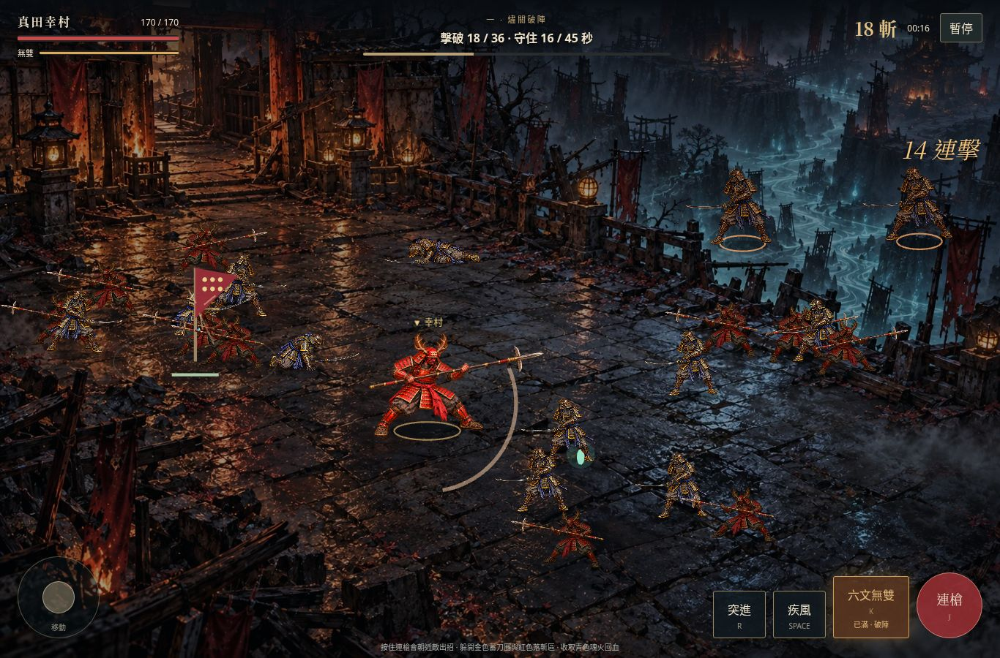
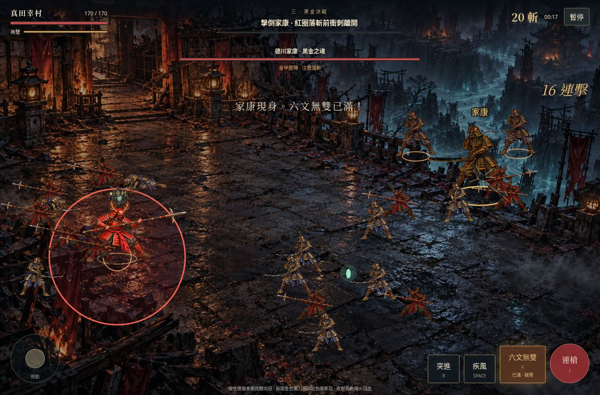

# 真田・六文劫：燼關突圍

這一輪把既有插畫與穩定槍術接成可玩的完整關卡。使用 **Phaser 3.90**，預計一局約 3–5 分鐘：破陣、護送赤備軍旗、擊敗家康。美術試作頁另行保留。

## 線上遊玩

**[直接開玩《燼關突圍》](https://clarencechien.github.io/yukimura/jigoku/)** — 手機或電腦開啟即可，不需下載或架伺服器。

Pages 使用固定版本 `44d6f935102fc9361146504a06467841fd25a663`；[部署流程](https://github.com/clarencechien/yukimura/actions/runs/39020488133) 與 [線上操作驗證](play/pages-verification.json) 可查。原有 3D v22 位於網站根目錄。公開站已驗證桌機移動／衝刺、手機觸控指令、暫停／繼續，HTML 與本機建置一致，下載 ZIP 也包含相同 HTML；原 3D 首頁校驗值維持不變。雲端瀏覽器檢查使用測試專用的代理憑證略過選項，HTTP 檔案驗證仍使用正常憑證檢查，網站本身未改動 TLS 設定。

## 下載與啟動

**[下載遊戲 ZIP](https://github.com/clarencechien/yukimura/raw/refs/heads/art/jigoku-prerendered-2d/docs/routes/jigoku-2d/play/sanada-jigoku.zip)** → 解壓縮 → 用桌面 Chrome、Edge 或 Firefox 開啟 `index.html`。單檔包含引擎、32 份圖片／骨架資料，不需要安裝、連網或開伺服器；Chromium 已驗證單檔載入、斷網後開始與移動。雲端受管瀏覽器禁止 `file://`，因此這次改由 HTTP 載入同一份單檔，不能宣稱已實測雙擊開檔。其他瀏覽器尚未逐一實測。

手機建議直接使用上方 Pages 網址；手機系統可能限制直接執行下載的 HTML。GitHub 的 HTML 原始碼頁不會執行遊戲。

本機 HTTP 啟動：

```sh
# repository 根目錄
python3 -m http.server 8000 --bind 0.0.0.0
# 開啟 http://localhost:8000/docs/routes/jigoku-2d/play/
```

手機與電腦在同一網路時，以電腦的區網 IP 取代 localhost。雲端環境則需平台提供的埠轉送網址。



## 操作

| 動作 | 鍵盤／滑鼠 | 手機 |
|---|---|---|
| 移動 | WASD／方向鍵 | 左搖桿 |
| 連槍 | 按住 J，或按住戰場滑鼠 | 按住連槍 |
| 疾風衝刺 | 空白鍵 | 疾風 |
| 六文無雙 | 能量滿時 K | 六文無雙 |
| 赤備集合／突進 | R | 集合／突進 |
| 暫停 | Esc／右上按鈕 | 右上按鈕 |

普攻會朝附近敵人出招，兩次短刺後接掃擊，可以同時擊中多敵。命中增加無雙，擊破掉落青色魂火，可回復體力。疾風有短暫無敵時間，無雙可以清開包圍；金色蓄刀圈和紅色落斬區提示敵人的攻擊。

## 一局的流程

1. **燼關破陣**：四面鬼軍持續進場，擊破至少 36 名並撐過 45 秒。
2. **赤備推進**：回到軍旗附近護送向東。離旗太遠便停步，遭圍攻會減慢推進；軍旗失守也會敗北。
3. **黑金決戰**：家康現身，回復部分體力並補滿無雙。半血進入修羅化，施放二連落斬；擊敗他後顯示戰績，可以重試或進入下一周目。

三種難度調整體力、敵人傷害、生成速度與數量上限。周目會提高敵人及首領強度，最多六周目。十名赤備共用角色素材、保持隊形並協助攻擊；目前友軍不會死亡，護送失敗由軍旗體力判定。



[手機直向](play/battle-mobile.jpg) · [手機橫向](play/battle-mobile-landscape.jpg) · [勝利結算](play/victory.jpg)

## 驗證與重建

```sh
npm ci
npm run test:2d
```

`test:2d` 執行 10 項戰鬥規則測試、建立離線包，再執行 Chromium 操作與載入檢查。瀏覽器預設 `/usr/bin/chromium`，可用 `CHROMIUM_PATH` 指定。

- 規則：普攻方向／多敵命中／單次傷害、無雙能量、移動邊界、衝刺無敵、暫停、四方生成與數量上限、護送與旗幟敗北、首領預警與二階段。
- 三種難度以相同自動操作策略，從開場透過正式規則完整通關：初陣約 174.5 秒、猛將 179.9 秒、修羅 183.2 秒。這是規則模擬，不能代替玩家難度回饋。
- 瀏覽器：鍵盤操作、無雙、暫停／失焦、勝敗／重試／下一周目、手機同時雙指移動與攻擊、直橫向版面。護送、首領與勝敗畫面使用測試模式設定情境，並非錄製完整人工通關。
- 單檔：受管瀏覽器的政策阻擋 `file://`；改用 HTTP 載入同一份 HTML，禁止額外 HTTP 素材請求，斷網後確認能開始與移動。
- `npm test` 全套 38 項通過，包含新增的 10 項 2D 規則測試。
- [機器檢查紀錄](play/verification.json)。手機採 Chromium 觸控模擬，尚無實體手機 FPS 結果。

`npm run build:2d` 可單獨重建 `play/sanada-jigoku.zip`；暫存單檔位於 `.tmp/jigoku-release/index.html`。一般 HTTP 版本直接讀取 `play/` 與相鄰 `combat/` 素材。測試除錯入口只在 `?test=1` 開啟。

## 目前的美術範圍

沿用既有幸村、鬼兵、槍與插畫戰場，沒有另外生成高模。本輪改善的是可操作的戰鬥循環與同屏隊伍。角色仍為固定視角的切片動畫，左右以鏡像轉向，沒有八方向原畫；十名友軍共用幸村造型，家康暫用放大黑金鬼將，尚非獨立完成的家康插畫。地圖是單一戰場背景及可移動範圍，背景中的建物與障礙未做逐件碰撞。

程式以 60 Hz 固定步長更新規則，實際畫面隨瀏覽器更新率；這不代表素材具有每秒 60 張獨立原畫，也不保證手機達到 60 FPS。音效為可關閉的簡單合成音，尚未製作完整配樂與刀槍音庫。周目進度只保留於本次執行，關閉後不存檔。

素材來源承接 [美術路線文件](README.md) 與 [既有戰鬥研究](COMBAT_STUDY.md)；Phaser 的 [MIT 授權](combat/vendor/PHASER-LICENSE.md) 同時附於離線 ZIP。修羅戰境、英魂重現與家康決鬥皆為架空敘事。
