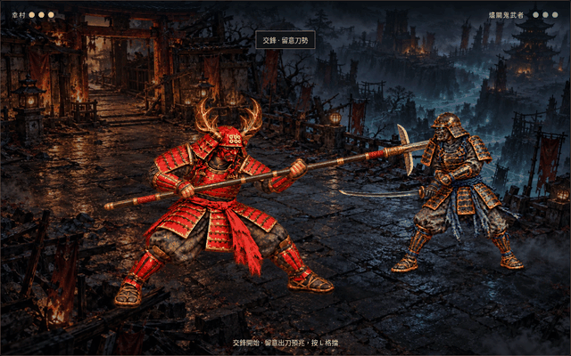
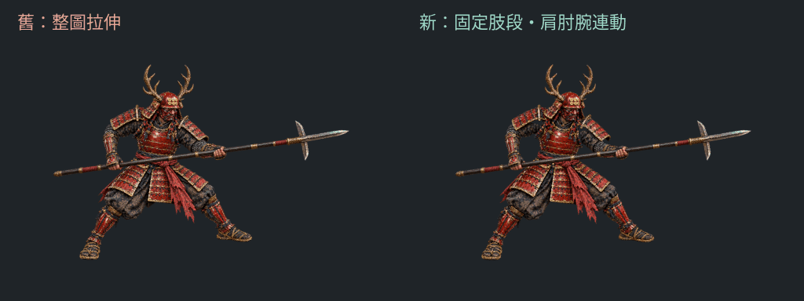
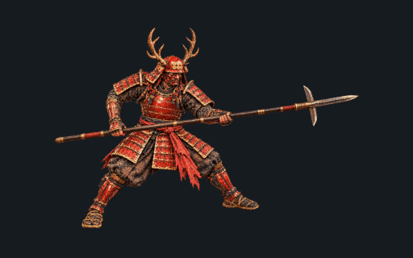
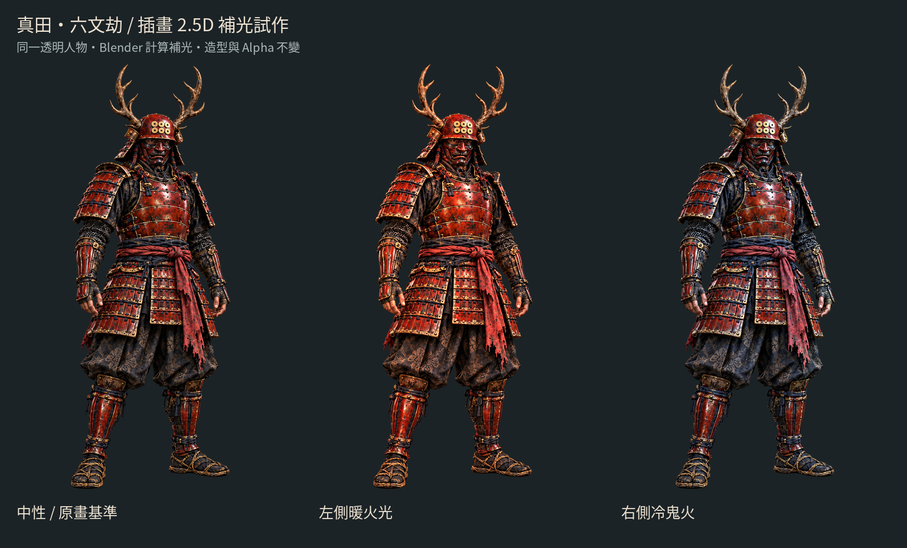
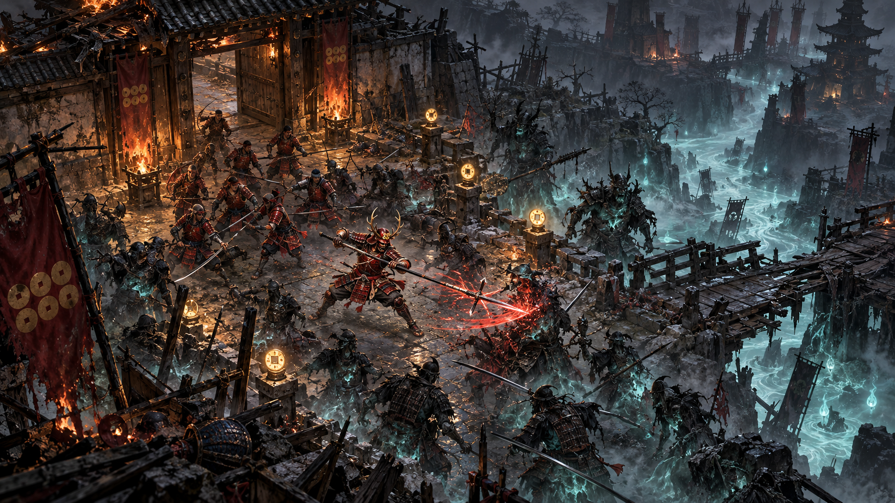
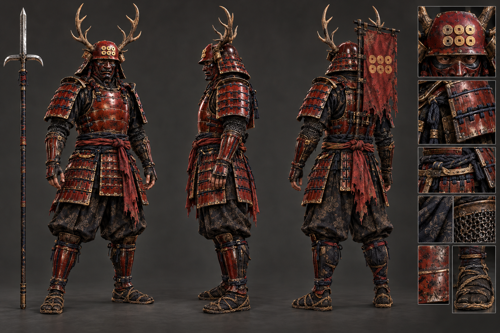
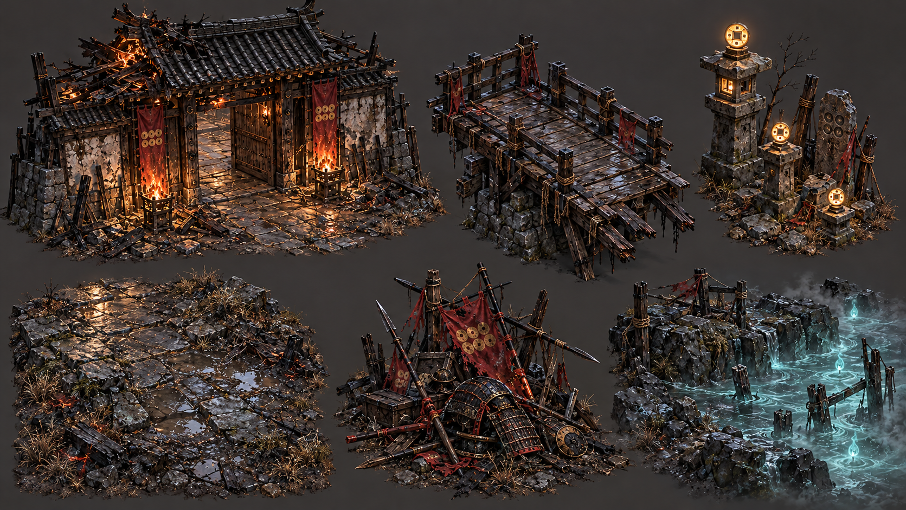
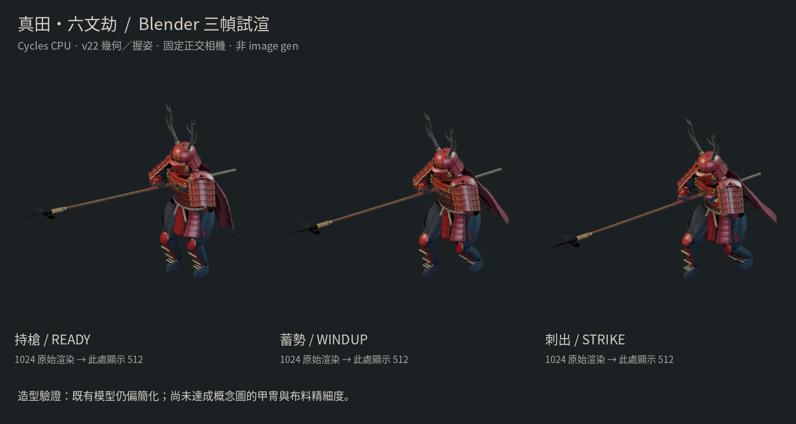

# 真田・六文劫：預渲染 2D 美術路線

## 最新：出刀與架槍的身體姿勢

[瀏覽器錄影與操作說明](COMBAT_STUDY.md) · [試玩頁原始檔](combat/index.html)

Phaser 3.90 固定站位試戰新增鬼武者蓄刀、斬下、收刀三張身體層，以及幸村架槍、承力兩張姿勢，接上現有交鋒規則。鬼武者沿用共用手臂、握手與刀；幸村的槍仍畫在新姿勢內，比例投影還需精修。這是關鍵姿勢切換，尚非連續骨架動畫。上方為實際瀏覽器 30 fps 擷取，此分支尚未部署為 Pages 遊戲。

## 前一輪：固定肢段，加入骨盆與雙腿連動

[前後對照與製作說明](YARI_RIGID_MOTION.md) · [新版互動檢視頁原始檔](yari-rigid-review.html)

延續固定長度手臂 IK，進一步拆成十五個剛性貼圖部件：骨盆先行、雙膝連動、後腳以腳尖為支點小幅抬跟。仍為 30 fps／36 幀，三種補光。上方左側為上一版固定下身，右側為新版。以下整圖變形版保留為歷史比較。

## 前一輪：持槍動作與三種補光

[赤槍初動：GIF、素材與限制](YARI_MOTION.md) · [互動檢視頁原始檔](yari-motion-review.html)

已完成一個固定視角的持槍待機與短刺循環，各 36 幀、30 fps（仍為 1.2 秒），提供手機／桌機圖集與三種補光。這是插畫變形試作，尚未成為可玩 2D 遊戲；GitHub 上可直接看本頁 GIF，互動 HTML 尚未部署。

## 前一輪：以插畫本身製作補光

[實際三光照結果與限制](RELIGHT_STUDY.md) · [原圖切換比較頁](relight-review.html)

此輪不使用舊 3D 人物模型，三張輸出保留同一透明人物的像素位置與造型。下方內容保留為先前的概念圖與管線研究。

> 2026-10-15 路線修正：使用者要求以插畫為實際素材，做分層／淺浮雕與重打光。新的優先方案見 [插畫 2.5D 重打光](ILLUSTRATION_RELIGHT.md)；下列完整 3D／舊模型試渲流程保留作研究比較，不是目前的造型製作方向。

2026-10-15（Asia/Taipei）。獨立分支 `art/jigoku-prerendered-2d`，自 `4b9f118` 分出。現有 Babylon.js v22 與 GitHub Pages 保留；此分支已完成資料調查、文案、image gen 視覺參考及第一輪實際 Blender 三幀驗證。新增離線場景、512／1024 透明角色 PNG；目前已追加插畫連續動畫圖集（見上方最新結果）；未建立新高模；目前已有上方的單目標 Phaser 試玩場景，尚非完整 2D 遊戲。

**六文不渡，赤槍開路。**

大坂一戰，幸村與十勇士未能改寫結局。死後，他們發現亡者仍被困在一場沒有黎明的戰爭中。六文錢本可換來渡河，幸村卻將它們繫回赤甲——這一回，他要讓身後的人也走出去。

## 路線判斷

可以用 Blender 高模與離線光影，渲染成帶透明背景的角色動畫、場景模組與特效，再由 2D 引擎組合。外觀可以追求精細插畫式的暗黑動作 RPG；運算重點轉為貼圖、透明疊加、載入與排序，並非沒有 GPU 成本。

建議試作 **Phaser 3.90 + TypeScript／Vite**，沿用現有戰鬥規則的可抽離部分；先做新的獨立 renderer，不替換 v22。已讀取的開源實例 [Flare HD](https://github.com/flareteam/flare-game-art-src) 提供 Blender／EEVEE → 高解析度 2D 素材的具體參考。這是流程參考，未匯入其素材或程式。

| 目標 | 建議起點 | 性質 |
| --- | --- | --- |
| 靜態宣傳／場景母圖 | Blender 4K，必要時 8K | 離線輸出目標，非本次生成圖尺寸 |
| 主角每幀畫布 | 512 px；近景評估 1024 px | 手機先量測，長槍與特效邊界另規劃 |
| 小兵每幀畫布 | 256 px，必要時 384／512 px | 共用動畫，少量配色變體 |
| 方向與動作 | 最終先評估 8 方向、每動作 12–24 幀 | 首輪只驗證 4 方向的一段動作 |
| 畫面呈現 | 手機與 laptop 自適應，2D sprite 合成 | 不能把 4K 畫布當成每個角色都需要 4K |

## 01 戰場概念：三途・燼關

固定俯視方向、赤甲與冷色亡魂對比、濕石與落燼、焦黑日式關門。這張是氣氛圖，有景深式遠景和戲劇性打光；不是精確正交相機、可切割地圖或實機截圖。前景遮擋與敵我辨識仍要在遊戲尺寸檢查。

## 02 幸村：人物建模參考

赤漆甲、低坐兜、鹿角、六文錢、面頬、藍黑繫繩與布料。空手站姿用於檢查比例與甲冑連接；不把圖中的手勢當成新的握槍動畫。生成的各視圖與細部可能不完全一致，建模前需統一甲片數、扣件、紋章與背旗尺寸。這不是歷史裝束的精確復原或可直接投射的 texture atlas。

## 03 場景：可共用模組參考

關門、橋段、石燈／紀念碑、濕石地面、戰場散件及河岸。保留同一材質語彙，後續建模時統一尺度、相機與主光。參考圖背景不透明、邊界不具無縫銜接；需重新建模／渲染，不能宣稱已是遊戲 tile。

## 實際 Blender 三幀驗證

[製作結果與差距](BLENDER_STUDY.md) · [互動比較頁](review.html)

這些是 Cycles CPU 渲染，重用 v22 模型。透明輸出與共用相機已驗證；造型仍比上方概念圖簡化，不能宣稱已達插畫品質。

## 本次產物與下一個驗證點

- [研究與可查來源](RESEARCH.md)：已讀取、受阻與尚待核對分開記錄。
- [世界觀與完整文案](NARRATIVE.md)：幸村／十勇士闖入地獄的架空故事。
- [Blender → 2D 製作規格](PIPELINE.md)：解析度、記憶體、排序、光照與第一個小試作。
- [生成記錄](art/manifest.json)：三張圖原始尺寸、SHA-256 與參考關係。
- [生成方向摘要](ART_BRIEFS.md)：供下輪延伸；不是逐字提示詞或可重現 seed。

上述三幀與模型精修方案是早期研究。現行方向以插畫保真為優先，下一個驗證點請見 [赤槍初動](YARI_MOTION.md)，不再以舊人物模型重畫插畫。
