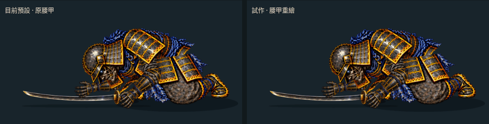

# 腰甲過渡原畫試作：局部重繪仍不足以銜接全身

2026-10-17（台北時間）。分支 `art/jigoku-prerendered-2d`。**保留試作入口，尚未採用為預設。**

[同步比較頁原始檔](free-arm-settle/hip-review.html) · [30 fps 比較影片](free-arm-settle/hip-30fps.mp4) · [手機比較](free-arm-settle/hip-mobile.jpg) · [目前預設動作](FREE_ARM_SETTLE.md)



這次試了兩張 image gen 腰甲原畫。第一稿仍太接近原本斜向的單片造型；第二稿改成較直立、相互遮擋的兩片裙甲，接到既有 1200–1240 ms 低頭過渡格。**造型有所改變，但前後兩次換圖沒有改善**；現有預設維持 `2bf6c56` 的護脛提前放低版本，正式遊戲未替換。

## 實際接入結果


[完整人物比較](free-arm-settle/hip-comparison.png)。放大圖直接裁自兩個同時播放的 Canvas，不是另外生成的宣傳圖。比較頁可逐點查看進入前、進入新稿、離開新稿前及離開後，也能播放、暫停和倒帶。

- 新稿只以 `?hip=paint` 啟用；未帶參數及 `?hip=original` 使用原圖。既有比較頁與歷史捕捉模式仍走原路徑。
- 保留原下身輪廓與 alpha，只在記錄的腰甲多邊形中、原圖及新稿皆 alpha ≥ 250 的區域替換 RGB。膝部輪廓與地面布料保持原圖，沒有把生成圖直接當作完整身體替換。
- 胸部圖層也帶有重疊腰甲，因此同一註冊圖同步寫入下身、去頭胸部、去肩甲胸部三張變體，避免舊甲片從胸部圖層覆蓋回來。遮罩外可見像素及整張 alpha 與原檔逐像素一致。
- 原始新稿為 1536×1024，按單一比例 `292/1536` 註冊成 292×195，原點對齊 `[480,487]`；不拉伸至 292×201，不修改原裁片尺寸或任何骨架矩陣。
- 三張額外貼圖約 **0.629 MiB RGBA8**，僅試作模式載入。不含生成來源、畫布與雙場景比較開銷，並非實機顯存量測。

## 兩端交接都要檢查

| 交接 | 目前預設全彩平均差 | 新稿全彩平均差（0–255） | 結果 |
| --- | ---: | ---: | --- |
| 1200 ms：進入過渡格 | 4.4055 | 4.4087 | 基本持平，略增 |
| 1220 ms：既有肩甲分層 | 0.00959 | 0.00959 | 相同 |
| 1240 ms：離開過渡格 | 2.2896 | 2.2933 | 基本持平，略增 |
| 1320 ms：下一個身體換圖 | 2.5910 | 2.5910 | 相同 |

[完整量測與來源驗證](free-arm-settle/waist-transition-check.json) · [實際交接截圖](free-arm-settle/handoffs/hip/)

量測使用同一時間前後 ±0.001 ms 的實際右側畫布；腰甲局部另量測 `[380,340,505,455]`，同樣沒有改善。這些數值是換圖色差，不是美術品質或人體正確性的分數。所有捕捉邊界的身體圖層 alpha 均與原版完全相同，表示這次局部重繪沒有處理外輪廓的姿態接續。

目前限制包括胸腰遮擋、骨盆位置及膝部投影。下一步應補出完整胸腰到大腿的中間姿勢，先固定胸部、髖部、膝部及地面接點，再確認前後兩端；不能僅憑單張腰甲更清楚就宣稱動畫更自然。

## 來源與重建

- [第一稿：較斜的腰甲](../../../assets/source/jigoku-2d/ghost-rig/waist-transition-study.png)：`exec-f95b20de-3367-4f4c-9128-e2654bcf0e3f.png`，保留作來源比較，不由試作模式載入。
- [第二稿：較直立的雙片裙甲](../../../assets/source/jigoku-2d/ghost-rig/waist-transition-upright.png)：`exec-8bd538a8-c204-487a-a0df-d6421c07e8dd.png`，本次可播放候選稿。
- 兩次均參考既有 `legless-bridge.webp` 與 `waist.webp`。輸入為 PNG 轉存，僅清除 alpha=0 的不可見 RGB，沒有預先重畫參考圖。要求維持原裁切、黑金漆甲、藍繩與跪地膝部；第二次特別指定兩片長矩形、近垂直甲片。
- [註冊、遮罩、原檔 SHA256 與來源](free-arm-settle/waist-transition.json)。沒有新增 Blender／Modal 工作或第三方素材；兩張生成來源均保留，原圖片未覆寫。

```sh
python tools/prepare_waist_transition.py
node tools/capture_fall_handoffs.mjs .tmp/hip-study/baseline hip previous
node tools/capture_fall_handoffs.mjs docs/routes/jigoku-2d/free-arm-settle/handoffs/hip hip
python tools/check_waist_transition_art.py
node tools/check_hip_review_browser.mjs
python tools/package_hip_review.py
```

46 項既有動作測試通過。新增素材檢查核對三張衍生圖的原始 alpha、遮罩內外像素、註冊尺寸及來源雜湊；[瀏覽器檢查](free-arm-settle/hip-browser-check.json) 核對兩側時間、身體矩陣、頭盔、雙臂、護脛、刀與繪圖順序相同，只有指定區間的貼圖不同。逐點、播放、重播、倒帶、390 px 排版及貼圖延遲時的縮放檢查通過。

[影片檢查](free-arm-settle/hip-video-check.json)：90 張實際瀏覽器截圖，30 fps／3 秒，動作時間為四分之一速度並含末姿停留；MP4 只補偶數尺寸邊界、不縮放，GIF 使用共用色盤並逐取樣核對。這是播放頻率，不是每秒三十張新原畫，也不是 image gen 產生的影片。此分支未部署 Pages，GitHub HTML 連結只顯示原始碼，可直接查看上方動圖及 MP4。
