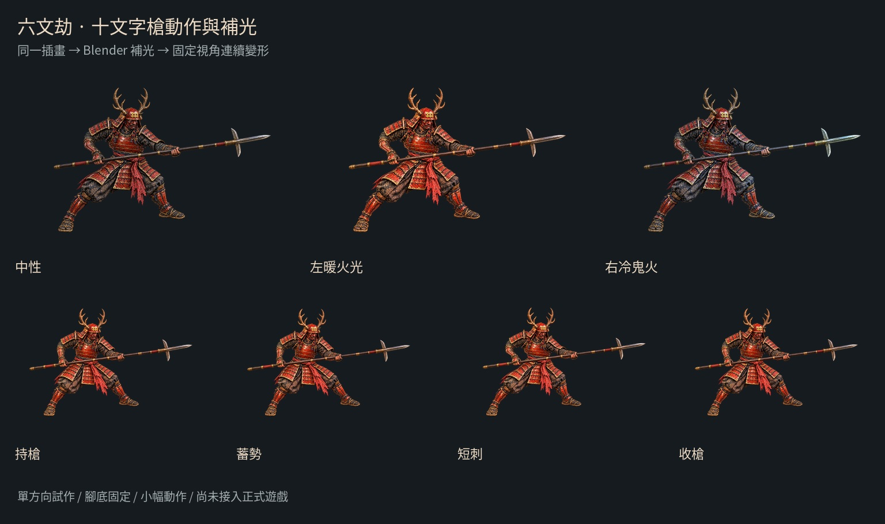

# 赤槍初動：插畫、武器與連續動畫

> 後續指出整圖變形會拉扯人體；已改為 [固定肢段、肩肘腕連動的版本](YARI_RIGID_MOTION.md)。本文保留舊版資料，不再作為新動作基礎。

2026-10-15。分支 `art/jigoku-prerendered-2d`。本輪已做出 **持槍待機** 與 **蓄勢 → 短刺 → 收槍**，各 36 幀、30 fps，搭配中性、左暖火光、右冷鬼火。

[**觀看固定 30 fps 短刺影片（MP4）**](yari-motion/thrust-preview-30fps.mp4)

本次由原先 20 fps／24 幀改為 **30 fps／36 幀**，每段仍是 **1.2 秒**。Blender 將原關鍵時間放大 1.5 倍後重新取樣與渲染，保留動作節奏，沒有將舊影格加速播放。


上方為方便 GitHub 直接觀看的 512 px GIF，只有暖光短刺，色彩經 GIF 調色盤量化。GIF 只能用 10 ms 的時間單位，因此採 30／30／40 ms 間隔，平均為 30 fps；請用上方固定 30 fps MP4 或互動頁判斷流暢度。透明 WebP 圖集與下方大圖保留較完整色彩。



[互動檢視頁原始檔](yari-motion-review.html) · [短刺大圖](yari-motion/warm-left-10.png) · [持槍大圖](yari-motion/warm-left-01.png) · [圖集清單](yari-motion/atlas-manifest.json)

HTML 需透過 HTTP 服務開啟才能操作；GitHub 的檔案頁只顯示原始碼。本分支未部署 Pages，請在這份 Markdown 直接看 GIF／大圖，避免把未發布的網址當成可玩的遊戲。

## 本輪完成

- 同一造型的新持槍插畫：1536×1024 RGBA，赤漆甲、六文錢、鹿角兜、面頬與十文字槍。image gen 只準備這張底圖；連續幀沒有逐張生成。它是參考舊站姿的新圖，與舊圖不是逐像素相同。
- 一個固定的淺三分之四視角；原圖沒有嚴格符合要求的俯視 30°，因此不能當成已校準的等角遊戲相機。
- Blender 連續薄片變形，具 `Thrust`、`Breath`、`Cloth` shape keys 和對應控制區域。手掌、握持處、槍身與槍刃共用位移；腳底保持固定。這裡的分區是同一網格的權重區域，尚未拆成可獨立替換的手、身體與武器圖層。
- 三種 Blender 光照先在持槍基準圖上計算，再與同一張插畫一起變形。原畫光影保留，沒有宣稱每個動作都重新計算完整人體光照。
- 兩種解析度的透明無損 WebP 圖集與 JSON、12 張 2048×1280 關鍵姿勢大圖（檔名中的 01／08／10／18 沿用舊版姿勢編號，非新版時間軸影格號）、可編輯 Blender 場景、固定 30 fps MP4／動作 GIF，以及播放／暫停／慢速／逐幀／切換光照的檢視頁。

## 動作與握持

| 項目 | 本輪內容 |
| --- | --- |
| 待機 | 原地呼吸、腰帶末端輕微跟隨，36 幀 |
| 短刺 | frame 1 持槍、12 附近蓄勢、15–16 接觸停頓、27 附近收槍、36 回到起點 |
| 武器 | 一支十文字槍，槍身與雙手一起平移；不做彎曲或旋轉手腕 |
| 幅度 | 槍身最大前移為原素材座標 100 px；身體位移較小，雙足固定 |
| 接入資料 | 固定畫布、固定 pivot `(0.5, 0.85)`；沒有 root motion，未接入命中碰撞 |

這是**短距離動作管線試作**，不是完整武術動作或成熟戰鬥動畫。前臂、胸甲附近仍會有平面拉伸；數學上沒有翻面的網格，也不代表解剖姿勢自然。大幅轉身、揮槍、換手、滑槍與跨步需要新的姿勢／遮擋素材，再建立分層關節或多姿勢變形，不能把這張圖任意拉長。

## 解析度與成本

| 用途 | 每幀畫布 | 每張圖集 | 未壓縮 RGBA8 記憶體，不含 mipmap |
| --- | --- | --- | --- |
| 手機素材 | 512×320 | 3072×1920，36 幀 | 22.5 MiB |
| 桌機細節檢查 | 1024×640 | 兩頁：4096×3840 ＋ 4096×1920，共 36 幀 | 90 MiB |
| 靜態關鍵幀 | 2048×1280 | 單張 PNG | 10 MiB |

每種解析度有兩動作 × 三光照，共六組圖集；手機每組一頁，桌機每組兩頁，單頁均不超過 4096 px。這是檔案選項，不建議手機把所有光照版本常駐。WebP 的傳輸大小也不能當成 GPU 記憶體；清單記錄每張檔案大小與 SHA-256。

檢視頁在初次載入時，700 px 以下選手機圖集，其餘選桌機圖集；同時只保留目前圖集的 JS 引用，但瀏覽器仍可能保留快取。這不是手機遊戲效能測試。2048 px 關鍵幀包含動作留白與重採樣，原插畫實際只有 1536×1024，不是新增 2K 級的細節。

本輪使用 Blender Cycles **CPU、4 執行緒**；補光 64 samples，純插畫輸出 8 samples。沒有使用 Modal 或 GPU。這種一次離線製作、執行時播放貼圖的方式，能將角色的光影運算移出遊戲，但仍有貼圖記憶體與透明疊加成本。

## 驗證範圍

- [素材檢查](yari-motion/validation.json)：兩種尺寸共 432 幀，無邊界裁切；循環首尾一致；WebP 前景與原渲染無損。512 px 三種光照同幀 Alpha 相同。
- [動作檢查](yari-motion/motion-report.json)：逐幀驗證變形三角形未翻面，控制點上的雙手／槍身位移一致、腳底無漂移。這不是人體骨架或槍術正確性的證明。
- [瀏覽器檢查](yari-motion/browser-check.json)：動畫確實改變 Canvas 像素；播放、暫停、逐幀、兩動作與三光照可操作；桌機與 390 px 手機載入；減少動態效果偏好預設暫停；受控時鐘驗證 600 ms 約前進 18 幀、1.2 秒完成 36 幀循環，並檢查桌機圖集第 24／25 幀的跨頁接續。

圖集 JSON 採常見的 frames/meta 格式，供後續 Phaser atlas 載入；目前沒有安裝或執行 Phaser。檢視頁是 Canvas 素材檢查器，正式 Babylon.js v22 與 Pages 未修改。

## 編輯與重建

- [持槍底圖](../../../assets/source/jigoku-2d/yukimura-yari-ready.png)、[手工補光表面](../../../assets/source/jigoku-2d/yari-surfaces.json)。
- [Blender 補光場景](../../../assets/optimized/jigoku-2d/yari-relight.blend)：三個光照關鍵幀，封裝原圖與中性參考。
- [Blender 動作場景](../../../assets/optimized/jigoku-2d/yari-motion.blend)：30 fps；frame 1–36 短刺、37–72 待機，封裝三張補光貼圖。材質的圖片節點可切換光照貼圖。
- [補光腳本](../../../tools/render_illustration_relight.py)、[動畫腳本](../../../tools/animate_yari_illustration.py)、[打包與素材檢查](../../../tools/package_yari_motion.py)、[瀏覽器檢查](../../../tools/check_yari_motion.mjs)。

從 repo 根目錄執行：

```sh
blender -b -t 4 --python-exit-code 1 --python tools/render_illustration_relight.py -- \
  --source assets/source/jigoku-2d/yukimura-yari-ready.png \
  --surfaces assets/source/jigoku-2d/yari-surfaces.json \
  --output docs/routes/jigoku-2d/yari-motion/lights \
  --scene assets/optimized/jigoku-2d/yari-relight.blend
blender -b -t 4 --python-exit-code 1 --python tools/animate_yari_illustration.py
python3 tools/package_yari_motion.py
node tools/check_yari_motion.mjs
```

需要 Blender、NumPy、Pillow、Noto Sans CJK、FFmpeg／ffprobe，瀏覽器檢查使用 repo 已有的 Playwright 與 `/usr/bin/chromium`。序列 PNG 存於忽略的 `.tmp/yari-motion/`；Git 保存可重建腳本、圖集、場景與檢查結果。

下一步應先把這套動作放到同視角的地面上，以遊戲實際角色尺寸確認節奏與辨識，再為「跨步突刺／橫掃」補專用姿勢和可遮擋圖層。十勇士、小兵、其他武器與八方向仍未製作。
