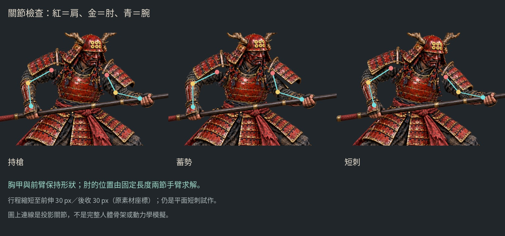

# 短刺修正：固定肢段，移除整圖拉伸

2026-10-15。分支 `art/jigoku-prerendered-2d`。延續 30 fps，每段 36 幀／1.2 秒。


[固定 30 fps 前後對照影片](yari-rigid/before-after-30fps.mp4) · [新版單人影片](yari-rigid/thrust-preview-30fps.mp4) · [互動檢視頁原始檔](yari-rigid-review.html)

GitHub 可直接看上方 GIF；GIF 時間以 30／30／40 ms 近似，判斷流暢度請用 30 fps MP4。HTML 須透過 HTTP 服務開啟，這一分支尚未部署為 Pages 遊戲。

## 原因與修正

舊版將胸甲、前臂和握槍區域放在同一個變形網格中，靠不同程度的位移製造突刺。這會改變手臂長度，也會壓縮胸甲。提高到 30 fps 只能補足時間取樣，不能修復這種空間變形；「網格沒有翻面」不足以證明人體合理。

本輪拆成 **9 個剛性貼圖部件**：下身、軀幹、左右上臂、左右前臂、左右手、槍。每個部件只有平移與旋轉，縮放固定為 1，沒有網格形變。

- **上下臂長度固定**：以肩膀與手腕目標求解兩節手臂 IK，保留原本的肘彎方向。目標超出可達範圍時報錯，不能靠拉長手臂補足。
- **握持位置固定**：兩手與槍共用位移，手腕與前臂末端對齊；前臂相對握持角度限制在 15° 以內。
- **胸甲保持形狀**：軀幹繞腰小幅旋轉，最大前後各 4°；下身固定，不用壓扁胸甲製造前傾。
- **縮短槍的行程**：原圖前手已接近伸展，改為原素材座標前伸 30 px／後收 30 px，不再要求手臂負擔原先 100 px 的前移。
- **補齊遮擋後的身體**：image gen 只做一次去掉手臂與槍的乾淨身體，補出原來被槍遮住的腰帶；手臂、手和武器仍從原插畫切出。沒有逐幀重畫人物。



互動頁可開啟「顯示肩、肘、腕」。紅點為肩、金點為肘、青點為腕；連線對應實際輸出姿勢的關節座標。

## 已輸出

- 持槍待機、短刺，各 36 幀／30 fps，搭配中性、暖火光、冷鬼火。
- 512×320 手機圖集、1024×640 桌機圖集，共 432 張來源影格。桌機圖集仍分頁，每頁不超過 4096 px。
- [三種補光與關鍵姿勢](yari-rigid/comparison.jpg)、[短刺大圖](yari-rigid/neutral-15.png)、[蓄勢大圖](yari-rigid/neutral-11.png)。
- [圖集清單](yari-rigid/atlas-manifest.json)、[Blender 場景](../../../assets/optimized/jigoku-2d/yari-rigid-motion.blend)。

手機每個動作／光照圖集為 22.5 MiB RGBA8；桌機兩頁合計 90 MiB，不含 mipmap。壓縮檔案大小不等於 GPU 記憶體；正式遊戲仍應按需載入。光照在動畫前烘焙，部件旋轉時不重新計算高光。

## 驗證與界線

[動作報告](yari-rigid/motion-report.json) 逐幀檢查固定肢段長度、肩肘腕的接點、兩手與槍的接觸位置、剛性變換矩陣，以及 Blender 時間軸實際求值後的位置。這些檢查能抓到拉伸、脫節與錯誤的變換，但不是人體自然程度的最終判定；本輪也實際檢視了持槍、蓄勢、短刺、收槍四個關鍵姿勢，再輸出全段。

[素材檢查](yari-rigid/validation.json) 驗證影格邊界、循環接續、圖集無損打包、光照透明度與 MP4 的 30 fps／36 幀／1.2 秒。[瀏覽器檢查](yari-rigid/browser-check.json) 驗證手機／桌機播放、跨圖集接續、補光切換、逐幀與關節標示。

目前仍是 **固定視角、平面關節的短刺試作**。關節是人工標記的投影位置，沒有完整人體骨架、重心、關節力矩、肩胯轉體或蹬地模擬；腰與肩的銜接仍可能帶有剪紙動畫感。較大幅度的攻擊需要額外的側身姿勢、遮擋素材與下肢動作，不能再靠放大這段位移硬做。

原本的整圖變形版保留為歷史對照，不再作為新動作的基礎。正式 v22 遊戲未替換。

## 來源與重建

新增的 [乾淨身體](../../../assets/source/jigoku-2d/yari-rigid/body-clean.png) 參考原持槍插畫，經 image gen 移除槍和手臂、補出腰帶；它是生成式清理，並非原圖精確修補。其他肢段從既有補光圖以多邊形遮罩切出，刪除小於 24 像素的獨立 Alpha 碎屑，沒有拉伸原畫來補洞。

- [切割範圍、關節與活動限制](../../../assets/source/jigoku-2d/yari-rigid/rig.json)
- [圖層與裁切位置清單](../../../assets/source/jigoku-2d/yari-rigid/layers.json)
- [分層腳本](../../../tools/prepare_yari_rigid.py)、[固定長度 IK](../../../tools/yari_rigid_pose.py)、[Blender 動畫與檢查](../../../tools/render_yari_rigid.py)
- [圖集打包](../../../tools/package_yari_motion.py)、[前後對照製作](../../../tools/review_yari_rigid.py)、[瀏覽器檢查](../../../tools/check_yari_motion.mjs)

```sh
blender -b -t 4 --python-exit-code 1 --python tools/render_illustration_relight.py -- \
  --source assets/source/jigoku-2d/yari-rigid/body-clean.png \
  --surfaces assets/source/jigoku-2d/yari-surfaces.json \
  --output docs/routes/jigoku-2d/yari-rigid/body-lights \
  --scene assets/optimized/jigoku-2d/yari-rigid-relight.blend
python3 tools/prepare_yari_rigid.py
blender -b -t 4 --python-exit-code 1 --python tools/render_yari_rigid.py -- --preview
# 檢視四張姿勢後，再輸出完整序列：
blender -b -t 4 --python-exit-code 1 --python tools/render_yari_rigid.py
python3 tools/package_yari_motion.py --rigid
python3 tools/review_yari_rigid.py
node tools/check_yari_motion.mjs --rigid
```

沿用 Blender Cycles CPU／4 執行緒，沒有使用 Modal 或 GPU。另需 NumPy、Pillow、SciPy、Noto Sans CJK、FFmpeg；瀏覽器檢查使用現有 Playwright 與 Chromium。
